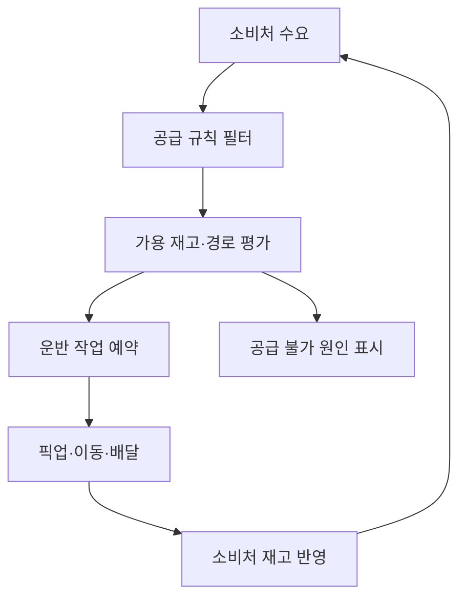

# 05. 내부 물류·보급망·운반 처리량 시스템 역기획

[전체 목차](README.md)

| 항목 | 내용 |
| --- | --- |
| 문서 ID | SYS-05 |
| 기준 | 상용 Cosmoteer 0.30.5a 공개 공지, 2026-11-13 |
| 검증 방식 | 문헌 기반. 원작 실행 및 예약·경로 알고리즘 검증 없음 |
| 표기 | **[확인]** 공개 규칙, **[해석]** 설계 분석, **[제안]** 재구현, **[검증 필요]** 추가 확인 |

## 1. 시스템 목적

**[해석]** 물류는 생산한 자원과 설치한 무장을 실제 전투 성능으로 바꾸는 과정이다. 자원이 함선 어딘가에 존재해도 필요한 위치에 제때 도착하지 않으면 해당 기능은 멈춘다. 따라서 이 게임의 경제는 크레딧과 재료 총량뿐 아니라 운반자의 시간과 공급 경로까지 포함한다.

이 문서는 함선 **내부**의 자원 흐름을 다룬다. 광물 채굴과 잔해 회수는 [자원·채굴·회수](14_Resources_Mining_and_Salvage.md), 생산식과 거래는 [제조·저장·교역](15_Manufacturing_Storage_and_Trade.md), 전지의 특수 규칙은 [전력](06_Power_Generation_and_Distribution.md)을 참조한다.

설계 질문은 “자원이 얼마나 있는가?”에서 다음으로 확장된다.

- 어떤 공급원이 어떤 소비처를 담당하는가?
- 운반자는 어떤 경로로, 한 번에 얼마를, 얼마나 자주 나르는가?
- 소비처가 버틸 수 있는 내부 재고는 얼마인가?
- 동시에 발생하는 전투·생산·수리 요청 중 무엇을 먼저 처리하는가?
- 공급원이나 경로를 잃으면 어떤 기능부터 멈추는가?

## 2. 확인된 자원 보급 규칙

**[확인]** Storage Bay는 셀별로 자원 종류를 지정할 수 있으며, 자원마다 쌓이는 양이 다르다. 지정 공간과 제한에 따라 생산물의 이동이 일어나고 Supply Chain으로 공급 관계를 지정할 수 있다. 전지는 일반 창고의 저장 대상이 아니다. [S-SC05-1]

**[확인]** 0.30.5는 지정 창고·공급원 사이에서, 미지정 칸 및 동일 자원에 대한 다른 공급원의 개입으로 발생하던 공급망 제한 예외를 보완했다. 따라서 지정 연결을 단순한 선호 경로로 해석하지 않는다. [S-SC05-2]

**[해석]** 공급망 지정은 자동 AI가 항상 최적의 출처를 찾아주는 기능과 다르다. 플레이어는 특정 원자로·공장·저장소를 특정 구역에 묶어 긴 횡단 운반을 줄일 수 있지만, 과도하게 제한하면 가까운 대체 자원이 있어도 공급이 끊길 수 있다. 효율과 장애 대응을 동시에 설계하게 하는 장치다.

## 3. 자원 흐름의 단계

아래는 **[제안]** 개념 모델이다.



| 단계 | 필요한 정보 | 사용자에게 설명할 수 있어야 하는 것 |
| --- | --- | --- |
| 수요 생성 | 소비처 현재량·용량·재보급 조건 | 무엇이 부족한가 |
| 공급 후보 | 자원 유형·공급망 지정·소유권 | 어디서 가져올 수 있는가 |
| 재고 계산 | 물리 재고·이미 예약된 양 | 지금 가져올 수 있는 양 |
| 경로 평가 | 문·통행·작업 지점·속도 조건 | 왜 가까운 곳을 사용하지 않는가 |
| 인력 배정 | 역할·할당·현재 작업 | 누가 처리할 수 있는가 |
| 배달 | 운반 중 물량·목적지 여유 | 언제까지 도착할 예정인가 |
| 재평가 | 파괴·이동·명령 변경 | 진행 중 작업이 왜 바뀌었는가 |

수요 생성, 공급원 선택, 승무원 선택은 서로 의존하지만 같은 함수 하나에 섞지 않는 편이 원인 추적에 유리하다. 특히 공급 가능한 원료가 없는데 승무원만 늘리는 오류를 진단할 수 있어야 한다.

## 4. 운반량과 시간의 분석 모델

다음 식은 **실제 게임의 내부 공식이 아닌 [제안] 분석 모델**이다.

\[
T_{trip}=T_{approach}+T_{pickup}+T_{delivery}+T_{drop}+T_{return}
\]

\[
R_{delivery}\leq\frac{N_{haulers}\,q_{useful}}{\overline{T}_{trip}}
\]

`q_useful`은 운반자가 들고 온 양 중 소비처에 유효하게 들어간 양이다. 큰 묶음을 운반해도 소비처가 그만큼 받을 수 없거나 중간에 수요가 해소되면 유효량은 작아질 수 있다. 정확한 초과량 보존·반환 규칙은 **[검증 필요]**다.

실제 처리량의 상한은 생산·운반·소비 중 가장 낮은 단계에 의해 제한된다.

\[
R_{effective}\leq\min(R_{source},R_{delivery},R_{consumer})
\]

여기서 소비처 상한은 무기의 발사 주기뿐 아니라 작업자·사격 조건·냉각 등 다른 시스템에 의해 낮아질 수 있다. 따라서 발사 빈도 감소를 모두 물류 탓으로 결론 내리지 않는다.

### 가정 예시: 같은 인원, 다른 거리

**[제안 예시]** 한 번에 유효 물량 2를 옮기는 운반자 4명이 있다. 모든 대기와 왕복을 합친 평균 주기가 8초라면 평균 1단위/초다. 내부를 개장해 12초가 되면 약 0.67단위/초로 감소한다. 자원 생산량도 인원도 그대로지만 공급률은 약 3분의 1 줄어든다. 이 숫자는 원작 부품 능력치가 아니라 배치가 처리량에 미치는 영향을 설명하기 위한 가정이다.

## 5. 재고와 예약은 분리한다

**[제안]** 물류에서 최소한 다음 네 가지 수량을 구분한다.

| 수량 | 의미 | 잘못 합쳤을 때 |
| --- | --- | --- |
| 물리 재고 | 공급원 안에 실제 존재 | 아직 도착하지 않은 물량을 소비 |
| 출고 예약 | 다른 운반 작업이 가져가기로 한 양 | 여러 운반자가 같은 자원에 배정 |
| 운반 중 | 승무원이 들고 이동하는 양 | 공급원·소비처에 이중 집계 |
| 입고 예약 | 목적지가 받기로 한 양 | 목적지 용량을 초과하는 배달 집중 |

가용 출고량은 `physical - outgoingReserved`로, 가용 입고 여유는 `capacity - physical - incomingReserved`로 정의할 수 있다. 자원별 셀 제한이나 종류 제한이 있다면 총용량뿐 아니라 해당 자원에 허용된 공간을 계산해야 한다.

```text
제안: TryCreateDelivery(source, destination, resource)
    if not SupplyRulesAllow(source, destination, resource): fail
    if not RouteExists(source.pickup, destination.dropoff): fail
    amount = min(source.available(resource),
                 destination.unreservedCapacity(resource),
                 carryPolicy(resource))
    if amount <= 0: fail
    AtomicallyReserve(source, destination, resource, amount)
    return DeliveryTask(source, destination, resource, amount)
```

이 예약 구조는 원작에서 확인한 구현이 아니다. 동작을 재현할 때 발생할 중복 배달과 음수 자원을 예방하기 위한 명세다.

## 6. 공급망 지정의 설계 의미

### 6.1 지역 분리

**[해석]** 전방과 후방에 각각 공급 거점을 두고 해당 구역을 담당하게 하면 예측 가능한 흐름을 만들 수 있다. 함선 중앙을 가로지르는 이동이 줄고, 특정 구역의 수요가 다른 구역의 재고를 먼저 소진하는 상황을 줄일 수 있다. 반대로 한 구역의 공급 거점이 파괴되면 남은 전체 재고가 많아도 그 구역은 정지할 수 있다.

### 6.2 우선순위와 공급 연결은 다른 규칙

**[제안]** 역할 우선순위는 “누가 무엇을 먼저 할 것인가”, 공급망 연결은 “어디에서 어디로 운반이 허용되는가”로 구분한다. 특정 승무원의 우선순위를 올려도 공급 연결이 금지되어 있다면 해당 작업을 만들지 않는다. UI는 두 규칙을 동시에 보되 원인 설명은 분리한다.

### 6.3 완충 저장소

**[해석]** 소비처 가까운 저장소는 공급이 일시적으로 끊겨도 작동을 유지하는 완충 역할을 할 수 있다. 그러나 원거리 공급원→완충 저장소→소비처라는 두 단계 운반이 되어 총 노동량이 늘 수 있다. 안정성과 이동량 감소를 동일시하지 않고, 전투 중 임계 구간의 공급 시간을 줄이는 효과를 평가한다.

버틸 수 있는 시간은 다음과 같은 단순 모델로 볼 수 있다.

\[
T_{buffer}\approx\frac{B_{usable}}{R_{consume}-R_{incoming}}
\quad(R_{consume}>R_{incoming})
\]

**[제안]** `B_usable`은 전체 함선 재고가 아니라 해당 기능이 실제로 쓸 수 있는 지역 재고다. 무기별 탄약·전력에 각각 계산하고 더 먼저 고갈되는 자원을 찾는다.

## 7. 대표 병목 진단

| 관찰 증상 | 먼저 구분할 원인 | 설계 검토 |
| --- | --- | --- |
| 재고가 있는데 무기가 멈춤 | 탄약 종류·공급 지정·경로·작업자·발사 조건 | 소비처까지 실제 배달 흔적 확인 |
| 운반 인원을 늘려도 개선 없음 | 공급원 생산량·픽업 시간·입고 공간 | 사람보다 설비가 상한인지 확인 |
| 특정 원자로만 비어 있음 | 공급원 선택·지역 수요 편중 | 소비처 분산과 공급 지정 비교 |
| 공장은 작동하지만 출력이 쌓임 | 창고 수용 정책·제한·출고 작업 | 생산 속도보다 목적지 정책 점검 |
| 평시엔 정상, 피격 순간 공급 중단 | 방어·소화·수리와 무장 보급 경쟁 | 동시 부하와 역할 선점 기록 |
| 큰 배로 확장한 뒤 성능 감소 | 왕복 거리·혼잡·할당 유지 문제 | 확장 이전과 작업 시간 분포 비교 |

**[해석]** 화력 부족의 원인이 물류일 때 무기를 더 달면 수요만 커져 문제를 악화시킬 수 있다. 따라서 성장 단계마다 “가격당 무기 수”와 함께 “실제로 유지되는 작동률”을 봐야 한다. 이 선택 구조가 건조와 전투 사이의 피드백을 만든다.

## 8. 손상·취소·교차 작업의 경계 사례

**[제안]** 공급원이 파괴되어도 이미 운반자가 들고 나온 자원이 자동으로 사라져서는 안 된다. 목적지가 파괴되면 대체 목적지로 재지정하거나 적절한 저장소로 반납하는 정책을 적용한다. 원작의 실제 반환·투하 규칙은 실측 대상이다.

창고를 철거하거나 셀별 자원 지정을 바꾸는 동안 입고 작업이 진행 중일 수 있다. 변경을 허용한다면 기존 예약을 취소하고 운반 중 물량에 대한 후속 정책을 정한다. 재고 한도를 낮췄다고 자원을 삭제하는 방식은 물류·경제 계약을 깨뜨린다.

같은 종류의 자원을 생산과 건조가 동시에 요구하면 우선순위만으로 해결되지 않는다. 진행 중 작업의 예약을 보호할지, 긴급 요청이 선점할 수 있게 할지 명세가 필요하다. 선점을 지원한다면 회수 가능한 예약과 이미 운반·가공 중인 자원을 구분한다.

## 9. 데이터·이벤트 계약

| 객체 | 주요 필드 | 필요한 이벤트 |
| --- | --- | --- |
| ResourceStore | 종류별 재고, 셀 정책, 제한, 예약량 | StockChanged, CapacityChanged |
| ConsumerRequest | 종류, 필요량, 중요도, 재보급 조건 | DemandChanged, ConsumerDestroyed |
| SupplyRule | 출발·도착 ID, 자원 필터, 허용 정책 | RuleChanged |
| DeliveryTask | 운반자, 수량, 경로, 단계, 예약 ID | PickedUp, Delivered, Cancelled |
| LogisticsMetrics | 배달 시간, 대기 원인, 고갈 시간, 유효량 | 주기 집계 |

모든 항목은 **[제안]**이다. 부품 ID는 함선 분리 후에도 대상 부품을 추적할 수 있게 유지하되, 경로와 소유권은 새 상태에서 다시 검사한다. 저장·불러오기에서는 예약을 그대로 직렬화할지 안전하게 재구성할지 하나를 선택해야 하며, 중간 방식을 섞으면 이중 예약이 생길 수 있다.

## 10. 평가 지표

**[제안]** 물류 개선 전후를 비교할 때 실험 조건을 고정한다. 같은 부품 토글, 같은 초기 재고·승무원 위치, 같은 소비 패턴에서 다음을 수집한다.

- 소비처별 작동률과 자원 부족으로 멈춘 시간.
- 공급 요청에서 완료까지의 평균·상위 지연.
- 운반자의 이동·픽업 대기·배달·유휴 시간 비율.
- 소비처까지 도달한 유효 자원량과 과잉 운반량.
- 주요 공급원 파괴 후 유지되는 기능 비율.
- 동일 시간 동안의 생산량과 실제 소비량 차이.

장기 평균만 사용하면 전투 시작 직후의 강한 일제사격과 이후 고갈을 구분하기 어렵다. 초반 구간과 정상 상태 구간, 피격 후 구간을 나누되 원작 UI가 이런 지표를 제공한다고 단정하지 않는다.

## 11. 수용·재현 테스트

아래는 **미실행 검증 명세**다.

| ID | 구분 | 절차 | 확인할 결과 |
| --- | --- | --- | --- |
| LOG-01 | 재현 관찰 | 같은 소비처에 가까운 미지정 공급원·먼 지정 공급원 배치 | 지정 규칙과 자동 선택의 우선 관계 |
| LOG-02 | 재현 관찰 | 지정 창고의 칸을 지정/미지정으로 바꾸어 동일 자원 공급 | 0.30.5 공급망 제한 조건 |
| LOG-03 | 제안 검증 | 한 단위 재고에 여러 운반 요청 동시 생성 | 음수 재고와 중복 픽업 방지 |
| LOG-04 | 제안 검증 | 운반 중 목적지 파괴·창고 지정 변경 | 물량 보존과 명시적 재배달 정책 |
| LOG-05 | 재현 관찰 | 인력 고정, 왕복 경로만 늘리기 | 실효 공급량·가동률 변화 |
| LOG-06 | 재현 관찰 | 평균 부하는 같고 순간 수요만 다르게 구성 | 완충 재고와 요청 임계값의 효과 |
| LOG-07 | 제안 검증 | 운반 중 저장·불러오기 | 자원 총량과 예약 정합성 |
| LOG-08 | 재현 관찰 | 보급·소화·생산을 동시에 발생 | 역할 우선순위가 만드는 실제 작업 배분 |

## 12. 출처

| ID | 출처 | 사용 범위 |
| --- | --- | --- |
| S-SC05-1 | [Storage Bay — Official Cosmoteer Wiki](https://cosmoteer.wiki.gg/wiki/Storage_Bay) | 셀별 자원 지정·제한·공급망·전지 저장 제외. 검색 색인 확인; 옛 Resource Collector 명칭은 현재 장비 목록으로 전재하지 않음 |
| S-SC05-2 | [Steam 개발자 공지: Update 0.30.5](https://steamcommunity.com/app/799600/allnews/) | 2026-10-23 정식 Resource Management 변경, 직접 열람. 날짜·제목으로 해당 항목 식별 |

관련 문서: [승무원 AI](04_Crew_Roles_and_Task_AI.md) · [전력](06_Power_Generation_and_Distribution.md) · [제조·교역](15_Manufacturing_Storage_and_Trade.md) · [검증 계획](21_Production_Plan_and_Acceptance_Tests.md)

<!-- 문서 내 출처 링크 -->
[S-SC05-1]: https://cosmoteer.wiki.gg/wiki/Storage_Bay
[S-SC05-2]: https://steamcommunity.com/app/799600/allnews/
