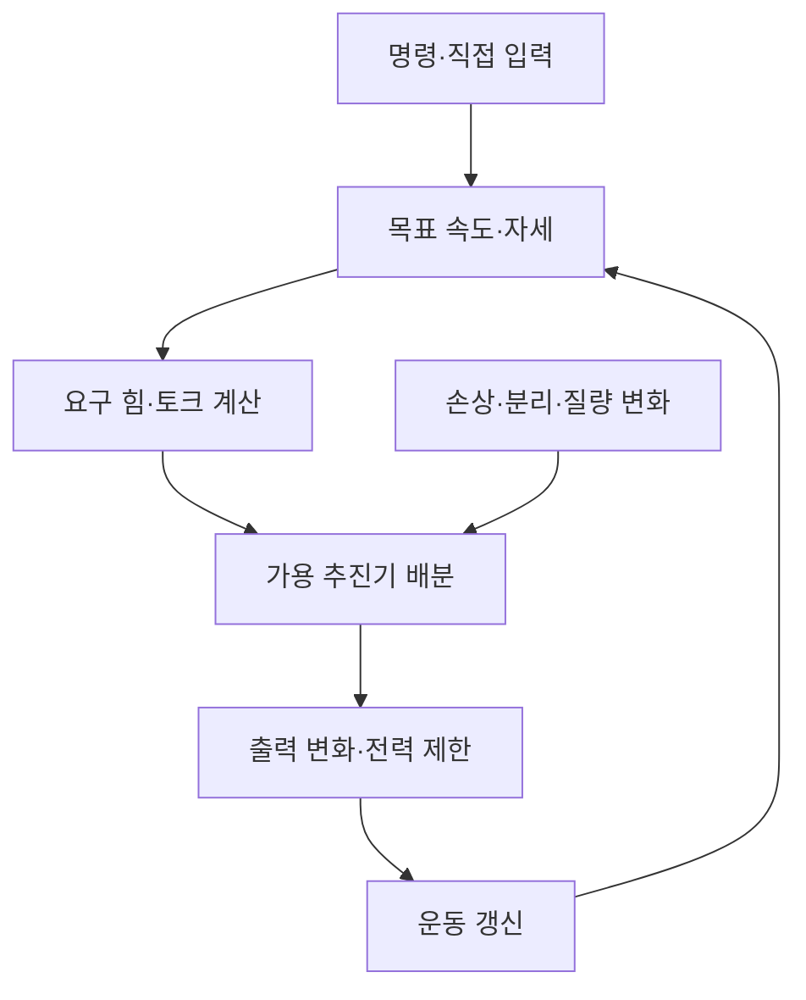

# 07. 추진·기동·비행 제어 시스템 역기획

[전체 목차](README.md)

| 항목 | 내용 |
| --- | --- |
| 문서 ID | SYS-07 |
| 기준 | 상용 Cosmoteer 0.30.5a 공개 자료, 2026-11-13 |
| 검증 방식 | 문헌·개발자 공지 확인. 실제 비행 제어 코드·물리 상수는 확인하지 않음 |
| 표기 | **[확인]** 공개 규칙, **[해석]** 설계 의미, **[제안]** 재구현 모델, **[검증 필요]** 실측 대상 |

## 1. 시스템 목적

**[해석]** 추진기는 이동 속도를 주는 장비를 넘어 함선이 어떤 전투 자세를 유지할 수 있는지 결정한다. 적에게 다가가는 속도, 사거리를 유지하며 물러나는 속도, 옆으로 비키는 능력, 약점을 노출하지 않고 선회하는 능력은 서로 다르다. 무장의 공격 방향과 추진기 배치가 맞지 않으면 충분한 화력을 가지고도 목표를 유지하지 못한다.

이 문서는 지역 공간에서의 이동·회전·제어를 다룬다. 성계 사이 이동과 하이퍼드라이브는 [탐지·탐험·하이퍼점프](13_Sensors_Exploration_and_Hyperjump.md), 함대 명령의 전술적 사용은 [전투·함대 제어](12_Tactical_Combat_and_Fleet_Control.md)를 참조한다.

## 2. 확인된 추진 계열

**[확인]** 추진기는 여러 크기·변형이 있고 규모에 따라 추력·전력 요구·공간을 교환한다. 기관실은 인접 추진기의 성능과 보급에 영향을 준다. Modular Rocket Thruster는 노즐에 확장 모듈 등을 조합하는 계열이다. [S-SC07-1]

**[확인]** 공개 모딩 문서는 추진기·무기에 배치 금지 영역이 있음을 설명한다. 따라서 추진기를 내부 깊숙이 배치할 때 외곽까지 필요한 공간을 단순 통로처럼 덮어버릴 수 있다고 가정해서는 안 된다. [S-SC07-2]

| 추진 구성의 분석상 범주 | 제공하는 선택 | 주의할 상호작용 |
| --- | --- | --- |
| 소형·다방향 배치 | 좁은 공간에서 여러 축 제어 | 많은 부품·보급 지점 관리 |
| 대형 추력 집중 | 특정 방향의 강한 이동 | 반대 방향 제동과 회전의 불균형 |
| 부스트 계열 | 특정 시점의 높은 기동 능력 | 지속 운용·충전·모드별 차이 |
| 모듈형 로켓 | 내부 길이를 추력으로 전환 | 방향 접점·출력 변화 시간·공급 위치 |
| 기관실 묶음 | 인접 추진기의 성능·보급 집약 | 기관실 상실에 따른 여러 엔진 영향 |

범주별 장단점은 **[해석]**이다. 부품별 정확한 추력·전력 표와 최적 조합을 뜻하지 않는다.

## 3. 이동의 입력과 출력

| 구분 | 내용 |
| --- | --- |
| 플레이어 입력 | 목적지·도착 방향, 공격 거리·각도, 추적·함대 명령, 직접 조작 |
| 물리 상태 | 위치, 자세, 선속도·각속도, 질량·질량중심·관성, 충돌 접촉 |
| 설비 상태 | 각 추진기의 위치·방향·현재 출력·전력·모드·손상 |
| 제어 목표 | 목표 위치·속도·방향·각속도 또는 직접 입력에서 생성한 요구 힘 |
| 출력 | 추진기별 출력, 이동·회전 변화, 전력·열 수요, 명령 완료 상태 |

**[제안]** “이동 명령 해석”과 “추진기 출력 배분”을 분리한다. 전자는 목표 위치와 자세를 만들고, 후자는 현재 장비로 그 목표를 얼마나 달성할 수 있는지 계산한다. 이 분리로 엔진 손실이 단순 이동 속도 감소가 아니라 특정 축의 제어 상실로 드러나게 할 수 있다.

## 4. 질량·추력·회전의 분석 모델

다음은 **일반적인 2차원 강체 운동학을 이용한 [제안]**이다. 실제 원작의 수치 적분·저항·제어식을 복원한 것이 아니다.

\[
\mathbf F=\sum_i u_iF_i^{max}\mathbf d_i
\]

\[
\tau=\sum_i (\mathbf p_i-\mathbf c)\times(u_iF_i^{max}\mathbf d_i)
\]

`u_i`는 추진기별 현재 출력 비율, `d_i`는 힘 방향, `p_i`는 힘의 작용 위치, `c`는 질량중심이다. 노즐이 보이는 방향과 함선이 받는 힘 방향을 혼동하지 않도록 데이터와 UI 모두에서 기준을 명확히 해야 한다.

**[해석]** 같은 추력이라도 질량중심에서 떨어진 위치는 회전에 다른 기여를 할 수 있다. 장갑·화물·손상으로 질량 분포가 바뀌면 같은 엔진 배치의 응답도 달라질 수 있다. 그러므로 완성 설계의 정지 상태 수치만으로 선회 성능을 판정하지 않는다.

**[확인]** 0.30.5는 함선 저항을 Meltdown 이전 값으로 되돌렸다고 명시한다. 따라서 진공에서 추력이 있으면 무한히 가속한다는 순수 우주역학 모델을 그대로 적용할 수 없다. 저항 계수와 종단속도는 별도 실측이 필요하다. [S-SC07-3]

## 5. 축별 성능을 나눠 평가한다

| 축·기능 | 주요 질문 | 전투에 미치는 영향 |
| --- | --- | --- |
| 전진 | 목표 거리까지 얼마나 빨리 닿는가? | 사거리 진입·추격 |
| 후진 | 전방 화력을 유지하며 물러날 수 있는가? | 거리 유지·카이팅 |
| 좌우 | 적의 사선과 측면 각도를 바꿀 수 있는가? | 포위·회피·위치 수정 |
| 선회 | 목표 각도를 얼마나 빨리·안정적으로 유지하는가? | 좁은 사각 무장·방어면 정렬 |
| 제동 | 도착점과 목표 거리를 지나치지 않는가? | 짧은 전술 명령의 신뢰성 |
| 손상 후 제어 | 엔진 일부 상실 후 어떤 축이 남는가? | 퇴각·전열 유지 |

**[해석]** 큰 전진 엔진만 늘리는 성장 경로는 최대 속도를 높일 수 있지만, 전투에서 급히 후퇴하거나 원하는 각도를 유지할 능력까지 같은 비율로 높이지 않는다. 사용자의 무장 운용 목표를 먼저 정한 후 필요한 축의 성능을 설계해야 한다.

**[제안]** 표시 지표는 전진 최고속도 하나보다 축별 가속·제동·선회 시간을 함께 사용한다. 단, 실제 원작 UI가 동일 지표를 제공한다고 주장하지 않는다. 손상 전후 비교 시 초기 재고·모드·승무원 배치를 고정해야 추진기 배치의 효과를 분리할 수 있다.

## 6. 기관실과 모듈형 추진기의 계약

**[확인]** 공개 모딩 자료에는 기관실의 추력 보너스와 전력 분배가 별도 효과로 설명된다. [S-SC07-4] **[확인/이력]** 0.26.0 기록에서는 전력 분배를 끌 수 있고, 모듈형 로켓의 보너스는 접촉한 노즐·확장 모듈을 기준으로 적용된다고 설명한다. [S-SC07-5]

**[해석]** 이 구조는 “기관실이 함선 전체 엔진에 보너스를 준다”는 전역 버프보다 공간적 배치 퍼즐을 만든다. 주변 엔진을 얼마나 묶을지, 공급 인력이 기관실까지 얼마나 빨리 도달하는지, 기관실 한 개를 잃었을 때 어떤 방향의 추력이 동시에 약해지는지가 중요한 선택이다.

**[확인/이력]** 0.28.0은 Huge Thruster와 M.R.T.의 출력 감소에도 시간이 걸리도록 변경했다고 기록한다. [S-SC07-6] **[해석]** 높은 정격 출력은 빠른 방향 전환과 동일하지 않다. 출력 상승·하강 시간이 있으면 짧은 목표 변경에서 현재 추력을 바로 제거할 수 없고, 제어기는 이 지연을 고려해야 한다.

**[제안]** 모듈형 추진기를 하나의 강한 엔진으로 합산하더라도 내부 상태에는 접점 그래프와 모듈별 전력·손상을 유지한다. 확장 모듈 손실 후 유효 노즐 출력과 변화 시간이 달라지는 정책을 정의하고 캐시를 갱신한다. 원작의 정확한 모듈별 계산식은 **[검증 필요]**다.

## 7. 자동 비행 제어 제안

### 7.1 목표 생성

**[제안]** 이동 목적지와 현재 속도를 사용해 목표 속도를 생성한다. 목표에 가까워지면 필요한 제동 거리와 남은 후진·측면 추력을 고려하여 속도를 줄인다. 적 공격 명령은 상대 위치를 기준으로 목표 거리·각도를 갱신하되 너무 작은 변화에 과도하게 반응하지 않도록 허용 오차를 둔다.

### 7.2 추진기 출력 배분

**[제안]** 각 추진기가 만드는 선형 힘·토크를 열벡터로 구성하고, 요구 힘·토크에 가까운 출력을 찾는다.

\[
\min_{0\leq u_i\leq 1}\|W(Au-b)\|^2+\lambda\|u-u_{previous}\|^2
\]

`b`는 요구 힘·토크, `A`는 추진기 기여, `W`는 축별 중요도다. 두 번째 항은 출력을 불필요하게 흔드는 것을 줄이기 위한 예시다. 실제 게임이 최적화 솔버를 사용한다고 주장하지 않는다. 더 간단한 규칙 기반 배분도 가능하며, 구현 복잡성과 목표 함선 규모를 보고 선택한다.

### 7.3 달성 불가능한 명령

**[제안]** 후진 추진기가 없거나 파괴되어 목표 거리를 유지할 수 없으면 제어기가 무한히 성공을 기다리지 않게 한다. 회전 후 전진으로 대체할지, 현재 각도를 유지하며 가능한 축만 제어할지, 사용자 명령 우선순위에 따라 정책을 정한다. 이를 사용자에게 명확히 설명할 수 있어야 한다.

## 8. 전력·열과의 결합

**[확인]** 0.30.5에서 오버클럭 소형 추진기는 실제 추력 출력 중 자가 발전하지 않도록 변경되었다. 자가 발전 기능이 있다는 이유로 지속 추진 전력까지 항상 자급한다고 계산하면 안 된다. [S-SC07-3]

**[해석]** 엔진의 정격 추력, 실제 연속 추력, 전투 중 유지되는 추력은 서로 다를 수 있다. 장거리 비행에서는 거의 안정적이었던 공급이 방어막 피격·무기 사격과 겹치면 경쟁하게 된다. 오버클럭에서는 냉각도 함께 평가한다.

정확한 모드별 열 발생량·기관실 열 처리 규칙은 [열·오버클럭](11_Heat_and_Overclocking.md)을 참조한다. 이 문서의 기동 모델은 `availableThrust`, `rampState`, `powerAvailable` 같은 인터페이스를 통해 제한을 받는 방식으로 분리한다.

## 9. 대표 설계 비교

### 시나리오 A: 전방 포격함

**[해석]** 공격면을 유지하는 것이 중요하다면 전진 최고속도뿐 아니라 후진 능력과 회전 안정성을 검토한다. 적이 접근할 때 거리를 벌리면서도 전방을 유지할 수 있어야 하므로, 전진 엔진을 추가하는 것이 언제나 주효하지 않다. 반대로 후진에 너무 많은 공간을 쓰면 방어면과 무장 배치가 제한될 수 있다.

### 시나리오 B: 측면 공격 함선

**[해석]** 상대의 약한 방향으로 이동하는 데에는 횡이동·선회와 목표 추적이 함께 필요하다. 회전 중 사격각이 빠르게 바뀌는 무장이라면 최대 선회보다 안정적으로 각도를 유지하는 능력이 중요할 수 있다. 무장·방어·추진을 같은 기준 방향으로만 평가하면 이 특성을 놓친다.

### 시나리오 C: 적재량이 큰 생산·운송 함선

**[제안]** 빈 화물 상태와 작업 후 가득 찬 상태에서 출발·정지·선회를 비교한다. 화물 질량이 실제 비행에 어떻게 반영되는지는 대상 빌드에서 먼저 확인한다. 반영된다면 임무 완료 후의 기동이 출발 시보다 나빠질 수 있으므로 후퇴 여유와 운송 안전성에 영향을 준다. 확인 전에는 “화물 한 칸당 질량”을 임의의 원작 수치로 설정하지 않는다.

## 10. 경계 사례와 성능

| 사례 | 설계 위험 | 제안 대응 |
| --- | --- | --- |
| 한쪽 추진기만 파괴 | 직진 명령의 비대칭 회전 | 가용 기여 행렬 즉시 갱신 |
| 큰 함선이 분리 | 과거 질량·질량중심 캐시 사용 | 새 함체별 물리량 재계산 |
| 전원이 짧게 끊김 | 출력 켜짐·꺼짐 반복 | 모드별 재시작·출력 변화 규칙 |
| 목표점이 매우 가까움 | 과도한 왕복·진동 | 위치·속도 허용 오차와 제동 계획 |
| 충돌 회피와 공격 명령 충돌 | 목표 방향 유지 실패 | 전술 목표와 안전 경로의 우선순위 명시 |
| 높은 출력 변화 지연 | 목표 통과·급회전 실패 | 상승·하강 상태를 예측에 포함 |

**[제안]** 매 프레임 모든 추진기 연결을 재탐색하지 않고 구조·모드 변경 때 기여 자료를 갱신한다. 반면 현재 전력·출력 상승 상태는 더 자주 바뀌므로 별도 경량 갱신 경로를 둔다. 실제 엔진의 최적화 방식과 성능 보장은 공개되지 않았으므로 제안의 필요성은 목표 시뮬레이션 규모에서 프로파일링한다.

## 11. 수용·재현 테스트

아래는 **미실행 명세**다.

| ID | 구분 | 절차 | 확인할 결과 |
| --- | --- | --- | --- |
| MOV-01 | 재현 관찰 | 같은 질량에서 전진·후진·횡방향 추력 비교 | 축별 가속·종단속도·제동 거리 |
| MOV-02 | 재현 관찰 | 추진기 금지 영역에 부품 종류별 배치 | 회전·부품 유형별 배치 제한 |
| MOV-03 | 재현 관찰 | 기관실 인접·비인접 및 분배 토글 비교 | 성능 효과와 전력 전달의 분리 |
| MOV-04 | 재현 관찰 | M.R.T. 확장 수를 바꾸고 짧은 기동 명령 | 정격 출력과 상승·하강 지연의 관계 |
| MOV-05 | 재현 관찰 | 오버클럭 소형 추진기의 정지·추력 상태 비교 | 최신 자가 발전 제한 |
| MOV-06 | 제안 검증 | 한쪽 추진기 손실 직후 직진·회전 요청 | 제거된 엔진의 유령 추력 없음 |
| MOV-07 | 제안 검증 | 큰 속도로 가까운 목표점 이동 | 진동·과도한 통과·무한 완료 대기 방지 |
| MOV-08 | 재현 관찰 | 전투·최대 추진 동시 부하 및 냉각 손상 | 지속 기동 성능과 전력·열의 실제 병목 |

## 12. 출처

| ID | 출처 | 지원 범위·제한 |
| --- | --- | --- |
| S-SC07-1 | [Thrusters — Official Cosmoteer Wiki](https://cosmoteer.wiki.gg/wiki/Thrusters), [Modular Rocket Thruster](https://cosmoteer.wiki.gg/wiki/Modular_Rocket_Thruster) | 추진 계열·모듈 구성의 개요. 검색 색인 확인 |
| S-SC07-2 | [Part placement blocking — Official Cosmoteer Wiki](https://cosmoteer.wiki.gg/wiki/Modding/Data_fields/Part_placement_blocking) | 공개 모딩 문서의 배치 금지 영역. 엔진 소스 분석과 구별 |
| S-SC07-3 | [Steam 개발자 공지: Update 0.30.5](https://steamcommunity.com/app/799600/allnews/) | 2026-10-23 drag 복귀·오버클럭 소형 추진기 발전 조건. 직접 열람 |
| S-SC07-4 | [Buffs — Official Cosmoteer Wiki](https://cosmoteer.wiki.gg/wiki/Buffs) | 기관실 성능 보너스와 전력 분배 효과의 분리. 공개 모딩 자료, 검색 색인 확인 |
| S-SC07-5 | [0.26.0](https://cosmoteer.wiki.gg/wiki/0.26.0) | 기관실 분배 토글과 M.R.T. 접촉 모듈 처리의 도입 기록 |
| S-SC07-6 | [0.28.0](https://cosmoteer.wiki.gg/wiki/0.28.0) | Huge Thruster·M.R.T. 출력 감소 시간 변경 이력 |

관련 문서: [전력](06_Power_Generation_and_Distribution.md) · [열](11_Heat_and_Overclocking.md) · [함대 전투](12_Tactical_Combat_and_Fleet_Control.md) · [하이퍼점프](13_Sensors_Exploration_and_Hyperjump.md)

<!-- 문서 내 출처 링크 -->
[S-SC07-1]: https://cosmoteer.wiki.gg/wiki/Thrusters
[S-SC07-2]: https://cosmoteer.wiki.gg/wiki/Modding/Data_fields/Part_placement_blocking
[S-SC07-3]: https://steamcommunity.com/app/799600/allnews/
[S-SC07-4]: https://cosmoteer.wiki.gg/wiki/Buffs
[S-SC07-5]: https://cosmoteer.wiki.gg/wiki/0.26.0
[S-SC07-6]: https://cosmoteer.wiki.gg/wiki/0.28.0
