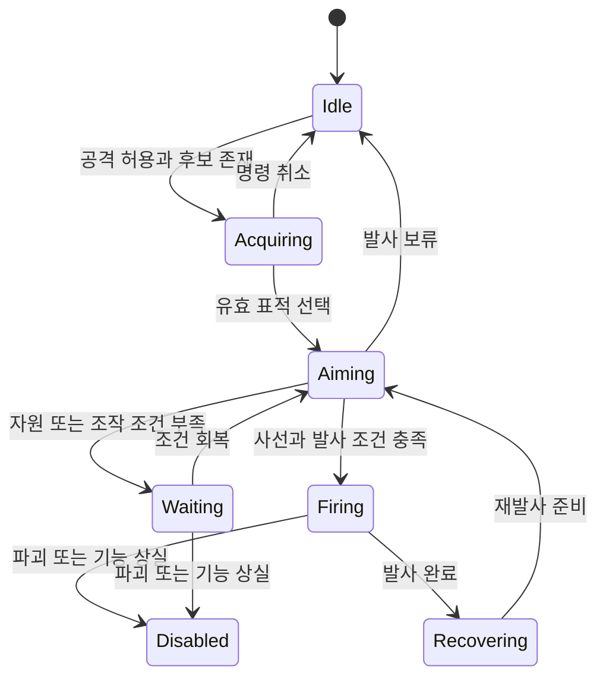

# 08. 무기와 사격 통제

[전체 목차](README.md)

- 문서 ID: COMBAT-08
- 작성일: 2026-11-13
- 기준: 상용판 0.30.5a까지 확인한 공개 문헌. 실제 게임 실행·내부 소스 분석은 수행하지 않았다.
- 표기: **[확인]** 문헌에 명시된 규칙, **[해석]** 규칙의 설계적 의미, **[제안]** 재구현 모델, **[검증 필요]** 자료가 상충하거나 실행 확인이 필요한 사항.

## 1. 시스템의 역할

**[해석]** 무기는 자원을 피해로 바꾸는 단일 장치가 아니라 함선 설계를 전투 결과로 변환하는 마지막 단계다. 같은 무기 수를 탑재해도 전력·탄약 전달, 조작 승무원, 사격각, 목표 추적, 선체 회전, 방열의 제약이 다르면 결과는 크게 달라진다. 따라서 역기획의 기준 단위는 무기의 표시 DPS가 아니라 **특정 설계와 기동 조건에서 중요한 목표에 전달한 효과**다.

플레이어의 주요 선택은 다음과 같다.

| 선택 | 얻는 것 | 함께 부담하는 제약 |
| --- | --- | --- |
| 무기 계열 선택 | 관통, 전력 차단, 지속 피해, 열 공격 등 서로 다른 효과 | 해당 계열의 보급·방어 대책 필요 |
| 탑재 위치와 방향 | 원하는 교전면에 화력 집중 | 사격구 노출, 내부 통로와 경쟁 |
| 사격 대상 부품 지정 | 방어막·무장·동력 등 기능 선택적 무력화 | 조준이 어려우면 실사격 시간 감소 |
| 발사 보류와 일제 사격 | 방어를 짧은 시간에 압도할 기회 | 기다리는 동안 상대에게 공격받음 |
| 오버클럭 전환 | 무기 기능과 전투 역할 변화 | 전력·열·사격 패턴 재검토 |

## 2. 확인된 무기 구조와 설계 의미

아래 표의 첫 두 열은 출처가 지원하는 기능 요약이고, 마지막 열은 **[해석]**이다. 모든 부품의 현재 수치를 복제한 데이터베이스는 아니며, 정상 모드와 오버클럭의 수치는 별도로 관리해야 한다.

| 무기 또는 구성 | [확인] 기능 요약 | [해석] 설계에서 확인할 문제 |
| --- | --- | --- |
| Ion Beam Emitter | 고정 방향의 빔을 발사하며 Prism으로 경로를 바꿀 수 있다. [B-03] | 함체 조준과 빔 출구를 얼마나 안정적으로 유지하는가 |
| Ion Beam Prism | 여러 빔을 합칠 수 있지만 결합에는 손실이 있다. [B-04] | 집중 공격의 가치가 결합 손실과 취약점 집중을 보상하는가 |
| Railgun | Loader와 Launcher가 필요하고 중간 Accelerator를 확장할 수 있다. [B-05] | 긴 선체·보급 통로·직선 사격을 감당할 수 있는가 |
| Deck Cannon | 선체 상부 탑재이며 사격이 주변 승무원을 일시 기절시킨다. [B-06] | 안전한 탑재 위치와 주변 작업 방해를 함께 해결하는가 |
| Chaingun | 연속 사격 중 발사 속도가 상승하며, 사격 중에는 본체와 연결 탄창을 재장전할 수 없다. [B-07] | 사격 구간과 재장전 구간을 어떻게 교대하는가 |
| Missile & Mine Launcher | 미사일 유형과 기뢰에 따라 공격 효과·궤적이 달라진다. [B-08] | 동일 발사기 면적을 어떤 탄종 역할로 사용하는가 |
| Thermal Resonance Lance | 적에게 열을 부여하는 동시에 자체 폐열을 만든다. [B-09] | 상대의 열 대응 능력을 먼저 무너뜨릴 수 있는가 |

**[확인]** 0.30.5에는 무기의 최대 사거리, 발사각, 방향을 편집하는 기능이 추가되었다. [B-01] **[해석]** 이것은 기본 사거리 증가 장치로 읽어서는 안 된다. 플레이어가 무기별 교전 조건을 조절해 탄약 낭비, 원치 않는 표적 전환, 분산 사격을 줄이는 제어 층으로 해석한다. 실제 허용 범위와 무기별 제한은 편집기의 현재 표시값으로 검증해야 한다.

## 3. 입력·출력과 책임 경계

**[제안]** 재구현 시 사격 통제는 다음 계약으로 분리한다.

| 구분 | 데이터 | 소유 시스템 |
| --- | --- | --- |
| 입력 | 조준 표적 ID, 부품 ID, 목표 좌표 | 전술 명령 |
| 입력 | 전력 잔량, 탄약·미사일 조립 상태 | 물류·전력 |
| 입력 | 조작 가능 여부, 기절·부재 상태 | 승무원 |
| 입력 | 포탑 방향, 선체 운동, 사선 | 기동·공간 질의 |
| 입력 | 일반·오버클럭 모드와 폐열 수용 상태 | 열 관리 |
| 출력 | 탄체·빔·열 효과 생성 | 전투 판정 |
| 출력 | 자원 소비 확정과 폐열 발생 | 물류·열 관리 |
| 출력 | 발사 불가 이유, 다음 발사 예상 시간 | UI |

부품을 목표로 지정했다는 사실과 그 부품을 실제로 맞혔다는 사실은 다르다. 다른 장갑, 방어막, 잔해 또는 움직이는 목표가 개입할 수 있다. 사격 시스템은 목표 선택을 담당하고, 최종 충돌 및 피해 시스템은 실제 적중 대상을 결정하도록 설계하는 편이 원인 추적에 유리하다.

## 4. 발사 상태 모델

아래는 **[제안]** 상태도다. 게임의 실제 클래스명이나 내부 업데이트 순서를 주장하지 않는다.



발사 가능 여부를 하나의 `IsReady`로만 저장하면 조작자는 왜 무기가 멈췄는지 알 수 없다. `NoOperator`, `NoPower`, `NoAmmo`, `OutOfArc`, `OutOfRange`, `NoLineOfFire`, `Reloading`, `Disabled`, `HoldFire`처럼 **독립된 차단 이유 집합**을 권장한다. 열이 높으면 언제나 자동 정지한다는 규칙은 확인되지 않았으므로, 열 차단은 해당 무기의 검증된 규칙에만 적용해야 한다.

**[제안]** 자원 소비와 발사는 하나의 확정 과정으로 처리한다.

```text
candidate = SelectTarget(order, candidates)
blockers = EvaluateFireConditions(weapon, candidate)
if blockers is not empty:
    PublishStatus(blockers)
    return
reservation = ReserveRequiredResources(weapon)
if reservation succeeded:
    SpawnValidatedAttack(weapon, candidate)
    CommitResourceUse(reservation)
    ApplyRecoilAndWasteHeat(weapon)
```

자원을 먼저 소모한 뒤 표적 유효성을 뒤늦게 확인하면, 표적 파괴·모듈 분리와 같은 같은 프레임의 변화에서 탄약만 사라지는 결함이 생길 수 있다. 반대로 효과 생성 후 자원을 검사하면 공짜 사격이 생긴다. 이는 재구현에서 검증해야 할 거래적 경계다.

## 5. 무기별 상호작용을 읽는 방법

### 5.1 집중과 분산

**[해석]** 단일 출구에 화력을 합치면 특정 장갑 통로를 뚫기 쉬워지지만, 출구 하나를 잃을 때 손실도 커진다. 반대로 여러 출구는 생존성과 사각 대응을 높이는 대신 동시에 같은 부품을 맞히기 어려울 수 있다. 이 비교는 표시 피해 총합으로 끝나지 않는다. 핵심 부품을 무력화하는 데 걸린 시간, 출구가 차단된 시간, 남은 무장 수를 함께 기록해야 한다.

Ion 결합의 정확한 손실 공식은 [B-04]에 자료가 있지만, 표적 거리와 모드가 섞인 실험에서 그대로 실효 DPS 공식으로 사용하지 않는다. 재구현 초안에서는 결합 함수를 별도 데이터로 두고, 동일 출력의 단일 빔·이중 빔·다단 결합을 독립적으로 검증한다.

### 5.2 긴 무기와 공간 비용

**[해석]** Railgun의 확장은 단순한 공격력 업그레이드가 아니다. 길이가 늘어날수록 선체의 회전 부담, 측면 방어 면적, 보급 접근, 피격 가능한 연결부가 함께 변한다. 같은 비용의 짧은 무기 여러 개와 긴 무기 한 개를 비교하려면 최대 사거리 외에 접근전 실패율과 손상 후 잔존 화력을 포함해야 한다.

**[검증 필요]** 오버클럭 Railgun의 열 연결 조건은 Wiki의 Loader 페이지와 Launcher·Accelerator 페이지가 상충한다. 전자는 전체 모듈 연결, 후자는 한 모듈 연결을 설명한다. 따라서 본 문서는 그 조건을 확정하지 않고 검증 과제로 남긴다. [B-05][B-26][B-27]

### 5.3 사격 주기와 장전 주기

**[해석]** Chaingun처럼 사격과 재장전이 분리되는 무기는 평균 보급량이 충분하더라도 긴 장전 공백을 만들 수 있다. 발사기를 두 그룹으로 나누고 시간차를 두면 적에게 노출되는 무방비 구간을 줄일 가능성이 있다. 반대로 일제 사격은 상대의 방어 갱신보다 큰 순간 유입을 만들 수 있다. 어느 쪽이 좋은지는 상대 방어와 임무 목표에 따라 달라진다.

### 5.4 열 무기와 일반 피해의 결합

**[해석]** 열 공격의 가치는 자체 효과만으로 평가하기 어렵다. 열 관리에 자원을 쓰게 만들고, 소화 작업과 기능 정지를 유발하고, 후속 일반 공격의 효율을 바꿀 수 있기 때문이다. 무기 조합을 비교할 때에는 동일한 총비용으로 일반 무기만 구성한 대조군이 필요하다. 열 시스템의 확정 규칙은 [11장](11_Heat_and_Overclocking.md)이 소유한다.

## 6. 실효 화력 분석 모델

다음 식은 **[제안]** 비교 도구이며 원작 내부 공식이 아니다.

$$
D_{effective}=D_{nominal}\times U_{supply}\times U_{aim}\times P_{hit}\times E_{target}
$$

- `U_supply`: 필요한 보급·조작 조건을 충족한 시간 비율.
- `U_aim`: 유효 표적을 사거리·사격각·사선에 넣은 시간 비율.
- `P_hit`: 발사된 공격이 의도한 목표 계층에 도달한 비율.
- `E_target`: 방어막, 장갑, 기능 부품에 대한 효과를 목적에 맞게 환산한 계수.

이 곱셈은 서로 상관된 원인을 단순화한다. 예를 들어 회피 기동 때문에 조준과 보급이 동시에 달라지면 독립 변수로 곱한 값이 실제 결과와 어긋날 수 있다. 최종 평가는 직접 측정한 `핵심 기능 정지까지 시간`, `탄약당 성과`, `아군 손실`로 해야 한다.

**[가정 예시]** 무기 A의 명목 출력이 100이고 공급 가동률이 0.5, 조준 가동률이 0.6이면 단순 모델의 출력은 30이다. 무기 수를 늘려 명목 출력을 150으로 만들기보다 공급 가동률을 0.9로 높이면 54가 된다. 이 숫자는 Cosmoteer 밸런스값이 아니라 보급 개선의 가치를 설명하는 예시다.

## 7. 대표 플레이 시나리오

**[제안]** 시험 함선은 동일 예산·승무원·시작 거리로 고정하고 다음 순서로 비교한다.

1. 전면 장갑 뒤에 핵심 발전기 하나가 있는 표적을 둔다.
2. 자동 사격과 특정 부품 집중 사격을 각각 실행한다.
3. 장갑 관통 시간, 실제 핵심 부품 피격 시간, 사격 중단 사유를 기록한다.
4. 표적을 횡이동시키고 같은 실험을 반복한다.
5. 보급 통로 한 곳을 절단해 설계의 손상 민감도를 확인한다.
6. 오버클럭을 켠 조건은 방열 면적·비용까지 포함한 별도 설계로 비교한다.

예상 결과를 미리 승패로 고정하지 않는다. 특정 무기가 항상 우세하다는 결론보다, 어떤 조건에서 우세가 바뀌는지 찾는 것이 역기획의 목적이다.

## 8. 튜닝 변수와 측정 항목

| 튜닝 축 | 조절 변수 예 | 관측 지표 |
| --- | --- | --- |
| 화력 | 피해, 주기, 관통·범위 효과 | 표적별 기능 정지 시간 |
| 기하 | 사거리, 사격각, 선회 속도 | 조준 실패 시간, 교전면 |
| 비용 | 자원, 질량, 면적, 지휘 부담 | 동일 예산에서 구성 다양성 |
| 물류 | 장전량, 저장량, 보급 접근 | 고갈 횟수, 작업 왕복거리 |
| 열 | 폐열, 열 수용량, 모드 효과 | 과열까지 시간, 냉각 회복시간 |
| 제어 | 자동 표적 전환, 발사 보류 | 명령당 유효 효과, 과잉 사격 |

## 9. 수용 테스트

다음은 **[제안]** 구현 검수 및 원작 추가 관찰용 테스트다. 통과했다고 주장하지 않는다.

| ID | 조건 | 확인할 결과 |
| --- | --- | --- |
| WPN-01 | 사거리 밖·안으로 표적 이동 | 발사 여부와 UI 이유가 일치 |
| WPN-02 | 보급 충분, 조작 승무원 제거 | 조작이 필요한 무기만 올바르게 중단 |
| WPN-03 | 대상 부품이 발사 직전 파괴 | 자원 손실·잘못된 참조·크래시 없이 재판정 |
| WPN-04 | 설정 사격각을 줄임 | 허용 영역 밖 자동 발사 억제, 기본 성능값과 혼동 없음 |
| WPN-05 | Chaingun 사격과 재장전 관찰 | 사격 구간·장전 구간의 실제 경계 확인 |
| WPN-06 | Railgun의 열 연결을 한 곳·전부로 비교 | 모순된 공개 문헌의 조건 확정 |
| WPN-07 | 일반·오버클럭 같은 무기 비교 | 모드별 자원·효과·열 변화가 구분되어 기록 |
| WPN-08 | 함체 분리 중 사격 지속 | 새로운 소유 함체와 표적 좌표로 안전하게 전환 |

## 10. 출처와 연결 문서

- [B-01] — 0.30.5 정식 공지. 커스텀 사거리·발사각·방향 도입 확인. 개별 페이지 제목과 공식 Steam 커뮤니티 피드의 본문을 대조했다.
- [B-03] — Ion Beam의 고정 방향·Prism 연계.
- [B-04] — Prism 결합과 손실의 존재. 페이지의 수학식은 현재 실행 검증 없이 재현 공식으로 확정하지 않음.
- [B-05] — Railgun Loader의 기본 구성과 열 연결 조건 설명.
- [B-06] — Deck Cannon의 상부 탑재·승무원 기절.
- [B-07] — Chaingun 사격 중 재장전 제한과 연사 상승.
- [B-08] — 미사일·기뢰의 역할 구분. 구버전 수치가 남아 있어 정량표에는 사용하지 않음.
- [B-09] — Thermal Resonance Lance의 공격 열·자체 열.
- [B-26], [B-27] — Railgun 열 연결 조건의 상충 자료.

[B-01]: https://steamcommunity.com/games/799600/announcements/detail/699905228356458048 "Update 0.30.5"
[B-03]: https://cosmoteer.wiki.gg/wiki/Ion_Beam_Emitter "Ion Beam Emitter"
[B-04]: https://cosmoteer.wiki.gg/wiki/Prism "Ion Beam Prism"
[B-05]: https://cosmoteer.wiki.gg/wiki/Railgun_Loader_Module "Railgun Loader Module"
[B-06]: https://cosmoteer.wiki.gg/wiki/Deck_Cannon "Deck Cannon"
[B-07]: https://cosmoteer.wiki.gg/wiki/Chaingun "Chaingun"
[B-08]: https://cosmoteer.wiki.gg/wiki/Mines "Missile & Mine Launcher"
[B-09]: https://cosmoteer.wiki.gg/wiki/Thermal_Resonance_Lance "Thermal Resonance Lance"
[B-26]: https://cosmoteer.wiki.gg/wiki/Railgun_Launcher_Module "Railgun Launcher Module"
[B-27]: https://cosmoteer.wiki.gg/wiki/Railgun_Accelerator_Module "Railgun Accelerator Module"

연결: [물류](05_Internal_Logistics_and_Supply.md) · [전력](06_Power_Generation_and_Distribution.md) · [기동](07_Propulsion_and_Maneuvering.md) · [방어](09_Defense_Shields_and_Point_Defense.md) · [피해·파괴](10_Damage_Fire_and_Destruction.md) · [열](11_Heat_and_Overclocking.md) · [전술](12_Tactical_Combat_and_Fleet_Control.md)
