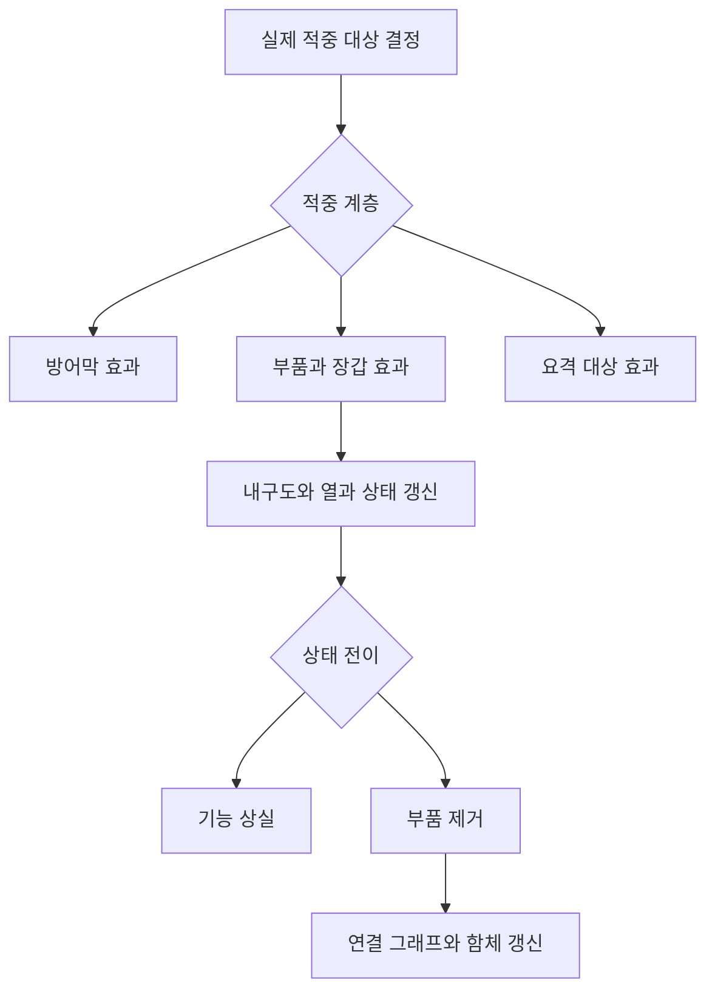

# 10. 피해·화재·기능 상실·파괴

[전체 목차](README.md)

- 문서 ID: COMBAT-10
- 작성일: 2026-11-13
- 기준: 상용판 0.30.5a의 공개 문헌. 내부 충돌·피해 코드와 실행 프레임은 확인하지 않았다.
- 표기: **[확인]** 문헌 규칙, **[해석]** 설계적 해석, **[제안]** 구현 모델, **[검증 필요]** 미확정 세부사항.

## 1. 시스템 목적

**[해석]** 피해 시스템은 "남은 선체 HP"를 줄이는 장치에 그치지 않는다. 공격 위치를 작동 불능, 보급 중단, 조타 변화, 화재, 함체 분리로 바꾸어 함선 구조의 의미를 드러내는 시스템이다. 피해는 설계의 약점을 실제 사건으로 보여 주며, 플레이어가 다음 개조에서 해결할 과제를 만든다.

역기획에서 구분할 결과는 네 가지다.

| 결과 | 의미 | 다음 시스템에 미치는 영향 |
| --- | --- | --- |
| 내구도 감소 | 부품이 손상되었지만 존재 | 수리 비용과 후속 피격 취약성 |
| 기능 상실 | 부품이 남아 있어도 역할 수행 불가 | 무기·생산·조작·이동 능력 감소 |
| 부품 제거 | 구조·공간·자원 연결이 사라짐 | 통행, 열망, 사선, 질량 갱신 |
| 함체 분리 | 연결된 집합이 여러 개로 나뉨 | 소유·제어·운동·작업 목표 재구성 |

이 표의 이벤트 분류는 **[제안]**이며 실제 원작 코드의 enum을 복제한 것이 아니다. 함체 연결의 본 규칙과 분리 모델은 [03장](03_Modules_Connectivity_and_Ship_Splitting.md)이 담당한다.

## 2. 확인된 피해 규칙과 판본 경계

### 2.1 관통과 단순 피해를 구분

**[확인]** 공식 Wiki의 관통 문헌은 공격체의 적중 효과와 관통 동작을 구분하고, 부품·구조물·방어막 등 적중 대상의 종류를 별도로 설명한다. 자료는 미완성 표시가 있으므로 최신 전체 엔진 규격으로 취급하지 않는다. [B-17]

**[확인]** 장갑에는 내구도와 별개인 관통 저항이 있으며, 장갑 형상에 따라 저항 특성이 다르다. 해당 자료는 손상된 장갑도 제거되기 전까지 저항을 유지한다고 설명한다. [B-15] **[해석]** 피해량을 관통 거리와 동일하게 계산하는 설계는 피해야 한다. 깊이 들어가지만 적은 피해를 주는 공격과, 얕은 범위에 큰 피해를 주는 공격은 다른 역할을 가져야 한다.

### 2.2 화재와 그을림

**[확인]** Meltdown 이후 화재는 열에서도 시작될 수 있다. 충분히 타 버린 일반 부품은 대부분 즉시 소멸하는 대신 `scorched` 상태로 기능을 잃고 수리를 요구한다. 폭발성 탄약을 가진 부품은 예외가 될 수 있다. [B-02]

**[확인]** 승무원은 소화기를 가져와 화재를 진압한다. 진압된 곳에는 잠시 재발화를 막는 거품이 남는다. [B-16] **[해석]** 화재를 단순 지속 피해로만 취급하면 이동·작업 전환·소화 장비 접근·복구라는 연결이 누락된다. 소화와 방열은 각각 화염과 열이라는 다른 원인을 다루므로 동일 작업으로 합치지 않는다.

### 2.3 0.30.5의 탄약 폭발 변경

**[확인]** 0.30.5는 화재에 의한 저장 탄약 폭발을 저장 부품의 `scorched` 도달과 연결하고, 폭발 규모를 자원 개수 대신 완전한 스택 단위로 조정했다. 무기·공장의 내부 저장도 파괴 또는 그을림 때 저장 자원에 따라 폭발하도록 정리했으며, 발사기는 완성된 미사일 수를 반영한다. [B-01]

**[해석]** 따라서 "탄약이 불 피해를 받을 때 매번 임의 폭발한다" 또는 "모든 탄약 공장은 항상 같은 고정 폭발을 일으킨다"는 오래된 설명을 현재 규칙으로 사용하면 안 된다. 정량 폭발 크기, 부분 스택과 부분 조립의 개별 처리, 종류별 예외는 현재 데이터와 실험으로 확정해야 한다.

## 3. 피해 파이프라인 제안

다음은 **[제안]** 재구현의 책임 분리다.



공간 질의는 무엇을 맞혔는지 반환하고, 피해 적용기는 대상과 공격 유형에 맞는 결과를 만든다. 피해 적용 도중 바로 모든 연쇄 폭발을 재귀 호출하기보다, 후속 사건을 안정된 큐에 넣는 방법을 권장한다. 그래야 동일한 폭발을 여러 번 계산하거나 이미 제거된 부품을 다시 참조하는 문제가 줄어든다.

| 사건 | 필수 정보 | 소비자 |
| --- | --- | --- |
| `HitResolved` | 공격 ID, 표적 ID, 위치, 적중 계층 | 피해 계산·이펙트 |
| `PartDamaged` | 전후 내구도, 원인, 시각 | UI·수리 작업 |
| `PartScorched` | 기능 상실 이유, 복구 요구 | 무기·생산·승무원 |
| `StoredPayloadDetonated` | 저장 자원 스냅샷, 원인 사건 | 연쇄 폭발 |
| `PartRemoved` | 점유 셀·연결 포트·질량 변화 | 구조·통행·열·기동 |
| `ShipPartitioned` | 이전 함체와 새 집합 매핑 | 명령·승무원·저장 |

각 사건은 중복 처리 방지 ID를 가져야 한다. 클라이언트 시각 효과와 게임플레이 효과가 같은 폭발 ID를 공유하면 화면상 폭발과 실제 피해가 다른 원인을 가리키는 문제도 줄일 수 있다.

## 4. 상태는 하나의 직선 순서가 아니다

**[제안]** 부품 상태는 하나의 `Alive/Dead` 대신 서로 직교하는 축으로 표현한다.

| 축 | 값의 예 | 구분 이유 |
| --- | --- | --- |
| 존재 | 설치됨 / 제거됨 | 물리·연결·점유의 기준 |
| 내구 | 정상 / 손상 / 파괴 임계 | 일반 공격 결과 |
| 기능 | 가능 / 전력 없음 / 인원 없음 / 그을림 | 작동 불능 원인의 차이 |
| 화염 | 없음 / 발생 / 진압 중 / 거품 보호 | 화재 처리 단계 |
| 열 | 선체 열 / 내부 열 저장량 | 소화 후 재발화와 폐열 문제 |
| 소속 | 기존 함체 / 분리 함체 / 잔해 | 명령·작업 대상 갱신 |

예를 들어 거품이 남은 부품은 화염이 없어도 열이 높을 수 있다. 그을린 부품은 구조적으로 남아 있어도 기능이 정지했을 수 있다. 전력이 없는 부품은 손상되지 않았으므로 수리로 해결할 문제가 아닐 수 있다. 이러한 조합이 같은 경고 아이콘으로 뭉개지면 사용자는 잘못된 개조를 하게 된다.

**[검증 필요]** 거품의 지속시간, 그을림의 정확한 발생 임계, 화재가 연결·문·형상과 상호작용하는 세부 규칙, 승무원 위험 판정은 현재 빌드에서 따로 관찰해야 한다. 선내 산소·압력·문 개폐가 다른 우주선 게임처럼 화재를 제어한다는 가정은 본 문서에 도입하지 않는다.

## 5. 연쇄 파괴를 읽는 관점

**[해석]** 연쇄 파괴의 위험은 폭발력이 큰 부품의 존재뿐 아니라 그 주변에 어떤 기능이 모여 있는가에 따라 달라진다. 동력, 탄약, 핵심 통로, 명령 기능을 가까이 모으면 평상시 물류가 편해질 수 있지만 같은 손상 사건이 여러 기능을 동시에 없앨 수 있다. 반대로 분산 배치는 손상 격리에 유리해도 일상 운영의 이동거리를 늘린다.

**[제안]** 설계 검토에서는 다음 세 종류의 연결을 별도로 그린다.

1. 구조 연결: 어떤 부품이 제거되면 함체가 분리되는가.
2. 기능 연결: 어떤 공급원·통로가 끊기면 무기가 정지하는가.
3. 위험 연결: 어느 폭발·화재·열 사건이 인접 기능으로 번질 수 있는가.

셋을 하나의 인접 그래프로 대체하지 않는다. 가까운 두 부품이 동일 열망에 속한다는 보장은 없고, 구조적으로 연결되어 있어도 승무원이 통과할 수 있다는 보장은 없다. 이 구분은 [05장 물류](05_Internal_Logistics_and_Supply.md), [11장 열](11_Heat_and_Overclocking.md)과의 공통 설계 원칙이다.

## 6. 계산 모델과 예외 처리

**[제안]** 단순 피해 적용의 예:

```text
ProcessHit(hit):
    target = ResolveLiveTarget(hit.targetId)
    if target does not exist: return
    context = SnapshotTargetState(target)
    effects = EvaluateAttackAgainstTarget(hit.attack, context)
    ApplyDurabilityChange(target, effects.damage)
    ApplyHullHeat(target, effects.hullHeat)
    ApplyEnergyEffect(target, effects.energyDrain)
    QueueStateTransitions(target, effects)

ProcessRemoval(part):
    if removalAlreadyCommitted(part.id): return
    payload = SnapshotStoredPayload(part)
    CommitRemoval(part)
    InvalidateStructuralCrewAndThermalGraphs(part)
    QueuePayloadEffects(payload)
```

피해량·관통 깊이·열량·전력 흡수량은 다른 단위를 가진다. 하나의 실수 `damage`에 모두 섞으면 방어막과 부품의 판정 차이를 표현하기 어렵다. 원작의 실제 `DamageType` 열거를 재현한다고 주장하지 말고, 요구되는 효과를 분리한 설계 후보로 둔다.

**[제안]** 과열에 따른 일반 피해 증폭을 실험할 때에는 함수 `DamageMultiplier(HullHeat)`를 독립적으로 측정한다. 함수를 선형·지수로 미리 고정하지 않는다. 열 자체가 일으킨 화재 피해와 일반 무기 피해가 뒤섞이지 않도록 시험을 나눠야 한다.

## 7. 대표 사건: 탄약 구획 손상

**[제안]** 아래 사례는 원작에서 실제로 실행한 기록이 아니라 여러 시스템을 함께 검수할 시험 설계다.

- 시작: 동일한 탄약을 가진 두 함선. A는 탄약·조작부·발전기를 밀집시키고 B는 구획을 나눈다.
- 자극: 같은 위치·각도의 공격으로 탄약 저장 구획에 화재를 만든다.
- 관찰: 초기 불꽃, 소화 작업 시작, 승무원 이동, 그을림 도달, 폭발 발생을 시간순으로 기록한다.
- 손실 측정: 제거된 부품 비용뿐 아니라 정지한 무기 수, 전력 공급 실패, 남은 추진 방향을 기록한다.
- 복구 측정: 소화 성공 후 수리 가능한 상태인지, 설계대로 다시 가동되는 데 무엇이 필요한지 확인한다.

B가 항상 우세하다고 결론 내리지 않는다. 같은 예산에서 분산으로 늘어난 통로·장갑 비용 때문에 B의 원래 화력이 낮을 수 있다. 손상 격리의 가치는 생존율과 임무 성공률로 비교해야 한다.

## 8. 플레이어에게 보여 줄 정보

**[해석]** 파괴 연출은 사건의 원인을 읽게 해야 한다. 화면을 가리는 폭발의 규모만 키우면 큰 손실을 경험하면서도 다음 설계를 개선할 단서를 얻지 못한다.

**[제안]** 정보 우선순위는 다음과 같다.

| 상황 | 즉시 정보 | 상세 정보 |
| --- | --- | --- |
| 방어막 붕괴 | 보호면 사라짐, 공급 경고 | 소비와 보급 기록 |
| 부품 그을림 | 기능 정지 표시 | 소화 완료와 수리 필요 분리 |
| 탄약 폭발 | 폭발 중심과 저장 구획 | 당시 저장량·원인 사건 |
| 열망 단절 | 영향받는 부품 강조 | 끊긴 포트와 연결 경로 |
| 함체 분리 | 남은 제어 가능 부분 | 명령·승무원·소속 변화 |

분리 직후 잔해와 살아 있는 함선의 선택 가능성을 명확하게 구분해야 한다. 파편 이펙트가 실제 잔해·자원·부품 판정을 대신해서는 안 된다.

## 9. 튜닝 항목과 검수

**[제안]** 정량화할 변수는 일반 내구도, 공격별 저항, 관통 특성, 화재 성장·진압 속도, 그을림 임계, 폭발의 자원 의존성, 열 확산·감쇠, 수리 작업량이다. 모든 값을 동시에 바꾸면 인과관계를 잃기 쉬우므로 한 계열씩 바꾸고 대표 함선의 기능 잔존 곡선을 비교한다.

| ID | 시험 | 확인할 결과 |
| --- | --- | --- |
| DMG-01 | 동일 내구도·다른 장갑 형상에 단발 관통 | 내구와 관통 특성의 독립성 |
| DMG-02 | 비폭발성 부품을 화재로 소진 | 그을림·제거·복구 조건 기록 |
| DMG-03 | 탄약 저장량을 0·부분 스택·완전 스택으로 변경 | 현 버전 폭발 스케일 검증 |
| DMG-04 | 완성 미사일과 부분 조립 상태 비교 | 발사기 폭발의 기준 상태 확인 |
| DMG-05 | 소화 직후 높은 선체 열 유지 | 거품과 열을 별도로 추적 |
| DMG-06 | 연결 부품 제거와 폭발을 같은 시점에 발생 | 중복 폭발·유실 이벤트 방지 |
| DMG-07 | 파괴 직전 저장·복원 | 진행 중 화재·열·예약 상태 일관성 |
| DMG-08 | 분리 부품을 향하던 승무원·무기 명령 | 새 함체 참조 또는 안전한 취소 |

이 표는 향후 실행해야 할 수용 기준이다. 이번 산출물은 테스트 통과 보고서가 아니다.

## 10. 출처와 연결 문서

- [B-01] — 0.30.5의 저장 탄약·미사일 폭발 규칙. RC의 값과 구분해 정식 공지 기준을 채택.
- [B-02] — Meltdown의 화재·그을림 도입 규칙.
- [B-15] — 장갑의 내구도와 관통 저항의 차이.
- [B-16] — 승무원 소화와 재발화 방지 거품.
- [B-17] — 공개 관통 동작 문헌. 미완성 문서이므로 구조적 참고로 한정.

[B-01]: https://steamcommunity.com/games/799600/announcements/detail/699905228356458048 "Update 0.30.5"
[B-02]: https://steamcommunity.com/games/799600/announcements/detail/521971821728244926 "The Meltdown Update"
[B-15]: https://cosmoteer.wiki.gg/wiki/Armor "Armor"
[B-16]: https://cosmoteer.wiki.gg/wiki/Fire_Extinguisher "Fire Extinguisher"
[B-17]: https://cosmoteer.wiki.gg/wiki/Penetration "Penetration modding documentation"

연결: [연결·분리](03_Modules_Connectivity_and_Ship_Splitting.md) · [승무원](04_Crew_Roles_and_Task_AI.md) · [물류](05_Internal_Logistics_and_Supply.md) · [방어](09_Defense_Shields_and_Point_Defense.md) · [열](11_Heat_and_Overclocking.md) · [기술 구조](20_Technical_Architecture_and_Data_Model.md)
