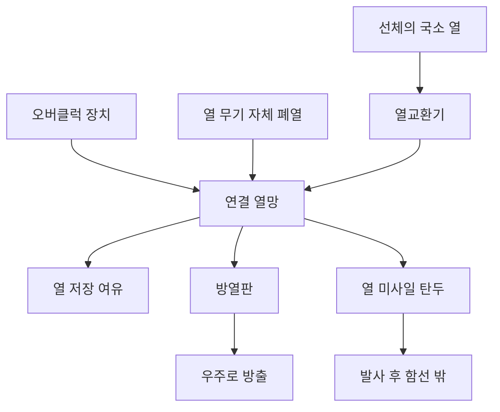

# 11. 열 관리·방열망·오버클럭

[전체 목차](README.md)

- 문서 ID: THERMAL-11
- 작성일: 2026-11-13
- 기준: Meltdown 0.30.0 도입 이후, 0.30.5a까지 확인한 공개 문헌.
- 표기: **[확인]** 문헌 규칙, **[해석]** 설계 의미, **[제안]** 재구현 모델, **[검증 필요]** 미확정 조건.

## 1. 시스템의 위치

**[확인]** Meltdown 업데이트는 열 관리와 오버클럭을 도입했다. 열 계통은 일반적인 모든 함선에 동일한 냉각 배관 설치를 강제하는 구조로 소개되지 않았으며, 열 무기와 오버클럭을 사용하는 설계에서 중요한 선택 층이 된다. [B-02]

**[해석]** 이 시스템은 기존의 "전력·탄약을 공급하면 출력이 유지된다"는 관계에 폐열이라는 추가 제약을 넣는다. 높은 순간 출력과 지속 가능한 출력을 분리하고, 장갑 뒤에 숨겨 둔 핵심부품 외에 방열을 위해 노출해야 하는 공간도 전술적 표적으로 만든다.

열은 두 관점에서 읽어야 한다.

| 구분 | [확인] 공개 설명 | [해석] 플레이어 과제 |
| --- | --- | --- |
| 선체의 열 | 타일에 쌓이고 주변으로 확산·감쇠하며 높은 열은 화재·피해 취약성과 연결 [B-02] | 어느 구역을 식힐 것인가 |
| 열망에 저장된 열 | 부품 연결과 저장·방열 장치를 통해 관리 [B-18][B-20][B-21] | 얼마를 흡수하고 얼마나 오래 배출할 것인가 |

두 값을 하나의 "함선 온도"로 합치면 같은 함선 안에서 발생하는 국소 과열, 열망 단절, 열교환기의 역할을 표현하기 어렵다. 문헌에서 쓰는 열량 단위가 있다고 해서 실제 재료의 비열·상변화·기체 냉각까지 원작이 시뮬레이션한다고 해석해서는 안 된다.

## 2. 구성 요소

| 부품 | [확인] 역할 | [해석] 설계에서 생기는 선택 |
| --- | --- | --- |
| Heat Pipe | 연결된 부품 사이 열을 전달 [B-18] | 열 포트 연결과 피격 취약점 관리 |
| Heat Pipe Crossing | 승무원이 아래로 통과할 수 있는 배관. 방향과 문 연결에 유의 [B-19] | 통로를 유지하며 열망을 횡단 |
| Radiator | 연결 열망의 열을 방출하며 전면 차폐가 효율에 영향 [B-20] | 보호와 방출 공간의 상충 |
| Thermal Battery | 열망의 저장 용량 제공 [B-21] | 순간 출력용 여유 확보 |
| Heat Exchanger | 선체 열을 열망으로 옮기며 추가 폐열 발생 [B-22] | 외부 열 공격·국소 과열 대응 |
| Thermal Resonance Lance | 열 공격과 자체 폐열 발생 [B-09] | 공격 효율과 자기 냉각 부담 |
| Lance 관련 Pump | 같은 열망의 Lance 강도 또는 적용 범위 확대 [B-10][B-11] | 증폭 효율·보조장치 부담 |

**[확인]** Heat Pipe는 문헌상 즉시 열을 전달하는 연결로 설명된다. [B-18] **[해석]** 이를 물·냉각수가 일정 유속으로 흐르는 파이프와 동일한 규칙으로 역기획하면 안 된다. 냉각수 자원, 펌프 압력, 배관별 유량 한계는 여기서 확인한 기본 규칙이 아니다. 명칭이 Pump인 Lance 보조 부품을 일반 냉각수 펌프로 오해하지 않는다.

## 3. 열 연결과 선체 연결

**[확인]** 0.30.5는 선체 열 확산과 Thermal Resonance Lance의 열 적용에 부품 사이 연속 경로가 필요하도록 변경했다. [B-01]

**[제안]** 재구현에서는 다음 연결을 구별한다.

- 구조 그래프: 함체가 붙어 있는지 판단한다.
- 승무원 그래프: 문과 통행 가능 공간을 통해 이동한다.
- 열망 그래프: 열 포트와 배관을 통해 에너지를 공유한다.
- 선체 열 인접 관계: 실제로 연결된 타일·부품 사이 열 확산을 계산한다.

네 그래프가 같은 결과를 내야 하는 것은 아니다. 승무원이 지나갈 수 없는 배관이어도 열 연결은 존재할 수 있고, 승무원 이동용 문을 추가했다고 아무 포트에나 열망이 생기는 것도 아니다. 편집기는 현재 보고 있는 연결의 종류를 명확히 표시해야 한다.

그림은 **[해석]** 기능 관계를 보여 주며 원작의 에너지 분배 우선순위·내부 컴포넌트 순서를 뜻하지 않는다.

## 4. 오버클럭은 개별 기능 전환

**[확인]** 오버클럭은 부품별로 기능을 바꾸며 열을 발생시킨다. Career에서는 해당 부품의 오버클럭 해금을 구매해야 한다. [B-02]

**[확인]** 예를 들어 Ion Beam의 오버클럭은 목표 부근에 불안정한 번개 효과를 만들고, Chaingun은 폭발성 점사 동작을 갖는다. [B-03][B-07] **[해석]** 따라서 오버클럭 전체에 하나의 공통 배율을 붙이면 목표 집중, 연속 사격, 탄약 사용, 제어 방식의 변화를 놓친다.

**[제안]** 모드 데이터는 다음처럼 분리한다.

| 필드 | 목적 |
| --- | --- |
| `ModeId` | 일반·오버클럭·부품별 하위 선택 식별 |
| `UnlockRequirement` | 구매·게임 모드별 허용 조건 |
| `BehaviorProfile` | 탄체·빔·점사·영역 효과 정의 |
| `ResourceProfile` | 전력·탄약 소비와 장전 조건 |
| `ThermalProfile` | 발생 열·저장·연결 요구 |
| `UIProfile` | 변경 전후 효과와 위험 설명 |

오버클럭 해금이 구매되었다는 것, 배관 연결이 가능하다는 것, 현재 냉각 설계가 충분하다는 것은 다른 조건이다. UI에서 이 셋을 하나의 체크 표시로 합치지 않는다.

**[검증 필요]** 모드 전환의 전투 중 허용 범위, 재장전·축적 자원 유지 여부, 모드별 열 연결의 강제 조건은 부품별로 확인해야 한다. 특히 Railgun은 공개 페이지 사이 연결 조건이 상충하므로 [08장 검증 항목](08_Weapons_and_Fire_Control.md)을 따른다.

## 5. 지속 출력과 순간 출력의 분리

**[제안]** 하나의 열망에 대한 분석용 수지를 다음처럼 정의한다.

$$
\frac{dH_{network}}{dt}
=Q_{generated}+Q_{exchange}
-Q_{radiated}-Q_{payload}-Q_{other}
$$

- `H_network`: 현재 해당 열망에 저장된 열량. 게임의 열량 단위를 유지한다.
- 모든 `Q_*`는 **열량/게임 초** 단위의 유입·유출률이다.
- `Q_generated`: 연결 장치의 폐열 생성률. 열교환기 자체의 추가 폐열도 이 항목에 한 번만 포함한다.
- `Q_exchange`: 선체에서 열망으로 실제 옮긴 열의 비율. 열교환기의 자체 폐열은 여기 중복 포함하지 않는다.
- `Q_radiated`: 실제 방열률. 차폐·손상 등 현재 조건을 반영한다.
- `Q_payload`: 미사일 탄두 등 다른 저장처로 열을 옮기는 비율.
- `Q_other`: 검증된 다른 소모·손실이 있을 때만 사용하는 비율이며, 없는 경우 0이다.

이 식은 보존 관계를 정리하는 도구다. 실제 게임의 분배 순서, 저장 한계 초과 시 처리, 화재 발생률을 규정하지 않는다. 미사일 탄두로 옮겨진 열은 네트워크에서는 빠질 수 있지만 발사 전까지 함선 안에 남아 있을 수 있으므로, **열망 기준과 함선 전체 기준을 혼동하지 않는다.**

지속 냉각보다 발생 열이 큰 단순 상황에서는 저장 여유가 소진되는 시간을 다음과 같이 근사할 수 있다.

$$
t_{buffer}\approx
\frac{H_{capacity}-H_{current}}
{Q_{in}-Q_{out}}
$$

여기서 `Q_in = Q_generated + Q_exchange`, `Q_out = Q_radiated + Q_payload + Q_other`이며 모두 열량/게임 초 단위다. 분모가 양수일 때만 유효하며, 발사·모드 전환·방열 차폐가 일정하다는 가정이 필요하다. 외부 공격이 선체를 가열하고 이후 열교환기로 회수된다면 그 열은 `Q_exchange`에 한 번만 기록한다. 이것은 원작의 정확한 과열 타이머가 아니다.

**[가정 예시]** 사용 가능한 열 저장 여유가 12,000, 초당 순증가가 600이면 단순 모델에서 20초의 여유가 생긴다. 같은 저장 용량이라도 순증가가 300이면 40초가 된다. 임의 단위의 설계 예시이며 실제 부품값이 아니다. 열 저장 장치를 두 배로 늘리면 순간 작동시간은 늘지만 순발열이 양수인 한 무한 지속은 불가능하다.

## 6. 방열 배치의 설계 문제

**[해석]** 방열판은 화력을 강화한 대가를 공간 배치로 돌려주는 부품이다. 많은 장갑으로 보호하고 싶지만 방출 방향을 가리면 기능이 약해질 수 있다. 따라서 함선의 앞·뒤·측면 중 어디를 전투 중 노출할지, 방열판 손상 후 얼마나 버틸지, 한 열망에 모든 장치를 묶을지를 결정하게 한다.

**[제안]** 대표 설계안 비교:

| 설계 | 장점 후보 | 비용·실패 위험 |
| --- | --- | --- |
| 하나의 큰 열망 | 저장·방열 여유 공유 | 일부 손상이 광범위한 장치에 영향 |
| 무기별 분리 열망 | 고장 격리와 원인 파악 | 여유 용량을 공유하기 어려움 |
| 대형 저장 중심 | 짧은 교전의 폭발적 출력 | 장기전 회복이 느릴 수 있음 |
| 방열 중심 | 지속 교전 안정성 | 외부 노출·면적 부담 |
| 열교환 중심 | 선체 열 대응 범위 확대 | 직접 연결보다 추가 부담 가능 |

이 비교는 확정된 최적 배치가 아니다. 연결을 나누었을 때 실제로 어떤 저장·방열 공유가 달라지는지 실험해야 한다. 파이프 한 칸이 파괴되었다는 이유만으로 선체 전체 냉각이 사라진다고 임의로 처리해서는 안 된다.

## 7. 열을 무기로 다시 사용하는 구조

**[확인]** Thermal Canister Missile은 함선의 폐열을 공격에 사용하며, 발사기는 열망 연결과 열 공급이 필요하다. [B-02] **[해석]** 열은 버려야 할 부산물이면서 특정 무기의 입력이 된다. 따라서 "더 차갑게 만들수록 항상 더 좋다"는 최적화 목표가 성립하지 않을 수 있다.

**[제안]** 이 연결을 시험할 때에는 최소 세 상태를 비교한다.

1. 발생 열 부족: 미사일 부품이 있어도 열 공급 때문에 공격이 제한되는가.
2. 균형 상태: 미사일 준비·발사와 방열이 함께 폐열을 처리하는가.
3. 공격 불가 상태: 표적 부재·발사각·탄종 보급 부족으로 열 소비가 줄었을 때 어떻게 되는가.

공격 명중률에 냉각 능력을 전부 의존하는 구성은 사격 중단 때 취약해질 수 있다. 다만 원작에서 어떤 준비 단계에 열을 소비하는지, 미완성 탄두가 얼마를 저장하는지는 **[검증 필요]**다. 그 부분을 임의의 '발사할 때만 즉시 냉각' 규칙으로 확정하지 않는다.

## 8. 선체 열과 소화의 책임 분리

**[해석]** 화재가 꺼졌다는 사실은 열 원인이 제거되었다는 뜻이 아니다. 열교환·열망·방열 문제를 그대로 둔 채 승무원 소화만 반복하면 같은 구역에 부담이 계속 집중될 수 있다. 반대로 열망 저장량이 충분해도 이미 생긴 화재의 처리는 별도 문제다.

**[제안]** UI에는 다음 정보를 분리해 보여 준다.

| 화면 | 주요 값 | 플레이어 질문 |
| --- | --- | --- |
| 선체 열 오버레이 | 위치별 상대 열 상태 | 어디가 위험한가 |
| 열망 오버레이 | 연결 집합·끊긴 포트 | 어떤 장치가 함께 연결되는가 |
| 열 수지 패널 | 발생·흡수·방출·저장 여유 | 계속 작동해도 되는가 |
| 모드 비교 | 출력 변화와 추가 폐열 | 이 전환이 현재 설계에 맞는가 |
| 방열판 검사 | 전면 차폐와 가동 여부 | 장치를 추가했는데 왜 식지 않는가 |

실제 UI의 모든 항목이 이미 존재한다는 뜻은 아니다. 역기획 결과를 재구현할 때 필요한 정보 요구사항이다.

## 9. 판본 충돌 기록

**[검증 필요]** Radiator Wiki에는 내구도 4,000이 남아 있지만, 0.30.5 정식 공지는 3,000으로 변경했다고 명시한다. 해당 값은 최신 패치가 우선한다. [B-01][B-20] 이 문서는 전체 장치 스탯표를 옮기는 대신 기능과 변경 근거를 기록한다.

**[검증 필요]** 일부 Overclocking Wiki 설명은 이전의 증가율·기능 설명을 유지할 수 있다. 특히 Power Capacitor의 용량 설명은 0.30.5a에서 정정되었으므로 [06장 전력](06_Power_Generation_and_Distribution.md)의 판본 기록을 따른다. Radiator 페이지의 기술 ID도 다른 부품과 동일하게 적혀 있어, 해당 ID를 구현 데이터 키로 채택하지 않는다.

## 10. 튜닝과 수용 테스트

**[제안]** 튜닝 축은 지속 발생 열, 순간 발생 열, 저장량, 방열량, 방열 차폐 반응, 열교환 범위·효율, 선체 확산·감쇠, 열 취약성과 모드 효과다. 체감 출력은 무기·기동·생산과 함께 평가한다.

| ID | 시험 | 확인할 결과 |
| --- | --- | --- |
| HEAT-01 | 동일 장치를 일반·오버클럭으로 운전 | 모드별 기능과 폐열 분리 기록 |
| HEAT-02 | 열 저장만 늘리고 방열은 고정 | 순간 작동시간과 장기 수지 구분 |
| HEAT-03 | 방열판 전면을 단계적으로 차폐 | 방출 효율의 실제 변화 확인 |
| HEAT-04 | 열망 연결 한 곳을 끊음 | 분리된 집합별 저장·방열 재계산 |
| HEAT-05 | 선체를 가열하고 열교환기 범위를 이동 | 국소 열 회수와 잔여 위험 확인 |
| HEAT-06 | 열 미사일의 부품·열·표적 조건을 각각 차단 | 정확한 열 소비 시점과 발사 제한 확인 |
| HEAT-07 | 배관 횡단부의 방향·문을 변경 | 열 연결과 승무원 통행을 독립 검증 |
| HEAT-08 | 연결되지 않은 두 선체 구역을 근접 배치 | 0.30.5의 연속 경로 조건 검증 |

테스트는 향후 실행할 계획이며, 본 문서는 실제 시험 결과를 주장하지 않는다.

## 11. 출처와 연결 문서

- [B-01] — 최신 연속 경로 조건과 Radiator 내구도 변경.
- [B-02] — 열·오버클럭·열 미사일의 기본 도입 규칙.
- [B-03], [B-07] — 개별 무기 오버클럭의 기능 변화.
- [B-09] — Lance의 열 공격과 폐열.
- [B-10], [B-11] — Lance 보조 Pump의 역할.
- [B-18]~[B-22] — 각 열 관리 부품의 기능. 정량값·기술 ID는 별도 검증 대상.

[B-01]: https://steamcommunity.com/games/799600/announcements/detail/699905228356458048 "Update 0.30.5"
[B-02]: https://steamcommunity.com/games/799600/announcements/detail/521971821728244926 "The Meltdown Update"
[B-03]: https://cosmoteer.wiki.gg/wiki/Ion_Beam_Emitter "Ion Beam Emitter"
[B-07]: https://cosmoteer.wiki.gg/wiki/Chaingun "Chaingun"
[B-09]: https://cosmoteer.wiki.gg/wiki/Thermal_Resonance_Lance "Thermal Resonance Lance"
[B-10]: https://cosmoteer.wiki.gg/wiki/Lance_Amplification_Pump "Lance Amplification Pump"
[B-11]: https://cosmoteer.wiki.gg/wiki/Lance_Dilation_Pump "Lance Dilation Pump"
[B-18]: https://cosmoteer.wiki.gg/wiki/Heat_Pipe "Heat Pipe"
[B-19]: https://cosmoteer.wiki.gg/wiki/Heat_Pipe_Crossing "Heat Pipe Crossing"
[B-20]: https://cosmoteer.wiki.gg/wiki/Radiator "Radiator"
[B-21]: https://cosmoteer.wiki.gg/wiki/Thermal_Battery "Thermal Battery"
[B-22]: https://cosmoteer.wiki.gg/wiki/Heat_Exchanger "Heat Exchanger"

연결: [건조](02_Ship_Construction_and_Blueprints.md) · [물류](05_Internal_Logistics_and_Supply.md) · [전력](06_Power_Generation_and_Distribution.md) · [무기](08_Weapons_and_Fire_Control.md) · [방어](09_Defense_Shields_and_Point_Defense.md) · [화재](10_Damage_Fire_and_Destruction.md)
