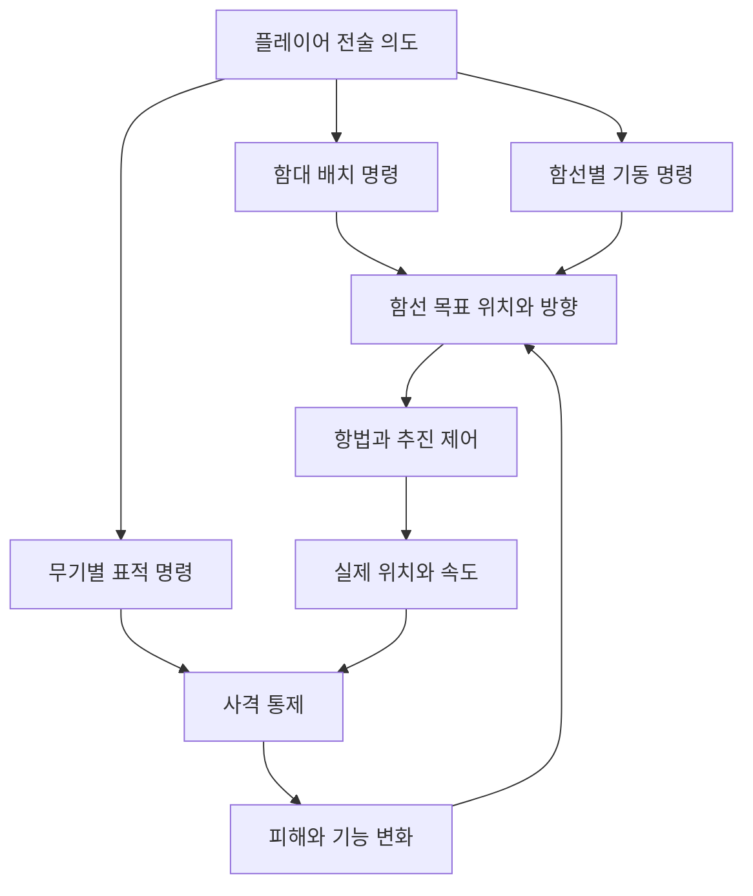

# 12. 전술 전투·함대 지휘·직접 조종

[전체 목차](README.md)

- 문서 ID: TACTICS-12
- 작성일: 2026-11-13
- 기준: 상용판 0.30.5a까지 확인한 공개 문헌. AI 내부 정책이나 자동 항법 알고리즘은 미확인이다.
- 표기: **[확인]** 문헌 규칙, **[해석]** 전략적 의미, **[제안]** 재구현 모델, **[검증 필요]** 추가 관찰 항목.

## 1. 전술 시스템의 역할

**[해석]** 함선 설계가 만들 수 있는 잠재력을 실제 전투 상황으로 바꾸는 것이 전술 시스템의 역할이다. 무기 배치가 전면 집중형이면 전면을 유지할 기동이 필요하고, 방어가 한 방향에 치우쳐 있으면 적의 접근각을 제한해야 한다. 장거리 공격은 단순 사거리 수치 외에 후진·선회·표적 추적 능력이 있어야 유지된다.

플레이어는 보통 세 수준의 결정을 오간다.

| 수준 | 결정 예 | 결과가 나타나는 시스템 |
| --- | --- | --- |
| 교전 선택 | 싸울 대상, 접근 시점, 철수 여부 | 자원·진행·위험 관리 |
| 함선 기동 | 거리, 방향, 접근 경로, 함대 배치 | 추진·사격각·보호면 |
| 부품 집중 | 표적 무기, 방어막, 동력, 연결부 | 기능 상실·연쇄 파괴 |

세 수준을 독립 메뉴로 분리하더라도 결과는 연결되어야 한다. 예를 들어 적 발전기를 표적 지정했어도 그 방향에 접근할 수 없다면 실제 타격은 어려워진다. 좋은 지휘 UI는 명령을 받았다는 사실과 명령을 수행할 수 있는지를 함께 보여 준다.

## 2. 문헌에서 확인되는 조작 범위

**[확인]** 공개 조작 문서는 RTS 방식의 명령과 Direct Control을 구분하며, 직접 조종 중에도 무기 자동 조준을 사용할 수 있는 설정을 설명한다. 사격 보류, 지정 표적 사격, 자유 사격 등의 통제 방식과 무기 그룹 선택이 제공된다. 공격 거리·각도의 기본값을 설계에 저장하는 흐름도 설명되어 있다. [B-24]

**[확인]** 설정에는 충돌 회피, 여러 함선의 속도 동기화, 공격 시 대형 이탈, 격자 기준 공격각·추종각 선택이 있다. [B-23] **[해석]** 따라서 관찰 결과를 기록할 때 설계 파일만 남기면 충분하지 않다. 같은 배치라도 이러한 설정이 달라지면 자동 항법과 함대 움직임이 달라질 수 있다.

**[확인]** Tractor Beam Emitter는 큰 물체를 밀거나 당기고 거리를 유지하는 용도로 설명되며, 자원 아이템 수집용 장치와 구분된다. [B-25] **[해석]** 상대 위치를 바꾸는 기능은 공격·방어를 직접 증가시키지 않아도 사격각과 거리 유지에 영향을 줄 수 있다.

## 3. 명령 계층 제안

다음은 원작의 내부 구조가 아니라 **[제안]**이다.



명령은 즉각적인 상태 변경이 아니라 지속되는 목표다. `Attack(target)`이 현재 속도와 거리를 무시하고 순간이동을 만들면 안 된다. 기동 능력이 부족하면 명령 수행이 지연되거나 불가능해지고, 그 이유를 상태로 반환해야 한다.

| 명령 데이터 | 내용 | 필요한 이유 |
| --- | --- | --- |
| `TargetEntityId` | 추적할 함선 또는 물체 | 화면 좌표와 분리 |
| `TargetPartId` | 집중 공격할 부품 | 적 함선 내부 목표 유지 |
| `DesiredRange` | 원하는 교전 거리 | 무기·방어 설계 반영 |
| `DesiredFacing` | 자신의 전투 방향 | 비대칭 함선 지원 |
| `ReferenceFrame` | 세계·표적 상대 기준 | 회전하는 표적 추종 해석 |
| `FormationSlot` | 함대 내 상대 위치 | 여러 함선의 배치 유지 |
| `FallbackPolicy` | 표적 소멸·접근 불가 시 행동 | 멈춤·재선택·후퇴의 일관성 |

이 필드가 실제 저장 파일에 존재한다고 주장하는 것은 아니다. 재구현에서 필요한 개념적 최소 계약이다.

## 4. 좌표계와 공격각

**[해석]** 적 함선이 회전할 때 플레이어가 원한 "적의 오른쪽"이 적 기준인지 화면의 오른쪽인지에 따라 명령 결과가 달라진다. 카메라가 회전한 결과를 게임플레이 좌표계로 혼동하면 조작이 불안정해진다.

**[제안]** 적 상대 접근점의 계산 예:

$$
p_{goal}=p_{target}+R(\theta_{target})\,o_{relative}
$$

세계 기준 접근점은 회전 변환을 적용하지 않은 일정 방향 오프셋으로 처리할 수 있다. 실제 Cosmoteer가 이런 수식을 그대로 사용한다는 뜻은 아니다. 중요한 것은 명령이 저장한 기준계를 유지하는 것이다.

| 기준 | 표적 회전 시 기대 동작 | 적합한 의도 예 |
| --- | --- | --- |
| 표적 상대 | 표적의 지정 면을 따라 접근점도 회전 | 특정 측면 계속 압박 |
| 세계 또는 격자 상대 | 접근 방향은 세계에 고정 | 다른 함선과 협공 각 유지 |
| 직접 조종 | 사용자가 추진·방향을 연속 입력 | 순간 회피·정밀 사격 |

UI는 명령 핸들과 기준계를 구별해야 한다. 카메라 회전·확대·PiP 선택은 표현 단계이고, 함선·부품 표적의 ID와 명령 기준계는 일관되게 보존하는 편이 좋다.

## 5. 교전 거리의 의미

**[해석]** 사거리가 긴 무기가 있다는 사실만으로 원거리 전투가 유지되지는 않는다. 적이 빠르게 접근하거나 자신이 후진 추력이 부족하거나 선회 중 무기 방향이 빗나가면 거리 이점이 사라질 수 있다. 따라서 거리는 정적인 속성이 아니라 상대 운동으로 계속 변하는 상태다.

**[제안]** 단순한 거리 오차는 다음과 같다.

$$
e_r=\|p_{enemy}-p_{self}\|-r_{desired}
$$

그러나 거리 오차만 줄이는 제어는 적을 향한 자세, 장애물, 아군 위치를 무시할 수 있다. 목표 함수 후보는 거리·방향·충돌 위험·사선 유지·연료나 전력 부담 등을 별도 항으로 둔다. 가중치는 함선 역할과 조종 모드에 따라 달라질 수 있다.

| 행동 후보 | 기대 이익 | 잠재 비용 |
| --- | --- | --- |
| 후퇴하며 사격 | 유리한 사거리 유지 | 후방 추진과 보급 부담 |
| 측면 선회 | 보호되지 않은 면 탐색 | 전면 화력 손실·추적 실패 |
| 접근 압박 | 짧은 사거리 화력 활용 | 장갑·요격이 버텨야 함 |
| 적 이동 제한 | 사선·접근 각도 고정 기회 | 전력·장치·기동 투자 |
| 교전 중지 | 손실과 열 축적 억제 | 상대 추격·임무 실패 가능 |

이 표는 **[해석]** 가능한 전략 관계이며 현재 최강 함선 유형이나 승률 데이터를 제시하는 것이 아니다.

## 6. 기능 표적 선정

**[제안]** 표적 부품의 가치는 부품 가격보다 현재 전투에 주는 영향으로 평가한다.

$$
V_{target}=\frac{ExpectedCapabilityLoss+CascadeValue}
{TimeToReach+TimeToDisable+ExposureCost}
$$

분모의 항들은 단위가 다르므로 실제 구현에는 정규화가 필요하다. 이 수식은 표적 선택에 고려해야 할 요소를 보여 주는 개념식이다.

| 목표 | 기대 효과 | 실패할 수 있는 이유 |
| --- | --- | --- |
| 노출 무기 | 즉시 들어오는 피해 감소 | 여러 무기가 분산되어 효과가 작음 |
| 방어막 투사기 | 보호면 약화 | 접근 전에 방어막·장갑을 통과해야 함 |
| 동력·보급원 | 다수 장치의 지속 출력 감소 | 저장 전력과 우회 보급이 남음 |
| 추진부 | 거리·방향 유지 능력 감소 | 다른 추진 방향이 충분함 |
| 연결 목 | 여러 기능 분리 가능 | 분리 후에도 해당 부분이 기능할 수 있음 |
| 방열 장치 | 장기 출력과 열 대응 약화 | 열 저장 여유·분리 열망이 충분함 |

"반드시 발전기부터 공격" 같은 단일 정답을 두지 않는다. 접근 난이도와 현재 적 화력이 높다면 가까운 무기 제거가 더 가치 있을 수 있다. 목표는 파괴 후 결과를 확인하고 바꿀 수 있어야 한다.

## 7. 함대 제어와 역할 분담

**[해석]** 여러 함선은 더 많은 방향과 역할을 제공하지만, 각 함선의 가속·선회·교전 거리·잔존 기능이 달라 조율 비용이 생긴다. 화면상 대형이 예쁘게 유지되는 것과 전투에 유리한 배치가 같은 것은 아니다.

**[제안]** 함대 역할을 검토하는 예:

| 역할 | 설계 의도 | 지휘자가 확인할 조건 |
| --- | --- | --- |
| 주력 교전함 | 적 주의를 묶고 지속 교전 | 방어·보급·열 여유 |
| 측면 공격함 | 적의 보호되지 않은 면 접근 | 단독 노출 시간과 탈출 능력 |
| 장거리 지원함 | 안전 거리에서 핵심 타격 | 아군에 가리지 않는 사선 |
| 보급·산업함 | 전투 전후 자원 운용 지원 | 전장 노출과 승무원 회수 |
| 견인·지원함 | 이동·위치 제어 보조 | 지원 장치의 전력·접근 조건 |

이는 원작의 고정 직업 분류가 아니라 사용자가 만들 수 있는 역할 설계다. 함선 이름이나 외형으로 자동 역할이 결정된다고 보지 않는다.

**[제안]** 함대 명령 충돌을 줄이려면 명령 소유권을 명확히 한다. 개별 함선에 직접 명령을 내리면 그 함선은 기존 대형 슬롯을 잠시 해제하거나 새 명령에 맞춰 갱신되어야 한다. 직접 조종 종료 후 이전 대형으로 돌아갈지 현 위치에서 대기할지도 일관된 규칙이 필요하다. 원작의 정확한 복귀 정책은 **[검증 필요]**다.

## 8. 대표 전투 검토 시나리오

**[제안]** 주력함 한 척과 측면함 한 척이 전면 방어가 강한 표적을 상대하는 시험이다.

1. 모든 함선의 비용·승무원·자원·열 상태를 기록한다.
2. 주력함은 표적 전면에서 버틸 수 있는 거리로 접근한다.
3. 측면함에는 세계 기준과 표적 상대 기준 접근 명령을 번갈아 시험한다.
4. 표적이 회전할 때 주력함·측면함의 사선과 보호면이 어떻게 바뀌는지 본다.
5. 표적 부품을 바꾸면서 기능 손실의 실제 순서를 기록한다.
6. 측면함의 추진 일부를 제거한 조건에서 철수 가능 여부를 비교한다.

필요한 지표는 승패 외에 첫 유효 측면 사격까지 시간, 핵심 기능 정지까지 시간, 주력함이 버틴 시간, 지휘 명령 수, 전투 후 복구 비용이다. 명령을 너무 자주 내리지 않아도 설계 의도가 구현되는지 함께 평가한다.

## 9. AI 재구현 후보와 한계

다음은 **[제안]** 관찰 가능한 의도를 표현하는 상태기계다.

```text
EvaluateCombatIntent(ship):
    capability = SummarizeRemainingCapabilities(ship)
    threat = EstimateIncomingThreat(ship)
    if objective permits retreat and cannot continue safely:
        return Withdraw
    target = ChooseTargetByObjectiveAndReachability()
    if target is absent:
        return HoldOrFollowFleet
    if not can reach useful firing geometry:
        return Reposition
    if weapon readiness is low and maneuver is possible:
        return RecoverOrProtect
    return EngageWithConfiguredRangeAndFacing
```

원작 AI가 체력 특정 비율에서 일괄 철수한다거나, 발전기를 우선 공격한다거나, 항상 특정 선회 방향을 택한다고 단정하지 않는다. 그런 규칙은 실제 반복 관찰 없이 쓰기 어렵다. 위 코드는 재구현을 위한 명세 초안이며, 적 함선의 성격을 데이터로 표현할 수 있게 하는 것이 목적이다.

멀티플레이에서는 일시정지·시간 배율·명령 권한·직접 조종 충돌이 별도 계약이 된다. 싱글플레이 설정을 그대로 모든 플레이어에게 적용한다고 가정하지 말고 [19장](19_Creative_Multiplayer_and_Modding.md)에서 규칙을 확인한다.

## 10. 수용 테스트와 튜닝

**[제안]** 튜닝 변수는 목표 거리 허용 오차, 방향 허용 오차, 표적 전환 비용, 장애물 회피 강도, 대형 유지 강도, 명령 중단 우선순위, 철수 정책, UI 핸들 민감도다. 원작의 값이나 실제 알고리즘으로 오인하지 않는다.

| ID | 시험 | 확인할 결과 |
| --- | --- | --- |
| TAC-01 | 표적을 180도 회전 | 세계·상대 기준 명령 차이가 일관됨 |
| TAC-02 | 카메라 회전 후 같은 표적 지정 | 게임플레이 표적·접근점 불변 |
| TAC-03 | 부품 파괴 후 집중 사격 명령 유지 | 안전한 취소·재선택 정책 |
| TAC-04 | 속도가 다른 함선에 공통 이동 명령 | 속도 동기화 설정의 차이를 기록 |
| TAC-05 | 대형 중 한 함선 직접 조종 | 명령 소유권과 복귀 정책 확인 |
| TAC-06 | 전진만 강한 함선으로 거리 유지 | 불가능한 명령 이유를 드러냄 |
| TAC-07 | 전투 중 분리·추진 손실 | 목표 기동 능력을 재평가 |
| TAC-08 | 보급·열 부족으로 화력 감소 | 명목 화력과 실제 전술 판단 분리 |

이 테스트 목록은 실행 결과가 아니며 구현·실플레이 검증 단계에서 사용할 기준이다.

## 11. 출처와 연결 문서

- [B-23] — 충돌 회피·속도 동기화·대형 이탈·기준계 설정의 존재. 내부 계산식은 제공하지 않음.
- [B-24] — RTS·Direct Control, 사격 통제, 공격 기본값 저장. 가이드의 경쟁 메타 조언은 확정 규칙으로 채택하지 않음.
- [B-25] — Tractor Beam의 위치 제어 역할과 자원 수집 장치와의 구분.

[B-23]: https://cosmoteer.wiki.gg/wiki/Settings "Settings"
[B-24]: https://cosmoteer.wiki.gg/wiki/Guides_Hub/Ship_Control "Ship Control"
[B-25]: https://cosmoteer.wiki.gg/wiki/Tractor_Beam_Emitter "Tractor Beam Emitter"

연결: [기동](07_Propulsion_and_Maneuvering.md) · [무기](08_Weapons_and_Fire_Control.md) · [방어](09_Defense_Shields_and_Point_Defense.md) · [피해](10_Damage_Fire_and_Destruction.md) · [열](11_Heat_and_Overclocking.md) · [탐사·점프](13_Sensors_Exploration_and_Hyperjump.md) · [플레이 모드](19_Creative_Multiplayer_and_Modding.md)
