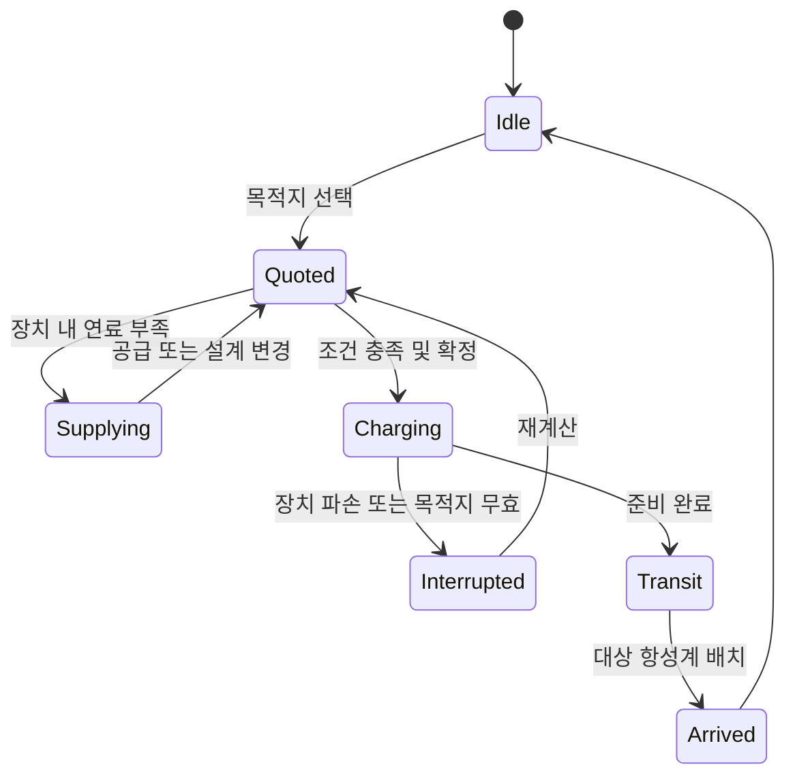

# 13. 센서·탐험·하이퍼점프 역기획

[전체 목차](README.md)

| 항목 | 범위 |
| --- | --- |
| 문서 ID | SYS-13 |
| 작성일 | 2026-11-13 |
| 기준 | 상용판 0.30.5a 문헌 기준, 현행 Career |
| 증거 수준 | 공식 위키 검색 색인·개발자 공지 확인, 게임 실행 및 설치 데이터 대조 미실시 |
| 표기 | [확인] 공개 문헌의 규칙 / [해석] 설계 의도 분석 / [제안] 재구현 모델 / [검증 필요] 불확실한 세부 |

## 1. 시스템 역할

**[해석] 이 시스템은 “어디로 갈 수 있는가”와 “무엇을 알고 출발하는가”를 함께 관리한다.** 추진기가 전투 중의 위치를 바꾼다면, 센서와 점프는 전투에 들어갈지, 어떤 자원을 회수할지, 어디에서 재정비할지를 결정한다. 정보 획득과 이동 비용이 결합되어 큰 함선을 만들수록 자동으로 편해지는 단순 확장 구조를 피한다.

플레이어는 정찰 장비·전력·승무원·점프 장치에 공간을 투자할 수 있고, 그만큼 무장이나 적재 면적이 줄어든다. 센서가 포착한 적과의 교전을 피하는 것도 전투력 활용이다. 점프 연료가 충분해도 필요한 장치가 파손되어 있거나 연료가 장치 안으로 운반되지 않았다면 출발 준비가 끝난 것이 아니다.

## 2. 확인되는 규칙과 경계

| 분류 | 공개 문헌에서 확인되는 규칙 | 설계상 의미 |
| --- | --- | --- |
| 센서 | Sensor Array는 시각 범위와 레이더 탐지 범위를 넓히며 여러 개의 효과가 단순 중첩되지 않는다. [C13-01] | 탐지와 상세 관측을 구별하고 중복 투자 효과를 명확히 한다. |
| 센서 비용 | 센서 부품에는 전력, 운영 승무원, 지휘 포인트 요구가 있다. [C13-01] | 설치 여부와 작동 여부가 다르다. |
| 점프 연료 | Hyperdrive는 Hyperium을 사용하고 승무원이 이를 장치에 공급한다. [C13-02] | 화물칸 보유량과 실제 출발 가능한 연료량을 구별한다. |
| 목적지 | 항성계 내부의 지원 목적지·친화적인 비콘 함선으로 점프할 수 있고, 항성계 간 이동에는 Hyper-Jump Relay가 관여한다. [C13-02] | 빈 좌표 어디든 점프하는 자유 순간이동으로 해석하지 않는다. |
| 효율 | 점프 장치 배치와 함선의 커버 범위가 연료 효율에 영향을 주며 편집기에 색상 표시가 있다. [C13-02] | 점프 장치의 개수만으로 경제성을 판단할 수 없다. |
| 환경 | 가스 구름은 관측을 제한하고 은폐를 제공한다. 전자 구름은 점프 출입을 막으며 이온 폭풍은 위험한 번개를 발생시킨다. [C13-03] | 탐색 지형은 이동·전투·정보를 동시에 바꾼다. |
| 탐색 편의 | “I Hate Exploring” 옵션은 미발견 관심 지점 표시를 드러내는 설정이다. [C13-04] | 관심 지점 공개와 모든 적의 실시간 위치 공개는 같은 의미가 아니다. |

**[검증 필요]** 작동 중인 여러 센서 중 어느 것을 선택하는지, 지휘 포인트 부족 시 범위가 언제 갱신되는지, 아군·협동 플레이의 관측 공유 범위는 설치 데이터 또는 실측으로 확정해야 한다. 본 문서는 센서 여러 대를 달면 거리 수치가 합산된다고 가정하지 않는다.

**버전 경계:** 0.30 이후의 센서 오버클럭은 열 관리와 연결된다. 구체적인 거리 배수는 고정하지 않는다. 항성계를 여러 소규모 섹터로 재구성하는 Career 2.0은 개발 중인 사항이며 현행 이동 체계로 기술하지 않는다. [C13-05][C13-06]

## 3. 플레이어 선택과 입력·출력

### 3.1 선택 공간

| 선택 | 즉시 얻는 이점 | 함께 발생하는 부담 |
| --- | --- | --- |
| 전투함에 센서 장착 | 스스로 교전 여부를 판단할 수 있다. | 내부 면적과 운영 인력을 사용한다. |
| 별도 정찰함 운용 | 값싼 기체로 먼저 위험을 살핀다. | 함대 지휘와 보호가 필요하다. |
| 점프 장치를 분산 | 선체의 여러 구역을 효율적으로 덮을 수 있다. | 장치 비용과 연료 보급 동선이 늘어난다. |
| 장치를 후방에 보호 | 피격으로 탈출 수단을 잃을 가능성을 줄인다. | 배치 효율과 다른 장비의 공간이 충돌한다. |
| Hyperium 비축 확대 | 연속 작전과 귀환의 여유가 생긴다. | 수익성 화물과 보급품의 적재 공간을 차지한다. |
| 위험 구름 경유 | 경로 단축·은폐 등 상황별 기회를 얻는다. | 관측 저하, 장비 약화, 점프 제한을 감수한다. |

이 표의 유불리는 **[해석]**이며 특정 함선 설계의 최적해를 보장하지 않는다.

### 3.2 시스템 계약 [제안]

| 제공 주체 | 들어오는 데이터 | 이 시스템의 출력 |
| --- | --- | --- |
| 선체·부품 | 부품 배치, 작동 여부, 통제 가능 여부 | 유효 센서·점프 능력 |
| 승무원·물류 | 공급 완료량, 장치 조작 상태 | 연료 공급 요구, 준비 대기 이유 |
| 은하·환경 | 항성계 연결, 목적지 비콘, 구름 상태 | 유효 목적지 목록과 위험 설명 |
| 함대 명령 | 이동 대상, 대상 함선 집합 | 함선별 준비 상태와 이동 결과 |
| UI | 탐색·귀환·점프 확정 입력 | 가시 영역, 탐지 신호, 비용 미리보기 |

“지도를 열면 실제 적 개체를 바로 참조한다”는 구현을 피하고, 플레이어에게 공개된 지식과 세계의 실제 상태를 분리한다. 이는 코스모티어 내부 코드에 대한 주장이 아니라 정보 누출을 방지하는 재구현 원칙이다.

## 4. 정보 표현 모델 [제안]

정보는 세 단계로 나눈다.

1. **세계 상태:** 실제 함선, 소행성, 정거장, 자원, 위험 구름의 존재.
2. **관측 상태:** 현재 센서로 포착한 신호와 상세히 볼 수 있는 대상.
3. **기억 상태:** 이미 발견했으나 현재는 관측되지 않는 관심 지점과 과거 위치.

정적 정거장 위치를 발견한 뒤 기억하는 일과 이동하는 적의 현재 위치를 아는 일은 다르다. 따라서 UI는 “마지막으로 관측한 위치”를 실제 추적 표시와 구별해야 한다. 본 제안의 기억 갱신 방식이나 잔상 시간은 원작 확인 규칙이 아니다.

| 제안 데이터 | 핵심 필드 | 보존 정책 |
| --- | --- | --- |
| SensorCapability | visualRange, radarRange, operational, modifiers | 부품 상태에서 재계산 |
| Contact | objectId, knowledgeLevel, lastSeenTime, lastSeenPosition | 실제 개체와 관측 기록 분리 |
| Discovery | pointOfInterestId, discoveredBy, discoveryTime | 저장 가능 |
| JumpTarget | targetId, systemId, eligibility, invalidReason | 점프 확정 직전 재검증 |
| TravelPlan | participatingShips, target, fuelQuotes | 다수 함선의 준비 상태를 따로 관리 |

가시성 업데이트는 모든 대상과 모든 함선을 매 프레임 비교하기보다 공간 인덱스로 후보를 줄이는 방법이 적합하다. 원거리 신호와 근거리 상세 관측의 갱신 주기를 달리하는 것도 가능하지만, 전투 중 대상이 보였다 사라지는 지연은 별도의 품질 기준으로 관리한다.

## 5. 점프 상태와 자원 처리 [제안]

다음은 구현을 위한 상태 구분이며 원작 내부 클래스나 정확한 순서를 복원한 것이 아니다.



원작의 항성계 내부 점프와 항성계 간 충전 절차는 동일한 시간 모델이라고 단정하지 않는다. 위 상태도는 공통 검증 지점을 표현한다.

**연료 예약은 두 번 차감하지 않는다.** 미리보기 때는 소비 예상량만 보여 주고, 확정 시에는 사용할 장치별 연료를 예약한다. 이동 완료 또는 취소 시 예약의 확정·해제를 한 번만 수행한다. 충전 중 함선 개조, 함선 분리, 장치 토글 등으로 유효 비용이 바뀔 때는 이전 예약을 추적할 수 있어야 한다.

```text
QuoteJump(ship, target):
    validate control, destination and environment
    activeDrives = operational drives belonging to this ship
    cost = configuredCostModel(ship, target, activeDrives)
    readyFuel = sum(storedUsableFuel in activeDrives)
    report cost, readyFuel, cargoFuel, blockingReasons

CommitJump(quote):
    revalidate the quote against the current ship revision
    reserve fuel by drive identity
    when transition succeeds, consume exactly the reserved fuel
    on failure, release reservations under an explicit refund policy
```

게임이 실제로 어느 시점에 연료를 차감하거나 환불하는지는 **[검증 필요]**다. 특히 파괴된 장치 안의 연료와 정상 취소의 환불을 같은 처리로 구현하면 자원 복제 문제가 생긴다.

## 6. 효율·비용 분석 모델 [제안]

정확한 원작 효율식을 사용하지 않고 비교 실험용 모델을 둔다.

    유효 커버율 = Σ(부품별 중요도 × 커버 계수) / Σ부품별 중요도
    점프 비용 = 기본 경로 비용 × 선체 규모 계수 × 효율 페널티
    준비 시간 = max(연료 공급 완료 시간, 충전 완료 시간, 기타 필수 대기)

커버 계수는 0~1로 제한하고, 장치 간 겹침의 처리 방식은 설정으로 둔다. **이 식의 중요도, 질량 반영, 거리 함수, 중복 합산 규칙은 모두 제안**이다. 위키에는 효율식이 제시되어 있으나 클램프·가중·적용 대상 정의가 충분하지 않아 정확한 현행 엔진 공식으로 채택하지 않는다.

색상지도에서는 비용에 영향을 주는 효율과 실제 열 상태를 다른 팔레트·이름으로 보여 준다. 점프 편집기의 “heat map”이라는 시각화 표현을 0.30 열 시뮬레이션과 혼동해서는 안 된다.

### 튜닝 항목

| 항목 | 올리면 발생하는 변화 | 기록할 지표 |
| --- | --- | --- |
| 기본 관측 범위 | 선제 판단과 안전한 우회 증가 | 기습 전투 비율 |
| 레이더·시각 범위 차이 | 신호를 보고 확인하러 가는 구간 증가 | 신호 확인까지의 시간 |
| 장거리 점프 비용 | 원정 준비의 중요도 증가 | 왕복당 연료비, 귀환 포기율 |
| 효율 배치 보상 | 장치 배치가 경제 설계에 미치는 영향 증가 | 같은 질량 대비 비용 분산 |
| 목적지 밀도 | 이동 편의와 탐색 선택지가 증가 | 이동 시간 대비 활동 시간 |
| 위험 구역 회피 비용 | 우회와 관통의 선택이 더 뚜렷해짐 | 위험 경로 선택률 |

## 7. 대표 플레이 시나리오 [해석]

플레이어가 손상된 전투함과 자원을 실은 보조함을 귀환시키려 한다. 전투함에는 연료가 충분하지만 보조함의 Hyperium은 창고에만 있고 장치 내부가 비어 있다. 함대 총량만 표시하면 “연료는 있는데 점프가 안 된다”는 혼란이 생긴다.

좋은 피드백은 함선별로 **보유 연료 / 장치 내 준비 연료 / 예상 소비량**을 나눠 보여 주고, 보조함이 기다리는 이유를 “Hyperdrive로 연료 운반 중”처럼 설명하는 것이다. 이후 적의 접근 신호가 나타나면 보조함의 공급을 기다릴지, 전투함으로 엄호할지, 장비를 조정할지 선택하게 된다. 이동 UI가 내부 물류의 결과를 설명해야 하는 이유다.

정찰 시나리오에서는 구름 바깥에서 보이는 신호, 구름에 들어가 줄어드는 시야, 공격으로 변하는 노출 상태가 함께 작용한다. 이는 센서가 전투 사거리 수치 하나에 종속되지 않고 상황 판단 수단으로 기능한다는 해석을 뒷받침한다.

## 8. 수용 테스트 및 실측 과제

아래는 **[제안] 재구현 수용 기준**이며 원작에서 실행한 테스트 결과가 아니다.

| ID | 조건·행동 | 기대 결과 |
| --- | --- | --- |
| EXP-01 | 센서 1개와 2개를 동일 조건에서 비교 | 문헌의 비중첩 규칙을 유지하고 중복 배치로 범위가 단순 합산되지 않는다. |
| EXP-02 | 센서 전력·운영 조건 중 하나를 제거 | 능력 변화가 UI와 탐지 결과에 일관되게 반영된다. |
| EXP-03 | 창고 연료는 충분하고 점프 장치는 비어 있음 | 준비 부족 이유를 표시하며 장치 내 공급량을 별도로 계산한다. |
| EXP-04 | 함선 개조로 점프 장치 배치가 변경됨 | 이전 비용 견적을 무효화하고 효율·비용을 다시 계산한다. |
| EXP-05 | 충전 중 목적지 비콘이 사라짐 | 잘못된 위치로 이동하거나 연료가 중복 차감되지 않는다. |
| EXP-06 | 여러 함선 중 한 척만 준비가 안 됨 | 함선별 상태와 일괄 명령의 처리 정책이 명시된다. |
| EXP-07 | 전자 구름 안팎에서 점프 시도 | 환경에 의한 제한을 식별 가능한 이유로 반환한다. |
| EXP-08 | 저장·불러오기 후 미발견·발견 지점 비교 | 탐색 기억과 실시간 관측을 혼합하지 않는다. |

원작 실측 우선순위는 ① 점프 시 연료 차감 시점, ② 여러 점프 장치의 효율 합산 방식, ③ 파손·분리 중 점프 처리, ④ 협동 관측 공유, ⑤ 센서 오버클럭과 구름 효과의 결합 순서다.

## 9. 연결 문서

- [07. 추진과 기동](07_Propulsion_and_Maneuvering.md): 일반 이동과 점프의 역할 분리.
- [05. 내부 물류](05_Internal_Logistics_and_Supply.md): Hyperium의 실제 장치 공급.
- [11. 열과 오버클럭](11_Heat_and_Overclocking.md): 센서 확장과 환경 열 위험.
- [16. 임무·명성·진영](16_Career_Missions_Fame_and_Factions.md): 관심 지점과 원정 동기.
- [18. UI·UX](18_UI_UX_and_Player_Feedback.md): 관측 수준과 출발 준비의 가시화.

## 10. 출처와 적용 범위

공식 위키는 일부 오래된 문구가 남아 있어, 본문에서는 구조적 규칙만 채택했다. 직접 열기 제한이 있었던 페이지는 검색 색인에 노출된 본문을 사용했다.

- **C13-01** [Sensor Array — Official Cosmoteer Wiki](https://cosmoteer.wiki.gg/wiki/Sensor_Array): 시각·레이더 확대, 비중첩, 운영 요구.
- **C13-02** [Hyperdrives — Official Cosmoteer Wiki](https://cosmoteer.wiki.gg/wiki/Hyperdrives): 목적지, 연료, 장치 내 적재, 배치 효율. 불완전한 효율식은 채택하지 않음.
- **C13-03** [Clouds and Storms — Official Cosmoteer Wiki](https://cosmoteer.wiki.gg/wiki/Gas_clouds): 가스·전자 구름·이온 폭풍의 기능. 수치 배수는 채택하지 않음.
- **C13-04** [Menu Screens — Official Cosmoteer Wiki](https://cosmoteer.wiki.gg/wiki/Guides_Hub/Menu_Screens): 탐색 편의 설정.
- **C13-05** [Meltdown Update 0.30.0 — 개발자 공지](https://store.steampowered.com/news/posts/?appids=799600&enddate=1756769273&feed=steam_community_announcements): 센서 오버클럭 및 열 체계 도입.
- **C13-06** [Career 2.0 Development Update — 공식 뉴스 목록](https://steamcommunity.com/app/799600/allnews/?l=english): 2026-10-30 공지, 섹터 재구성은 개발 중.

<!-- 문서 내 출처 링크 -->
[C13-01]: https://cosmoteer.wiki.gg/wiki/Sensor_Array
[C13-02]: https://cosmoteer.wiki.gg/wiki/Hyperdrives
[C13-03]: https://cosmoteer.wiki.gg/wiki/Gas_clouds
[C13-04]: https://cosmoteer.wiki.gg/wiki/Guides_Hub/Menu_Screens
[C13-05]: https://store.steampowered.com/news/posts/?appids=799600&enddate=1756769273&feed=steam_community_announcements
[C13-06]: https://steamcommunity.com/app/799600/allnews/?l=english
