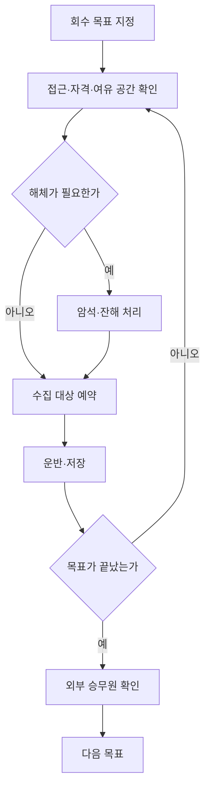

# 14. 자원·채광·잔해 회수 역기획

[전체 목차](README.md)

| 항목 | 범위 |
| --- | --- |
| 문서 ID | SYS-14 |
| 작성일 | 2026-11-13 |
| 기준 | 상용판 0.30.5a 문헌 기준, 현행 Career |
| 증거 수준 | 공개 문헌 확인, 실제 플레이·드롭률 측정 미실시 |
| 표기 | [확인] 공개 규칙 / [해석] 설계 분석 / [제안] 재구현 모델 / [검증 필요] 미확정 세부 |

## 1. 시스템 역할

**[해석] 채광과 잔해 회수는 함선 개조 비용을 공간에 존재하는 작업으로 바꾸는 시스템이다.** 전투에서 승리하면 보상이 곧바로 완성된 장비로 들어오는 것이 아니라, 남은 잔해와 부유 자원을 확보하고 운반해야 한다. 전투 함선의 승리와 작전 전체의 수익은 서로 다르다.

채광은 전투 외 성장 경로를 제공하지만 탐색·채굴 장비·수집 인력·창고·이동 시간이 필요하다. 잔해 회수는 적 함선을 어떤 순서로 무력화했는지에 따라 후속 작업과 회수 가치가 달라질 수 있다. 이 연결 때문에 전투 표적 선정이 경제적 선택이 된다.

## 2. 확인되는 자원과 획득 규칙

| 항목 | 문헌상 확인 | 적용 경계 |
| --- | --- | --- |
| 자원 분류 | 원광, 가공 자원, 탄약 계열로 구분되며 채광·잔해·생산·거래로 확보한다. [C14-01] | 전지를 일반 화물과 동일하게 취급하지 않는다. |
| Hyperium | 원광 상태로 점프 연료에 사용된다. [C14-02] | 모든 원광이 먼저 공장 가공을 거친다는 규칙은 아니다. |
| Mining Laser | 소행성 채굴과 잔해 해체를 지원하며 승무원이 직접 처리하지 못하는 단단한 암석을 처리한다. [C14-03] | 적 함선 전투 성능과 채광 성능은 같은 수치가 아니다. |
| 채광 경로 | 레이저는 표적까지 사이에 있는 암석을 제거해야 하므로 접근 각도가 중요하다. [C14-03] | 선택한 광물만 장애물을 통과해 즉시 제거하는 방식이 아니다. |
| 수집 보조 | Manipulator Beam Emitter는 자원 수집과 우주 공간 승무원 이동을 돕는다. [C14-04] | 과거 Resource Collector는 0.26.2에 대체되었다. |
| 작업 명령 | 전체 소행성·잔해에 채광·회수 명령을 주고 여러 명령을 대기열에 넣을 수 있다. [C14-05] | 정확한 단축키는 사용자 설정에 따라 달라진다. |
| 함선 확보 | 버려진 함선이나 잔해에 승무원을 옮겨 함대에 편입할 수 있다. [C14-06] | 소유권 확보와 곧바로 정상 운항 가능함은 별개다. |
| 함외 활동 | 승무원은 에어록을 통해 밖에서 작업하며 산소가 부족하면 복귀해야 한다. [C14-06] | 무한 거리에서 영구적으로 활동하는 드론으로 모델링하지 않는다. |

자원 드롭률은 **[검증 필요]**다. 플레이어가 건조한 부품, 적 함선 잔해, 이미 손상된 유기 함선, 경제 난이도와 버전 변경을 같은 고정 비율로 묶지 않는다. 0.30에서도 일부 자원 회수량 관련 조정이 있었으므로 “부품 가격의 몇 %가 항상 반환된다”는 보편식은 채택하지 않는다.

## 3. 자원 상태를 구별해야 하는 이유 [해석]

회수할 자원이 보이더라도 그 자원이 이미 함선의 사용 가능한 재고인 것은 아니다. 구분해야 할 상태는 다음과 같다.

| 상태 | 예 | 플레이어가 기대하는 표시 |
| --- | --- | --- |
| 원천에 포함됨 | 소행성 광맥, 아직 해체하지 않은 잔해 | 예상 획득 대상 |
| 외부에 방출됨 | 우주 공간의 부유 자원 | 수집 대기량 |
| 운반 중 | 승무원 또는 수집 수단이 이동 중 | 도착 예정량 |
| 저장됨 | 화물칸 또는 사용 장치 내부 | 현재 이용 가능한 재고 |
| 예약됨 | 건조·생산·거래에 이미 배정된 수량 | 다른 작업에 쓸 수 없는 수량 |
| 소모됨 | 부품 건조·탄약 사용·점프 소비 | 과거 지출 이력 |

이 구분은 **[제안] 데이터 모델**이다. 원작 내부에 같은 이름의 상태나 예약 시스템이 있다는 뜻은 아니다. 중요한 사용자 경험은 “자원이 근처에 많은데 왜 수리가 안 되는가”를 설명할 수 있다는 점이다.

## 4. 플레이어의 주요 선택

### 4.1 무엇을 회수할 것인가 [해석]

잔해의 모든 자원을 가져오면 총가치는 늘 수 있지만, 왕복·수집 시간이 길어지고 전투용 화물 공간을 잠식한다. 철강만 가득 실어 고급 부품이나 점프 연료를 실을 자리가 없어진다면 단순한 빈 창고 면적 지표는 충분하지 않다.

자원 가치는 판매 가격뿐 아니라 현재 개조 계획의 병목인지, 다음 정거장에서 구입할 수 있는지, 함대가 어느 자원을 반복적으로 소비하는지에 따라 달라진다. 낮은 단가의 탄약 재료가 전투 지속성을 지키는 마지막 재고라면 높은 단가의 판매용 광물보다 우선순위가 높다.

### 4.2 해체할 것인가, 확보할 것인가 [해석]

| 선택 | 이점 | 비용·위험 |
| --- | --- | --- |
| 현장에서 전부 해체 | 현재 함선의 개조 자원을 확보한다. | 수집 시간이 들고 새 함선 플랫폼을 잃는다. |
| 승무원을 보내 확보 | 별도의 수송·채광·전투 플랫폼을 얻는다. | 승무원을 나눠야 하고 수리·추진·보급이 필요하다. |
| 일부만 회수 후 이탈 | 위험 노출 시간을 줄인다. | 남은 자원은 나중에 다시 접근해야 한다. |
| 전투부대와 회수부대 분리 | 주력 함선의 장비·인력을 전투에 집중한다. | 회수함을 호위하고 함대 명령을 관리해야 한다. |

함선 확보 판정의 필수 부품, 적 승무원 잔존 여부, 연결된 잔해 조각의 소유권 전이는 실측 대상이다. “조종실만 부수면 모든 함선을 즉시 나포한다”는 단순 규칙으로 쓰지 않는다.

## 5. 입출력과 작업 의존성 [제안]

| 의존 시스템 | 받는 정보 | 돌려주는 정보 |
| --- | --- | --- |
| 센서·탐험 | 알려진 자원·잔해·위험 위치 | 회수 목표와 접근 후보 |
| 함선 이동 | 접근 가능 거리와 정지 위치 | 다음 작업 위치 요청 |
| 승무원 AI | 사용 가능한 함외 인력, 귀환 가능성 | 채굴·수집·귀환 작업 |
| 저장·물류 | 종류별 여유 공간과 상한 | 획득 예약·반입 완료 |
| 손상·파괴 | 남아 있는 부품과 드롭 이벤트 | 해체 작업, 잔해 자원 생성 |
| 건조·경제 | 필요한 자원 목록과 우선순위 | 실제 공급 가능량 |

함선이 다음 소행성으로 이동하는 시점은 단순히 레이저 표적이 없어졌을 때로 두면 안 된다. 외부에 승무원이 남았는지, 이전 목표의 반입이 끝났는지, 긴급 전투 명령이 들어왔는지까지 함께 다뤄야 한다. 원작 옵션별 자동 소집·명령 대기열의 세부는 별도 검증한다.

## 6. 획득 작업 상태 [제안]

### 예외 처리

- **목표 소멸:** 다른 함선이 먼저 채굴·회수했거나 폭발로 잔해가 사라지면 작업을 재평가한다. 실패한 목표를 영구 재시도하지 않는다.
- **적재 불가:** 화물칸 전체가 비어 보여도 해당 자원 지정 슬롯이나 자원 상한이 없으면 대기 사유를 명확히 한다.
- **작업자 귀환:** 산소·거리·긴급 이탈을 이유로 작업을 중단할 때 대상 예약을 해제한다.
- **전투 전환:** 수집 작업보다 전투 임무가 우선하는 설정에서는 외부 인력 상태를 경고하고 소집 정책을 적용한다.
- **목표 소유권 변경:** 회수 대상으로 보던 잔해가 아군 함선으로 확보되면 파괴적 작업을 재검증한다.
- **부품 분리:** 기존 함선의 한 조각이 독립 객체가 되면 작업 대상의 좌표계와 소유자를 다시 연결한다.

위 정책은 재구현에서 필요한 계약이며 원작의 정확한 자동 취소 조건을 확정한 목록이 아니다.

## 7. 처리량과 수익의 분석 모델 [제안]

    실효 회수량/초 = min(채굴·해체 산출률, 수집 운반률, 저장 수용률)
    회수 순가치 = 획득 자원의 대체 구매가치 - 직접 소비 - 예상 손실
    시간당 회수 가치 = 회수 순가치 / (탐색 + 접근 + 해체 + 수집 + 귀환 시간)

직접 소비에는 해당 작업의 실제 소모품을 넣고, “승무원 월급”처럼 확인되지 않은 원작 비용을 추가하지 않는다. 승무원과 장치의 기회비용은 별도의 분석 항목으로 둔다.

### 가정 예시

채굴 장비의 산출량을 분당 120 단위, 운반을 분당 60 단위, 저장을 분당 90 단위라고 가정하면 실효 처리량의 상한은 분당 60 단위다. 채굴 장비를 두 배로 늘려도 이 병목은 없어지지 않는다. 수집 능력 또는 접근 위치를 개선해 운반을 분당 100 단위로 올리면 그때는 저장 수용률 90이 다음 병목이 된다.

**모든 수치는 설명용 가정이며 게임 측정값이 아니다.** 이 예시는 공장 생산과 같은 최소 처리량 모델을 외부 자원 획득에도 적용할 수 있음을 보여 준다.

### 공통 화폐 단위로 환산한 자원 선택 평가액의 예

    평가액[Credits] =
        필요도 가중치[무차원] × 목표 자원의 대체 구매가치[Credits] × 획득 확률[0~1]
        - 예상 위험 손실액[Credits]
        - 소요 시간[s] × 시간 기회비용[Credits/s]
        - 적재 기회비용[Credits]

비교 단위는 회수 작업 목표 하나로 통일한다. 위험 손실액은 해당 작업 때문에 발생할 수 있는 수리·자원 손실의 기대 비용이며, 시간 기회비용은 같은 시간에 다른 활동으로 얻을 수 있었던 가치를 환산한 계수다. 적재 기회비용은 그 화물을 싣느라 포기한 다른 화물의 평가액이다. 모든 가감 항의 단위가 Credits이므로 화폐와 시간을 직접 빼지 않는다. 필요도 가중치를 적용한 평가액은 의사결정용 효용이며 실제 장부상 순이익과는 다르다.

이는 자동화 선택 알고리즘 제안이다. 원작 수집 AI가 이런 평가액을 계산해 우선순위를 결정한다는 뜻은 아니다. 시간가치·위험 예측·필요도는 재구현자가 정의할 변수이며, 사용자 지정 우선순위가 존재할 경우 그 입력을 우선 반영한다.

## 8. 대표 시나리오와 설계 의도

### 전투 후의 선택 [해석]

적 함선을 무력화한 뒤 주력 함선의 전면 장갑이 손상되었고, 창고에는 다음 교전에 쓸 탄약이 부족하다. 잔해에는 다양한 재료가 있지만 수리용 재료를 먼저 확보해야 안전한 귀환이 가능하다. 플레이어는 회수량 최대화보다 함선의 즉시 기능 회복을 우선한다.

이때 “모두 수집”과 “현재 개조·수리에 필요한 자원 우선”은 다른 목표다. 후자를 지원하는 인터페이스를 구현한다면 현재 필요량, 예약량, 실제 반입량을 연결해야 한다. 코스모티어에서 영감을 얻은 재구현에서는 건조 계획을 수집 계획의 입력으로 삼는 방식이 유효하다.

### 채광 전용함의 성장 [해석]

처음에는 채광 속도가 느리지만 장비를 추가한 뒤에는 수집 인력이 병목이 되고, 인력을 늘리면 화물칸이 먼저 찬다. 화물칸을 늘리면 이동·회전·방어 부담이 커진다. 이는 성장하면서 같은 지표만 반복적으로 올리는 구조보다 병목이 순환하는 구조다.

### 태양 근처 자원의 주의점 [확인·검증 필요]

오래된 태양 채광 가이드는 현재 열 시스템과 다를 수 있다. 0.30 변경 이력은 태양이 함선에 직접 피해를 주던 방식에서 열을 적용하는 방식으로 바뀌었다고 설명한다. 따라서 옛 가이드의 실드 수·발전기 수를 현행 보장 설계로 사용하지 않는다. 실제 태양 열량, 실드의 열 차단, 함외 승무원 위험은 [11번 문서](11_Heat_and_Overclocking.md)와 함께 실측해야 한다. [C14-07]

## 9. 튜닝 항목과 위험

| 변수 | 높였을 때의 효과 | 과도할 때 발생하는 문제 |
| --- | --- | --- |
| 기본 잔해 수율 | 전투 후 회복과 성장 가속 | 손실 비용이 희미해지고 경제가 빠르게 포화 |
| 고급 자원 희소성 | 원정·특정 목표의 동기 강화 | 필요한 개조를 장기간 못 하는 정체 |
| 채굴 속도 | 눈앞의 반복 작업 단축 | 수집 병목만 커지고 장비 투자 만족도 저하 |
| 수집 지원 범위 | 재배치 횟수 감소 | 위험 지역 바깥에서 자원을 안전하게 모두 흡수 |
| 창고 효율 | 회수 여행 횟수 감소 | 운송선 역할과 적재 선택 약화 |
| 외부 작업 위험 | 호위와 이탈 판단 강화 | 귀환 AI의 작은 오류가 과도한 손실로 이어짐 |

밸런스 측정에는 단순 획득량 외에 **자원 1단위당 작업 시간, 함외 승무원 체류 시간, 원정당 회수 중단 횟수, 저장 제한으로 발생한 대기 시간**을 포함한다.

## 10. 수용 테스트 [제안]

| ID | 조건·행동 | 기대 결과 |
| --- | --- | --- |
| RES-01 | 단단한 암석 안에 광물을 배치하고 승무원만 투입 | 처리 불가 이유를 표시하며 레이저 필요 조건을 유지한다. |
| RES-02 | 목표 광물과 레이저 사이에 암석 배치 | 장애물 처리 순서가 보이며 순간 관통 채굴하지 않는다. |
| RES-03 | 두 함선이 같은 부유 자원 수집 | 단일 자원을 중복 반입하거나 음수 수량으로 만들지 않는다. |
| RES-04 | 자원별 상한에 도달한 채 회수 명령 유지 | 초과 반입을 막고 남은 목표의 대기 이유를 표시한다. |
| RES-05 | 수집 중 함선을 이동시키고 승무원을 귀환시킴 | 예약·목표·외부 인원 표시가 일관되게 정리된다. |
| RES-06 | 잔해 확보와 해체 명령이 충돌 | 소유권을 재확인하고 의도하지 않은 새 아군 해체를 방지한다. |
| RES-07 | 저장 중 또는 운반 중 게임 저장·불러오기 | 수량이 보존되고 작업이 복제되지 않는다. |
| RES-08 | 같은 잔해를 난이도·소유 기원별로 비교 | 설정한 수율 규칙이 적용되며 총 반환이 원천량을 넘지 않는다. |

## 11. 연결 문서

- [10. 손상·화재·파괴](10_Damage_Fire_and_Destruction.md): 잔해 생성과 자원 소실.
- [04. 승무원과 작업 AI](04_Crew_Roles_and_Task_AI.md): 함외 활동과 작업 전환.
- [13. 센서·탐험·점프](13_Sensors_Exploration_and_Hyperjump.md): 자원 위치 발견과 원정.
- [15. 생산·저장·거래](15_Manufacturing_Storage_and_Trade.md): 반입 이후의 변환·소비.
- [17. 성장과 밸런스](17_Progression_and_Balance.md): 전투·채광의 성장 속도 비교.

## 12. 출처와 적용 범위

- **C14-01** [Resources — Official Cosmoteer Wiki](https://cosmoteer.wiki.gg/wiki/Resources): 자원 분류와 획득 경로.
- **C14-02** [Hyperium — Official Cosmoteer Wiki](https://cosmoteer.wiki.gg/wiki/Hyperium): 원광 점프 연료의 역할.
- **C14-03** [Mining Laser — Official Cosmoteer Wiki](https://cosmoteer.wiki.gg/wiki/Mining_Laser): 단단한 암석, 접근 경로, 해체 기능. 상충하는 인포박스 피해 수치는 채택하지 않음.
- **C14-04** [Manipulator Beam Emitter — Official Cosmoteer Wiki](https://cosmoteer.wiki.gg/wiki/Manipulator_beams): 수집·승무원 이동 지원 및 Resource Collector 대체 이력.
- **C14-05** [0.28.0 개발자 패치 노트 — Steam 공식 뉴스](https://store.steampowered.com/news/posts/?appids=799600&enddate=1736901638&feed=steam_community_announcements): 전체 잔해·소행성 작업 명령과 대기열.
- **C14-06** [Crew — Official Cosmoteer Wiki](https://cosmoteer.wiki.gg/wiki/Crew): 함외 활동·산소·유기 함선으로 승무원 이전.
- **C14-07** [0.30.0 개발자 패치 노트](https://store.steampowered.com/news/posts/?appids=799600&enddate=1756769273&feed=steam_community_announcements): 태양의 열 적용과 자원 수율 조정. 변경 도입 근거이며 모든 후속 수치를 보장하지 않음.

<!-- 문서 내 출처 링크 -->
[C14-01]: https://cosmoteer.wiki.gg/wiki/Resources
[C14-02]: https://cosmoteer.wiki.gg/wiki/Hyperium
[C14-03]: https://cosmoteer.wiki.gg/wiki/Mining_Laser
[C14-04]: https://cosmoteer.wiki.gg/wiki/Manipulator_beams
[C14-05]: https://store.steampowered.com/news/posts/?appids=799600&enddate=1736901638&feed=steam_community_announcements
[C14-06]: https://cosmoteer.wiki.gg/wiki/Crew
[C14-07]: https://store.steampowered.com/news/posts/?appids=799600&enddate=1756769273&feed=steam_community_announcements
