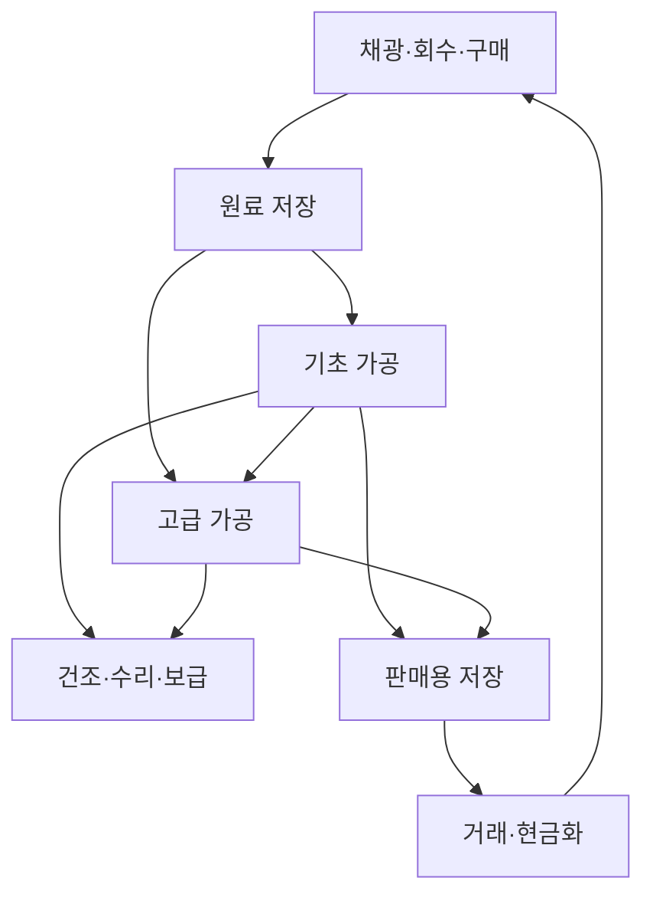

# 15. 생산·저장·거래 역기획

[전체 목차](README.md)

| 항목 | 범위 |
| --- | --- |
| 문서 ID | SYS-15 |
| 작성일 | 2026-11-13 |
| 기준 | 상용판 0.30.5a 문헌 기준, 현행 Career |
| 증거 수준 | 공개 문헌 확인, 생산·물류 수치 실측 미실시 |
| 표기 | [확인] 문헌 규칙 / [해석] 설계 분석 / [제안] 재구현 모델 / [검증 필요] 미확정 사항 |

## 1. 시스템 역할

**[해석] 생산은 자원의 종류를 바꾸고, 저장은 다음 행동의 여유를 만들며, 거래는 원정의 결과를 다음 설계 투자로 전환한다.** 세 기능은 별개 메뉴처럼 보이지만 같은 자원을 놓고 경쟁한다.

예를 들어 Coils를 모두 판매하면 즉시 Credits는 늘지만, 개조와 고급 자원 생산이 중단될 수 있다. 화물칸을 일반 수집용으로만 사용하면 전투 보급품을 실을 공간이 사라질 수 있다. 공장을 늘리면 제조 잠재력은 커지지만 전력·운반·원료·출력 공간이 함께 늘지 않으면 실효 생산량은 늘지 않는다.

따라서 이 시스템의 핵심 지표는 “공장 개수”나 “총 자산”보다 **지속 가능한 보급량, 사용할 수 있는 재고, 현금화에 걸리는 시간**이다.

## 2. 확인 규칙

### 2.1 공장과 변환

| 예시 | 문헌에서 확인되는 변환 | 적용 범위 |
| --- | --- | --- |
| Steel Smelter | Iron을 Steel로 가공한다. [C15-01] | 구조·수리 자원 공급 사례 |
| Coil Factory | Copper를 Coils로 가공한다. [C15-02] | 기초 전자 부품 생산 사례 |
| Hyper-Coil Factory | Coils와 Copper를 사용해 Hyper-Coils를 만든다. [C15-03] | 전 단계 결과물을 재투입하는 생산 사슬 |
| 공장 인접 배치 | 위 공장 문헌은 인접 공장당 생산 속도 보너스를 명시한다. [C15-01] [C15-02] [C15-03] | 접촉 판정·누적 계산은 데이터 검증 대상 |
| 공장 오버클럭 | 0.30에서 다수 공장의 고속 생산과 폐열 생성이 추가되며 Diamond Smelter는 예외로 구분된다. [C15-04] | 오버클럭이 없는 공장까지 임의로 확대하지 않는다. |

기본 변환 사례로 Iron 1 → Steel 1, Copper 1 → Coils 1, Coils 2 + Copper 0.5 → Hyper-Coils 1이 위키에 제시되어 있다. **[확인: 문헌 수치]**이며 마지막 비율을 정수 단위 작업으로 표현할 경우 배치를 두 배로 묶을 수 있다. 실제 내부 자원 단위·반올림은 **[검증 필요]**다. 공장 내부 저장량, 순간 생산률, 오버클럭 배수는 여기서 고정하지 않는다.

### 2.2 저장과 거래

| 항목 | 문헌에서 확인되는 규칙 |
| --- | --- |
| 저장 슬롯 | Storage Bay의 타일마다 한 자원 종류를 저장하며 종류에 따라 스택 크기가 다르다. 일반 화물칸에는 전력 배터리를 저장하지 않는다. [C15-05] |
| 슬롯 지정 | 특정 자원을 위한 저장 타일 지정과 공급 연결을 설정할 수 있다. [C15-05] |
| 최대 수량 | 자원별 저장 상한은 수집·거래·이전·생산이 그 수량을 초과하지 못하게 한다. [C15-06] |
| 목표 수량 | Desired 수량은 공장 생산 허용량과 필요·잉여 자원 거래에 사용된다. [C15-07] |
| 거래 한도 | 정거장의 재고와 수용 공간이 거래 가능한 양을 제한한다. [C15-08] |
| 통화 | Credits는 임무 보상과 자원 판매 등으로 얻으며 자원·설계도·승무원 확보에 사용한다. [C15-09] |

가격을 설명할 때는 기본 가격, 경제 난이도, 진영 평판을 구별한다. 평판 영향은 [16번 문서](16_Career_Missions_Fame_and_Factions.md)를 따른다. 공급·수요에 따라 은하 전체의 가격이 동적으로 움직이는 경제를 현행 기능으로 가정하지 않는다. 개발자가 Dynamic Economy를 이후 Career 2.5 범위로 분리한 상태이기 때문이다. [C15-10]

## 3. 재고 계층과 의사결정 [해석·제안]

### 3.1 같은 자원도 용도를 구별한다

| 재고 용도 | 플레이어 목적 | 부족할 때 나타나는 결과 |
| --- | --- | --- |
| 전투 보급 | 탄약·소모품을 유지 | 무장이 남아 있어도 지속 사격 불가 |
| 복구 예비 | 손상 수리와 필수 장비 재건 | 승리 후 다음 전투를 진행하지 못함 |
| 이동 예비 | 점프·원정 유지 | 수익은 있어도 귀환 선택이 제한됨 |
| 생산 투입 | 공장 가동 | 후속 가공 자원 공급 중단 |
| 건조 예약 | 확정한 개조 계획 수행 | 계획이 끝나지 않음 |
| 판매 재고 | 현금화 | 적재 공간을 차지하지만 즉시 기능은 낮음 |

이 표는 원작에 해당 이름의 재고 분류가 있다는 뜻이 아니라 분석용 분류다. 재구현 UI에서는 동일 자원에 여러 목적이 겹칠 수 있으므로 예약량과 목표량의 관계를 일관되게 표시해야 한다.

### 3.2 물리 공간과 정책 공간

화물칸의 타일 수가 물리적 용량이라면, 지정 슬롯·최대량·Desired는 정책적 용량이다. 물리적으로 빈 공간이 있어도 정책이 금지하면 저장하지 않는 것이 정상일 수 있다. 반대로 전체 자원 합계만 보면 여유가 있어도 특정 스택을 나눠 넣을 타일이 없어질 수 있다.

재구현에서는 아래 네 수량을 분리한다.

    보유량 = 저장되어 있는 실제 수량
    가용량 = 보유량 - 다른 작업의 확정 예약량
    입고 예정량 = 거래·수집·생산으로 이미 도착이 예정된 수량
    정책 여유량 = 허용 상한 - 보유량 - 입고 예정량

원작의 실제 예약 시점과 상한 계산에서 운반 중 수량을 어떻게 세는지는 검증해야 한다. 위 식은 자원 복제와 상한 초과를 방지하려는 **[제안]**이다.

## 4. 생산 사슬과 병목

### 4.1 공장 실효 처리량 [제안]

    실효 생산률 = min(
        장치 명목 생산률 × 인접·모드 계수,
        원료 공급률 / 제품당 원료 요구량,
        전력 공급이 허용하는 생산률,
        출력 반출·저장률,
        열 관리가 허용하는 지속 생산률
    )

여러 원료를 사용하는 경우 원료별 제한을 모두 계산한다. 모든 값은 제품 단위/초로 맞춘다. 오버클럭되지 않아 폐열 제한이 관련 없는 장치에는 마지막 항을 적용하지 않는다. **이 식은 병목 분석용 근사식이며 게임 코드의 산출식이 아니다.**

공장을 밀집해 인접 보너스를 얻는 선택은 이동 통로, 외부 장갑, 자원 유입 위치, 냉각 공간과 충돌한다. 인접 보너스의 존재가 모든 공장을 가능한 한 조밀하게 붙이는 것이 항상 최적이라는 뜻은 아니다.

### 4.2 가정 예시

가공 공장의 목표 생산률이 초당 2개이고 제품 한 개에 원료 3개를 사용한다고 가정한다. 원료 공급이 초당 3개뿐이면 생산의 상한은 초당 1개다. 인접 보너스나 오버클럭으로 장치 명목률을 올려도 이 조건에서는 결과가 늘지 않는다.

이런 상황에서 유용한 피드백은 “효율 50%”라는 단일 숫자보다 **원료 부족 대기 40%, 출력 막힘 10%, 정상 가공 50%**처럼 손실 시간을 분해하는 것이다. 이 비율 역시 UI 설명을 위한 가정값이다.

## 5. 공장 상태와 데이터 [제안]

| 상태 | 진입 이유 | 다음 판단 |
| --- | --- | --- |
| Disabled | 플레이어가 끔 | 재활성화 대기 |
| MissingInput | 원료 부족 | 공급 요청 |
| MissingPower | 필요한 전력 미달 | 전력 공급 요청 |
| Producing | 입력·전력·출력 조건 충족 | 가공 진행 |
| OutputBlocked | 출력 공간 또는 자원 상한 부족 | 반출·거래·정책 변경 대기 |
| HeatLimited | 제안된 열 안전 정책에 걸림 | 냉각 또는 모드 조정 |
| Damaged | 손상으로 기능 상실 | 수리 요청 |

HeatLimited는 원작의 자동 온도 제한 상태가 확인되었다는 뜻이 아니다. 재구현에서 자동 제한을 둘지, 사용자가 직접 관리하도록 할지는 별도의 디자인 선택이다. 원작 열·화재 동작은 11번 문서의 확인 규칙과 구별한다.

| 제안 데이터 | 필드 |
| --- | --- |
| Recipe | inputVector, outputVector, baseDuration, energyNeed |
| FactoryInstance | inputBuffer, outputBuffer, progress, enabledMode |
| StorageSlot | acceptedResource, quantity, capacity, reservationIds |
| ResourcePolicy | resourceId, desired, maximum, priority |
| TransferJob | source, destination, resource, amount, reservation, status |
| MarketQuote | seller, buyer, resource, amount, unitPrice, stockRevision |

레시피와 공장 인스턴스를 분리하면 밸런스 변경 시 기존 저장 파일의 진행 중 배치를 어떻게 처리할지 결정할 수 있다. 레시피가 바뀐 순간 이미 투입한 자원을 무조건 되돌리거나 새 비용을 추가 청구하면 저장 호환성 문제가 생긴다.

## 6. 거래 흐름과 불변 조건 [제안]

원작의 Credits 정산 시점은 실측하지 않았으므로 다음은 안전한 재구현 절차다.

1. 상대의 판매 가능 재고·구매 수용 공간과 플레이어의 정책 한도를 조회한다.
2. 단가와 최대 거래량을 제시한다.
3. 확정 시 양측 자원·화폐·도착 공간을 예약한다.
4. 실제 이동과 반입을 수행한다.
5. 완료된 수량만 정산하거나, 선결제 정책이라면 미완료 수량을 일관되게 환불한다.

두 정책을 혼합해서 일부는 선결제하고 일부는 도착 후 다시 차감하는 일이 없어야 한다. 파괴·이탈·취소 때의 책임을 계약 데이터가 추적해야 한다.

### 거래 불변 조건

- 원천에서 빠진 자원은 목적지·운반 중·명시적인 손실 중 하나에 존재한다.
- 거래가 완료된 수량만큼만 화폐 교환이 확정된다.
- 동일 예약을 여러 번 완료 처리해도 한 번만 반영된다.
- 설계도 해금은 물리 자원 반입과 다른 종류의 거래다.
- 한쪽 저장 공간이 파괴되면 남은 거래량을 다시 검증한다.
- 평판이나 거래 조건이 바뀌었을 때 기존 견적을 유지할지 재견적할지 정책이 명확하다.

이 불변 조건은 함대 간 자원 이전과 협동 플레이의 재고 공유에도 재사용할 수 있다.

## 7. 경제 가치와 기회비용 [제안]

    생산 순마진 = 제품 판매 수입 - 원료의 대체 판매 가치 - 직접 소비 비용
    투자 회수 시간 = 장치·필수 지원 설비 투자액 / 시간당 순마진
    원정 순익 = 임무 보상 + 실현 판매액 - 구매·수리·보급 지출

“채굴한 원료는 공짜”라고 계산하면 비교가 왜곡된다. 원료 자체를 판매할 수 있었다면 가공의 기회비용에 포함해야 한다. 반면 원작에서 확인되지 않은 정기 임금이나 유지세를 실제 비용으로 추가해서도 안 된다.

또한 생산 장치 가격만 투자액에 넣으면 공간·발전·승무원·추진·열 관리의 부대비용을 놓친다. 이 비용은 모두 가상의 화폐 항목을 신설하라는 의미가 아니라, 해당 기능을 갖추기 위해 실제로 건조한 부품과 인력의 투자를 합산하라는 의미다.

## 8. 대표 운영 시나리오 [해석]

플레이어는 고급 부품 생산으로 돈을 벌려고 공장을 설치한다. 초반에는 원료가 충분해 공장이 빠르게 작동하지만, 제품이 지정된 화물칸을 채우자 작업이 멈춘다. 생산 중단을 전력 문제로 오해하면 발전기를 더 설치해 비용과 면적만 늘린다.

이 사례에서 좋은 UI는 공장 위에 “출력 저장 공간 부족”을 표시하고, 선택하면 연결된 화물칸의 지정 타일과 자원 최대량을 함께 보여 주는 것이다. 거래 화면에서는 전투·개조에 필요한 목표량을 남긴 뒤 잉여를 판매한다.

다음 단계에서 오버클럭으로 처리량을 높인다면 입력·반출·열 관리까지 함께 늘려야 한다. 고급 제조선은 전투함과 다른 내부 배치를 요구하게 되고, 동일한 건조 시스템으로 새로운 역할이 만들어진다.

## 9. 튜닝 변수와 관측 지표

| 튜닝 항목 | 주로 바뀌는 경험 | 관측 지표 |
| --- | --- | --- |
| 레시피 가치 차이 | 제조를 하는 경제적 이유 | 원료 직판 대비 순이익 |
| 생산 시간 | 가공 대기와 장치 수요 | 시간당 완제품 수 |
| 저장 스택 크기 | 수송선의 면적 효율 | 판매 왕복당 실현 수익 |
| 상한·목표 기본값 | 자원 자동화의 안전성 | 의도하지 않은 과잉 생산 |
| 거래 재고 | 구매 편의와 자급 필요성 | 필수 자원 품절로 인한 중단 |
| 인접 보너스 | 공장 배치의 응집도 | 고효율 배치의 다양성 |
| 열 발생·냉각 비용 | 오버클럭의 지속 가능성 | 단기·장기 생산률 차이 |

“가장 수익성이 높은 공장 한 종류”만 반복하는 전략이 다른 모든 루프를 압도하면 제조가 선택이 아니라 정답이 된다. 정거장의 수용량, 자원 접근성, 원정 시간 등을 함께 보며 수익을 평가해야 한다.

## 10. 수용 테스트 [제안]

| ID | 조건·행동 | 기대 결과 |
| --- | --- | --- |
| ECO-01 | 같은 레시피를 단독·인접 배치에서 실행 | 지정된 인접 효과만 적용하고 중복 접촉을 오계산하지 않는다. |
| ECO-02 | 원료는 충분하고 출력 저장이 없음 | 원료를 무한 소모하지 않고 출력 막힘을 설명한다. |
| ECO-03 | Desired보다 Maximum을 낮게 설정 | 유효 생산·구매 목표가 허용 상한을 넘지 않는다. |
| ECO-04 | 거래·생산·수집이 같은 자원을 동시에 반입 | 예약을 포함해 상한과 물리 저장 용량을 지킨다. |
| ECO-05 | 한 거래 상대의 마지막 재고를 여러 함선이 구매 | 재고와 Credits가 음수가 되거나 자원이 복제되지 않는다. |
| ECO-06 | 운반 중 거래 취소·함선 파괴 | 실제 위치와 계약 상태에 맞춰 자원·대금을 정리한다. |
| ECO-07 | 공장 오버클럭 장기 실행 | 명목 생산률과 지속 가능한 실효 생산률을 구별할 수 있다. |
| ECO-08 | 미완료 생산·거래를 저장·불러오기 | 진행과 예약이 한 번만 복원된다. |

## 11. 연결 문서

- [05. 내부 물류](05_Internal_Logistics_and_Supply.md): 실제 공급·운반 경로.
- [06. 전력](06_Power_Generation_and_Distribution.md): 공장 전력 공급.
- [11. 열·오버클럭](11_Heat_and_Overclocking.md): 생산 가속의 열 부담.
- [14. 자원 획득](14_Resources_Mining_and_Salvage.md): 원료·잔해 반입.
- [16. Career](16_Career_Missions_Fame_and_Factions.md): 평판과 가격, 설계도 해금.

## 12. 출처와 적용 범위

- **C15-01** [Steel Smelter](https://cosmoteer.wiki.gg/wiki/Steel_Smelter): 기본 변환과 인접 생산 보너스.
- **C15-02** [Coil Factory](https://cosmoteer.wiki.gg/wiki/Coil_Factory): 기본 가공 레시피.
- **C15-03** [Hyper-Coil Factory](https://cosmoteer.wiki.gg/wiki/Hyper-Coil_Factory): 중간재를 사용하는 고급 변환.
- **C15-04** [0.30.0 개발자 패치 노트](https://store.steampowered.com/news/posts/?appids=799600&enddate=1756769273&feed=steam_community_announcements): 공장 오버클럭과 Diamond 예외.
- **C15-05** [Storage Bay](https://cosmoteer.wiki.gg/wiki/Storage_Bay): 슬롯·지정·공급 연결. 옛 Resource Collector 명칭은 현행 명칭 근거로 사용하지 않음.
- **C15-06** [0.23.2 변경 이력](https://cosmoteer.wiki.gg/wiki/0.23.2): 자원 최대 수량의 적용 범위.
- **C15-07** [0.27.2 개발자 패치 노트 — Steam 공식 뉴스](https://store.steampowered.com/news/posts/?appids=799600&enddate=1736901638&feed=steam_community_announcements): Desired 수량 기능.
- **C15-08** [Stations](https://cosmoteer.wiki.gg/wiki/Stations): 재고·수용 공간 제한과 정거장 서비스.
- **C15-09** [Credits](https://cosmoteer.wiki.gg/wiki/Credits): 수입·지출 경로. 가격 배수의 종합 공식은 채택하지 않음.
- **C15-10** [Career 2.0 Development Update — 공식 뉴스](https://steamcommunity.com/app/799600/allnews/?l=english): Dynamic Economy는 후속 Career 2.5 계획으로 분리.

<!-- 문서 내 출처 링크 -->
[C15-01]: https://cosmoteer.wiki.gg/wiki/Steel_Smelter
[C15-02]: https://cosmoteer.wiki.gg/wiki/Coil_Factory
[C15-03]: https://cosmoteer.wiki.gg/wiki/Hyper-Coil_Factory
[C15-04]: https://store.steampowered.com/news/posts/?appids=799600&enddate=1756769273&feed=steam_community_announcements
[C15-05]: https://cosmoteer.wiki.gg/wiki/Storage_Bay
[C15-06]: https://cosmoteer.wiki.gg/wiki/0.23.2
[C15-07]: https://store.steampowered.com/news/posts/?appids=799600&enddate=1736901638&feed=steam_community_announcements
[C15-08]: https://cosmoteer.wiki.gg/wiki/Stations
[C15-09]: https://cosmoteer.wiki.gg/wiki/Credits
[C15-10]: https://steamcommunity.com/app/799600/allnews/?l=english
