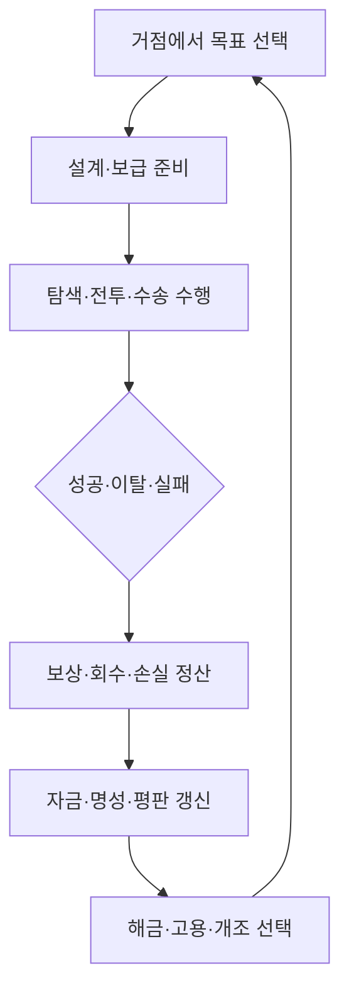
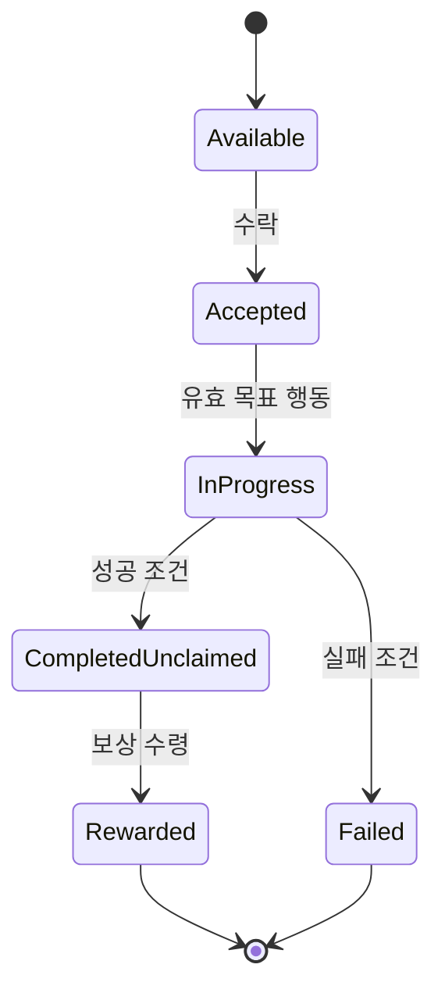

# 16. Career·임무·명성·진영 역기획

[전체 목차](README.md)

| 항목 | 범위 |
| --- | --- |
| 문서 ID | SYS-16 |
| 작성일 | 2026-11-13 |
| 기준 | 상용판 0.30.5a 문헌 기준, Career 1.x 계열의 현행 규칙 |
| 증거 수준 | 개발자 변경 기록·공식 위키 확인, 실제 세이브 검증 미실시 |
| 표기 | [확인] 문헌 규칙 / [해석] 설계 의도 / [제안] 재구현 구조 / [검증 필요] 세부 불확실성 |

## 1. 시스템 역할

**[해석] Career는 함선 제작이라는 열린 활동에 단기 목표와 장기 확장 속도를 부여한다.** 임무는 다음 행동의 이유를 제공하고, Credits는 선택할 수 있는 장비·서비스의 폭을 넓히며, Fame은 운용 가능한 승무원 규모를 제한한다. 진영 Reputation은 누구와 협력하고 누구를 공격했는지가 후속 조건에 영향을 주게 한다.

이 네 요소를 하나의 “경험치”로 묶으면 원작의 성장 구조를 잃는다. 돈이 많아도 충분한 인력을 고용하지 못할 수 있고, 인력 상한이 커도 실제 채용비·침상·함선 설계가 갖춰져야 한다. 한 진영에서의 좋은 평판도 다른 진영과 동일하지 않다.

## 2. 가장 중요한 개념 구분

| 개념 | 저장 단위 | 플레이어에게 미치는 영향 | 혼동하면 안 되는 대상 |
| --- | --- | --- | --- |
| Credits | 통화 잔액 | 구매·고용·기술 해금 | 적재된 자원의 수량 |
| Fame | 플레이어 명성·등급 | 고용 가능한 승무원 상한 | 진영별 친밀도 |
| Reputation | 진영별 값 | 보상·구매 조건·수배 관련 조건 | 전역 Fame |
| Blueprint unlock | 부품별 해금 상태 | 해당 부품을 건조할 권한 | 완성 함선 설계 파일, 실제 부품 재료 |
| Mission state | 개별 의뢰 상태 | 수행·보상·실패 | 적 함선 단순 존재 여부 |
| Wanted / truce | 관계의 현재 상태 | 공격·추격·항복 관계 | 장기 Reputation의 숫자만 |

저장 단위와 구현 표현은 **[제안]**이다. 기능 구분의 근거는 아래 확인 규칙을 따른다.

## 3. 확인되는 진행 규칙

### 3.1 명성과 승무원 상한

**[확인]** Fame은 임무와 적 함선 격파를 통해 성장하며 고용 가능한 승무원 수를 제한한다. 현재 명성보다 낮은 수준의 활동만 반복해서 계속 같은 성장 이득을 얻는 구조는 아니다. Crew/Fame Ratio 설정도 상한에 영향을 준다. [C16-01]

**[확인]** 0.28.0 개발자 패치는 승무원 상한이 명성 등급 상승 시 묶음으로 증가하도록 바뀌었다고 명시한다. 또한 항복으로 맺은 휴전을 깨면 명성이 줄고 같은 항성계의 다른 AI 함선의 항복에 불이익이 생긴다. [C16-02]

따라서 “명성은 절대 감소하지 않는다”, “명성이 1 오를 때마다 승무원이 조금씩 늘어난다”는 설명은 현행 기준으로 사용하지 않는다. Fame 위키 안에도 감소 불가 문구와 휴전 파기 예외가 함께 남아 있으므로 더 구체적인 변경 기록을 우선했다.

명성 상한과 침상은 동시에 충족해야 하는 서로 다른 조건이다. 침상만 많이 지어도 인력이 자동 생성되지 않으며, 상한이 올라도 새 인력의 실제 고용·이동·배치를 수행해야 한다. 작업 배치는 [04번 문서](04_Crew_Roles_and_Task_AI.md)에서 다룬다.

**[확인: 고용 비용]** Crew 문헌은 고용 인원이 늘면 추가 고용비가 높아지고 Fame이 높아지면 비용이 낮아진다고 설명한다. 따라서 다음 승무원 확보에 필요한 Credits를 현재 고용 규모와 명성에 관계없는 고정 단가로 취급하지 않는다. [C16-10] **[검증 필요]** 정확한 가격 함수, 현재 인원의 반영 방식, 명성의 등급값·연속값 중 무엇을 사용하는지, 진영 평판과의 결합 순서는 미확정이다. 문헌이 설명하는 영향의 방향만 채택하며 선형식이나 구체 단가는 가정하지 않는다.

### 3.2 진영 평판

**[확인]** Reputation은 진영별로 증가·감소하며 음수가 될 수 있다. 임무 보상, 자원·승무원·설계도 구매 가격, 수배 시간과 추격 세력 등에 영향을 준다. 임무 수행은 우호도를 높이고 해당 진영 함선·정거장 파괴는 악화 요인이다. [C16-03]

명성은 함대 규모의 성장축이고 평판은 관계·거래의 축이라는 구분이 핵심이다. 구체적인 가격·보상 배수와 수배 판정은 설정과 버전의 영향을 받으므로 전체 수치표를 확정하지 않는다.

### 3.3 설계도와 부품 건조

**[확인]** 부품 설계도는 정거장에서 Credits로 구입하는 기술 해금이며 물리 자원 아이템이 아니다. 일부 설계도는 선행 해금을 요구한다. 협동 Career에서는 설계도 해금을 공유한다. [C16-04]

해금했다고 부품 재료가 무료가 되거나 완성 부품이 배송되는 것은 아니다. 반대로 .ship.png 같은 함선 디자인을 가져왔더라도 현재 Career의 해금·재료·배치 조건을 만족하는지는 별도 문제다. 여기서 부품 기술 해금과 사용자 함선 디자인을 같은 “블루프린트”라고 부르면 혼란이 생긴다.

## 4. 임무 구조와 유형

### 4.1 문헌에서 확인되는 유형 [확인]

| 유형 | 목표 형태 | 주요 디자인 기능 |
| --- | --- | --- |
| 단일 현상금 | 지정 적 함선 격파 | 명확한 첫 교전 목표 |
| 무리·구역 정리 | 다수 적·방어 시설 제거 | 집중 전력과 연속 교전 시험 |
| 해적 기지 공격 | 기지와 보호 전력 상대 | 큰 손실 위험을 가진 원정 |
| 정거장 접촉·여행 | 목적지 방문·교신 | 새로운 거점으로 이동 유도 |
| 정거장 구출 | 공격 세력 제거, 방어 대상 보존 | 시간·우선 표적의 의미 강화 |
| 진영 분쟁 | 특정 진영 순찰·기지 공격 | 관계 악화를 감수하는 보상 선택 |
| 자원 조달: Procurement (구 Delivery) | 필요한 자원을 확보하여 기한 내 제공 | 재고·생산·이동을 임무와 연결 |
| 탐험 | 관심 지점 발견 목표 달성 | 탐색 활동의 가시적 진척 |

유형과 조건은 Missions 문헌에 근거한다. 각 행의 “디자인 기능”은 **[해석]**이다. 정거장 구출에서 보호 대상이 파괴되면 실패하며, 자원 조달에는 시간 조건이 있다. [C16-05] **[확인]** 0.28.1 개발자 패치는 기존 Delivery 명칭을 조달 임무 명칭으로 변경하여, 요구 자원을 플레이어가 직접 확보해야 한다는 점을 명확히 했다. 본문은 Procurement를 사용하고 구칭을 함께 표기했다. [C16-11]

임무 완료와 보상 수령은 구별된다. 정거장에는 수행 가능한 임무와 완료한 임무가 있고, 일부 보상은 의뢰한 정거장에 돌아가 받아야 한다. [C16-06] 따라서 전투 승리 직후 현금이 기대만큼 늘지 않은 상황을 버그로 단정해서는 안 된다.

### 4.2 항복은 전투와 진행의 연결점

**[확인]** 플레이어 또는 AI가 항복 대가로 Credits를 주고 교전을 끝내는 기능이 있으며, 모든 상대가 반드시 수락하는 것은 아니다. [C16-02]

**[해석]** 항복은 전멸과 무손실 승리 사이에 비용을 지불하는 중간 결과를 둔다. 플레이어가 불리한 전투에서 살아남아 재설계할 수 있고, 유리한 상황에서도 잔해를 얻을지 즉시 보상을 받을지 판단할 수 있다.

**[검증 필요]** 항복 수락·거절 시 임무 완료가 정확히 언제 확정되는지, 주변 아군의 잔여 발사체가 휴전 위반으로 잡히는지, 미션별 예외가 있는지는 실측해야 한다. 원작 전체를 “상대가 항복하면 무조건 현상금도 즉시 지급된다”는 규칙으로 단순화하지 않는다.

## 5. 진영과 세계 배치

**[확인]** 문헌에서 확인되는 주요 진영은 Cabal of Sol, Centauri Imperium, Fringe Systems Resistance, Monolith Cooperative, Great House Io다. [C16-07] 0.30은 Great House Io를 추가했으며 신규 Career 생성과 기존 저장 파일의 진영 출현을 구별했다. [C16-08]

| 진영을 데이터로 구분할 항목 [제안] | 활용 |
| --- | --- |
| 함선 디자인 풀 | 부품 배치·무장 조합의 학습 다양성 |
| 색·도형·이름 규칙 | 전투 전에 세력을 알아보는 시각 언어 |
| 정거장·순찰 배치 | 거점과 위험을 설명하는 공간 구성 |
| 임무 발행·대상 관계 | 세력 선택과 평판 변화 |
| 평판 곡선 | 거래와 추격의 후속 결과 |

진영별 함선의 성격을 정리할 때 공식 설정의 수사적 표현을 객관적 전투 순위로 바꾸지 않는다. “최강의 함선 설계자” 같은 세계관 서술과 실제 비용 대비 승률은 다른 종류의 증거다. 밸런스 검증에서는 진영 이름보다 해당 함선의 사거리·물류·기동·열 구조를 측정한다.

## 6. 진행 루프의 설계 해석

이 루프는 **[해석]**이다. 명성 상승은 성장 자체만 보상하지 않고 다음 단계의 인력 문제를 해결한다. 설계도 해금은 새로운 부품 선택을 주지만, 새 장비가 좋은 결과를 내도록 기존 함선의 물류·전력·열 구조를 다시 맞춰야 한다.

반복적으로 쉬운 지역에 머무르는 플레이어에게는 자원 축적의 여지가 있고, 인력 규모를 더 키우려는 플레이어에게는 더 높은 명성의 목표를 찾는 동기가 생긴다. 전투 숙련도와 경제적 안정성 사이의 선택을 만든다는 해석이다.

## 7. 임무 상태와 이벤트 계약 [제안]

위 상태는 재구현 예시다. 원작이 임무 수락 전에 수행한 행동을 소급 인정하는지 등은 확인되지 않았으므로 실제 코드처럼 단정하지 않는다.

| 제안 객체 | 핵심 데이터 |
| --- | --- |
| MissionDefinition | objectiveType, targetRules, rewardRules, failureRules |
| MissionInstance | issuerId, targetIds, progress, state, eventLedger |
| PlayerProgress | credits, fame, fameTier, unlockedPartTech |
| FactionRelation | factionId, reputation, wantedState, truceRecords |
| RewardGrant | missionId, recipientId, grantedComponents, receiptId |

임무는 “적 함선이 사라짐” 이벤트만으로 성공하면 안 된다. 파괴·항복·항성계 이탈·대상 소유권 변경·분리 후 잔해 등 서로 다른 원인이 있기 때문이다. 목표가 요구하는 무력화 상태를 전투 시스템과 명시적으로 계약해야 한다.

보상 지급은 임무 ID와 수령자 ID를 기준으로 중복 방지해야 한다. 저장·불러오기나 협동 플레이에서 같은 완료 이벤트를 두 번 수신해도 Credits·Fame·Reputation이 다시 증가하지 않게 한다.

## 8. 대표 시나리오

### 8.1 돈은 충분하지만 승무원이 부족함 [해석]

플레이어가 채광으로 많은 재료와 Credits를 얻었지만 다음 확장을 운영할 인력 상한이 없다. 이때 함선 면적을 늘리는 것만으로 문제를 해결할 수 없다. 기존 동선을 줄이거나 작업 분업을 개선해 인력을 절약할 수도 있고, 더 높은 명성의 임무를 수행해 규모 제한을 완화할 수도 있다.

이 선택은 경제 루프와 전투 루프를 연결한다. 채광을 강제로 금지하지 않으면서 모든 성장을 채광만으로 대체하기 어렵게 만든다.

### 8.2 진영 분쟁 임무의 총수익 [해석]

보상액이 높은 임무가 적대 진영의 기지 공격을 요구한다. 즉시 지급액만 보면 매력적이지만, 해당 세력과의 거래 조건과 수배 위험이 악화될 수 있다. 플레이어는 현재 거래 거점, 다음 이동 경로, 수리비와 잔해 가치를 함께 생각해야 한다.

재구현 UI에서는 가능한 경우 관계 변화의 방향과 대상 진영을 보상액 옆에 보여 주는 것이 좋다. 정확한 수치를 숨기더라도 “어느 관계가 악화되는지”는 알 수 있어야 사후 처벌처럼 느껴지지 않는다.

## 9. 튜닝과 실패 방지

| 항목 | 주된 영향 | 확인할 부작용 |
| --- | --- | --- |
| 명성 등급 간격 | 인력 확장 주기 | 긴 정체 또는 급격한 전력 증가 |
| 임무 보상 구성 | 돈·명성·평판의 선택 | 한 임무 유형만 반복하는 최적 전략 |
| 실패·항복 비용 | 재도전 가능성 | 한 번의 실패로 회복 불가능해짐 |
| 평판 가격 곡선 | 거점 선택의 지속 효과 | 기존 관계를 바꾸기 지나치게 어려움 |
| 선행 설계도 | 기술 진입 비용 | 시험하고 싶은 무장을 너무 늦게 사용 |
| 탐색 보상 | 원정 동기 | 전투보다 단순 지도 순회가 지배 |

Fame, Credits, Reputation 각각의 변화를 별도 로그로 남긴다. 단일 “총 진행 점수”로 합치면 임무는 성공했는데 고용이 막힌 원인을 분석하기 어렵다.

## 10. 현행·계획 기능의 경계 [확인]

2026-10-30 개발자 공지는 Career 2.0의 항성계·섹터 재구성, 새로운 장소와 임무 도구를 진행 중인 개발로 소개했다. Dynamic Economy와 Configurable Ship A.I.는 이후 Career 2.5 범위로 분리했다. [C16-09]

본 문서의 현행 Career에는 계획 단계의 행성 무역 섹터, 분기형 임무 스크립팅, 동적 은하 경제를 포함하지 않는다. 이를 재구현 확장 아이디어로 도입하려면 별도 기능 명세와 비용을 산정해야 한다.

## 11. 수용 테스트 [제안]

| ID | 조건·행동 | 기대 결과 |
| --- | --- | --- |
| CAR-01 | 현상금 목표 달성 후 보상 미수령 | 완료 상태와 실제 지급 상태가 분리된다. |
| CAR-02 | 보상 수령을 반복·재전송 | 각 보상은 한 번만 지급된다. |
| CAR-03 | 명성 등급 직전·직후 고용 시도 | 등급별 상한과 현재 채용 인원을 정확히 비교한다. |
| CAR-04 | 침상만 늘리고 명성은 유지 | 상한을 초과해 인력이 생성되지 않는다. |
| CAR-05 | 특정 진영 임무·공격을 수행 | 해당 진영 Reputation과 전역 Fame을 혼동하지 않는다. |
| CAR-06 | 구출 임무의 정거장 파괴 | 실패 조건과 미수령 보상 정책이 일관된다. |
| CAR-07 | 항복 휴전 후 위반 행동 | 명성·관계 효과가 정의된 규칙에 따라 적용된다. |
| CAR-08 | 협동 플레이에서 기술 해금 구매 | 공유 해금 상태와 개인 자원 지출을 올바르게 반영한다. |

## 12. 연결 문서

- [02. 함선 제작](02_Ship_Construction_and_Blueprints.md): 부품 해금과 함선 디자인의 구분.
- [04. 승무원](04_Crew_Roles_and_Task_AI.md): 실제 인원과 고용·배치.
- [12. 전투·함대 지휘](12_Tactical_Combat_and_Fleet_Control.md): 목표 무력화와 이탈.
- [15. 생산·거래](15_Manufacturing_Storage_and_Trade.md): 보상·소모·현금화.
- [17. 성장·밸런스](17_Progression_and_Balance.md): 난이도와 성장 속도 분석.

## 13. 출처와 적용 범위

- **C16-01** [Fame](https://cosmoteer.wiki.gg/wiki/Fame): 명성과 고용 상한. 페이지의 “감소 불가” 문구는 후속 변경 기록과 충돌하여 제외.
- **C16-02** [0.28.0 개발자 패치 노트](https://store.steampowered.com/news/posts/?appids=799600&enddate=1736901638&feed=steam_community_announcements): 상한의 단계 성장, 항복과 휴전 파기 예외.
- **C16-03** [Reputation](https://cosmoteer.wiki.gg/wiki/Reputation): 진영별 평판과 거래·수배 영향.
- **C16-04** [Blueprints](https://cosmoteer.wiki.gg/wiki/Blueprints): 부품 기술 해금과 협동 공유. 오래된 가격·장비명 표는 채택하지 않음.
- **C16-05** [Missions](https://cosmoteer.wiki.gg/wiki/Missions): 임무 유형·구출 실패·자원 조달의 시간 조건. 옛 Delivery 명칭은 C16-11의 변경 기록으로 보정.
- **C16-06** [Stations](https://cosmoteer.wiki.gg/wiki/Stations): 의뢰·완료·보상 수령 인터페이스.
- **C16-07** [Category: Factions](https://cosmoteer.wiki.gg/wiki/Category:Factions): 다섯 주요 진영의 명칭.
- **C16-08** [0.30.0 개발자 패치 노트](https://store.steampowered.com/news/posts/?appids=799600&enddate=1756769273&feed=steam_community_announcements): Great House Io 추가 및 신규 Career 적용.
- **C16-09** [Career 2.0 Development Update — 공식 뉴스](https://steamcommunity.com/app/799600/allnews/?l=english): 2026-10-30 개발 중 범위와 후속 계획.
- **C16-10** [Crew](https://cosmoteer.wiki.gg/wiki/Crew): 고용 규모·명성에 따른 추가 고용 비용의 변화 방향. 정확한 함수는 채택하지 않음.
- **C16-11** [0.28.1 개발자 패치 노트](https://store.steampowered.com/news/posts/?appids=799600&enddate=1738900328&feed=steam_community_announcements): Delivery 임무의 명칭 변경과 직접 자원 조달의 의미. 공지 원문에는 “Procument”로 표기되어 있으며 본문은 통상 표기인 Procurement로 정리.

<!-- 문서 내 출처 링크 -->
[C16-01]: https://cosmoteer.wiki.gg/wiki/Fame
[C16-02]: https://store.steampowered.com/news/posts/?appids=799600&enddate=1736901638&feed=steam_community_announcements
[C16-03]: https://cosmoteer.wiki.gg/wiki/Reputation
[C16-04]: https://cosmoteer.wiki.gg/wiki/Blueprints
[C16-05]: https://cosmoteer.wiki.gg/wiki/Missions
[C16-06]: https://cosmoteer.wiki.gg/wiki/Stations
[C16-07]: https://cosmoteer.wiki.gg/wiki/Category:Factions
[C16-08]: https://store.steampowered.com/news/posts/?appids=799600&enddate=1756769273&feed=steam_community_announcements
[C16-09]: https://steamcommunity.com/app/799600/allnews/?l=english
[C16-10]: https://cosmoteer.wiki.gg/wiki/Crew
[C16-11]: https://store.steampowered.com/news/posts/?appids=799600&enddate=1738900328&feed=steam_community_announcements
