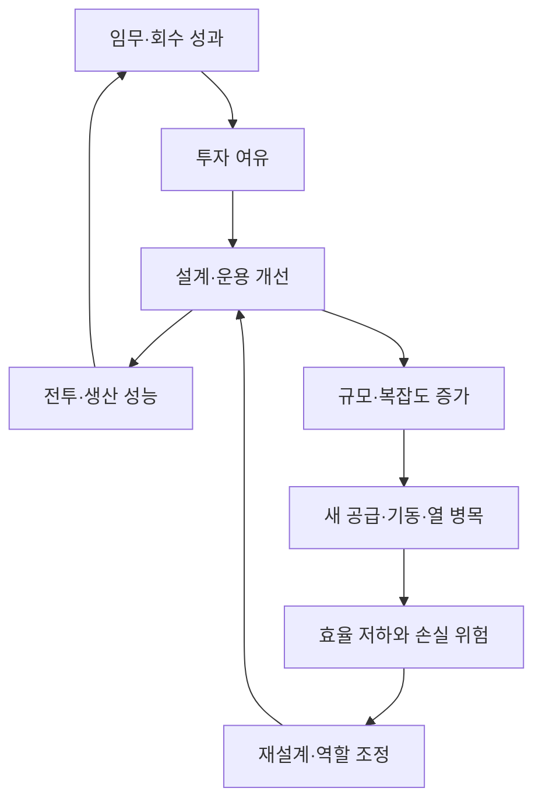

# 17. 성장 구조·난이도·밸런스 역기획

[전체 목차](README.md)

| 항목 | 범위 |
| --- | --- |
| 문서 ID | SYS-17 |
| 작성일 | 2026-11-13 |
| 기준 | 상용판 0.30.5a 문헌 기준 |
| 증거 수준 | 성장 제한·설정은 문헌 확인, 수치 밸런스와 승률은 미측정 |
| 표기 | [확인] 게임 규칙 / [해석] 성장 구조 분석 / [제안] 재구현·검증 모델 / [검증 필요] 실측 대상 |

## 1. 설계 관점의 핵심

**[해석] 코스모티어의 성장은 함선 가격만 증가하는 과정이 아니라, 새로운 기능을 감당하도록 내부 조직을 바꾸는 과정이다.** 무기를 추가하면 전력·탄약·운반·조작 인력이 필요하고, 선체가 커지면 기동·방어·점프 효율·외부 회수 시간이 새 문제가 된다.

따라서 성장 단계가 바뀔 때마다 플레이어가 다시 해결해야 하는 병목이 있다. 장비 해금과 함선 규모는 설계 선택지를 늘리지만, 선택지를 실제 성능으로 바꾸는 과정은 여전히 플레이어의 책임이다. 이 점이 단순 장비 등급 상승과 다른 전략적 깊이를 만든다는 해석이다.

## 2. 확인된 성장 제한과 설정

| 확인 항목 | 규칙 | 분석에 사용하는 의미 |
| --- | --- | --- |
| Fame | 더 높은 명성의 목표를 통해 성장하고 승무원 고용 상한을 제한한다. [C17-01] | 자금 축적만으로 운용 규모가 무한히 커지지 않는다. |
| 부품 설계도 | Credits와 선행 해금이 건조 가능한 부품 범위를 결정한다. [C17-02] | 기능의 진입 비용이 존재한다. |
| 난이도 축 | 전투 난이도와 경제 난이도가 별도로 제공된다. [C17-03] | 전투 숙련 요구와 손실 회복 속도를 따로 조정할 수 있다. |
| 인력 설정 | Crew/Fame Ratio를 조절할 수 있다. [C17-03] | 동일 명성에서도 운용 규모가 달라진다. |
| 작업 편의 설정 | 승무원 건설·회수·탐색 부담을 조절하는 고급 옵션이 있다. [C17-03] | 같은 Career라도 자원·시간 비용 구조가 달라질 수 있다. |
| 오버클럭 | 열을 감수해 기능을 바꾸거나 강화하는 선택이 있다. | 신규 기술을 무조건 사용해야 하는 단일 상위 등급으로 보지 않는다. [11. 열과 오버클럭](11_Heat_and_Overclocking.md) |

이 문서의 단계 구분, KPI, 밸런스 공식은 모두 **[해석] 또는 [제안]**이다. 원작 개발팀의 비공개 설계 목표·매출 지표·실제 플레이 통계를 추정 사실로 제시하지 않는다.

## 3. 분석용 성장 단계 [해석]

아래 구분은 공식 챕터가 아니다. 플레이어가 해결하는 문제의 변화에 따른 분석 틀이다.

| 단계 | 주된 질문 | 확장되는 선택 | 흔한 새 병목 |
| --- | --- | --- | --- |
| 기초 운용 | 무장과 추진이 끊기지 않는가 | 기본 부품 배치, 문, 승무원 수 | 전력 전달·조작 인력 |
| 안정화 | 전투 후 다음 활동까지 이어 갈 수 있는가 | 수리 예비, 수집, 자원 지정 | 저장·회복 자원 |
| 특화 | 어떤 방식으로 싸우거나 벌 것인가 | 무장 계열, 채광·제조 역할 | 특정 원료·사거리·기동 |
| 규모 확장 | 더 큰 장비와 많은 인력을 효율적으로 쓸 수 있는가 | 구역 분업, 큰 장치, 함대 | 장거리 운반·통제·노출 면적 |
| 복합 운용 | 여러 함선과 상호 의존 설계를 관리할 수 있는가 | 전투·정찰·회수·생산 분업 | 명령 부담·보급·지원함 생존 |
| 숙련 최적화 | 같은 비용으로 더 안정적인 결과를 낼 수 있는가 | 세부 표적·발사 방향·열 활용 | 상대 조합·지속전·고장 회복 |

상위 단계가 하위 단계를 대체하지는 않는다. 큰 함선을 만들었어도 공급 동선이 나쁘면 초기 문제인 전력 고갈을 다시 겪을 수 있다. 잘 설계된 작은 함선이 특정 조건에서 큰 함선보다 유리할 수 있는 여지를 유지하는 것이 이 분석의 핵심이다.

## 4. 성장 자원의 역할 분리 [해석]

| 자원·제약 | 무엇을 허용하는가 | 부족할 때의 합리적 선택 |
| --- | --- | --- |
| Credits | 거래·고용·기술 해금 | 임무·판매·투자 순서 조정 |
| 건조 자원 | 부품 생성·복구 | 회수·채광·제조·구매 |
| Fame | 더 많은 인력 고용의 자격 | 더 높은 목표 또는 현재 인력 효율 개선 |
| 승무원 | 조작·운반·건설의 실효 처리량 | 분업·우선순위·동선 단축 |
| 내부 면적 | 장비와 통로 배치 | 구역 재배치·모듈 선택 |
| 질량·추력 | 접근·이탈·각도 유지 | 추진·무장·방어 비중 조정 |
| 전력 전달 | 연속 작동 | 생산량과 배달 능력을 따로 개선 |
| 열 관리 | 오버클럭·열 무장의 지속 운용 | 단기 출력·지속 출력 선택 |
| 지휘 부담 | 여러 함선을 의도대로 운용 | 역할 단순화·명령 그룹 활용 |

“최대 DPS 함선”과 “Career에서 가장 편한 함선”은 같은 목적함수가 아니다. 회수·수리·원정·플레이어 조작 부담까지 합치면 전투가 조금 느려도 작전 전체의 수익과 안정성이 더 높을 수 있다.

## 5. 성장 피드백 루프



**[해석]** 왼쪽의 성과 순환만 있으면 이긴 플레이어가 계속 더 쉽게 이기는 누적 우위가 커진다. 오른쪽의 복잡도 순환은 확장을 새로운 문제로 바꾸어 설계 학습을 지속시킨다. 다만 복잡도 비용이 너무 빠르게 커지면 새 장비 획득이 보상보다 불편으로 느껴진다.

손실도 설계 개선의 정보를 주어야 한다. 외형상 대포가 살아 있는데 발사하지 못했다면 단순한 “패배”보다 탄약 부족·조작 인력 부족·전력 부족·사거리 이탈 중 무엇이 원인이었는지 파악할 수 있어야 다음 시도가 달라진다.

## 6. 단기 성능과 지속 성능 [제안]

전투 개시 직후에는 전지·탄약·열 여유가 충분해 높은 성능이 나오지만, 장기전에서는 공급률과 냉각이 결과를 결정할 수 있다. 따라서 같은 함선도 최소한 다음 세 구간을 나눠 분석한다.

| 관측 구간 | 주요 질문 |
| --- | --- |
| 시작 출력 | 사전 적재 상태에서 첫 교환의 위력이 어느 정도인가 |
| 지속 출력 | 재공급과 열 관리가 따라오는 평균 처리량은 얼마인가 |
| 손상 후 출력 | 핵심 구역 하나를 잃어도 남은 기능이 얼마나 작동하는가 |

### 성능 모델의 사용법

    실효 화력 = 실제 명중 피해 / 관측 시간
    가동률 = 의도한 기능을 수행한 시간 / 수행 기회가 있었던 시간
    공급 손실률 = 공급 부족으로 멈춘 시간 / 수행 기회 시간
    전투 순효율 = 달성한 전술 목표 가치 / 투입·손실 비용

가동률은 단순 명중률과 다르다. 표적이 사거리 밖에 있던 시간을 공급 실패로 세면 무기·물류 튜닝이 잘못된다. 원인 분류가 중첩될 때는 대표 원인 규칙을 정하거나 다중 원인을 따로 기록해야 한다.

종종 “명목 DPS × 가동률 × 명중률”을 근사 모델로 사용할 수 있지만, 이미 실제 피해로 산출한 DPS에 같은 계수를 다시 곱하면 손실을 이중 계산한다. 서로 독립적이지 않은 계수를 기계적으로 곱해 게임의 실제 성능식이라고 제시하지 않는다.

## 7. 밸런스 비교의 기준 [제안]

### 7.1 하나의 승률로 결론 내리지 않는다

비교 실험에는 함선 비용, 승무원 수, 기술 해금, 자원 적재, 준비 시간, 직접 조작 수준, 초기 거리·방향, 상대 종류를 함께 기록한다. 모드·버전·난이도도 실험 키에 포함한다.

| 비교 축 | 필요한 이유 | 함께 볼 결과 |
| --- | --- | --- |
| 동일 건조 비용 | 구매력 차이를 제거 | 승률·손실액 |
| 동일 승무원 수 | 인력 효율을 비교 | 공급 대기·인당 성능 |
| 동일 초기 보급 | 적재된 전지·탄약 차이를 제거 | 초반·지속 성능 |
| 동일 기술 단계 | 해금 비용 차이를 고려 | 해당 단계에서의 선택 폭 |
| 동일 명령 정책 | 조작 숙련의 영향을 분리 | 자동·수동 운용 차이 |
| 상대 조합 변화 | 상성 의존성을 확인 | 특정 조합만 지배하는지 |
| 시작 위치 변화 | 기습·선회 이점을 분리 | 평균과 최악 조건 |

동일 비용과 동일 승무원을 동시에 완벽히 맞추기 어려우면 어느 것을 고정했고 어느 차이를 허용했는지 명시한다. 한 번의 근소한 승패를 특정 부품의 우월성으로 일반화하지 않는다.

### 7.2 원정 단위 지표

전투 한 번을 잘해도 귀환·회수·수리에 오래 걸리면 시간당 진행은 낮을 수 있다.

    원정 소요 = 준비 + 이동 + 전투 + 회수 + 복구 + 보상 수령
    원정 순가치 = 실제 획득 가치 - 실제 지출 - 회복되지 않은 손실
    지속 성장률 = 원정 순가치 / 원정 소요

회수하지 않은 잔해를 이미 가진 자산으로 세지 않고, 임무를 완료했지만 받지 않은 보상도 실제 지급과 구분한다. Credits와 재료 가치를 합칠 때는 평가 가격을 기록하며 같은 자원을 두 번 더하지 않는다.

## 8. 난이도와 선택적 복잡도 [해석]

전투·경제 난이도를 분리하면 적을 상대하는 긴장감과 손실을 복구하는 부담을 따로 맞출 수 있다. 전투 실패를 자주 겪더라도 자원 회복이 빠르면 설계를 실험하기 쉽고, 전투는 무난해도 회수·거래가 엄격하면 원정 계획이 중요해진다.

자동·즉시 건설이나 회수 부담을 줄이는 옵션이 켜진 경우에는 “승무원 건설 시간”이 원정 비용에서 사라지거나 크게 달라진다. 따라서 기본 설정의 효율을 다른 설정의 플레이 기록과 그대로 비교하지 않는다.

오버클럭 역시 사용 여부에 따라 다른 복잡도를 만든다. 열 시스템을 쓰는 함선과 쓰지 않는 함선의 비교에서는 단순한 출력 증가뿐 아니라 냉각 부품·공간·운용 부담까지 포함한다. 구체 규칙은 [11. 열과 오버클럭](11_Heat_and_Overclocking.md)을 따른다.

## 9. 재구현용 데이터 계약 [제안]

| 데이터 | 필드 예시 | 목적 |
| --- | --- | --- |
| BalanceProfile | combatRules, economyRules, crewFameCurve, optionFlags | 세션 규칙 고정 |
| UnlockGraph | partId, prerequisites, purchaseCost | 기술 단계와 접근 비용 |
| ShipBudget | resourceValue, crewCount, unlockValue, supportCost | 비교 기준 생성 |
| EncounterSpec | opponentIds, spawnLayout, orderPolicy, environment | 재현 가능한 전투 |
| ExperimentResult | victory, damage, lossValue, elapsedTime, idleReasons | 결과와 원인 분리 |
| ExpeditionResult | travel, combat, salvage, repair, netValue | 활동 전체 효율 |

### 기록 흐름

```text
BeginExperiment:
    capture version, mods, settings and ship designs
    capture initial resources, crew and thermal state
    apply a recorded spawn and command policy

DuringExperiment:
    log meaningful state transitions, not only final HP
    accumulate time by mutually defined blocking reasons

EndExperiment:
    separate achieved goals, remaining capabilities and economic loss
    export results with the exact configuration snapshot
```

이 구조는 실제 게임의 내부 텔레메트리를 복원한 것이 아니다. 외부 관찰이나 유사 게임 구현에서 동일한 질문을 반복 검증하기 위한 설계다.

## 10. 대표 밸런스 문제와 진단

| 관측 증상 | 성급한 결론 | 먼저 확인할 원인 |
| --- | --- | --- |
| 큰 함선이 자꾸 패배 | 대형 장비가 약하다 | 선회·사거리·분산 공급·표적 노출 |
| 무기를 더 달아도 느림 | 피해량이 낮다 | 조작·전력·탄약·열의 병목 |
| 채광이 전투보다 압도적 | 광물 가격만 낮추면 된다 | 전투 회복비·회수 시간·인력 성장 가치 |
| 새 기술을 아무도 쓰지 않음 | 수치가 약하다 | 선행 해금·지원 설비·학습 비용 |
| 함대보다 한 척이 편함 | 여러 함선이 불리하다 | 지휘 부담·보급 분산·지원함 보호 |
| 초반이 지나치게 느림 | 모든 보상을 늘린다 | 첫 임무 접근성·정보 부족·설계 실수 회복 |

위 행은 **[제안] 진단 가설**이며 실제 코스모티어에 해당 문제가 발생한다는 결론이 아니다.

### 가정 시나리오

새 무기 조합 A가 동일 비용의 B보다 30초 안에 끝나는 실험에서 높은 승률을 보였다고 가정한다. 장기전으로 바꾸면 A가 탄약·열 문제로 멈추고 B가 안정적으로 작동할 수 있다. 이때 A를 일괄 하향하기보다 목표 교전 길이와 보급 부담이 제대로 가격에 반영되는지 확인해야 한다.

여기의 30초는 실험을 설명하는 가정이다. 실제 경기 길이·무기 승률·개발팀의 밸런스 목표를 의미하지 않는다.

## 11. 수용 테스트 및 검증 계획 [제안]

| ID | 과제 | 판정 기준 |
| --- | --- | --- |
| BAL-01 | 동일 설계·설정·명령으로 반복 실험 | 결과 차이를 난수·초기 상태·조작 차이로 설명할 수 있다. |
| BAL-02 | 승무원만 늘리며 출력 추적 | 인력 병목 해소 후 다른 병목으로 넘어가는 지점을 찾는다. |
| BAL-03 | 발전량과 운반 능력을 각각 변경 | 전력 생산 부족과 배달 부족이 별도 원인으로 기록된다. |
| BAL-04 | 명성 등급 전후 확장 비용 비교 | 상한 증가가 실제 운영 비용을 면제하지 않는다. |
| BAL-05 | 오버클럭 단기·장기 비교 | 시작 성능과 지속 성능·냉각 비용을 모두 기록한다. |
| BAL-06 | 전투·채광 원정의 순익 비교 | 회수·귀환·복구 시간을 누락하지 않는다. |
| BAL-07 | 전투·경제 난이도를 각각 변경 | 어느 규칙이 바뀌었는지 실험 설정에 남는다. |
| BAL-08 | 동일 함선을 복수 상대·시작 방향에서 검증 | 단일 상성 결과를 전반적 우열로 보고하지 않는다. |

원작 실측을 시작할 때는 대표 함선 세트와 짧은 원정 하나를 먼저 고정하는 것이 좋다. 매번 다른 설계를 사용하면서 모든 시스템을 동시에 비교하면 어떤 변화가 결과를 만들었는지 알 수 없다.

## 12. 연결 문서

- [01. 핵심 루프](01_Core_Loop_and_System_Map.md): 시스템 전체의 인과관계.
- [04. 승무원](04_Crew_Roles_and_Task_AI.md), [05. 물류](05_Internal_Logistics_and_Supply.md): 성장 규모와 실효 처리량.
- [08. 무장](08_Weapons_and_Fire_Control.md), [11. 열](11_Heat_and_Overclocking.md): 단기·지속 성능.
- [15. 경제](15_Manufacturing_Storage_and_Trade.md), [16. 진행](16_Career_Missions_Fame_and_Factions.md): 자금·기술·인력의 별도 성장축.
- [21. 제작 계획·수용 테스트](21_Production_Plan_and_Acceptance_Tests.md): 구현 순서와 검증 범위.

## 13. 출처와 적용 범위

- **C17-01** [Fame — Official Cosmoteer Wiki](https://cosmoteer.wiki.gg/wiki/Fame): 명성이 더 높은 도전과 인력 상한을 연결하는 기본 구조. 감소 예외와 단계 상승은 16번 문서의 개발자 패치를 우선.
- **C17-02** [Blueprints — Official Cosmoteer Wiki](https://cosmoteer.wiki.gg/wiki/Blueprints): 기술 해금과 선행 조건. 가격표를 현행 전체 데이터로 복사하지 않음.
- **C17-03** [Menu Screens — Official Cosmoteer Wiki](https://cosmoteer.wiki.gg/wiki/Guides_Hub/Menu_Screens): 전투·경제 난이도, Crew/Fame Ratio, 고급 옵션. 모든 수치 배수와 최신 UI 명칭은 실행 검증 대상.

본 문서의 성장 단계, 성능식, 텔레메트리, 밸런스 진단 표는 위 규칙과 다른 시스템 문서에 근거한 독창적 분석·재구현 제안이다. 실측된 원작 통계로 인용해서는 안 된다.

<!-- 문서 내 출처 링크 -->
[C17-01]: https://cosmoteer.wiki.gg/wiki/Fame
[C17-02]: https://cosmoteer.wiki.gg/wiki/Blueprints
[C17-03]: https://cosmoteer.wiki.gg/wiki/Guides_Hub/Menu_Screens
