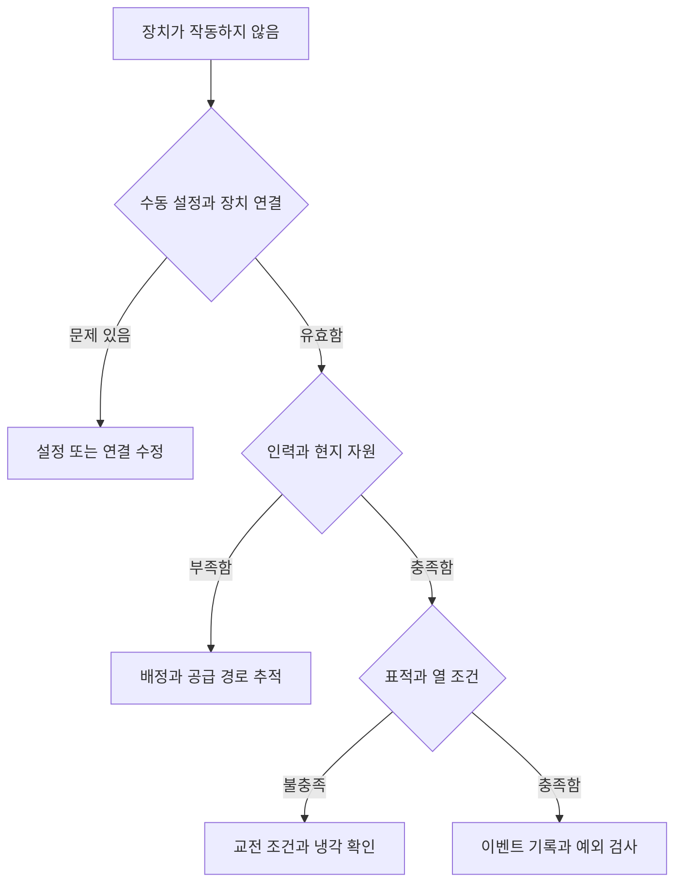

# 18. UI·UX와 플레이어 피드백

[전체 목차](README.md) · 문서 ID: SYS-18 · 작성: 2026-11-13 · 기준: 0.30.5a 문헌

## 1. 시스템 목표

**[해석]** UI의 핵심 역할은 복잡한 함선의 상태를 읽을 수 있게 하는 것이다. 플레이어가 “왜 움직이지 않는가”, “왜 발사하지 않는가”, “왜 자원이 있는데 건조가 안 되는가”를 이해하면 설계 학습이 시작된다. 수치와 버튼이 많이 있는 것만으로는 이를 달성하기 어렵다.

이 문서는 확인된 UI 기능의 존재와, 그 기능을 재구현할 때 유용한 정보 구조를 분리한다. 화면 좌표·버튼 배치·아이콘 그림은 게임을 직접 실행해 대조하지 않았으므로 원작과 동일한 화면 명세로 제시하지 않는다.

## 2. 확인된 UI 기능의 범주

**[확인]** 설정 문서는 부품 상태 아이콘·상태 막대·툴팁, 자원 표시, 적 발견 시 감속 또는 일시정지, 카메라·미니맵·보조 화면, 배율·화면 흔들림 같은 표시 옵션을 설명한다. [P04]

**[확인]** 메뉴 가이드에는 설계 목록을 관리하는 Ship Library와 게임 내 설명인 Codex가 포함된다. [P05] 최신 무기 편집 기능은 [08](08_Weapons_and_Fire_Control.md)의 사거리·사격각·방향 설정 절을 기준으로 읽는다.

## 3. 정보 계층 [제안]

| 계층 | 플레이어가 바로 알아야 할 것 | 보여 줄 정보 | 갱신 특성 |
| --- | --- | --- | --- |
| 생존·위험 | 지금 잃을 수 있는 핵심 기능 | 제어 상실, 주요 장치 중단, 위험 구역 | 상태 전환 즉시 |
| 전술 | 어디로, 무엇을, 어느 각도로 공격하는가 | 목표, 명령 핸들, 사거리·사격각 | 조작 중 실시간 |
| 운용 | 왜 장치가 쉬는가 | 전력·탄약·인력·열·경로 사유 | 상태 변경 중심 |
| 성장 | 다음 행동을 가능하게 하는 것은 무엇인가 | 재고, 크레딧, 명성, 해금 | 거래·보상 시 |
| 설계 | 변경 후 무엇이 달라지는가 | 비용 차이, 배치 오류, 경로, 예상 성능 | 편집 시 |

긴급 경고는 항상 모든 부품 위에 겹쳐 출력하지 않는다. 함선 수준 요약을 먼저 제공하고 선택 시 원인 장치로 이동하게 한다. 예를 들어 탄약 부족 20개는 20개의 동일 경고보다 “탄약 공급 구역 2곳 중단”으로 요약한 뒤 상세를 열어 보는 편이 이해하기 쉽다. 이 집계 방식은 재구현 제안이다.

## 4. 실패 원인의 분류 [제안]

모든 작동 실패를 `Disabled` 하나로 저장하면 툴팁이 해결책을 줄 수 없다. 다음처럼 원인과 결과를 분리한다.

| ReasonCode 예시 | 상태 설명 | 플레이어가 확인할 곳 |
| --- | --- | --- |
| ManualOff | 플레이어가 끔 | 장치 설정 |
| NoOperator | 조작 인력이 없음 | 역할·배정·경로 |
| NoInputResource | 탄약 또는 원료 부족 | 현지 저장·공급 경로 |
| NoPowerAtDevice | 해당 장치의 전력 부족 | 장치 전지와 운반 |
| NoEligibleTarget | 유효 표적 없음 | 거리·사격각·표적 유형 |
| BlockedOutput | 산출 공간 또는 배출 조건 부족 | 창고·접근 경로 |
| InvalidModuleLink | 모듈 연결 요건 미충족 | 장치 연결 구조 |
| ThermalConstraint | 열 관련 조건의 영향 | 열·냉각 오버레이 |
| LostTopology | 구조 변경으로 기존 경로 무효 | 파손 지점·문 |

한 부품에 여러 원인이 동시에 존재할 수 있다. UI는 우선순위가 높은 원인 하나를 큰 아이콘으로 보여 주되 상세에는 전체 원인 목록을 남긴다. “탄약 부족”을 해결한 뒤 “조작자 없음”이 나타나는 현상을 설명할 수 있어야 한다.

## 5. 오버레이의 설계 계약 [제안]

오버레이는 장식이 아니라 시뮬레이션을 설명하는 다른 표현이다. 소유권과 업데이트 근거를 분명히 해야 한다.

| 오버레이 | 읽는 원본 상태 | 사용자 질문 | 오해를 막는 표시 |
| --- | --- | --- | --- |
| 내부 이동 | 통행 가능 그래프·문·이동 비용 | 여기까지 갈 수 있나? | 직선 거리와 실제 경로를 분리 |
| 공급 | 요청·예약·출발·도착 | 무엇이 어디로 가나? | 예정량과 확정 재고를 구분 |
| 전력 | 장치 버퍼·공급률 | 출력이 부족한가, 배달이 늦나? | 생성 능력과 현지 잔량을 분리 |
| 열 | 열 상태·네트워크·냉각 연결 | 어디에 열이 쌓이나? | 뜨거운 선체와 열 배관을 구분 |
| 사격 | 유효 사거리·각도·차폐·표적 | 지금 사격할 수 있나? | 물리적 범위와 사용자 제한을 구분 |
| 손상 | 부품 상태·연결 변화 | 어디가 취약해졌나? | 체력 손실과 기능 상실을 구분 |

모든 그래프를 한 번에 켜기보다 기본 오버레이 한 개와 선택 부품의 연결 강조를 제공한다. 색을 바꾸는 것에 더해 선 모양, 아이콘, 텍스트, 깜박임이 없는 정적 경고를 함께 사용한다.

## 6. 설계 편집 흐름 [제안]

입력은 `선택 → 미리보기 → 유효성 검사 → 비용 계산 → 적용 명령 → 결과 확인`으로 나눈다. 편집 도중의 불완전한 상태와 실제 함선 상태를 분리하면 복잡한 재배치를 쉽게 할 수 있다. 현행 Blueprint Mode 규칙 자체는 [02](02_Ship_Construction_and_Blueprints.md)가 소유한다.

| 편집 중 사건 | 처리 정책 |
| --- | --- |
| 부품 중첩 또는 배기 공간 충돌 | 문제 셀과 이유를 함께 표시 |
| 특정 부품의 해금 부족 | 필요 조건과 비용을 별도 줄로 표시 |
| 연결은 되지만 승무원 경로 없음 | 합법성 오류와 운용 경고를 구분 |
| 자원 부족 | 부족량·주변 조달 가능량·부족 사유 구분 |
| 적용 직전에 상태 변경 | 계획을 재검증하고 바뀐 차이를 표시 |
| 실행 취소 | 설계 명령의 취소 범위를 명확히 표시 |

건조 중인 함선의 피해, 다른 플레이어의 변경, 재고 이동이 생겼는데 화면의 비용 견적만 과거 상태인 문제를 막아야 한다. `PreviewVersion`과 현재 상태 버전을 비교하고 오래된 미리보기를 적용하지 않는다. 이는 제안하는 일관성 정책이다.

## 7. 전술 명령과 시간 제어 [제안]

일시정지는 플레이어에게 관찰과 명령 편집 시간을 제공한다. 입력이 즉시 물리 이동으로 이어지지 않는 경우에는 다음과 같은 상태를 구분한다.

| 명령 상태 | 사용자에게 보일 의미 |
| --- | --- |
| Editing | 아직 드래그 또는 값 조절 중 |
| Submitted | 입력을 제출함 |
| Accepted | 게임 규칙 또는 네트워크에서 접수됨 |
| Active | 함선이 의도를 실행 중 |
| Blocked | 자원·제어·경로 등으로 진행 불가 |
| Completed / Cancelled | 종료 또는 교체됨 |

승무원이 외부에 있는 상태의 장거리 이동처럼 다른 작업에 영향을 주는 명령은 예상 결과를 가까운 위치에 표시한다. “명령을 내렸다”와 “함선이 가동 조건을 갖췄다”의 차이를 진행 중 문구로 드러낸다.

협동에서는 시간 속도와 일시정지의 권한 규칙을 세션 정책으로 다룬다. 단독 플레이의 창 포커스 자동 일시정지와 협동 세션의 공통 시간 제어를 동일 기능으로 간주하지 않는다. 실제 옵션 범위는 [P04], 네트워크 정책 제안은 [19](19_Creative_Multiplayer_and_Modding.md)를 참고한다.

## 8. 학습과 진단 UX [해석·제안]

초반 학습은 버튼을 전부 소개하는 순서보다 원인과 결과가 잘 보이는 과제로 구성한다.

| 학습 과제 | 실패를 만들 조건 | 학습 결과 |
| --- | --- | --- |
| 부품을 놓고 운용하기 | 문 또는 인력 경로 누락 | 배치와 작동의 차이 |
| 같은 무기를 지속 발사하기 | 비축 이후 공급 부족 | 순간 출력과 처리율 |
| 적 무기를 집중 공격하기 | 총 피해는 적지만 기능 상실 | 부위 표적의 의미 |
| 한 구역 손상을 견디기 | 중앙 통로 또는 공급원 상실 | 구역 독립성과 복원력 |
| 열 설정을 바꾸기 | 지속 출력에 따른 열 축적 | 출력 증가의 대가 |
| 전투 후 회수하기 | 빈 공간·운반 인력 부족 | 승리 이후의 운영 |

이 과제는 제안한 튜토리얼 구성이다. 현행 게임의 실제 튜토리얼 순서라고 주장하지 않는다. 각 과제는 실패가 발생한 순간 관련 상태를 강조하고, 해결을 대신 수행하기보다 변경 전후 결과를 비교하게 한다.

## 9. 데이터와 이벤트 [제안]

`DeviceStatusChanged`, `ResourceReservationChanged`, `TopologyChanged`, `OrderRejected`, `BlueprintValidationFinished`와 같은 이벤트를 UI 모델에 전달한다. 화면은 원본 상태를 직접 변경하지 않고 명령을 제출한다.

경고 이벤트에는 `entityId`, `reasonCode`, `severity`, `firstSeen`, `lastSeen`, `relatedEntityIds`, `suggestedView`를 둔다. `suggestedView`는 자동 조작 명령이 아니라 문제 위치와 관련 오버레이를 여는 힌트다.

자주 변하는 수치는 갱신 빈도와 히스테리시스를 둔다. 예를 들어 전지 한 단위가 들어왔다가 바로 소비되는 장치에서 “부족/정상” 아이콘이 매 순간 점멸하면 원인 파악이 어려워진다. 실제 상태는 그대로 유지하면서 요약 UI에 짧은 관측 구간을 적용할 수 있다.

## 10. 검증 시나리오 [제안·미실행]

| ID | 시나리오 | 기대 결과 |
| --- | --- | --- |
| UX-01 | 탄약·전력·인력이 동시에 부족 | 상세 원인이 모두 보이고 대표 경고가 안정적 |
| UX-02 | 경로상 문 또는 부품 파괴 | 기존 경로 표시가 사라지고 관련 원인을 설명 |
| UX-03 | 자원 충분, 특정 저장 공간 부족 | 자원 부족으로 오표시하지 않음 |
| UX-04 | 편집 중 외부 상태 변경 | 오래된 비용·합법성 판정을 재검증 |
| UX-05 | 큰 UI 배율과 작은 화면 | 핵심 확인·취소·명령 상태에 접근 가능 |
| UX-06 | 색 구분 없이 오버레이 사용 | 패턴·아이콘·텍스트로 상태 구분 가능 |
| UX-07 | 일시정지 중 명령 여러 개 수정 | 적용된 마지막 명령과 편집 중 명령을 구분 |
| UX-08 | 설계 파일 로드 시 필요한 부품 누락 | 어떤 부품과 버전이 필요한지 설명 |

성공 지표는 버튼 수가 아니라 실패 원인을 찾는 시간, 첫 수정의 해결률, 잘못된 증설 반복 횟수, 경고에서 문제 위치에 도달하는 조작 수다. 수치 목표는 실제 사용자 테스트 후 정한다.

## 출처와 연결

- [P04] [공식 Wiki — Settings](https://cosmoteer.wiki.gg/wiki/Settings): 실제 설정·표시 기능. 검색 색인 본문 확인, 직접 열기는 403.
- [P05] [공식 Wiki — Guides Hub/Menu Screens](https://cosmoteer.wiki.gg/wiki/Guides_Hub/Menu_Screens): Ship Library와 Codex 등 메뉴 진입점. 검색 색인 본문 확인.
- 연결: [02 편집](02_Ship_Construction_and_Blueprints.md), [05 물류](05_Internal_Logistics_and_Supply.md), [11 열](11_Heat_and_Overclocking.md), [12 전술](12_Tactical_Combat_and_Fleet_Control.md), [20 데이터](20_Technical_Architecture_and_Data_Model.md).

<!-- 문서 내 출처 링크 -->
[P04]: https://cosmoteer.wiki.gg/wiki/Settings
[P05]: https://cosmoteer.wiki.gg/wiki/Guides_Hub/Menu_Screens
