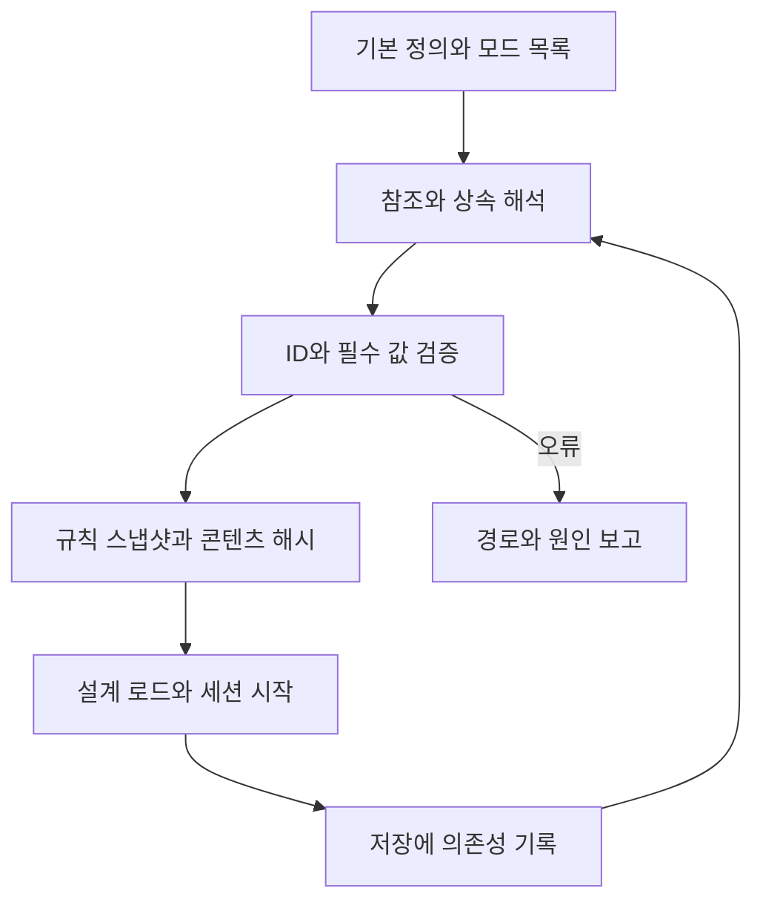

# 19. Creative·멀티플레이·모딩·설계 공유

[전체 목차](README.md) · 문서 ID: SYS-19 · 작성: 2026-11-13 · 기준: 0.30.5a 문헌

## 1. 시스템 목적

**[해석]** 같은 함선 시뮬레이션을 다른 목표와 제약으로 반복 이용하는 영역이다. Career는 획득과 손실의 맥락을 만들고, Creative는 실험을 빠르게 하며, PvP는 상대 설계와 조작을 통해 전략의 편향을 드러낸다. 공유와 모딩은 사용자가 만든 설계·콘텐츠가 다음 플레이의 입력이 되게 한다.

게임 모드마다 무기나 승무원을 별개로 구현하기보다는, 공통 시뮬레이션에 경제·배치·승패·재생성 정책을 붙이는 방식으로 역설계할 수 있다. 아래 구현 구조는 원작의 실제 클래스 구조가 아닌 제안이다.

## 2. 확인된 모드와 핵심 규칙

**[확인]** 공식 Wiki의 Game Modes는 다음 모드를 설명한다. Career 협동은 자신을 포함해 최대 네 명으로 설명된다. 서버 설정, 향후 변경, 모드의 변형 규칙은 별도로 확인해야 한다. [P06]

| 모드 | 문헌에서 확인한 목적·승패 | 역기획의 주요 관심사 |
| --- | --- | --- |
| Career | 탐사·임무·자원 확보·성장 | 장기 경제와 복구 비용 |
| Creative | 자원·크레딧 제약 없이 설계 실험 | 초기 상태 통제와 빠른 반복 |
| Elimination | 마지막으로 생존한 플레이어 또는 팀 승리 | 예산·생존 판정·종료 조건 |
| Arena | 적 손상·파괴로 점수 획득, 파괴 후 재생성 | 점수 귀속·재생성·회전율 |
| Domination | 거점 확보와 자금으로 함선 투입 | 점유 상태·증원·전선 유지 |
| Build & Battle | 제한된 부품 선택으로 건조 후 라운드 전투 | 선택지 생성·건조 단계·라운드 전환 |

표의 “주요 관심사”는 분석이다. 위키에 적힌 특정 커뮤니티 예산을 게임의 영구적인 기본 규칙으로 채택하지 않는다.

## 3. 모드 정책의 분리 [제안]

| 정책 인터페이스 예시 | 책임 | 공통 시뮬레이션에 주는 값 |
| --- | --- | --- |
| EconomyPolicy | 비용 차감·환급·자원 제약 | 구매 가능 여부와 재고 변경 |
| BuildPolicy | 건조 가능 시점·범위·부품 제한 | 설계 검증 결과 |
| SpawnPolicy | 시작 배치·증원·재생성 | 새 함선과 초기 상태 |
| VictoryPolicy | 생존·점수·거점·시간 제한 | 경기 종료와 결과 |
| OwnershipPolicy | 조작권·공유·팀 관계 | 명령 권한 |
| TimePolicy | 배속·일시정지·준비 완료 | 시뮬레이션 진행 허용 |
| PersistencePolicy | 저장 범위·설계 반출·기록 | 세이브와 리플레이 대상 |

공통 코드는 “현재 모드가 Creative인가”를 여러 곳에서 직접 검사하기보다 정책이 허용하는 기능을 읽는다. 예를 들어 무한 건조 자원과 무한 탄약을 별개의 정책으로 두면 설계 실험에서 현실적인 전투 보급을 유지할 수 있다. 실제 게임의 옵션 조합이라고 주장하는 것이 아니라 실험 도구로서의 제안이다.

## 4. 협동의 상태 소유권 [제안]

같은 세션에서 함께 플레이해도 플레이어, 함선, 자원, 임무, 전역 시간은 서로 다른 소유 범위를 갖는다. 이를 먼저 정의해야 공유 편집과 저장에서 충돌을 줄일 수 있다.

| 상태 | 권한 정책에서 정할 것 | 충돌 예시 |
| --- | --- | --- |
| 함선 명령 | 소유자 전용·팀 공동·위임 여부 | 서로 다른 이동 명령 |
| 설계 편집 | 단일 편집자·잠금·병합 여부 | 같은 셀의 부품 변경 |
| 재고·크레딧 | 공동 계정 또는 개인 계정 | 같은 자원으로 동시 구매 |
| 임무 | 세션 공유 또는 참여자별 인정 | 완료 보상 중복 수령 |
| 시간 속도 | 호스트·투표·최저 요청 속도 등 | 한 명은 전투, 다른 한 명은 건조 |
| 저장 | 호스트 기준·세션 상태 버전 | 편집 도중 저장과 복귀 |

이 표는 원작의 현재 세부 권한을 확정하는 표가 아니다. 원작을 동일하게 재현할 경우 각 행을 실측해야 한다. 특히 한 플레이어가 다른 항성계로 독립적으로 이동하는 기능은 [23](23_Sources_and_Fact_Check.md)의 개발 중 기능 구분을 먼저 확인한다.

### 4.1 공동 편집의 최소 계약

편집 요청에 `shipId`, `expectedDesignVersion`, `editId`, `authorId`, `operations`를 넣는다. 적용 시 버전이 달라졌다면 오래된 명령을 덮어쓰지 않고 충돌 범위를 알려 준다. 비겹침 변경만 병합할지, 편집 잠금을 사용할지는 제품의 사용성 목표에 따라 정한다.

## 5. 네트워크 방식: 공개 사실과 재구현 선택

**[확인·역사적 사실]** 개발자 Walt의 2017년 0.13.0 기술 글은 deterministic lockstep을 채택하여 입력을 공유하고 각 컴퓨터가 같은 시뮬레이션을 수행한다고 설명한다. 이는 공개된 당시 설계 근거이며, 현재 0.30.5a의 세부 프로토콜·재접속·복구 구현 전체를 확인한 근거는 아니다. [P07]

**[제안]** 비슷한 규모의 시뮬레이션을 만든다면 다음 두 방향을 비교한다.

| 방향 | 적합한 요구 | 개발 부담 |
| --- | --- | --- |
| 결정론 입력 동기화 | 많은 승무원·투사체, 공통 시간, 재현성 | 모든 권위 상태의 결정론·버전 일치·불일치 진단 |
| 권위 서버와 상태 복제 | 독립적인 지역·유연한 참여·서버 판정 | 전송량·보간·대규모 객체 복제·관측 범위 관리 |

어느 방향이든 화면 연출은 게임 결과를 바꾸는 난수와 분리한다. 폭발 파티클 수를 줄였다는 이유로 피해 판정 순서가 바뀌어서는 안 된다. 락스텝을 선택했다면 렌더 프레임 시간, 컨테이너 순회 순서, 작업 스레드 완료 순서가 결과를 바꾸지 않도록 설계한다.

### 5.1 불일치 진단 데이터 [제안]

세션의 콘텐츠 해시, 모드 목록, 명령 프레임, 난수 스트림 상태, 함선·재고·승무원 상태의 요약 해시를 기록한다. 전체 해시가 다르면 하위 계층으로 내려가 원인 범위를 좁힌다. 실제 게임의 패킷 형식이나 기록 주기를 추정하여 고정하지 않는다.

## 6. 설계 공유와 저장 경계

**[확인]** 공식 홈페이지는 Workshop 등을 통한 설계 공유를 안내한다. [P01] Ship Library에는 내 설계, 내장 설계, Workshop 설계의 진입점이 설명되어 있다. [P05]

**[해석]** 공유 가능한 설계는 함선 시뮬레이션의 콘텐츠 포맷이자, 다른 사용자가 학습하는 예제다. 따라서 디자인 결과를 가져오는 것과 현재 커리어의 소유권·재고·해금을 가져오는 것은 분리해야 한다.

| 저장 대상 | 담아야 하는 범위의 예시 [제안] | 별도로 처리할 것 |
| --- | --- | --- |
| 설계 | 부품 ID·위치·회전·설정·외형 | 현재 피해·잔량·승무원 상태 |
| 게임 저장 | 세계·함선·자원·인력·임무 상태 | 배포 가능한 공유 설명 |
| 실험 프리셋 | 설계와 초기 재고·대치 조건 | 실제 커리어 성과 |
| 경기 기록 | 시작 상태·명령·버전·결과 | 버전이 다른 실행의 완전 호환 |

청사진을 불러오는 동작이 곧 무료로 완성 함선을 얻는 동작이 되어서는 안 된다. 현행 커리어의 자원·해금·건조 조건은 [02](02_Ship_Construction_and_Blueprints.md)와 [15](15_Manufacturing_Storage_and_Trade.md)에 따른다.

## 7. 모딩의 확인 범위

**[확인]** 공식 모딩 문서는 `.rules` 기반 콘텐츠 정의와 `mod.rules` 진입점을 설명한다. 모드 식별자·이름·버전·문자열·적용 동작 등의 정보가 있으며, 다른 파일의 값을 참조하거나 상속하는 형식이 안내된다. [P08][P09]

**[확인]** 기본 모드 예제를 이용한 시작 경로와 호환 게임 버전의 메타데이터도 문서화되어 있다. [P10] 여기서 확인한 데이터 확장성만으로 모든 게임 코드를 자유롭게 바꿀 수 있다고 결론 내리지 않는다.

### 7.1 재구현할 콘텐츠 파이프라인 [제안]

로드 시 검증할 것은 ID 충돌, 참조 누락, 순환 상속, 잘못된 단위, 존재하지 않는 자원, 불가능한 부품 크기, 저장 데이터의 요구 버전이다. 오류 메시지는 단순히 “모드 로드 실패”가 아니라 파일·정의 ID·참조 경로·충돌 상대를 제공해야 한다.

### 7.2 호환 정책

플레이에 영향을 주는 콘텐츠와 표시만 바꾸는 콘텐츠를 구분하되, 어떤 범주인지 모드의 자기 선언만 믿지 않는다. 네트워크에 필요한 규칙 해시를 구해 세션 입장 전에 비교한다. 게임 업데이트 시에는 이전 설계가 참조하던 부품을 삭제하는 변경과 새 필드를 기본값으로 추가하는 변경을 구분한다.

## 8. PvP 밸런스와 실험 도구 [해석·제안]

경쟁전은 비용만 맞추는 것으로 공정성이 완성되지 않는다. 승무원 제한, 투입 가능한 함선 수, 초기 탄약, 맵 경계, 승패 시간, 부품 제한 등이 다른 전략을 만든다. 따라서 경기 규칙은 설계와 함께 기록되어야 한다.

Creative의 재현 가능한 실험 프리셋이 있으면 패치 전후 결과를 비교하기 쉽다. 예산과 부품 수가 같은 두 설계를 초기 상태·각도·명령 정책을 고정하여 비교하고, 별도로 실제 플레이어 조작 경기를 측정한다. 자동 결투 성능이 실제 경기 성능을 그대로 대표한다고 가정하지 않는다.

## 9. 수용 테스트 [제안·미실행]

| ID | 입력·조건 | 기대 결과 |
| --- | --- | --- |
| MODE-01 | 동일 설계를 Creative와 Career에서 로드 | 공통 구조는 같고 자원·해금 정책은 모드대로 적용 |
| MODE-02 | Elimination과 Arena에서 함선 파괴 | 각 모드의 종료·재생성 정책이 독립 적용 |
| MODE-03 | 두 플레이어가 같은 설계 버전 편집 | 덮어쓰기 없이 충돌 또는 일관된 병합 |
| MODE-04 | 같은 자원에 동시 건조 요청 | 중복 사용 없이 하나의 일관된 결제 |
| MODE-05 | 플레이에 영향 있는 모드 설정 불일치 | 세션 진입 전 차이를 식별 |
| MODE-06 | 부품 정의가 없는 공유 설계 | 누락 ID와 해결 방법을 표시 |
| MODE-07 | 같은 시작 상태·입력 기록 재생 | 선택한 결정론 정책의 결과가 일치 |
| MODE-08 | 저장 후 모드 버전 변경 | 지원되는 마이그레이션 또는 명시적 호환 오류 |

## 출처

- [P01] [공식 홈페이지](https://cosmoteer.net/): 설계 공유와 모드 지원의 제품 범위.
- [P05] [공식 Wiki — Menu Screens](https://cosmoteer.wiki.gg/wiki/Guides_Hub/Menu_Screens): 설계 라이브러리 진입점. 검색 색인.
- [P06] [공식 Wiki — Game Modes](https://cosmoteer.wiki.gg/wiki/Creative_mode): 모드별 핵심 규칙. 검색 색인 본문; 주소는 Game Modes로 리다이렉트되는 항목.
- [P07] [개발자 블로그 — 0.13.0 Multiplayer, 2017-11-12](https://blog.cosmoteer.net/2017/11/cosmoteer-0130-multiplayer.html): 당시 락스텝 도입 설명. 직접 열람. 현재 구현 전체의 확정 근거로 확장하지 않음.
- [P08] [공식 Wiki — mod.rules](https://cosmoteer.wiki.gg/wiki/Modding/mod.rules): 모드 진입점·메타데이터. 검색 색인.
- [P09] [공식 Wiki — Rules file format](https://cosmoteer.wiki.gg/wiki/Modding/Rules_file_format): 참조·상속 형식. 검색 색인.
- [P10] [공식 Wiki — Example mod walkthrough](https://cosmoteer.wiki.gg/wiki/Modding/Example_mod_walkthrough): 예제 및 호환 버전 정보. 검색 색인.

<!-- 문서 내 출처 링크 -->
[P01]: https://cosmoteer.net/
[P05]: https://cosmoteer.wiki.gg/wiki/Guides_Hub/Menu_Screens
[P06]: https://cosmoteer.wiki.gg/wiki/Creative_mode
[P07]: https://blog.cosmoteer.net/2017/11/cosmoteer-0130-multiplayer.html
[P08]: https://cosmoteer.wiki.gg/wiki/Modding/mod.rules
[P09]: https://cosmoteer.wiki.gg/wiki/Modding/Rules_file_format
[P10]: https://cosmoteer.wiki.gg/wiki/Modding/Example_mod_walkthrough
