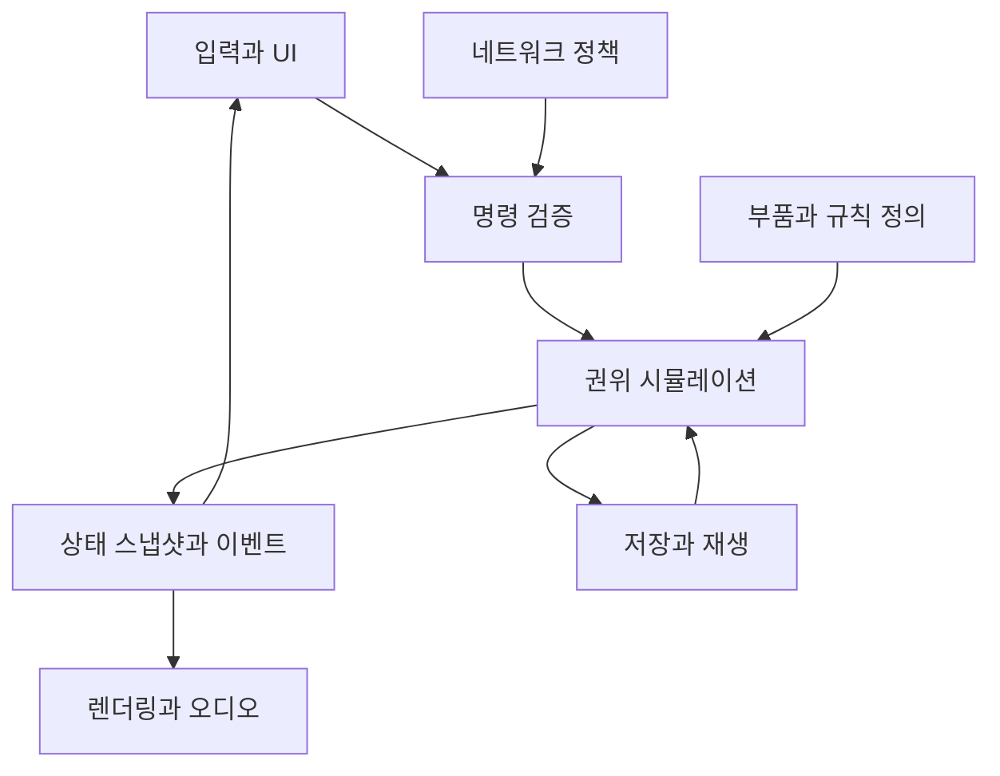

# 20. 재구현 아키텍처와 데이터 모델

[전체 목차](README.md) · 문서 ID: SYS-20 · 작성: 2026-11-13 · 기준: 0.30.5a 문헌

> **이 문서의 구조·필드·코드·처리 순서는 모두 [제안]이다.** Cosmoteer의 비공개 구현이나 역어셈블한 결과를 기술한 것이 아니다. 문헌에서 확인된 플레이 규칙을 일관되게 구현하기 위한 독립적인 설계다.

## 1. 설계 목표

부품 단위의 편집·손상, 개별 승무원의 작업, 자원의 물리적 위치, 함선 운동, 열과 무기가 서로 영향을 준다. 이를 구현하려면 원본 상태의 소유자를 분명히 하고 변경의 적용 시점을 정해야 한다. 같은 탄약을 두 장치가 사용하거나 이미 파괴된 문을 승무원이 통과하는 문제는 개별 알고리즘보다 시스템 경계의 문제인 경우가 많다.

원칙은 다음과 같다.

1. **정의와 인스턴스 분리:** 부품의 설계 데이터와 현재 체력·저장량을 분리한다.
2. **실행과 표시 분리:** 시뮬레이션만 게임 결과를 소유하고 화면은 이를 읽는다.
3. **의도와 확정 분리:** 건조·사격·운반 요청은 검증과 예약을 거쳐 확정한다.
4. **구조 버전 관리:** 연결 변화는 관련 그래프·경로·작업을 무효화한다.
5. **재현성 확보:** 입력·콘텐츠 버전·난수 상태를 기록한다.

## 2. 제안 계층



“권위”는 결과를 확정하는 상태라는 의미다. 반드시 별도 전용 서버가 존재한다는 뜻은 아니다. 단독 실행, 락스텝, 서버 복제 중 어떤 방식을 선택해도 시뮬레이션과 표시의 경계는 유지할 수 있다.

## 3. 핵심 엔터티와 소유권

| 엔터티 | 소유 상태 | 식별 방식 | 함선 분리 시 처리 |
| --- | --- | --- | --- |
| World | 시간·지역·소유 관계·자원 객체 | WorldId / RegionId | 함선 목록 갱신 |
| Ship | 위치·속도·부품 집합·명령 | ShipId | 새 집합에 새 ID 또는 계승 정책 |
| Part | 정의 ID·격자 위치·체력·장치 상태 | 영구 PartId | 새 ShipId에 재소속 |
| Crew | 위치·역할·작업·운반 화물 | 영구 CrewId | 위치 기준 재소속·경로 재검증 |
| ResourceStack | 종류·수량·소유자·물리 위치 | StackId | 저장된 부품 또는 외부 객체에 귀속 |
| Job | 요구·예약·진행·취소 사유 | JobId | 출발지·목적지·경로 유효성 재검증 |
| Projectile | 궤적·표적·피해 정의 | ProjectileId | 함선 ID가 바뀌어도 충돌 대상 조회 |
| Career | 명성·세력 관계·임무·해금 | PlayerId / SessionId | 보상과 함선 객체를 분리 |

승무원이 화물을 들고 이동하면 그 화물의 소유 위치는 승무원이다. 출발 창고의 수량을 계속 포함하면 같은 자원이 두 번 세어진다. `소유자`와 `물리 위치`도 분리한다. 다른 함선으로 운송 중인 자원이 아직 누구의 거래 계약에 속하는지 정의할 수 있어야 하기 때문이다.

## 4. 정의 데이터

다음 필드는 실제 `.rules` 스키마를 복제한 것이 아닌 개념 스키마다.

```text
PartDefinition
  definitionId, schemaVersion, category
  footprintCells, structuralPorts, walkableCells, doorPorts
  massDistribution, healthDefinition, resistances
  deviceDefinitions, storageDefinition
  powerRequirements, operationSlots
  thermalDefinition, effectReferences
  buildRequirements, unlockRequirements
```

| 정의 데이터 | 정적 검증 | 실행 중 인스턴스 |
| --- | --- | --- |
| footprintCells | 중복·빈 형태·회전 변환 | 배치 점유 영역 |
| structuralPorts | 유효 면·격자 좌표 | 인접 연결 |
| operationSlots | 위치·접근 조건 | 현재 조작 승무원 |
| storageDefinition | 자원 유형·용량·필터 | 실제 스택과 예약 |
| thermalDefinition | 유효 계수·포트·상태 영향 | 현재 열·냉각 흐름 |
| deviceDefinitions | 요구 자원·작동 단계 | 충전·장전·조준·작동 |

`massDistribution`을 단일 질량으로 단순화할지 셀별 질량으로 다룰지는 정확도와 데이터 비용의 선택이다. 먼저 게임플레이에 필요한 질량 중심·관성의 정확도를 결정하고 표현 수준을 선택한다.

## 5. 서로 다른 네 개의 그래프

| 그래프 | 노드·간선의 의미 | 사용처 | 같은 그래프로 대체하면 생기는 문제 |
| --- | --- | --- | --- |
| G_structure | 부품의 물리적 연결 | 선체 분리·질량 재계산 | 통로가 없는 장갑 연결을 놓침 |
| G_walk | 승무원이 이동 가능한 셀·출입 | 내부 경로와 작업 접근 | 붙어 있지만 문이 없는 곳을 통과 |
| G_supply | 허용한 자원 전달 관계 | 공급원 후보와 목적지 필터 | 거리가 가까우면 무조건 공급하는 오류 |
| 열 모델: G_pipe / A_hull | 배관망 연결 / 선체의 열 인접 관계 | 열망 공유·냉각 / 선체 열 확산 | 배관 공유와 선체 확산을 같은 현상으로 처리 |

공간상 가까움과 연결됨은 다르다. 장갑으로 이어진 두 구역은 물리적으로 한 함선일 수 있지만 내부 이동 경로는 없을 수 있다. 공급 지정 역시 실제 통행 경로를 만들어 주지는 않는다. 네 번째 범주인 열은 다시 배관망 G_pipe와 선체 열 인접 관계 A_hull로 나눈다. 열망의 저장·공유와 타일의 국소 열 확산을 별도 상태로 처리하며, 세부 규칙은 [11](11_Heat_and_Overclocking.md)를 적용한다.

각 그래프에는 `version`을 둔다. 경로 캐시는 `shipId + graphVersion + start + target + movementProfile`을 키로 사용할 수 있다. 모든 그래프를 매 틱 전체 재생성하는 대신, 구조 변경이 발생한 구역을 무효화한다. 다만 최적화 전에는 전체 재계산으로 정확한 기준 구현을 확보한다.

## 6. 명령과 트랜잭션

```text
Command
  commandId, authorId, issuedSimulationTick
  targetIds, expectedStateVersion
  commandType, payload

ValidationResult
  accepted, reasonCodes, affectedIds, resultingVersion
```

### 6.1 건조 트랜잭션 예

1. 현재 설계 버전과 편집이 기대한 버전을 비교한다.
2. 배치·연결·해금·범위·모드 정책을 검증한다.
3. 필요한 자원과 환급 항목을 계산하고 중복 사용되지 않게 예약한다.
4. 즉시 적용인지 건조 작업 생성인지 정해진 모드 정책을 실행한다.
5. 확정된 변경만 구조 버전과 재고 원장에 반영한다.
6. 취소·실패 시 예약을 해제하고 명확한 이유를 반환한다.

건조가 시간에 걸쳐 진행되는 경우 전체 변경을 하나의 즉시 원자 연산으로 취급하지 않는다. `계획 확정`과 `개별 건조 완료`를 별도 트랜잭션으로 처리하여 중간 저장·피해·취소를 다룬다.

## 7. 자원 예약과 작업 AI

물류 시스템이 운송 수요를 만들고, 작업 선택 시스템이 적격 승무원을 배정하며, 재고 시스템이 예약을 소유한다. 이 세 기능을 서로의 데이터에 직접 쓰게 만들지 않는다.

```text
planJob(demand, crew, snapshot):
  reject if crew is not eligible
  source = findAllowedReachableSource(demand, snapshot)
  destination = validateDestination(demand, snapshot)
  if either endpoint is invalid: return blocked(reason)
  request = reserve(source.amount, destination.capacity, crew)
  if request fails: return retryOnRelevantChange
  return job(request.reservationId, snapshot.graphVersion)

beforeJobStep(job):
  if endpoints changed or graphVersion is stale:
    revalidate or release reservation and cancel
```

실물량은 `stored`, `carried`, `floating` 같은 서로 배타적인 물리 위치로 추적한다. `reserved`는 실물량을 추가하는 상태가 아니라 출발 재고 또는 도착 공간에 대한 사용권 원장이다. 따라서 현지의 출발 가용량은 `available = stored - reservedForPickup`으로 계산하고, 목적지의 예약 공간은 별도로 관리한다. `consumed`, `sold`, `lost`는 현재 보유 위치가 아니라 물량의 유출을 기록한 사건이다. 자원이 도착하면 예약 목적지와 실제 목적지가 같은지 확인하고, 수용 공간이 사라졌으면 반환·대체 저장·외부 방출 중 명시된 정책을 적용한다.

### 7.1 정체와 기아 방지

같은 높은 우선순위 작업만 반복해서 낮은 우선순위가 영구히 굶지 않도록 작업 대기 시간과 필수 생존 작업의 정책을 정한다. 무조건 모든 작업에 같은 보정을 주면 전투 중 필수 조작자가 이탈할 수 있으므로 `고정 조작 슬롯`, `운송 후보`, `긴급 작업`을 구분한다. 실제 원작의 점수식은 확정하지 않는다.

## 8. 시뮬레이션 단계의 예

아래 순서는 일관된 기준 구현을 만들기 위한 한 가지 선택이다. 원작의 실제 틱 순서가 아니다.

| 단계 | 처리 | 확정 시점과 주의점 |
| --- | --- | --- |
| 1 | 입력·명령 적용, 이전 틱 변경 반영 | 오래된 상태 버전 검증 |
| 2 | 구조·경로 무효화 처리 | 동일 단계가 읽을 스냅샷 확정 |
| 3 | 장치 수요·작업 후보 생성 | 재고를 즉시 여러 곳에서 차감하지 않음 |
| 4 | 예약·이동·작업 도착 확정 | 취소된 작업의 예약 해제 |
| 5 | 장치 작동과 소비 확정 | 발사·추력·생산·열원 이벤트 생성 |
| 6 | 운동·충돌·투사체 해석 | 안정적인 충돌·피해 순서 |
| 7 | 피해·화재·열 상태 해석 | 동시에 발생한 효과의 정책 명시 |
| 8 | 파괴·분리 확정과 상태 이벤트 | 다음 단계에서 옛 경로를 사용하지 않음 |
| 9 | 관측 스냅샷·저장 지점 생성 | 화면이 반쯤 갱신된 상태를 읽지 않음 |

예를 들어 발사가 확정된 뒤 같은 틱에 무기가 파괴되면 발사체가 남는지 결정해야 한다. 여기서는 이미 확정한 발사를 유지하는 정책을 선택할 수 있다. 반대 정책도 가능하지만 순회 순서에 따라 달라지는 비명시적 결과를 허용하지 않는다.

선체의 국소 열 확산처럼 이웃 상태를 읽는 계산은 이전 상태를 읽고 다음 상태를 쓰는 방식으로 구현하면 부품 순회 방향에 따라 열이 달라지는 문제를 줄일 수 있다. 이는 배관 열망의 즉시 공유 규칙과 별개의 연산이다. 실제 열 수치와 전달 제한은 해당 시스템 문서에서 채택한 모델에 따른다.

## 9. 함선 분리와 운동 상태

부품 제거 뒤 G_structure의 연결 성분을 구해 독립된 조각을 만든다. 각 조각의 부품·승무원·저장 자원·열 상태를 새 소속으로 옮기고 제어 가능 여부를 다시 계산한다. 기존 명령이 함선 전체를 대상으로 했다면 어느 조각이 계승할지 별도 정책을 둔다.

운동의 초기 조건은 단순히 모든 조각의 선속도를 부모의 값과 같게 놓기보다, 회전 중이던 위치의 속도를 반영할 수 있다.

$$
\mathbf v_i = \mathbf v_{COM} + \boldsymbol\omega \times (\mathbf r_i-\mathbf r_{COM})
$$

여기서 r_i는 새 조각 i의 질량 중심을 세계좌표로 표현한 값이고, r_COM·v_COM·omega는 분리 직전 부모 강체의 질량 중심·선속도·각속도다. 추가 충격이 없다면 조각의 초기 각속도도 `omega_i = omega_parent`로 계승한다. 이는 분리 순간 부모의 국소 속도장을 보존하는 일반적인 강체 운동학 모델이다. 폭발 충격, 파괴되어 모델에서 제거된 질량, 충돌 반응은 따로 계산한다. 원작이 정확히 이 수식과 정밀도를 사용한다고 주장하지 않는다.

### 분리 후 반드시 재검증할 참조

| 참조 | 재검증 사유 |
| --- | --- |
| 운반 작업 | 출발·도착이 다른 조각이 될 수 있음 |
| 조작자와 장치 | 장치가 파괴되거나 위치가 바뀜 |
| 표적 부품 | PartId는 남아도 ShipId가 달라짐 |
| 냉각 연결 | 연결 네트워크가 바뀜 |
| 이동·공격 명령 | 제어·추력·사격 성능이 달라짐 |
| UI 선택 | 존재하지 않는 객체를 계속 참조할 수 있음 |

## 10. 저장과 복구

정의 ID, 스키마 버전, 콘텐츠 해시, 세션 정책, 시뮬레이션 시간, 엔터티 상태를 저장한다. 작업 예약을 저장할지 재구축할지는 하나의 정책으로 고정한다. 예약 ID는 저장했는데 원장 상태는 재구축하면 중복 자원 또는 영구 예약이 생길 수 있다.

로드 절차는 `정의 확인 → ID 복원 → 참조 연결 → 구조 재구성 → 예약 검증 → 명령 재검증 → 실행 재개`로 구성할 수 있다. 이전 버전의 필드가 사라진 경우 조용히 기본값을 넣기보다 호환 변환의 적용 내역을 기록한다.

## 11. 성능 설계

| 부하 | 우선 측정할 지표 | 가능한 개선 |
| --- | --- | --- |
| 승무원 작업 검색 | 후보 수·검색 시간·재탐색 빈도 | 작업 인덱스·구역 후보·변경 시 재평가 |
| 내부 길찾기 | 요청 수·평균 확장 노드·캐시 적중 | 그래프 버전 캐시·계층 경로 |
| 부품 연결 | 파괴당 변경 셀·재계산 시간 | 변경 구역 갱신·연결 성분 재사용 |
| 투사체·충돌 | 후보 쌍·좁은 검사 수 | 공간 분할·충돌 필터 |
| 열 | 활성 노드·수렴 비용·전달 간선 | 비활성 구역 생략·활성 집합 |
| 표시 | 부품 수·효과 수·선 오버레이 | 묶음 렌더링·가시성·효과 품질 |
| 저장 | 상태 크기·쓰기 시간·복원 시간 | 안정 스냅샷·증분 변경 기록 |

최적화 목표는 임의로 “승무원 1,000명에 60fps”로 고정하지 않는다. 하드웨어, 틱 빈도, 부품 수, 투사체 수, 그래프 변경 빈도, UI 오버레이가 함께 명시된 부하 시나리오를 만든다. 평균뿐 아니라 느린 틱과 파괴 직후의 최대 지연을 본다.

멀티스레드가 필요하면 독립 작업을 병렬로 계산하고 확정 결과를 정해진 순서로 합친다. 스레드 완료 순서로 자원 예약 승자가 달라지는 구조는 재현성과 네트워크 동기화 모두에 불리하다.

## 12. 수용 테스트 [미실행]

| ID | 검증 | 기대 결과 |
| --- | --- | --- |
| ARCH-01 | 같은 스택에 복수 운송 예약 | 보유량보다 많은 확정 예약 없음 |
| ARCH-02 | 운송 중 목적지 파괴 | 예약·화물·승무원 상태가 유실되지 않음 |
| ARCH-03 | 회전 중인 함선 분리 | 선택한 운동 정책에 맞는 조각 속도 |
| ARCH-04 | 동일 입력의 반복 실행 | 상태 해시가 선택한 재현성 정책과 일치 |
| ARCH-05 | 분리 직후 저장·로드 | 소속·자원·명령의 참조 무결성 유지 |
| ARCH-06 | 그래픽 품질 변경 | 권위 시뮬레이션 결과 불변 |
| ARCH-07 | 부품 순회 순서 변경 | 동시 효과의 결과가 정의된 정책대로 유지 |
| ARCH-08 | 대규모 파괴와 경로 무효화 | 오래된 경로를 사용하지 않고 지연을 계측 |

## 13. 공개 자료와의 관계

공개 자료는 함선의 부품별 시뮬레이션, 모딩용 데이터 정의, 과거 락스텝 도입의 존재를 설명한다. 이 문서의 데이터 구조와 실행 순서는 공개 자료에서 복사한 것이 아니라 그러한 요구를 만족시키려는 독립 제안이다.

- [P07] [개발자 기술 글 — 0.13.0 Multiplayer](https://blog.cosmoteer.net/2017/11/cosmoteer-0130-multiplayer.html): 네트워크 설계의 역사적 배경. 설명과 범위는 [19](19_Creative_Multiplayer_and_Modding.md).
- [P09] [공식 Wiki — Rules file format](https://cosmoteer.wiki.gg/wiki/Modding/Rules_file_format): 공개 콘텐츠 정의 형식의 참고. 본문의 제안 필드는 실제 포맷이 아님.
- 연결: [03 구조](03_Modules_Connectivity_and_Ship_Splitting.md), [04 AI](04_Crew_Roles_and_Task_AI.md), [05 물류](05_Internal_Logistics_and_Supply.md), [11 열](11_Heat_and_Overclocking.md), [21 제작·검증](21_Production_Plan_and_Acceptance_Tests.md).

<!-- 문서 내 출처 링크 -->
[P07]: https://blog.cosmoteer.net/2017/11/cosmoteer-0130-multiplayer.html
[P09]: https://cosmoteer.wiki.gg/wiki/Modding/Rules_file_format
