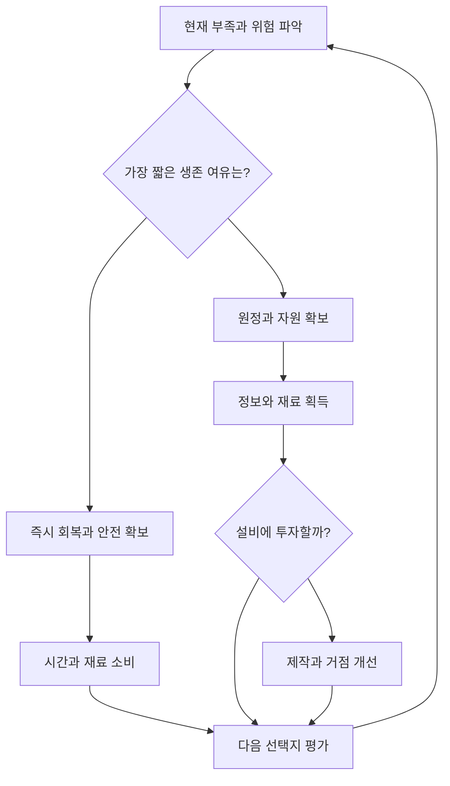
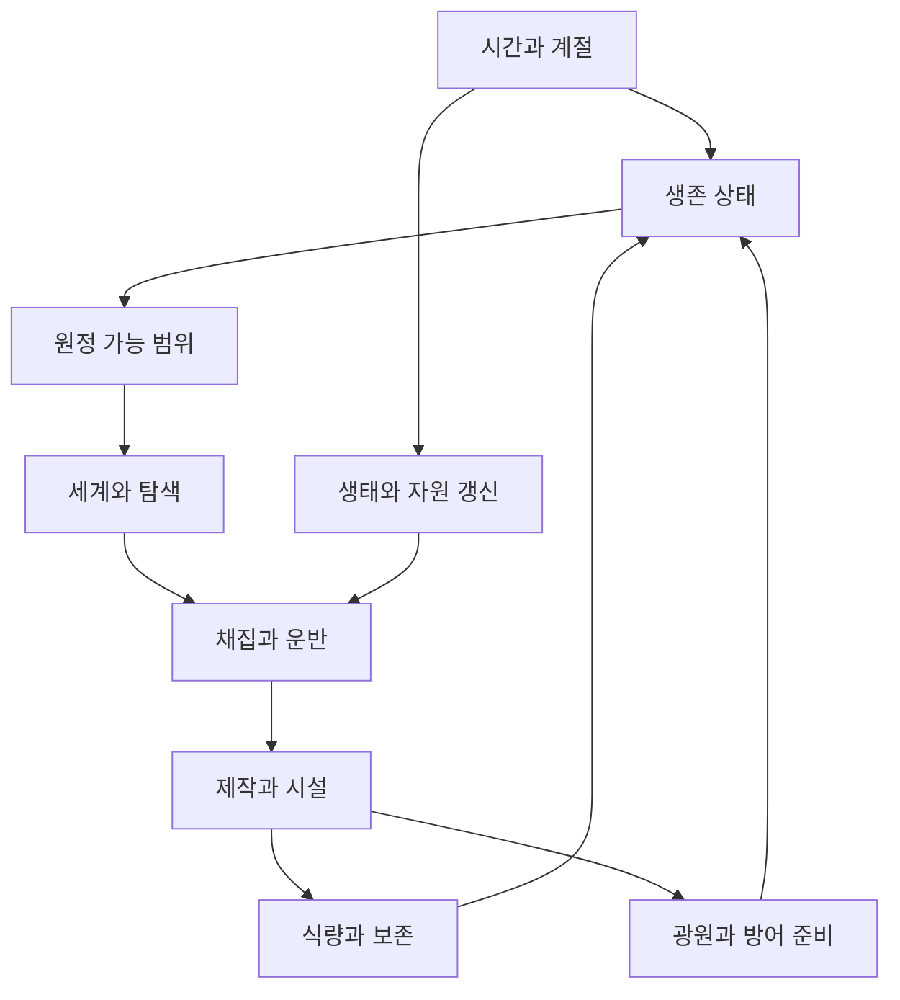

# 01. 게임 개요와 핵심 플레이 루프

> 작성일: 2026-11-13 | 범위: PC 싱글플레이 Don't Starve 원작과 Reign of Giants | 문서 버전: 1.0  
> 자료 기반 역기획이며 직접 플레이 계측·원본 코드 검증은 수행하지 않았다. [목차](00_index.md)

## 1. 문서 목적과 해석 기준

이 문서는 게임을 기능 목록으로 설명하는 데서 나아가, 플레이어의 선택이 어떤 자원을 교환하고 어떤 다음 문제를 만드는지 재구성한다. 아래의 시스템 경계와 품질 기준은 개발에 활용하기 위한 분석이며 Klei의 내부 기획서가 아니다.

| 표기 | 의미 |
|---|---|
| [자료 확인] | 공개 자료에서 해당 제품의 규칙이나 설명을 확인한 내용 |
| [설계 해석] | 확인된 규칙이 플레이 경험에 미치는 효과에 대한 분석 |
| [재구성 설계] | 비슷한 경험을 구현한다면 사용할 수 있는 데이터·처리·검증 제안 |
| [검증 필요] | 제품·설정·패치에 따라 다르거나 자료가 충돌하여 미확정인 내용 |
| [공통] | 이 문서집에서 다루는 DS 원작과 RoG에 공통인 범위. 시리즈 전체를 뜻하지 않음 |
| [DS] / [RoG] | 각각 확장팩을 끈 원작 / Reign of Giants를 활성화한 싱글플레이 |

## 2. 제품 정의

**[자료 확인]** Don't Starve는 무작위로 생성된 세계에서 환경과 생물을 이용하며 생존하는 게임이다. 공식 소개는 수집·제작·연구·농사·전투를 함께 제시한다. RoG는 캐릭터·계절·생물·바이옴 등을 확장한다. [S1], [S2]

**[설계 해석] 핵심 경험:** 플레이어가 스스로 목표를 세우고, 제한된 시간 안에서 위험을 감수해 생존 여유를 확보하며, 실패에서 배운 지식을 다음 선택에 적용한다.

| 항목 | 본 문서의 분석 기준 | 기획상 의미 |
|---|---|---|
| 주 조작 대상 | 한 명의 생존자 | 노동력을 늘리기보다 동선·장비·환경 활용으로 생산성을 높임 |
| 공간 | 탐색해야 하는 세계와 거점 | 이동 시간이 자원 가격에 포함됨 |
| 생존 압력 | 신체 상태, 시간, 빛, 환경, 적 | 단일 게이지를 채워도 안전이 완성되지 않음 |
| 성장 | 지식, 제작 가능성, 설비, 준비물 | 수치 상승 외에 선택지와 대응 범위가 커짐 |
| 장기 목표 | 생존 지속, 탐험, 개인 목표, 별도 모험 진행 | 모든 플레이를 하나의 퀘스트 순서로 강제하지 않음 |
| 주요 손실 | 사망, 자원 소진, 시설 손상, 기회 상실 | 잘못된 선택이 다음 선택의 여유를 줄임 |

이 표는 분석을 위한 분류다. 생존 모드에 정해진 날짜의 자동 승리 조건이 있다고 가정하지 않는다. 모험 모드와 캐릭터 해금은 [17번 문서](17_adventure_death_progression.md)에서 별도 취급한다.

## 3. 설계 기둥

### 3.1 부족함은 행동의 이유다

**[설계 해석]** 배고픔은 식량 확보를, 어둠은 광원 준비를, 계절 변화는 미래 대비를 요구한다. 각각의 요구는 다른 자원을 쓰므로 한 가지 최적 행동을 계속 반복하기 어렵다. 당장 먹을 수 있는 재료를 저장하거나 가공하려면 현재의 안전 여유가 필요하다.

### 3.2 지식은 실패 뒤에도 남는다

**[자료 확인]** Klei의 플레이 안내는 탐색과 발견을 핵심 재미로 설명하고, 사망 후에는 배운 것을 바탕으로 다시 시도하는 경험을 강조한다. 이는 구체적인 프로필 저장 규칙을 전부 설명하는 문장은 아니다. [S3]

**[설계 해석]** 같은 적에게 패배하더라도 공격 전조·도주 경로·회복 비용을 알게 되면 다음 시도에서 기대 손실이 작아진다. 플레이어의 이해가 커지는 것과 캐릭터의 수치가 커지는 것을 구분해야 한다.

### 3.3 편리함에는 유지 비용과 취약점이 붙는다

**[설계 해석]** 거점은 이동과 작업을 줄이지만 자산을 한 장소에 모은다. 전투 장비는 즉시 생존성을 높이지만 다른 장비의 편의를 포기하게 할 수 있다. 보존 수단은 재료의 사용 기한을 늘리지만 식량 생산을 대신하지는 않는다. 편의를 주는 기능은 다른 시스템의 문제를 전부 지우기보다 선택을 바꾸는 방향으로 읽을 수 있다.

### 3.4 환경은 적이면서 도구다

**[설계 해석]** 생물의 적대 관계, 지형, 낮과 밤, 불의 확산을 이해하면 직접적인 공격력 외의 해결 수단을 얻는다. 월드의 여러 규칙이 동시에 작동할 때 플레이어가 계획하지 않은 결과도 생긴다. 이를 재현하려면 콘텐츠별 예외만 추가하기보다 재사용 가능한 상호작용 규칙을 정의해야 한다.

### 3.5 목표의 소유권은 플레이어에게 있다

**[자료 확인]** Klei의 개발 회고는 초기 퀘스트와 외적 보상이 탐험의 동기에 미친 문제를 설명한다. [S4]

**[설계 해석]** 역기획의 목표는 퀘스트를 제거하는 표면적 특징을 복제하는 데 있지 않다. 플레이어가 현재 상태를 해석하고 자신에게 필요한 목표를 만들 수 있게 하는 상태 정보, 위험 신호, 보상 관계가 함께 있어야 한다.

## 4. 시간 규모별 플레이 루프

| 시간 규모 | 플레이어의 질문 | 주요 입력 | 결과 | 연결 문서 |
|---|---|---|---|---|
| 즉시 행동 | 지금 무엇을 집거나 쓰거나 피할까? | 대상, 도구, 거리, 상태 | 획득·소비·피해·이동 | [06](06_resources_tools_gathering.md), [13](13_combat_armor.md) |
| 짧은 원정 | 어디까지 다녀올 수 있을까? | 광원, 식량, 빈칸, 귀환 경로 | 자원과 지도 정보 | [05](05_world_generation_exploration.md), [07](07_inventory_equipment_durability.md) |
| 하루 운용 | 다음 어둠 전에 무엇을 끝낼까? | 남은 시간, 작업량 | 준비 상태와 미룬 작업 | [02](02_time_day_night.md) |
| 거점 운영 | 무엇을 가까이 두고 어떤 설비를 만들까? | 자재, 장소, 위험 분포 | 반복 작업 시간의 변화 | [08](08_crafting_research_magic.md), [09](09_building_base_fire.md) |
| 계절 대비 | 다음 환경에서 무엇이 부족해질까? | 연료, 의복, 식량, 방재 | 생존 가능 활동 범위 | [12](12_seasons_weather_temperature.md) |
| 장기 탐험 | 현재의 안전을 어떤 보상과 바꿀까? | 예비 장비, 지식, 회복 수단 | 고급 자원·새로운 위험 | [16](16_caves_ruins.md), [17](17_adventure_death_progression.md) |



**[재구성 설계]** 이 흐름은 의사결정 모형이며 원본 엔진의 실행 순서가 아니다. 탐험 도중에도 상태와 위협은 계속 변하므로 실제 처리는 여러 시스템이 함께 갱신하는 형태여야 한다.

## 5. 공통 의사결정 단위

하나의 플레이 행동을 다음과 같이 분해하면 시스템 간 경제를 비교할 수 있다.

| 구성 요소 | 정의 | 예시 |
|---|---|---|
| 전제 | 행동을 시작할 수 있는 조건 | 대상 존재, 도구 보유, 안전한 접근 가능 |
| 직접 비용 | 즉시 소모되는 자원 | 재료, 장비 내구도, 연료 |
| 시간 비용 | 행동·이동·정리에 쓰는 시간 | 이동, 채집, 제작, 귀환 |
| 위험 노출 | 행동 중 발생할 수 있는 손실 | 적 접근, 광원 종료, 온도 문제 |
| 보상 | 즉시 증가하는 가치 | 식량, 재료, 지도 정보 |
| 후속 의무 | 보상을 사용하기 위해 필요한 일 | 운반, 가공, 보관, 수리·교체 |
| 대안 비용 | 이 행동 때문에 포기한 기회 | 겨울 준비, 다른 탐험, 휴식 |

**[재구성 설계]** 기획 검토용 행동 가치의 예:

```text
ActionValue = SurvivalGain + InformationGain + FutureOptions
              - TimeCost - MaterialCost - ExpectedLoss - FollowupCost
```

모든 항을 하나의 게임 내 통화로 계산한다는 뜻은 아니다. 예컨대 체력의 가치와 금의 가치는 현재 상태에 따라 달라진다. 밸런싱에서는 단일 점수보다 비용 벡터를 보존하는 편이 좋다.

## 6. 시스템 의존 관계



**[설계 해석]** 중요한 연결은 식량에서 상태로 이어지는 정방향만이 아니다. 상태가 나빠지면 원정 가능 범위가 줄고, 원정이 줄면 식량과 제작 재료의 접근성이 나빠지는 역방향 연결도 있다. 좋은 설계 검토는 이 악순환이 회복 가능한지, 회복하려면 어떤 결정을 요구하는지를 함께 본다.

## 7. 대표 플레이 시나리오

### 시나리오 A — 첫 어둠을 앞둔 탐색

**[설계 해석]** 플레이어가 미확인 지역을 더 탐험하고 싶지만 광원 재료와 귀환 경로가 충분하지 않은 상황이다. 탐험 보상은 새로운 자원 위치이며 비용은 남은 밝은 시간이다. 이때 공정성은 숫자로 정답을 알려주는 것보다 시간이 흐른다는 사실, 어둠이 접근한다는 징후, 광원 제작 가능성을 이해할 수 있는지에 달려 있다.

**[재구성 설계] 수용 기준:** 준비되지 않은 플레이어도 위험이 발생한 이유를 사후 설명할 수 있고, 다음 시도에서는 다른 행동을 선택할 수 있어야 한다. 확인하지 못한 정보가 무엇인지 남기지 않는 즉사만 반복되면 학습 루프가 끊어진다.

### 시나리오 B — 기지를 지을 것인가, 자재를 휴대할 것인가

**[설계 해석]** 건축은 자재와 시간을 반복 작업의 편의로 전환한다. 그러나 너무 이른 정착은 중요한 자원 분포를 모르는 상태에서 위치를 고정하게 한다. 반대로 계속 이동하면 제작·보존·정리를 위한 비용이 반복된다. 좋은 거점 위치는 절대적인 점이 아니라 플레이어가 해결하려는 문제에 따라 달라진다.

### 시나리오 C — 위협에 맞서거나 우회하기

**[설계 해석]** 전투 승리는 체력·장비·식량을 소비하고 새로운 재료를 얻는 교환이다. 생물 사이의 적대 관계나 지형을 활용하는 대안이 있다면 전투력 외의 지식도 보상된다. 비교할 때 처치 시간만이 아니라 회복 시간과 시설 피해까지 포함해야 한다.

## 8. 실패 구조와 복구 경로

| 실패 시작점 | 연쇄 손실의 예 | 플레이어가 학습할 내용 | 재구성 시 확인할 회복 경로 |
|---|---|---|---|
| 식량 지연 | 회복·원정 준비 부족 | 채집과 소비의 균형 | 저위험 식량으로 일단 안정화 가능 |
| 광원 소진 | 야간 활동 제한 또는 치명적 위험 | 예비 연료와 장비 교체 | 임시 광원으로 탈출하는 선택 |
| 무리한 전투 | 체력·내구도 동시 손실 | 전조와 철수 시점 | 적을 떼어내고 회복할 장소 |
| 정착지 화재 | 보관과 생산 자산 손실 | 밀집 배치와 방재 | 분산 재고 또는 임시 캠프 |
| 계절 대비 실패 | 활동 반경 축소 | 현재 생산과 미래 소비의 관계 | 짧은 이동과 임시 보호 수단 |

이 표는 실패를 쉽게 만들라는 제안이 아니다. 실패의 원인과 회복 가능한 선택을 정의하는 분석 도구다. 구체적인 실제 규칙은 각 시스템 문서가 기준이다.

## 9. 역기획의 완료 조건

**[재구성 설계]** 다음 질문에 답할 수 있으면 기능 이름을 나열하는 수준에서 벗어난다.

1. 무엇이 행동을 시작하고 무엇이 완료 또는 취소시키는가?
2. 비용은 시작·완료·피격 중 어느 시점에 확정되는가?
3. 같은 상황에서 여러 규칙이 성립할 때 무엇이 우선하는가?
4. 저장·불러오기·지역 이동을 거쳐도 남아야 하는 상태는 무엇인가?
5. 수치를 바꾸면 다른 시스템의 어떤 선택이 쉬워지거나 사라지는가?
6. 실패 사례를 다시 만들 수 있는 초기 조건이 기록되어 있는가?

실제 빌드의 정확한 수치를 확보하지 못한 항목은 문서의 빈틈을 임의 숫자로 메우지 않는다. [20번 문서](20_balance_qa_reproduction.md)의 검증 계획에 남긴다.

## 10. 출처와 문서 연결

- [S1 — Klei 공식 게임 소개](https://www.klei.com/games/dont-starve/): DS와 확장팩의 제품 설명. 본문 직접 열람.
- [S2 — What is Don't Starve?](https://support.klei.com/hc/en-us/articles/360029554792-What-is-Don-t-Starve): 생존 활동, 무작위 세계, 시각적 특징의 공식 개요. 본문 직접 열람.
- [S3 — How do I play Don't Starve?](https://support.klei.com/hc/en-us/articles/360029880331-How-do-I-play-Don-t-Starve): 탐색·발견 중심의 플레이 안내. 본문 직접 열람.
- [S4 — Intrinsic vs. Extrinsic rewards](https://support.klei.com/hc/en-us/articles/360035456011-Intrinsic-vs-Extrinsic-rewards): 개발자의 설계 회고. 특정 세부 규칙이나 현재 수치의 근거로 사용하지 않음. 본문 직접 열람.
- 다음: [시간과 낮·밤](02_time_day_night.md), [밸런스·QA·재현 계획](20_balance_qa_reproduction.md).

[S1]: https://www.klei.com/games/dont-starve/
[S2]: https://support.klei.com/hc/en-us/articles/360029554792-What-is-Don-t-Starve
[S3]: https://support.klei.com/hc/en-us/articles/360029880331-How-do-I-play-Don-t-Starve
[S4]: https://support.klei.com/hc/en-us/articles/360035456011-Intrinsic-vs-Extrinsic-rewards
