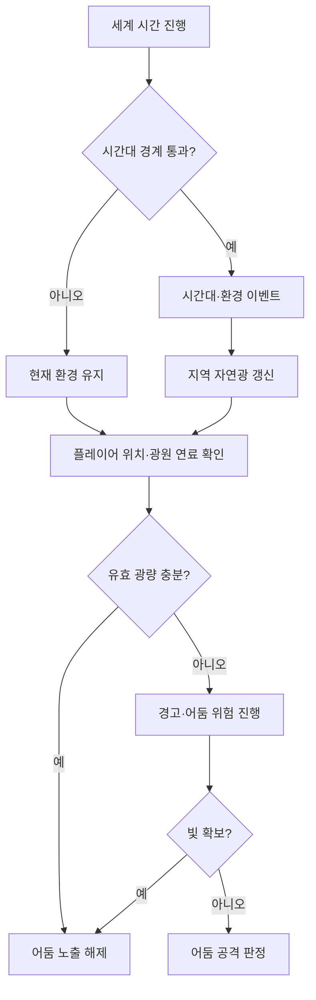

# 02. 시간·낮밤·광원·수면 시스템

작성일: 2026-11-13 | 범위: PC 싱글플레이 DS 기본판 및 RoG | 직접 플레이/원본 코드 검증 미실시

[목차](00_index.md) · [생존 수치](03_survival_stats.md) · [계절·환경](12_seasons_weather_temperature.md)

## 1. 문서의 읽는 법과 목적

- **[자료 확인]**은 공개 자료에서 확인한 플레이 규칙이다. 출처별 DS/RoG 구분을 유지한다.
- **[설계 해석]**은 해당 규칙이 플레이에 미치는 효과에 대한 분석이다.
- **[재구성 설계]**의 상태, 필드, 의사코드는 유사 경험을 구현하기 위한 제안이며 원작 내부 구조의 설명이 아니다.
- **[검증 필요]**는 대상 빌드를 실행해 확인해야 할 사항이다.

이 시스템의 역할은 모든 행동에 마감 시간을 부여하는 것이다. 플레이어는 자원량뿐 아니라 다음 어둠까지 남은 시간, 왕복 이동 시간, 밤에 유지할 광원의 수명을 동시에 계산한다. 계절은 이 시간 예산의 구성을 바꾸고, 동굴은 시계와 밝기의 관계를 바꾼다.

## 2. 핵심 규칙과 범위

| 항목 | 구분 | 확인 내용 | 출처 |
| --- | --- | --- | --- |
| 기본 하루 | [공통·자료 확인] | 기본 설정에서 30초 단위 16구간, 총 480초 | [T01](#t01) |
| 시간대 | [공통·자료 확인] | 낮·황혼·밤으로 나뉘며 계절에 따라 배분이 달라짐 | [T02](#t02) |
| 광원의 역할 | [공통·자료 확인] | 완전한 어둠에서 발생하는 Charlie 공격을 피하는 수단 | [T03](#t03) |
| 수면 | [공통·자료 확인] | 싱글플레이에서는 시간을 앞당기며 잠자는 수단에 따라 낮 또는 밤을 건너뜀 | [T04](#t04) |
| 보름달 | [RoG·자료 확인] | 지상 보름달 밤에는 이동에 충분한 자연광이 생김 | [T02](#t02) |
| 동굴 | [공통·자료 확인] | 지상과 동일한 밝기 규칙으로 취급할 수 없으며 별도 환경 해석이 필요 | [T02](#t02) |

**시간대가 밤이라는 사실과 현재 위치가 위험할 만큼 어둡다는 사실은 별개다.** 밤에도 광원 안에서는 활동할 수 있고, 지하에서는 낮이라는 이유만으로 안전하지 않다. 이것이 시간 관리자와 광원 안전 판정을 분리해야 하는 이유다.

## 3. 플레이어가 내리는 결정

| 의사결정 | 현재 이득 | 지연되는 비용 | 실패의 형태 |
| --- | --- | --- | --- |
| 해질 때까지 먼 지역 탐사 | 새 자원·지형 발견 | 귀환 및 연료 확보 시간 감소 | 어둠 속 이동, 임시 야영 강요 |
| 이동 광원 사용 | 밤에도 이동 가능 | 손 장비 슬롯과 연료 소비 | 광원 소진 직후 공격·작업 대응 곤란 |
| 고정 화덕에 머무름 | 조리·정비·보관 동선 확보 | 탐색 범위 제한 | 생산적인 밤이 단순 대기로 바뀜 |
| 수면으로 시간 생략 | 회복과 위험 시간대 우회 | 수면 자원·허기 비용, 작업 기회 소멸 | 일어난 뒤 식량 적자 |
| 광원 수명 연장에 투자 | 긴 밤 대응 | 다른 기술·장비 투자 지연 | 너무 늦은 투자로 계절 전환에 취약 |

**[설계 해석]** 밤은 단순한 활동 금지 구간이 아니다. 낮에는 이동과 현장 수집의 가치가 높고, 밤에는 가까운 시설을 활용하는 작업의 가치가 상대적으로 높아진다. 같은 공간에서 할 수 있는 조리·제작·인벤토리 정리가 밤의 기회비용을 줄인다.

## 4. 시간 예산의 수학적 표현

**[재구성 설계]** 하루를 다음처럼 표현한다.

```text
day_duration = 16 × 30 = 480 seconds
day_segments + dusk_segments + night_segments = 16
phase_duration = phase_segments × 30 seconds
```

항상 낮 10칸·황혼 4칸·밤 2칸이라고 고정하지 않는다. 그것은 특정 달력 상태를 설명하는 예시가 될 수 있지만 계절 전체에 적용할 불변식은 아니다.

원정 계획의 남는 시간을 아래처럼 정의하면 각 위험을 비교하기 쉽다.

```text
time_margin = time_until_required_light
              - return_travel_time
              - planned_work_time
              - contingency_time
```

`time_margin < 0`이면 귀환 포기가 아니라 계획 변경 신호다. 이동 광원을 만들거나, 가까운 장소에서 야영하거나, 작업을 줄이는 선택지가 생긴다. 이 공식은 플레이 계획을 위한 분석식이며 원작이 표시하는 값은 아니다.

## 5. 상태와 이벤트 모델

**[재구성 설계]** 아래 모델에서는 시계, 지역의 밝기, 개인의 위험 상태를 독립적으로 관리한다.

| 상태 소유자 | 저장할 상태 | 상태 변화 | 소비하는 시스템 |
| --- | --- | --- | --- |
| 세계 달력 | 누적 시뮬레이션 시간, 일차, 계절 위치 | 하루 경계 통과 | 계절, 성장, 공격 이벤트 |
| 시간대 스케줄 | 구간 배분, 현재 시간대 | 낮→황혼→밤→낮 | 조명 연출, 생물 활동 |
| 지역 광량 | 자연광, 주변 광원, 위치 | 이동·점화·소등·달 변화 | 어둠 안전 판정 |
| 플레이어 위험 | 안전/경고/어둠 노출 | 유효 광량 경계 통과 | 피해·경고음·대사 |
| 광원 아이템 | 연료, 장착 여부, 광원 활성 | 연료 소진·장비 교체 | 광량, HUD |
| 수면 처리 | 준비/시간 이동/결과 적용 | 수면 승인 또는 취소 | 허기·회복·달력 |



`어둠 공격 판정`은 실제 피해량, 첫 공격 대기 시간, 이후 간격을 포함하는 별도 규칙이다. 이 문서는 그 수치를 추정으로 채우지 않는다. 광량 경계와 프레임 처리 순서 역시 구현 시 검증 대상으로 남긴다.

## 6. 수면을 시간 이동으로 처리할 때의 요구사항

**[자료 확인·공통]** 싱글플레이의 수면은 DST의 실시간 수면과 다르다. Bed Roll은 황혼 또는 밤에 사용하여 다음 날로 진행하며, 즉시 허기 비용을 가진다. 주변 위험 등의 사용 제한도 있다. Wickerbottom의 수면 제한은 캐릭터 예외다. [T04](#t04) [T05](#t05)

**[재구성 설계]** 시간 이동을 처리할 때 다음 순서를 명시한다.

1. 현재 시간대, 캐릭터, 위험 상황, 수면 수단 사용 가능 여부를 검사한다.
2. 잠에서 깨어날 목표 시각을 결정한다.
3. 허기·회복·내구도 비용과 시간 이동을 하나의 처리 단위로 적용한다.
4. 이동한 시간 동안 진행해야 할 부패·성장·계절 상태를 갱신한다.
5. 깨어난 위치의 광량·기온·적대 상황을 다시 계산한다.
6. 결과 HUD와 환경을 확정하고 조작을 재개한다.

이는 원작의 함수 호출 순서를 주장하는 것이 아니다. 재현 구현에서 수면만 사용하면 음식이 보존되거나, 계절이 바뀌었는데 화면은 그대로인 불일치를 막기 위한 명세다.

## 7. 데이터 예시

```yaml
# [재구성 설계] 설명용 스키마이며 원작 데이터 파일이 아니다.
ClockRules:
  seconds_per_segment: 30
  segments_per_day: 16
  phase_layout_source: season_calendar
  moon_ruleset: edition_specific
PlayerLightState:
  location_context: surface_or_cave
  effective_light: computed
  darkness_elapsed: runtime_value
  warning_stage: none_or_warning_or_attack
SleepTransaction:
  source_time: runtime_value
  target_time: computed
  hunger_cost: item_and_character_rule
  recovery: item_and_character_rule
  denied_reason: optional_reason
```

원작의 시간을 그대로 복제하려면 `edition_specific`에 플랫폼·DLC·모드·세계 설정을 함께 묶어야 한다. 시계의 16칸 표현과 실제 시간 진행 배율도 구분한다. 사용자 정의 세계가 항상 기본 480초 조건과 같다고 가정하지 않는다.

## 8. 다른 시스템과의 계약

| 연결 시스템 | 시간 시스템이 제공하는 것 | 되돌아오는 정보 | 주요 오작동 |
| --- | --- | --- | --- |
| 생존 수치 | 시뮬레이션 경과 시간 | 캐릭터별 소비 배율 | 일시정지 중 허기 감소 |
| 음식 | 실제 진행한 시간 | 부패 완료·음식 변환 | 수면 후 음식 나이가 그대로 |
| 제작 | 남은 시간과 광원 상태 | 광원 제작·장착 완료 | 제작 성공과 어둠 피해 순서 불명 |
| 생물 AI | 시간대 전환 | 활동·귀가·수면 상태 | 밤이 되어도 낮 행동 지속 |
| 계절 | 일차 증가 | 새 구간 배분·환경값 | 계절 경계에서 하루 길이 변경 |
| 저장 | 현재 시각·개별 타이머 | 복원된 위치·상태 | 재접속할 때 노출 타이머 초기화 |

## 9. 구체적인 플레이 시나리오

### 9.1 탐사 도중 밤이 되는 경우

**[설계 해석]** 플레이어는 새로운 광맥을 발견했지만 남은 작업과 귀환을 모두 끝내기 어렵다. 여기서 핵심 선택은 자원을 포기할지뿐 아니라 안전을 이동식으로 확보할지다. 임시 불을 피우면 채광은 이어갈 수 있지만 다음 날 이동 계획이 달라지고, 횃불을 들면 이동은 가능하지만 손을 사용하는 작업과 충돌할 수 있다. 밤은 준비의 양을 시험하면서 위치에 대한 선택을 만든다.

### 9.2 긴 밤에 거점의 가치가 커지는 경우

**[설계 해석]** 계절 때문에 밤의 비중이 늘면 같은 연료 재고로 확보할 수 있는 일수가 줄어든다. 거점에 식량·제작 시설이 모여 있으면 밤에도 생산적인 행동이 가능하다. 따라서 거점의 평가는 건물 수보다 안전하게 활용할 수 있는 작업 시간으로 해야 한다.

### 9.3 수면 비용을 놓친 경우

**[설계 해석]** 낮은 정신력을 회복하려고 잠을 잤지만 식량이 준비되지 않아 다음 날 바로 허기 문제를 맞는다. 회복 행동이 다른 수치를 소모하도록 연결되면 수면은 모든 위기를 지우는 버튼이 되지 않는다. 수면 전후 자원 수지를 비교하는 인터페이스가 학습에 중요하다.

## 10. 검증 시나리오

아래 항목은 실행 결과가 아니라 **재현 구현 또는 실제 게임 조사 시 수행할 QA 명세**다.

| ID | 준비·행동 | 확인해야 할 결과 |
| --- | --- | --- |
| T-01 | 기본 세계에서 연속 하루 측정 | 16구간과 480초의 대응, 경계 시점 일치 |
| T-02 | 서로 다른 계절 중간 날짜 비교 | 전체 하루 길이는 유지되고 시간대 배분이 변경되는지 |
| T-03 | 밤에 광원 안·밖을 왕복 | 시간대와 지역 어둠 판정이 독립인지 |
| T-04 | 광원 연료 마지막 순간 장비 교체 | 남은 연료·조명·경고 상태가 일치하는지 |
| T-05 | 수면 전후 음식·성장·계절 비교 | 이동한 시간에 맞는 상태 진행 여부 |
| T-06 | 위험 인접 상태에서 수면 시도 | 거부 사유와 자원 미소모 처리 확인 |
| T-07 | [RoG] 보름달 지상과 동굴 비교 | 지상 특례를 지하에 잘못 적용하지 않는지 |
| T-08 | 밤 시작 직전 저장·재개 | 시간대, 조명, 노출 상태 복원 여부 |
| T-09 | 일시정지·지도·메뉴 각각 유지 | 실제 시간 정지 범위는 대상 플랫폼에서 별도로 측정 |

## 11. 밸런스 해석과 변경 시 영향

하루를 늘리면 탐사 이동의 상대 비용이 감소하고, 같은 일차의 사건까지 플레이어가 더 많은 준비를 할 수 있다. 반대로 허기를 초당 비율로 그대로 유지한다면 하루 식량 요구량이 커진다. 따라서 하루 길이 변경은 편의성 옵션처럼 보여도 성장·식량·습격 주기를 함께 건드린다.

밤을 줄이면 광원 비용만 줄어드는 것이 아니다. 야행성 생물과 만날 시간, 거점 작업 시간, 밤에만 얻을 수 있는 학습 경험도 줄어든다. 설계 변경은 "하루당 생존율"과 "일차당 준비 자산"을 함께 관찰해야 한다.

## 12. 미확정 사항

- 기본 DS의 정확한 연간 일수는 자료마다 20일 여름+15일 겨울과 20일 여름+16일 겨울이 충돌하므로 이 문서에서 확정하지 않는다.
- 동굴과 지상의 시간 동기화·시간 이동 처리 범위는 설치판을 지정하여 추가 확인한다.
- Charlie 첫 공격 지연, 후속 공격 간격, 광량 임계값은 직접 계측하지 않았다.
- 지도·메뉴·창 비활성화의 일시정지 동작은 플랫폼·설정에 따라 검증한다.

## 13. 출처

확인일: 2026-11-13. wiki.gg 직접 페이지 열기는 403으로 제한되어 **검색 인덱스에 제공된 해당 문서 발췌**를 확인했다. 전체 본문을 열람했다고 주장하지 않으며, 수치가 충돌하는 경우 보류했다.

<a id="t01"></a>**T01.** [Time](https://dontstarve.wiki.gg/wiki/Time), [Console/Commands](https://dontstarve.wiki.gg/wiki/Console/Commands) — 하루·구간의 기본 시간 단위 확인. 명령 실행 또는 코드 검증은 하지 않음.

<a id="t02"></a>**T02.** [Day-Night Cycle](https://dontstarve.wiki.gg/wiki/Day-Night_Cycle) — 시간대 변화, 동굴, RoG 보름달 차이. 기본 DS 계절 길이는 다른 문서와 충돌하여 미확정.

<a id="t03"></a>**T03.** [Light Tab](https://dontstarve.wiki.gg/wiki/Light_Tab) — 광원과 어둠의 관계.

<a id="t04"></a>**T04.** [Sleeping](https://dontstarve.wiki.gg/wiki/Sleeping) — 싱글플레이 시간 이동과 DST 실시간 수면의 구분.

<a id="t05"></a>**T05.** [Bed Roll](https://dontstarve.wiki.gg/wiki/Bed_Roll) — 시간대·허기 비용·사용 제한.
