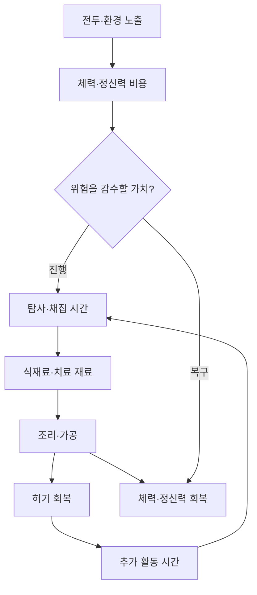

# 03. 체력·허기·정신력과 생존 압박

작성일: 2026-11-13 | 범위: PC 싱글플레이 DS 기본판 및 RoG | 직접 플레이/원본 코드 검증 미실시

[목차](00_index.md) · [시간](02_time_day_night.md) · [캐릭터](04_characters.md) · [음식](10_food_cooking_spoilage.md) · [환경](12_seasons_weather_temperature.md)

## 1. 목적과 증거 구분

세 수치는 서로 다른 종류의 결핍을 만든다. **허기**는 반복적인 보급 의무, **체력**은 실수와 위험 감수의 한도, **정신력**은 주변 위험의 양상을 바꾸는 누적 압박으로 읽을 수 있다. 이것은 [설계 해석]이며 개발자의 내부 의도를 확인한 진술은 아니다.

이 문서에서 [자료 확인]은 공개 자료에 나타난 플레이 규칙, [재구성 설계]는 재현용 데이터·처리 제안이다. [검증 필요] 수치나 처리 순서는 실제 빌드를 확인하기 전 확정하지 않는다.

## 2. 확인한 기준값

| 범위 | 값 또는 규칙 | 적용 조건 | 출처 |
| --- | --- | --- | --- |
| [공통·자료 확인] | Wilson 기본 체력 150, 허기 150, 정신력 200 | 기본 상태, 최대치 변형 없음 | [S01](#s01) |
| [공통·자료 확인] | 일반적인 허기 감소 75/하루 | 기본 배율 캐릭터, 수면·장비 등 별도 소비 제외 | [S02](#s02) |
| [공통·자료 확인] | 허기가 비면 체력 1.25/초 감소 | 굶주림 상태 | [S02](#s02) |
| [공통·자료 확인] | 체력 소진은 사망으로 이어짐 | 부활 가능 여부는 별도 시스템 | [S03](#s03) |
| [공통·자료 확인] | 정신력은 음식·환경·장비·행동 등에 의해 변함 | 변화량과 예외는 원인별 | [S04](#s04) |
| [공통·자료 확인] | 낮은 정신력은 그림자 생물의 적대 위험과 연결됨 | 개체 종류·특수 환경에 따라 세부 조건 다름 | [S04](#s04) |

위 수치는 모든 캐릭터의 공통 최대치를 의미하지 않는다. 특히 Wolfgang의 허기 연동 상태, WX-78의 성장, Maxwell의 소환 관련 최대치 변화 등은 [캐릭터 문서](04_characters.md)에서 별도로 다룬다.

## 3. 세 수치의 역할 분담

| 수치 | 주된 감소 압력 | 회복 접근 | 플레이에 요구하는 행동 | 고갈의 의미 |
| --- | --- | --- | --- | --- |
| 허기 | 시간 경과, 특정 행동·캐릭터 | 식사·음식 생산 | 미래 소비량을 보고 보급 계획 수립 | 체력 손실로 문제 전이 |
| 체력 | 전투, 환경, 위험한 섭취·행동 | 회복 음식·치료·조건부 회복 | 손해를 피하고 회복 비용 확보 | 생존 상태 종료 및 부활 판정 |
| 정신력 | 불리한 환경·오라·행동 | 음식·장비·수면·개별 능력 | 누적 위험 조절 또는 의도적 감수 | 세계 인지·적대 위험 변화 |

**[설계 해석]** 세 개의 동일한 체력 바를 두는 구조가 아니다. 허기가 줄어든다고 바로 조작 능력이 줄어드는 것은 아니지만, 보급을 미루면 체력 문제로 연결된다. 정신력은 단순한 사망 타이머가 아니라 추가 위협과 보상 기회의 조건이 된다. 각 수치의 회복 경로가 겹치면서도 완전히 같지 않아 식량의 선택 가치가 생긴다.

## 4. 자원 전환 관계



**[설계 해석]** 식량의 가치는 음식에 표시된 회복량만으로 결정되지 않는다. 재료를 얻는 시간, 위험, 조리 시설까지의 거리, 부패 전 사용 가능성까지 포함해야 한다. 체력이 부족한 상황에서는 허기 효율이 낮더라도 회복 음식이 더 가치 있다.

## 5. 상태 전이와 임계 조건

**[재구성 설계]** 다음은 구현을 위한 상태 분해다. 원작의 클래스명이나 내부 상태값을 옮긴 것이 아니다.

| 상태 | 진입 조건 | 유지 중 처리 | 종료 조건 |
| --- | --- | --- | --- |
| 정상 보급 | 허기가 양수 | 기본·캐릭터 소비 적용 | 허기 고갈 또는 특수 상태 |
| 굶주림 | 허기가 0 | 굶주림 원인의 피해 누적 | 섭취로 허기 양수 회복, 사망 |
| 부상 | 체력이 최대치 미만 | 별도 회복 효과만 적용 | 회복 또는 추가 손실 |
| 낮은 정신력 | 해당 위험 구간 진입 | 연출·생물 규칙 갱신 | 구간 복귀 또는 특수 예외 |
| 사망 대기 | 체력이 생존 경계 이하 | 행동 취소·사망 이벤트 1회 | 부활 또는 게임 종료 |

정신력 상태는 단일 Boolean보다 위험 구간과 개별 생물 상태를 분리하는 편이 명확하다. 이미 생성된 그림자가 정신력을 조금 회복하자마자 없어지는지, 별도의 해제 조건을 갖는지는 종별로 조사해야 한다. 유적의 악몽 주기에서 오는 적대성을 플레이어 정신력 하나로 덮어쓰면 안 된다.

## 6. 계산 예시: 비축량과 활동 시간

기본 하루 480초를 쓰면 일반 허기 소비는 다음과 같다. 수치는 [S02](#s02)와 [시간 문서](02_time_day_night.md)의 기준값에서 계산한 **분석 결과**다.

```text
base_hunger_per_second = 75 / 480 = 0.15625
Wilson_full_hunger_duration = 150 / 75 = 2 in-game days
```

이는 아무것도 먹지 않고 다른 허기 변형이 없을 때 허기 바가 비는 시간이다. "어떤 행동을 해도 이틀 생존"이라는 보장은 아니다.

굶주림만 받고 현재 체력이 150이라고 가정하면:

```text
nominal_starvation_survival = 150 / 1.25 = 120 seconds
```

이 계산은 전투·추위·과열·회복·부활을 모두 제외한 조건부 계산이다. 실제 죽는 시간은 다른 위험과 동시 발생하면 더 짧아진다.

원정의 필요 식량은 다음처럼 평가할 수 있다.

```text
required_hunger_supply = travel_days × daily_hunger_cost
                         + special_action_cost
                         + safety_reserve
                         - usable_current_hunger
```

이 식의 출력이 음수라고 음식이 불필요한 것은 아니다. 식량이 회복 수단을 겸할 수 있고, 예상 귀환 시간이 늘어날 수 있기 때문이다.

## 7. 입력·효과 처리의 우선순위

**[재구성 설계]** 음식 섭취 하나가 세 수치와 온도 등에 영향을 줄 수 있으므로 각 효과를 독립적인 임의 순서로 반영하지 않는다.

1. 캐릭터 식이 제한, 현재 행동 가능 상태, 음식 존재를 검사한다.
2. 음식 기본 효과에 신선도·캐릭터 특성을 적용하여 효과 묶음을 만든다.
3. 아이템 소비와 효과 묶음을 한 번만 적용한다.
4. 변화된 최대치와 현재치를 정규화한다.
5. 허기 고갈·정신력 구간·사망 등 경계 이벤트를 판정한다.
6. HUD 변화 원인과 결과를 함께 전달한다.

체력이 거의 없는 캐릭터가 체력 감소와 허기 회복을 동시에 주는 음식을 먹는 상황은 중요한 경계 사례다. 원작이 실제로 어떤 순서를 쓰는지 조사해야 하며, 재현 구현에서는 같은 입력에 다른 프레임 순서가 적용되어 결과가 달라지지 않도록 한다.

## 8. 데이터와 효과 출처 추적

```yaml
# [재구성 설계] 원작 스크립트/컴포넌트 명칭이 아니다.
SurvivalState:
  health: { current: runtime, base_max: character, max_modifiers: [] }
  hunger: { current: runtime, max: character, rate_modifiers: [] }
  sanity: { current: runtime, base_max: character, max_modifiers: [] }
Effect:
  source_id: food_or_weather_or_action
  target_stat: health_or_hunger_or_sanity
  mode: instant_or_rate_or_maximum_modifier
  amount: data_driven
  duration: optional
  stack_policy: explicit_policy
  cause_tag: starvation_or_combat_or_food_or_environment
ThresholdEvent:
  previous_band: runtime
  new_band: runtime
  triggered_once: true
```

효과의 원인을 저장하면 체력이 줄어드는 이유를 디버깅할 수 있다. 여러 원인의 수치를 합산한 결과만 저장하면 "방어구가 있는데도 체력이 줄었다"가 정상적인 환경 피해인지 방어 계산 오류인지 구분하기 어렵다. 방어 적용 여부는 피해 원인별 표로 정하고 전투 시스템에 위임한다.

## 9. 최대치와 현재치의 구분

**[자료 확인·공통]** 체력은 현재치와 최대치를 구분하며, 특정 부활 관련 장치 등으로 최대치가 바뀔 수 있다. [S03](#s03)

**[재구성 설계]** 최대치 변경 정책을 다음 세 가지 중에서 명확히 지정해야 한다.

| 정책 | 예시 의미 | 설계 위험 |
| --- | --- | --- |
| 절대값 유지 후 상한 제한 | 현재치가 새 상한보다 높을 때만 낮춤 | 최대치 증가가 즉시 회복을 주지 않음 |
| 비율 유지 | 현재 50%면 변경 후에도 50% | 상한 증감이 체력 이동으로 느껴질 수 있음 |
| 차이만큼 보정 | 상한 증가분을 현재치에도 더함 | 상한 효과 반복으로 회복 악용 가능 |

이 표는 원작이 모든 능력에 동일한 정책을 쓴다는 의미가 아니다. 캐릭터 능력과 장치별로 실제 처리를 확인하고 데이터에 지정한다.

## 10. 시스템 연계와 실패 연쇄

| 시작 문제 | 즉각적 반응 | 2차 문제 | 복구 선택 |
| --- | --- | --- | --- |
| 식량 생산 중단 | 허기 감소 | 위험한 사냥 강요 → 부상 | 대체 음식·비축·일정 축소 |
| 추위에 노출 | 환경 피해 | 회복 재료 소비 → 탐사 지연 | 열원 복귀·보온 장비 |
| 낮은 정신력 방치 | 위협 증가 | 전투 회피로 보급 시간 감소 | 회복·안전 지역 이동·전투 준비 |
| 질 나쁜 음식으로 연명 | 허기 일부 해결 | 체력·정신력 손해 | 조리·다른 식단·캐릭터 예외 활용 |
| 회복을 위한 수면 | 자원 회복 및 시간 이동 | 허기 재고 부족 | 잠들기 전 식량 생산 |

**[설계 해석]** 실패가 하나의 수치만으로 끝나지 않는 것이 긴장감의 핵심이다. 반대로 모든 회복 음식이 세 수치를 크게 회복하면 이 구분이 사라진다. 회복 목적이 나뉘는 음식과 캐릭터별 예외가 선택의 폭을 유지한다.

## 11. 검증 시나리오

아래는 아직 실행하지 않은 **QA 명세**다.

| ID | 상황 | 검증 포인트 |
| --- | --- | --- |
| S-01 | Wilson 기본 상태에서 하루 경과 | 허기 기준 감소량과 시간 단위 일치 |
| S-02 | 허기가 정확히 0에 도달 | 굶주림 피해 시작, 음수 허기 방지 |
| S-03 | 굶주림 중 음식 섭취 | 아이템 한 번 소비, 피해 상태 정상 종료 |
| S-04 | 허기·추위·전투가 동시 발생 | 피해 원인 구분 및 합산의 재현성 |
| S-05 | 최대치를 넘는 음식 섭취 | 초과 회복 처리와 아이템 소비 일관성 |
| S-06 | 정신력 경계 바로 위·아래 왕복 | 연출·AI의 불필요한 반복 전환 방지 |
| S-07 | 정신력만 0, 체력은 양수 | 즉사와 다른 위험 증가를 분리 |
| S-08 | 최대치 변경 후 저장·재개 | 현재치·상한·효과 출처 복원 |
| S-09 | 캐릭터 교체 또는 새 게임 | 이전 캐릭터 효과가 남지 않는지 |
| S-10 | 허기 감소 장비 장착·해제 반복 | 배율 중첩·해제 누락 여부 |
| S-11 | 피해와 회복이 같은 순간 발생 | 명세한 생사 판정 순서의 일관성 |
| S-12 | 수면으로 시간 이동 | 일반 틱 소비와 수면 비용의 중복 여부 |

## 12. 밸런스 평가 항목

**[재구성 설계]** 다음 지표는 원작의 실제 수집 지표가 아니라 역기획의 검증 도구다.

- **보급에 사용하는 시간 비율:** 하루 중 음식 확보 때문에 다른 목표를 포기하는 정도.
- **회복 부채:** 현재 잃은 체력을 안전하게 복구하는 데 필요한 재료·시간.
- **회복 수단 집중도:** 특정 음식 하나가 허기·체력·정신력을 모두 해결하는 비율.
- **위험 연쇄 길이:** 첫 결핍부터 사망까지 추가 문제가 몇 단계 연결되는지.
- **캐릭터별 수지 차이:** 동일한 자원 배치에서 누구에게 식량·회복이 병목인지.

허기 감소를 완화하면 단순히 식사 빈도만 줄어드는 것이 아니라 계절 준비와 전투에 투입할 시간이 늘어난다. 정신력 위험을 제거하면 어두운 지역 탐사 비용과 특정 자원 획득 방식도 바뀐다. 세 수치는 개별 편의성 옵션이면서 서로의 난도를 바꾸는 연결 변수다.

## 13. 미확정 사항과 출처

정신력 임계 구간별 모든 시각효과, 그림자 종류별 생성·해제 임계값, 최대치 변경의 정확한 보정 순서는 직접 검증하지 않았다. 공개 문서의 대표 설명을 모든 적·모든 DLC에 일반화하지 않는다.

확인일: 2026-11-13. wiki.gg 직접 열기는 403으로 제한되어 검색 인덱스 발췌로 확인했다.

<a id="s01"></a>**S01.** [Wilson](https://dontstarve.wiki.gg/wiki/Wilson) — 기본 세 수치. DST 능력 변경은 사용하지 않음.

<a id="s02"></a>**S02.** [Hunger](https://dontstarve.wiki.gg/wiki/Hunger) — 일반 소비량과 고갈 시 피해. 캐릭터별 변형은 별도 취급.

<a id="s03"></a>**S03.** [Health](https://dontstarve.wiki.gg/wiki/Health) — 체력 소진·회복·최대치의 개념. DST 전용 부활 방식은 본문에서 제외.

<a id="s04"></a>**S04.** [Sanity](https://dontstarve.wiki.gg/wiki/Sanity), [Shadow Creature](https://dontstarve.wiki.gg/wiki/Shadow_Creature) — 정신력 변화 원인과 낮은 정신력 위험. 유적 환경의 적대 조건은 별개.
