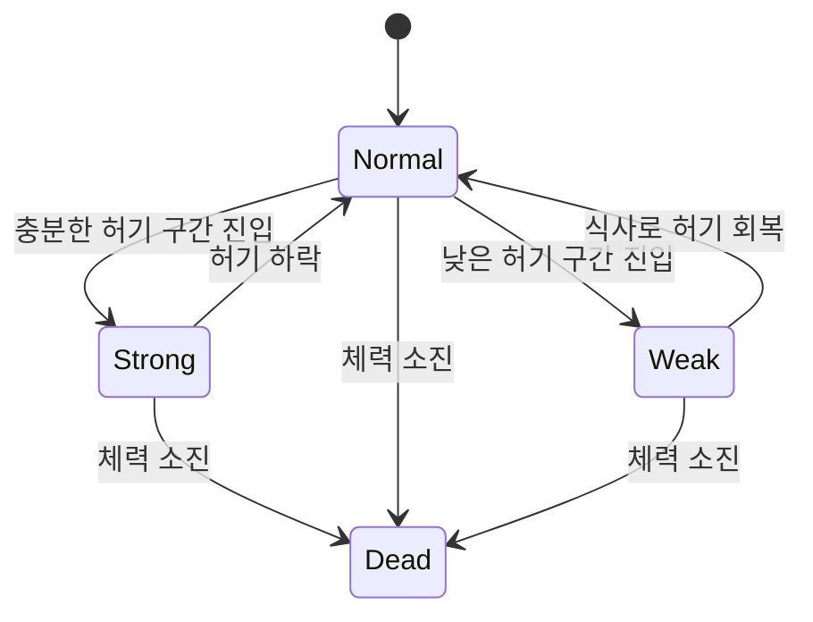

# 04. 캐릭터 특성·해금·고유 행동 시스템

작성일: 2026-11-13 | 범위: PC 싱글플레이 DS 기본판 및 RoG, 2023 업데이트 이후를 기준으로 분류 | 직접 플레이/원본 코드 검증 미실시

[목차](00_index.md) · [생존 수치](03_survival_stats.md) · [음식](10_food_cooking_spoilage.md) · [전투](13_combat_armor.md)

## 1. 목적과 범위

캐릭터는 같은 세계를 다른 자원 문제로 경험하게 만드는 규칙 묶음이다. 수치 차이뿐 아니라 음식 허용, 동료 관계, 제작 접근, 수면, 장비 슬롯, 변신과 같은 규칙의 예외를 제공한다. **[설계 해석]** 한 캐릭터를 익힌 뒤 다른 캐릭터로 바꾸면 이미 아는 지형과 자원이 다시 다른 가치를 갖는다.

이 문서는 기본판 등장인물과 RoG의 Wigfrid·Webber를 중심으로 다룬다. Shipwrecked·Hamlet 전용 캐릭터는 [판본 비교](21_dlc_dst_comparison.md) 범위이며, DST의 스킬 트리·리워크·멀티플레이 역할을 원작 능력으로 합치지 않는다. Wagstaff는 원작의 이후 추가 캐릭터이므로 기본판 초기 출시 명단과 구분한다.

표의 **규칙 요약은 [자료 확인]**, 그 결과로 바뀌는 전략은 **[설계 해석]**이다. 수치·전환 순서가 확보되지 않은 부분은 [검증 필요]로 남긴다.

## 2. 캐릭터별 규칙과 의사결정

| 캐릭터 | 범위 | 자료에서 확인한 대표 특성 | 달라지는 핵심 의사결정 | 출처 |
| --- | --- | --- | --- | --- |
| Wilson | [공통] | 기본 기준 캐릭터, 수염 관련 특성 | 수염 보존과 소재 활용의 시기 | [C01](#c01) |
| Willow | [공통] | 라이터, 화염 피해 면역, 불 근처 정신력 회복 | 불을 안전·회복에 활용하는 배치 | [C02](#c02) |
| Wolfgang | [공통] | 허기 상태에 따라 전투 능력·형태가 달라짐 | 식사를 생존 외 전투 준비에 배정 | [C03](#c03) |
| Wendy | [공통] | Abigail 소환, 본체 공격력 감소, 일부 정신력 손실 감소 | 동료 유지와 본체 위험 분담 | [C04](#c04) |
| WX-78 | [공통] | 기어 섭취 성장, 상한 변형, 비에 취약 | 시설용 기어와 자기 성장 경쟁 | [C05](#c05) |
| Wickerbottom | [공통] | 고유 책, 수면 제한, 상한·지식의 차이 | 정신력을 작업량과 교환하고 별도로 회복 | [C06](#c06) |
| Woodie | [공통] | Lucy와 벌목, Werebeaver 변신 | 대량 채집과 변신 후 복구의 균형 | [C07](#c07) |
| Wes | [공통] | 낮은 생존 여유, 빠른 허기, 풍선, 말 경고 부재 | 같은 자원으로 더 정밀하게 운영 | [C08](#c08) |
| Maxwell | [공통] | 낮은 체력, 정신력 회복, 그림자 인형 | 노동 보조와 생존 여유의 교환 | [C09](#c09) |
| Wagstaff | [공통·후기 추가] | 근시와 고글·발명품, 날것·건조식품 섭취 불이익 | 시야 확보와 머리 장비 선택 | [C10](#c10) |
| Wigfrid | [RoG] | 육식 제한, 전투 이점, 전투를 통한 회복 | 초반 식량을 사냥 중심으로 구성 | [C11](#c11) |
| Webber | [RoG] | 거미와 우호 관계, 몬스터 음식 예외, 다른 생물과의 적대 관계 변화 | 생태계의 아군·적군 구성을 재평가 | [C12](#c12) |

단순한 "강한 순서"로 비교하면 특성의 의미가 줄어든다. 예를 들어 전투 효율이 좋아도 식량 종류가 제한되면 낮은 위험의 식물 채집을 그대로 활용할 수 없다. 장비 제작으로 얻는 이득도 캐릭터의 고유 장비가 차지하는 슬롯에 따라 달라진다.

## 3. 설계 유형으로 분해

| 유형 | 관련 캐릭터 예 | 변경되는 규칙 | 재현 시 독립시킬 데이터 |
| --- | --- | --- | --- |
| 기준형·완만한 보조 | Wilson | 일반 루프에 수염 자산 추가 | 성장 단계·산출물·보온 효과 |
| 특정 위험 예외 | Willow, WX-78 | 화염 또는 비와의 관계 | 피해 원인별 면역·취약성 |
| 자원에 따른 상태형 | Wolfgang | 허기와 전투 성능 연결 | 상태 경계·전환 보정 |
| 동료 운영형 | Wendy, Maxwell | 본체 능력을 동료 노동·전투로 분산 | 소환 비용·동료 생명주기 |
| 시스템 접근 변경형 | Wickerbottom, Wagstaff | 고유 제작·사용 가능 행동 | 지식·레시피·슬롯 점유 |
| 변신형 | Woodie | 조작·HUD·상호작용 집합 변경 | 변신 상태와 복귀 정책 |
| 식단·진영 변경형 | Wigfrid, Webber | 먹을 수 있는 것과 관계 재구성 | 식이 태그·진영 반응 |
| 도전형 | Wes | 수치 여유와 경고 정보 축소 | 소비 배율·대사 정책 |

**[설계 해석]** 차별화의 핵심은 "모든 능력을 조금씩 바꾸기"보다 특정 시스템의 우선순위를 바꾸는 데 있다. 이렇게 하면 아이템·생물·세계 콘텐츠를 크게 늘리지 않아도 기존 콘텐츠의 활용법이 달라진다.

## 4. 대표 상태 머신: 허기와 능력

**[자료 확인·공통]** 싱글플레이 Wolfgang은 허기를 중심으로 형태와 능력이 달라진다. DST의 별도 Mightiness 체계를 그대로 적용하지 않는다. [C03](#c03)

**[재구성 설계]** 형태 전환을 다음처럼 데이터로 다룬다. 아래 이름과 경계 필드는 설명용이다.



형태 전환 때 공격 배율만 바꾸면 안 된다. 최대 체력, 현재 체력 보정, 이동·소비 배율, 애니메이션과 크기, 저장 상태가 함께 바뀌는지 확인해야 한다. 실제 원작의 모든 변형 수치는 이 문서에서 확정하지 않는다.

## 5. 대표 상태 머신: 동료와 변신

### 5.1 Wendy·Maxwell: 동료의 비용을 별도 자원으로 표현

**[자료 확인·공통]** Wendy는 Abigail의 꽃과 소환 절차를 사용하며, Abigail 사망 후 다시 준비가 필요하다. Maxwell의 원작 Codex Umbra는 그림자 인형 소환에 자원과 수치상의 비용을 가진다. [C04](#c04) [C09](#c09)

**[설계 해석]** 동료가 제공하는 시간 절감은 그 동료를 준비하고 복구하는 시간과 비교해야 한다. 약한 다수의 적을 빠르게 처리하는 능력과 단일 강적을 안정적으로 처리하는 능력은 다른 성능이다. 본체가 받는 피해 감소를 동료의 공격력 증가와 동일한 항목으로 평가하지 않는다.

**[재구성 설계]** 동료는 `준비 → 소환 가능 → 활성 → 상실 → 복구` 상태를 가지며, 본체 사망·지역 이동·저장/불러오기 때의 생명주기를 명시한다. 소환 아이템의 존재와 실제 동료 존재를 서로 다른 진실로 저장하면 중복 소환이 발생하기 쉬우므로 관계 ID를 둔다.

### 5.2 Woodie: 행동 집합이 바뀌는 캐릭터

**[자료 확인·공통]** 원작 Woodie는 Lucy와 Werebeaver 변신을 갖는다. DST의 Weregoose·Weremoose를 원작 상태 목록에 넣지 않는다. [C07](#c07)

**[재구성 설계]** 변신 중 가능 행동, 인벤토리 접근, 장비 처리, 별도 게이지, 복귀 시 수치 정책을 각각 표로 정의한다. 이는 단순 외형 변경보다 입력·자원·UI가 한꺼번에 달라지는 전환이다. 실제 장비 드롭과 인벤토리 복원 규칙은 대상 빌드에서 확인한다.

## 6. 식이 제한·진영 관계는 수치와 분리

| 판단 | 잘못된 단순화 | 재현 설계의 권장 구분 |
| --- | --- | --- |
| Wigfrid가 음식 섭취 가능? | 재료 중 고기가 들어가면 무조건 가능 | 완성 음식의 식이 분류와 예외 규칙 확인 |
| Webber가 몬스터 고기 섭취? | 모든 캐릭터에게 같은 불이익 적용 | 캐릭터별 음식 효과 변형 |
| WX-78이 부패 음식 섭취? | 모든 부패 효과를 일괄 적용 | 신선도 규칙에 대한 캐릭터 예외 |
| Wickerbottom의 회복? | 모든 수면 수단을 공통 허용 | 자발적 수면과 강제 기절 구분 |
| Webber에게 생물이 우호적인가? | 플레이어라는 이유로 같은 AI 반응 | 태그·진영·개별 행동에 따른 반응 |

**[설계 해석]** 위 예외는 같은 규칙을 제거하는 편의 기능이 아니라 다른 준비 과정을 만든다. 예를 들어 몬스터 음식을 안전하게 먹을 수 있으면 전투로 얻은 부산물의 가치가 달라지고, 거미와 우호적이면 거점의 안전 지도가 바뀐다.

## 7. 해금과 반복 플레이

**[자료 확인·공통]** 캐릭터 해금에는 경험치와 별도 조건이 섞여 있다. Wilson·Wagstaff는 접근 가능한 시작 캐릭터로 정리되어 있으며, Maxwell은 Adventure Mode 진행과 연결된다. 전체 로스터의 해금 조건은 판본별로 구분해야 한다. [C00](#c00) [C09](#c09)

**[설계 해석]** 캐릭터 해금은 기존 세계에서 능력치를 영구적으로 키우는 성장과 다르다. 다음 플레이에서 선택할 규칙 집합이 늘어나는 방식이다. 실패한 플레이도 새로운 캐릭터를 만나는 계기가 될 수 있어 반복 플레이의 목표를 제공한다.

**[재구성 설계]** 프로필 수준의 `unlocked_character_ids`와 현재 세계의 `active_character_state`를 분리한다. 세계를 삭제했을 때 프로필 해금이 함께 사라지지 않아야 하고, 세계 이동 또는 특수 진행으로 캐릭터를 바꾸는 경우 이미 만든 고유 아이템의 처리 정책도 별도로 갖는다.

정확한 경험치 요구량 전체와 Webber·Wes의 상세 해금 이벤트는 이 문서의 확정 수치표에 넣지 않았다. 구현용 전체 로스터를 만들 때는 해당 캐릭터의 단일 플레이 문서와 실제 빌드를 대조한다.

## 8. 데이터 구조

```yaml
# [재구성 설계] 실제 원작 클래스·컴포넌트 구성을 주장하지 않는다.
CharacterDefinition:
  id: sample_character
  supported_rulesets: [DS, RoG]
  initial_stats: data_row
  starting_items: data_rows
  diet_policy: referenced_rule
  faction_tags: []
  trait_ids: []
  exclusive_recipe_ids: []
  unlock_rule: profile_condition
CharacterRuntime:
  active_form: default
  trait_progress: {}
  companion_ids: []
  stat_modifier_handles: []
  temporary_effects: []
TraitDefinition:
  trigger: event_or_continuous
  prerequisites: []
  effects: []
  removal_policy: explicit
```

예외를 `if character == ...`로 여러 시스템에 분산시키면 신규 음식, 수면 도구, 피해 원인이 생길 때 누락되기 쉽다. 식이·면역·진영·제작 지식은 재사용 가능한 규칙으로 정의하고 캐릭터가 필요한 규칙을 묶어 참조하게 하는 구성이 검토하기 쉽다.

## 9. 능력 적용 순서와 경계

**[재구성 설계]** 행동 가능 여부 → 고유 예외 → 기본 효과 계산 → 캐릭터 효과 수정 → 결과 적용 → 상태 전환 순서로 설계하되, 실제 원작과 일치하는지는 별도 확인한다.

예를 들어 음식을 먹을 수 없는 캐릭터에게 음식 효과를 먼저 적용한 다음 거부하면 소비와 회복이 어긋난다. 변신 직후 이전 형태의 장비 효과가 남거나, 동료 소멸 후 최대 정신력 제한이 복구되지 않는 문제도 효과의 소유자와 제거 조건을 명시하면 줄일 수 있다.

| 경계 상황 | 필요한 정책 |
| --- | --- |
| 능력 성장 후 사망·부활 | 유지되는 성장과 초기화되는 효과 구분 |
| 동료가 다른 지역에 남음 | 동반 이동·대기·소멸 중 명세 |
| 고유 아이템 분실·파괴 | 재제작 가능 여부와 복구 경로 |
| 형태 전환과 체력 소진 동시 | 사망·복귀 처리 순서 |
| 캐릭터 변경 후 고유 아이템 잔존 | 아이템 존재와 사용 자격 분리 |
| 모드 제거 후 저장 재개 | 미지원 캐릭터 처리와 오류 안내 |

## 10. 원작과 DST 혼합 방지 체크

- Wilson의 DST 스킬 트리를 원작 기본 성장 체계로 설명하지 않는다.
- Wolfgang의 원작 허기 연동을 DST의 별도 힘 관리로 치환하지 않는다.
- WX-78의 원작 기어 성장을 DST의 회로 체계로 치환하지 않는다.
- Woodie의 원작 변신에 DST 전용 변신들을 추가하지 않는다.
- Wendy·Maxwell의 동료 준비·소환 규칙은 해당 게임의 문서를 따로 확인한다.
- Wigfrid의 노래, Webber의 추가 거미 관리 도구를 원작 기본 능력이라고 표기하지 않는다.
- 캐릭터 이름이 같아도 최대치·시작 아이템·해금 방식이 같다고 추정하지 않는다.

위 목록은 DST 최신 콘텐츠의 전체 사양을 정의하는 표가 아니라 **원작 역기획에 다른 판본의 규칙이 유입되는 것을 막는 검토 기준**이다.

## 11. 검증 시나리오

| ID | 대상 | 미실시 QA 항목 |
| --- | --- | --- |
| C-01 | Wilson | 수염 성장·면도·사망 후 수염 상태 |
| C-02 | Willow | 화염 피해와 과열 피해 구분, 낮은 정신력 예외 |
| C-03 | Wolfgang | 허기 경계별 형태·공격·현재치 보정 |
| C-04 | Wendy | 꽃 준비·소환·동료 사망·재소환 일관성 |
| C-05 | WX-78 | 기어 성장 상한·비·저장/부활 후 유지 |
| C-06 | Wickerbottom | 고유 제작, 자발적 수면 거절, 정신력 비용 |
| C-07 | Woodie | 강제/행동 변신, 장비·HUD·복귀 수치 |
| C-08 | Wes | 허기·공격 배율, 말 경고와 환경음 구분 |
| C-09 | Maxwell | 동료 비용·최대치 복구·소환 중복 방지 |
| C-10 | Wagstaff | 고글 내구도 소진·시야·머리 슬롯 충돌 |
| C-11 | Wigfrid | 원재료와 완성 음식의 식이 분류 |
| C-12 | Webber | 거미·돼지 등 관계, 음식 예외, 동료 공격 |
| C-13 | 공통 | 새 게임·캐릭터 변경에서 이전 효과 제거 |

## 12. 밸런스 해석

동일한 생존 일수를 얻었다고 캐릭터 성능이 같은 것은 아니다. 식량 확보 시간, 전투 위험, 자원 접근 속도, 회복 비용을 나누어 비교해야 한다. 특정 캐릭터가 전체 시간을 줄이는 대신 사고 한 번의 손실을 키운다면 속도와 안정성의 교환으로 볼 수 있다.

고유 능력의 강함은 그 능력을 발휘할 상황의 빈도와 함께 평가한다. 불을 자주 쓰는 거점, 거미가 많은 지역, 긴 겨울, 반복 전투가 있는 환경은 각 캐릭터의 가치 순서를 바꾼다. 따라서 캐릭터 간 검증은 한 시드의 동일한 목표뿐 아니라 다른 자원 배치와 계절 시작 조건도 필요하다.

## 13. 출처

확인일: 2026-11-13. wiki.gg 직접 열기 제한(403)으로 검색 인덱스 발췌를 확인했다. `/Don't_Starve`·`/Reign_of_Giants` 문서를 우선하고 공통 문서의 DST 내용은 제외했다.

<a id="c00"></a>**C00.** [Characters](https://dontstarve.wiki.gg/wiki/Characters) — 로스터와 해금 방식의 구분.

<a id="c01"></a>**C01.** [Wilson](https://dontstarve.wiki.gg/wiki/Wilson) — 원작 기준 캐릭터.

<a id="c02"></a>**C02.** [Willow (Don't Starve)](https://dontstarve.wiki.gg/wiki/Willow/Don%27t_Starve) — 라이터·화염·정신력.

<a id="c03"></a>**C03.** [Wolfgang (Don't Starve)](https://dontstarve.wiki.gg/wiki/Wolfgang/Don%27t_Starve), [Hunger](https://dontstarve.wiki.gg/wiki/Hunger) — 허기 연동 능력.

<a id="c04"></a>**C04.** [Wendy (Don't Starve)](https://dontstarve.wiki.gg/wiki/Wendy/Don%27t_Starve) — Abigail 소환과 원작 특성.

<a id="c05"></a>**C05.** [WX-78 (Don't Starve)](https://dontstarve.wiki.gg/wiki/WX-78/Don%27t_Starve) — 기어 성장과 비.

<a id="c06"></a>**C06.** [Wickerbottom (Don't Starve)](https://dontstarve.wiki.gg/wiki/Wickerbottom/Don%27t_Starve), [Sleeping](https://dontstarve.wiki.gg/wiki/Sleeping) — 책·수면 예외.

<a id="c07"></a>**C07.** [Woodie (Don't Starve)](https://dontstarve.wiki.gg/wiki/Woodie/Don%27t_Starve) — Lucy·Werebeaver.

<a id="c08"></a>**C08.** [Wes (Don't Starve)](https://dontstarve.wiki.gg/wiki/Wes/Don%27t_Starve) — 도전형 수치·풍선·말 경고.

<a id="c09"></a>**C09.** [Maxwell (Don't Starve)](https://dontstarve.wiki.gg/wiki/Maxwell/Don%27t_Starve) — 해금·그림자 인형.

<a id="c10"></a>**C10.** [Wagstaff (Don't Starve)](https://dontstarve.wiki.gg/wiki/Wagstaff/Don%27t_Starve) — 고글·근시·섭취 불이익.

<a id="c11"></a>**C11.** [Wigfrid (Reign of Giants)](https://dontstarve.wiki.gg/wiki/Wigfrid/Reign_of_Giants) — 육식과 전투 특성.

<a id="c12"></a>**C12.** [Webber (Reign of Giants)](https://dontstarve.wiki.gg/wiki/Webber/Reign_of_Giants), [Monster Meat](https://dontstarve.wiki.gg/wiki/Monster_Meat) — 거미 관계·음식 예외.
