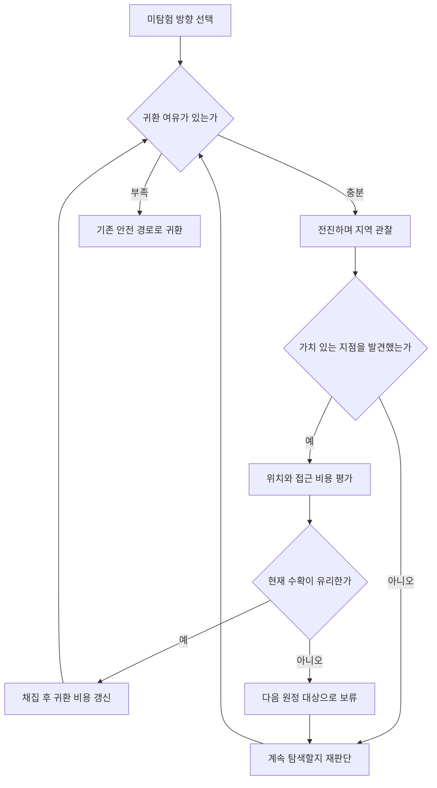

# 05. 월드 생성·바이옴·탐험

> 작성일: 2026-11-13 | 범위: PC 싱글플레이 DS 기본판 + Reign of Giants | 직접 플레이·원본 코드 검증 미실시
>
> `[자료 확인]`은 공개 자료에서 확인한 동작, `[설계 해석]`은 그 동작의 역할 분석, `[재구성 설계]`는 재현을 위한 독자적 제안이다. `[검증 필요]`는 대상 빌드에서 추가 확인할 항목이다.

[전체 목차](00_index.md) · [자원과 채집](06_resources_tools_gathering.md) · [동굴과 유적](16_caves_ruins.md)

## 1. 시스템의 목적과 범위

**탐험은 지도 면적을 채우는 활동인 동시에, 앞으로의 생존 비용을 계산할 정보를 얻는 활동이다.** 자원을 많이 발견하는 것뿐 아니라 그 자원으로 왕복하는 시간, 위험, 계절별 접근성을 이해하는 일이 중요하다.

`[자료 확인·공통]` Klei는 무작위로 생성되는 세계를 게임의 핵심 특징으로 설명한다. 지도는 탐험한 지역부터 드러나며 싱글플레이에서는 지도 열기가 게임을 일시정지시킨다. 바이옴에 따라 자원·생물의 출현 경향이 달라진다. [W1][W2][W3]

이 문서는 지상 탐험과 월드 구성의 설계적 역할을 다룬다. 동굴 내부의 생존 규칙은 16번, Teleportato와 Adventure Mode의 진행은 17번 문서에서 다룬다. 해양 항해, 달섬, DST의 공유 지도는 이 문서의 기본 규칙에 포함하지 않는다.

## 2. 플레이어에게 주어지는 선택

| 선택 | 얻는 가치 | 지불하는 비용 | 설계상 질문 |
| --- | --- | --- | --- |
| 아직 모르는 방향으로 전진 | 신규 자원·지형·특수 지점 정보 | 귀환 지연, 안전 경로 부재 | 정보 한 단위가 식량 한 단위보다 필요한 시점인가? |
| 기존 자원지 재방문 | 예측 가능한 획득량 | 이미 아는 경로의 반복 | 재성장 시간을 왕복 일정과 맞출 수 있는가? |
| 도로 중심 탐색 | 이동 효율과 연결 방향 파악 | 도로 바깥 자원 누락 | 속도와 탐색 범위 중 무엇을 택하는가? |
| 이동 수단의 연결 확인 | 긴 거리의 반복 비용 감소 | 첫 이용의 위험·상태 비용 | 단축 경로의 종착지가 안전한가? |
| 임시 정착 | 당장의 조리·연구·보관 | 이후 이전할 때의 매몰비용 | 정보를 더 모을 가치가 건설 지연보다 큰가? |
| 넓게 탐험한 뒤 정착 | 장기 동선에 유리한 위치 선택 | 초기 안정화 지연 | 살아남을 수 있는 정보 수집 한도는 어디인가? |

위 표는 `[설계 해석]`이며, 모든 상황에서 넓은 탐험이 유리하다는 공략을 뜻하지 않는다. 캐릭터, 시작 계절, 식량 상황이 같은 지도를 다르게 평가하게 만든다.

## 3. 관찰 가능한 공간 구조

### 3.1 세 층으로 읽는 지도

| 분석 층 | 구성 요소 | 플레이에 미치는 영향 |
| --- | --- | --- |
| 지형 연결 | 육지 윤곽, 좁은 연결부, 이동 불가 영역 | 실제 이동거리와 귀환 경로 |
| 지역 성격 | 숲·초원·암석 지대 등 바이옴 | 획득 가능한 자원 묶음과 위험 기대 |
| 개별 지점 | 식물, 광물, 둥지, 구조물, 진입점 | 지금 실행할 구체 행동과 보상 |

`[자료 확인·공통]` 바이옴 문서는 숲의 상록수, 사바나의 비팔로처럼 지역별 출현 경향을 설명한다. 이는 “해당 지역이면 항상 같은 개체 수가 보장된다”는 뜻이 아니다. [W3]

`[설계 해석]` 지형이 비슷해도 지점 배치가 다르면 좋은 거점의 위치는 바뀐다. 반대로 지점 목록이 같아도 연결부가 길면 왕복 부담이 커진다. 월드의 체감 난도를 자원 총량 하나로 설명할 수 없는 이유다.

### 3.2 대표 지역을 읽는 방법

| 대표 지역 | 적용 범위 | 자료에서 확인한 특징 | 설계 해석: 방문 목적과 판단 |
| --- | --- | --- | --- |
| Forest | 공통 | 상록수가 상대적으로 집중 [W3] | 목재 작업과 운반 동선을 함께 계획 |
| Savanna | 공통 | 비팔로 출현 경향 [W3] | 반복 동물 자원 접근성과 안전거리 비교 |
| Marsh | 공통 | 갈대가 자라고 촉수가 밀집한 특수 배치도 존재 [W7] | 필요한 재료를 위해 위험을 감수할 범위 결정 |
| Deciduous Forest | RoG | 자작나무 계열 숲이 추가됨 [W6] | 기본판의 숲 지식이 그대로 적용되는지 다시 학습 |
| 도로·길 주변 | 공통, 바이옴과 별개 | 이동 이점과 연결 경로 [W4] | 지도상의 거리 대신 실제 이동비용 평가 |

대표 사례만 제시했다. 바이옴 명칭이 같다고 모든 생성에서 동일한 구조물·개체가 보장되지는 않으며, 특수 배치를 일반 출현 규칙과 분리해야 한다.

### 3.3 연결성의 가치

`[자료 확인·공통]` 도로와 길은 이동 속도를 높인다. 자연 도로가 돼지 마을 등으로 이어질 수 있지만 목적지가 보장되지는 않는다. [W4]

`[설계 해석]` 도로를 발견하면 이동시간을 줄일 수 있다는 확실한 정보와, 끝에 무엇이 있을지 모른다는 불확실한 정보가 함께 주어진다. 도로를 퀘스트 화살표처럼 해석하면 탐험의 실패 가능성을 놓친다.

## 4. 탐험 상태와 정보의 확실성

| 정보 상태 | 플레이어가 아는 것 | 아직 모르는 것 | 재구성 시 기록할 값 |
| --- | --- | --- | --- |
| 미발견 | 방향과 지도 경계 | 지형, 자원, 위협 | 미노출 영역 |
| 통과 확인 | 이동 가능 여부와 지형 | 세부 자원량·재성장 상태 | 발견 시각, 관찰 범위 |
| 자원지 확인 | 채집할 수 있는 대상의 위치 | 다음 방문 시 실제 잔량 | 자원 종류와 마지막 관찰 |
| 경로 검증 | 왕복 경로와 주요 장애 | 계절·적 출현으로 바뀔 위험 | 경로 길이, 관찰된 위험 |
| 운영 편입 | 정기 방문과 소비 계획 | 외부 사건으로 바뀔 공급량 | 예상 수확일과 여유 시간 |

이 구분은 `[재구성 설계]`이며 원작이 위 항목을 모두 UI나 내부 데이터로 저장한다는 주장이 아니다. 특히 지도에 보이는 아이콘을 실시간 재고 정보로 취급하지 않는 것이 핵심이다.



이 흐름도는 플레이어 의사결정 모형이다. 원작 AI나 자동 경로 탐색기의 실제 알고리즘을 나타내지 않는다.

## 5. 월드 생성의 재구성 요구사항

`[재구성 설계]` 비슷한 플레이 경험을 구현하려면 완전한 균일 난수 배치보다 “지역별 성격과 생존 경로의 최소 성립”을 검사하는 편이 적절하다. 아래 요구사항은 원작의 보장 조건이 아니다.

| 요구사항 | 검증 방법 | 잘못 구현했을 때의 결과 |
| --- | --- | --- |
| 시작 지점에서 초기 필수 행동이 가능 | 조명·초기 채집 도구 재료까지의 도달 비용 검사 | 조작을 배우기 전에 운으로 실패 |
| 바이옴별 성격이 유지 | 자원 종류 분포와 군집도 측정 | 탐험 방향을 판단할 단서가 사라짐 |
| 지상 연결이 플레이 가능 | 실제 이동 가능 영역으로 연결성 검사 | 지도상 가까워도 도달할 수 없는 목표 |
| 희귀 지점이 유의미한 우회 유도 | 주요 거점 후보와 거리 분포 비교 | 희귀 지점이 모두 시작점 곁에 모임 |
| 복수 거점 후보가 존재 | 물자 접근성·위험·이동거리의 상충 검증 | 매번 같은 자리가 압도적 정답 |
| 특정 자원의 편중이 허용됨 | 총량보다 지역 집중 정도 측정 | 모든 곳에서 같은 생존 루프 반복 |

### 5.1 설정과 분포를 구분한다

`[자료 확인·공통·2023 이후]` Mega Update는 자원량을 More/Lots로 높여도 해당 자원의 바이옴 범위를 벗어나 배치하지 않도록 변경했다. 과거 자료의 “많음이면 어디에나 생성” 설명을 현행 PC 기준에 그대로 적용하면 안 된다. [W5]

`[설계 해석]` 양을 늘리는 설정과 공간적 제약을 푸는 설정은 난도에 다른 영향을 준다. 전자는 채집량을 늘리지만 이동의 필요성을 남길 수 있고, 후자는 탐험 동기 자체를 줄일 수 있다.

## 6. 재현용 데이터 모형

다음 이름과 필드는 모두 예시이며 Klei의 실제 클래스·테이블 이름이 아니다.

```yaml
WorldDesignProfile:
  edition: DS_RoG_PC
  ruleset_revision: post_2023_reference
  seed: selected_seed
  start_policy: configured_start
  region_catalog: biome_profiles
  abundance_settings: user_settings
  validation_policy: reproduction_constraints

RegionProfile:
  region_id: generated_id
  biome_id: forest_example
  traversable_area: terrain_mask
  resource_affinities: weighted_resource_tags
  hazard_affinities: weighted_hazard_tags
  connections: neighboring_region_ids

ExplorationRecord:
  revealed_area: player_known_mask
  landmark_records: observed_landmarks
  observation_time: world_time
```

### 6.1 생성 의사코드

```text
GenerateWorld(profile):
    seed the reproduction generator from profile.seed
    create a connected region plan
    assign biome profiles under edition constraints
    shape traversable terrain and verify connections
    place resources using biome-specific distributions
    place landmarks using their placement constraints
    validate the chosen reproduction requirements
    if invalid: retry within a bounded attempt budget
    persist generated terrain and initial object states
```

`[재구성 설계]` 제한 횟수 이후 실패 사유를 남겨야 잘못된 설정 조합과 드문 생성 결함을 구분할 수 있다. 원작의 실제 난수 소비 순서, 그래프 알고리즘, 재시도 조건은 본 문서에서 확인하지 않았다.

## 7. 탐험과 거점 평가의 연결

다음 식은 원작 공식이 아닌 `[재구성 설계]`용 비교 지표다.

`원정 부담 = 이동 시간 + 채집 시간 + 예상 회복 시간 + 귀환 예비 시간`

`거점 효용 = 자주 쓰는 자원의 접근 이득 + 위험 회피 이득 − 유지비 − 장거리 원정 부담`

한 종류의 희귀 자원이 가까운 곳과 매일 쓰는 재료가 가까운 곳은 다른 해답이다. 장기 거점에는 자원별 방문 빈도를 가중치로 사용하고, 계절에 따라 그 가중치를 다시 평가하는 방식이 적절하다.

| 연결 시스템 | 탐험이 제공하는 입력 | 탐험 계획을 바꾸는 출력 |
| --- | --- | --- |
| [시간](02_time_day_night.md) | 경로별 소요시간 | 조명 없이 활동할 수 있는 여유 |
| [생존 상태](03_survival_stats.md) | 예상 소비량과 위험 | 체력·허기·정신력의 귀환 조건 |
| [인벤토리](07_inventory_equipment_durability.md) | 발견한 전리품 종류 | 더 가져갈 수 있는 슬롯 |
| [건설](09_building_base_fire.md) | 거점 후보와 접근 경로 | 실제 출발점과 보급 거점 |
| [계절](12_seasons_weather_temperature.md) | 노출 구간과 체류 시간 | 이동 가능한 원정 길이 |

## 8. 구체적인 플레이 시나리오

### 시나리오 A: 가까운 자원과 좋은 위치가 다른 경우

`[설계 해석·가상 사례]` 출발점 근처의 숲에는 목재가 충분하지만 암석 자원지는 멀다. 플레이어는 첫 연구 구조물을 빨리 세우기 위해 임시 작업장을 만들 수 있다. 이후 지도를 넓힌 다음 이전 여부를 판단한다. 여기서 초반 시설은 실패한 건설이 아니라 정보가 부족할 때 구매한 안정성으로 볼 수 있다.

### 시나리오 B: 지도는 밝혔지만 원정이 더 위험해진 경우

`[설계 해석·가상 사례]` 기존 경로를 알고 있어도 겨울의 체온 관리 비용 때문에 같은 원정이 길게 느껴질 수 있다. 이동거리만 저장한 평가 모형은 이 변화를 설명하지 못한다. 원정 예산에는 현재 계절·장비·조명 상태가 함께 들어가야 한다.

### 시나리오 C: 자원이 많은 월드 설정

`[재구성 설계·가상 사례]` 광물의 밀도만 높인 월드와 모든 지역에 광물을 허용한 월드를 비교한다. 총량이 같아도 전자는 광물 지대 발견의 가치를 남긴다. 이 비교로 자원량 옵션이 난도뿐 아니라 탐험 구조도 바꾸는지 평가할 수 있다.

## 9. 예외와 검증 항목

| ID | 조건 | 확인할 결과 | 증거 수준 |
| --- | --- | --- | --- |
| WLD-01 | 자원 More/Lots 설정 | 허용 바이옴 밖에 자원이 확산하지 않는가 | 2023 변경 자료, 실제 빌드 확인 필요 |
| WLD-02 | 서로 다른 월드 크기 | 크기 증가가 바이옴 개수 증가와 동일한가 | 설정별 실측 필요 |
| WLD-03 | 동일 시드·다른 DLC 호환 설정 | 생성 결과가 어느 범위까지 달라지는가 | 원작 보장 조건 미확인 |
| WLD-04 | 육지 연결부에 구조물 설치 | 유효 귀환 경로가 막히는가 | 재구성 구현 검증 |
| WLD-05 | 탐험 후 자원지를 장기간 미방문 | 지도 아이콘과 실제 상태가 어떻게 다른가 | 원작 관찰 필요 |
| WLD-06 | 지도 열기·닫기 반복 | 싱글플레이 시간 정지가 일관적인가 | 자료 확인, 입력별 검증 필요 |
| WLD-07 | 생성 실패가 반복되는 설정 | 무한 재시도 없이 실패 이유를 남기는가 | 재구성 구현 검증 |
| WLD-08 | 로드 후 다른 층에서 복귀 | 발견 영역·랜드마크 정보가 보존되는가 | 저장 연계 검증 |

## 10. 밸런스 해석과 재현 우선순위

`[설계 해석]` 월드 생성의 핵심은 모든 맵을 동일하게 공정하게 만드는 것이 아니라, 불리한 배치에서도 다른 행동을 선택할 여지가 있는지 확인하는 데 있다. 자원 총량이 충분해도 필요한 순서대로 접근할 수 없으면 난도가 크게 오른다.

초기 재현에서는 **지형 연결 → 바이옴별 자원 군집 → 탐험 가시화 → 특수 지점 → 설정별 분포 검증** 순서가 적절하다. 지도의 시각적 다양성부터 늘리면, 다른 색의 지역을 돌아다니지만 의사결정은 동일한 결과가 생기기 쉽다.

`[검증 필요]` 생성 보장 바이옴 목록, 정확한 자원 수량 분포, 시드 재현성의 플랫폼 차이, 월드 크기별 통계는 데이터 조사와 직접 생성 실험 없이 확정하지 않는다.

## 11. 출처와 접근 수준

| 출처 | 확인한 내용 | 접근 수준 |
| --- | --- | --- |
| [W1] Klei 공식 소개 | 무작위 세계와 생존·탐험의 기본 범위 | 공식 본문 열람 |
| [W2] Map | 탐험에 따른 지도 노출, 싱글플레이 지도 일시정지 | 검색 인덱스 확인 |
| [W3] Biomes | 바이옴별 자원·생물 경향 | 검색 인덱스 확인, 원문 open 403 |
| [W4] Road | 이동 이점과 목적지 비보장 | 검색 인덱스 확인 |
| [W5] Mega Update | 자원량 설정의 바이옴 제약 변경 | 공식 검색 인덱스 확인, 원문 open 403 |
| [W6] Deciduous Forest | RoG의 자작나무 계열 숲 | 검색 인덱스 확인 |
| [W7] Reeds | 늪 갈대와 위험한 특수 배치 | 검색 인덱스 확인 |

[W1]: https://support.klei.com/hc/en-us/articles/360029554792-What-is-Don-t-Starve
[W2]: https://dontstarve.wiki.gg/wiki/Map
[W3]: https://dontstarve.wiki.gg/wiki/Biomes
[W4]: https://dontstarve.wiki.gg/wiki/Road
[W5]: https://kleiforums.com/forums/topic/147423-the-dont-starve-mega-update-is-now-live/
[W6]: https://dontstarve.wiki.gg/wiki/Deciduous_Forest
[W7]: https://dontstarve.wiki.gg/wiki/Reeds
