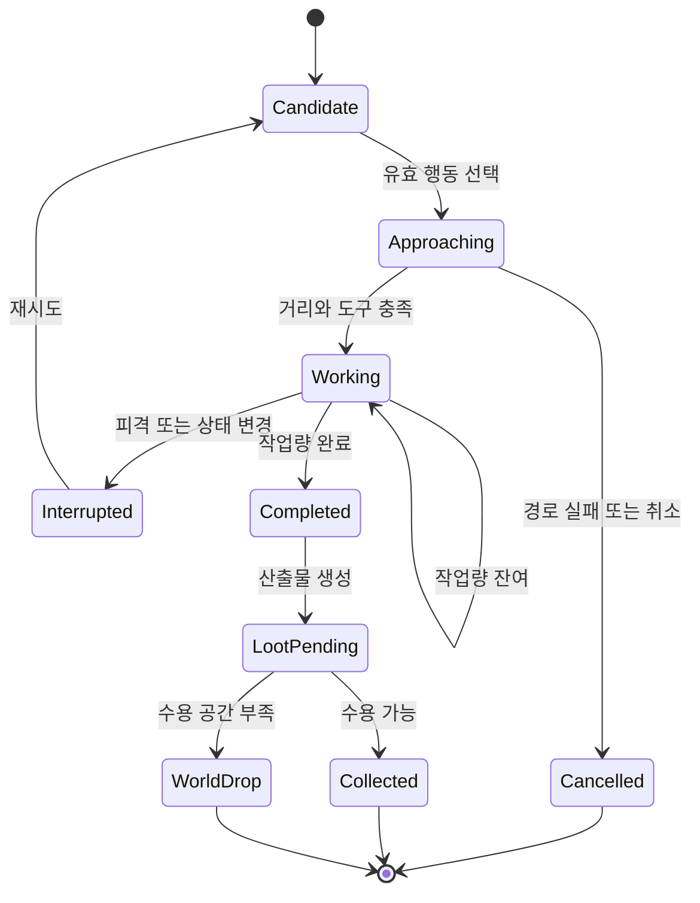

# 06. 자원·도구·채집 경제

> 작성일: 2026-11-13 | 범위: PC 싱글플레이 DS 기본판 + Reign of Giants | 직접 플레이·원본 코드 검증 미실시
>
> `[자료 확인]`은 공개 규칙, `[설계 해석]`은 그 규칙의 역할, `[재구성 설계]`는 독자적 구현 모형이다. 실제 코드의 구조·상수·처리 순서를 복원했다고 주장하지 않는다.

[전체 목차](00_index.md) · [월드와 탐험](05_world_generation_exploration.md) · [제작과 연구](08_crafting_research_magic.md)

## 1. 시스템의 목적

**채집은 소비 자원을 생산하면서 동시에 시간·도구·공간을 소비하는 교환 과정이다.** 지면에 떨어진 재료를 줍는 것, 나무를 베는 것, 광물을 캐는 것은 모두 아이템을 얻지만 생산 조건이 다르다. 이 차이를 보존해야 기술을 얻고 탐험 범위를 넓히는 이유가 생긴다.

`[자료 확인·공통]` 도구는 벌목·채광·굴착 등 특정 행동을 가능하게 하고, 일반적인 도구는 해당 작업을 수행하면서 내구도를 소모한다. 도구별 내구 소모 방식과 예외는 존재한다. [R1][R2]

`[설계 해석]` 원작의 자원 경제는 화면에 가격을 표시하지 않는다. 플레이어가 이동시간, 체력 손실, 내구도, 슬롯 점유를 경험하며 재료의 실질 가격을 배운다.

## 2. 자원을 분류하는 기준

### 2.1 아이템과 생산원을 분리한다

| 구분 | 설명 | 설계상 의미 |
| --- | --- | --- |
| 획득물 | 나뭇가지, 목재, 광물, 식재료 등 휴대 가능한 결과 | 제작·연료·음식 등의 공용 입력 |
| 생산원 | 식물, 나무, 바위, 생물, 특수 구조물 | 위치·재생성·위험이 붙는 공간 자산 |
| 변환 수단 | 도구, 불, 제작법, 거래 대상 | 원료를 다른 효용으로 바꾸는 조건 |
| 수송 수단 | 인벤토리·가방·보관함·동행 보관 개체 | 수확량을 실제 사용량으로 연결 |
| 소모처 | 제작·연료·회복·장비 유지 | 자원의 반복 수요를 생성 |

`[자료 확인·공통]` 지상의 바위 오브젝트가 다시 생성되지 않아도 그 산출 광물은 지하 지진 등 다른 경로에서 얻을 수 있다. 따라서 생산원 고갈과 아이템의 세계 전체 고갈을 같은 것으로 분류하면 안 된다. [R3]

### 2.2 재생성은 세 가지 질문이다

1. **이 생산원은 다시 수확 가능한 상태가 되는가?** 식물의 재성장처럼 같은 개체를 반복 이용하는 경우다.
2. **생산원 자체가 새로 생기는가?** 개체 번식·특수 재생성·다른 지역 생성의 문제다.
3. **같은 아이템을 다른 경로로 얻을 수 있는가?** 광산이 고갈되어도 거래나 지하 공급이 남을 수 있다.

이 세 축은 `[재구성 설계]`의 자원 분류 기준이다. “재생 가능”이라는 단일 체크박스만으로는 장기 생존 경제를 설명하기 어렵다.

### 2.3 대표 자원과 진행상의 역할

| 자원·생산원 | 확인한 획득 경로 | 설계 해석: 병목이 되는 이유 |
| --- | --- | --- |
| 나무와 목재 | 도끼를 이용한 벌목 [R1] | 조명 연료와 구조물 투자에 수요가 겹침 |
| 바위와 광물 | 채광으로 돌·부싯돌·금·초석 계열 획득 [R3] | 기본 도구와 연구 투자 사이의 재료 배분 |
| 풀·베리·묘목 | 채집과 일부 생산원의 이식 [R4] | 반복 이동을 줄이는 대신 유지와 손실 집중을 감수 |
| 갈대 | 늪의 식물을 수확 [R5] | 위험 지역 접근이 특수 제작의 공간적 조건이 됨 |
| 숯 | 태운 나무를 베어 회수 [R6] | 평소 보존할 나무를 의도적으로 다른 재료로 변환 |

`[자료 확인·공통]` 숯은 Crock Pot·Drying Rack 등의 제작 입력이다. [R6] `[설계 해석]` 따라서 불을 끄기만 하는 플레이에서 필요한 대상을 의도적으로 태우는 플레이로 이해가 확장된다. 모든 나무를 같은 수량의 숯으로 환산하는 상수는 버전·나무 종류별 검증 없이 사용하지 않는다.

## 3. 자원 접근 단계와 플레이 역할

| 접근 단계 | 대표적인 행동 유형 | 필요한 준비 | 이후 열리는 행동 |
| --- | --- | --- | --- |
| 손으로 확보 | 줍기·따기 | 이동·시간·빈 슬롯 | 초기 도구와 조명 확보 |
| 기본 도구 사용 | 벌목·채광 | 도구 제작 재료와 내구도 | 대량 재료, 연구 구조물 |
| 생산원 이동 | 굴착·이식 | 삽, 운반 공간, 정착지 | 접근 비용을 줄인 반복 수확 |
| 위험 지역 채집 | 늪·적 근처·장거리 자원지 방문 | 회복·장비·귀환 계획 | 특수 제작과 저장 인프라 |
| 고급 변환 | 마법·희귀 제작·특수 거래 | 기술과 희귀 입력 | 기존 한계의 우회 |

`[설계 해석]` 같은 재료도 초반에는 생존 필수품이고, 중반에는 유지비이며, 후반에는 원정 시간의 제약이 된다. 생산량이 증가했다고 해서 가치가 일방적으로 사라지는 구조는 아니다.

## 4. 채집 행동의 계약

다음 표는 공개 행동을 `[재구성 설계]` 관점에서 입력·조건·결과로 분해한 것이다. 구체 작업 횟수와 드롭률은 대상 빌드의 별도 테이블에서 검증해야 한다.

| 입력 | 사전 조건 | 소비 | 처리 | 출력 |
| --- | --- | --- | --- | --- |
| 줍기 | 대상 유효, 접근 가능 | 이동·행동 시간 | 대상 소유권 이전 | 슬롯 병합 또는 신규 슬롯 |
| 따기 | 생산원이 수확 가능 | 행동 시간 | 수확 상태 해제 | 획득물 + 재성장 대기 |
| 벌목 | 벌목 가능 대상·호환 도구 | 작업 시간·내구도 | 남은 작업량 감소 | 단계별 또는 완료 시 드롭 |
| 채광 | 채광 가능 대상·호환 도구 | 작업 시간·내구도 | 자원 노드 작업 진행 | 광물 드롭·노드 변화 |
| 굴착 | 굴착 가능한 상태 | 작업 시간·내구도 | 뿌리·그루터기 등의 상태 변화 | 제거 또는 이식 가능한 결과 |
| 연소 후 회수 | 연소 가능한 대상 | 점화 수단·시간·위험 | 원료 상태를 태움 상태로 변환 | 연소 산출물, 생산원 손실 가능 |

### 4.1 행동 진행과 획득을 같은 사건으로 취급하지 않는다

`[재구성 설계]` 버튼을 누르는 시점, 도구가 대상에 닿는 시점, 작업이 완료되는 시점, 드롭이 생기는 시점, 아이템이 인벤토리에 들어가는 시점을 분리한다. 그래야 중간에 공격받아 취소되거나 도구가 마지막 사용에서 깨지는 상황을 일관되게 처리할 수 있다.



## 5. 도구의 실제 가격

`[설계 해석]` 좋은 도구는 단순히 오래 쓰는 도구가 아니다. 재료를 얻기 쉬운지, 작업 속도가 달라지는지, 인벤토리 한 칸을 줄이는지, 교체 도구를 만드는 현장 재료가 필요한지까지 평가해야 한다.

| 평가 항목 | 질문 | 개발용 비교 지표 |
| --- | --- | --- |
| 제작 접근성 | 지금 만들 수 있는가? | 선행 재료·기술·이동 부담 |
| 작업 수명 | 원정 중 얼마나 쓸 수 있는가? | 대상별 완료 가능한 작업 수 |
| 작업 효율 | 한 번의 원정에 더 많이 얻는가? | 산출량/행동시간 |
| 운반 효율 | 여러 도구 역할을 합치는가? | 확보되는 인벤토리 슬롯 수 |
| 대체 비용 | 파괴되면 즉시 다시 만들 수 있는가? | 현장 제작 가능 여부 |
| 부작용 | 안전·정신력·생태계에 비용이 생기는가? | 추가 회복·위험 노출 시간 |

다음 식은 원작 공식이 아닌 `[재구성 설계]`용 비교식이다.

`유효 생산 비용 = 왕복 시간 + 작업 시간 + 도구 보충 시간 + 예상 손실 복구 시간`

`회수 효율 = 실제 거점까지 운반한 유효 산출량 / 유효 생산 비용`

가득 찬 인벤토리 때문에 현장에 두고 온 광물은 수확량에는 포함되지만 당일 가용 재고에는 포함되지 않는다. 이 구분이 없어지면 도구 성능만 과대평가하게 된다.

## 6. 생산원 이동과 지역 고갈

`[자료 확인·공통]` 파내서 이식한 풀과 베리 덤불은 다시 생산하려면 비료가 필요하다. 이식한 묘목은 같은 비료 요구를 갖지 않는다. [R4]

`[설계 해석]` 이식은 생산량 자체를 늘리는 행위라기보다 생산원과 플레이어 사이의 거리를 줄이는 투자다. 가까워진 만큼 채집이 쉬워지지만, 한 장소에 모인 생산원은 화재나 거점 상실에 함께 노출된다.

| 운영 방식 | 단기 이점 | 장기 제약 |
| --- | --- | --- |
| 야생 분포 유지 | 초기 이전 비용 없음, 위험 분산 | 매번 이동 필요 |
| 거점 집중 이식 | 반복 동선 감소 | 초기 삽·운반·비료 비용, 손실 집중 |
| 복수 보급지에 분산 | 원정 중 보충, 재난 분산 | 관리 지점 증가 |
| 단기 집중 채굴 | 빠른 기술 투자 | 가까운 생산원 고갈 후 동선 증가 |

`[검증 필요]` 구형 문서의 “비재생 자원” 목록을 현행 빌드에 그대로 사용하지 않는다. DLC 호환, 버전, 동굴·유적 재생성 수단 유무를 함께 기록한다. 지상 바위가 자연 재생하지 않는다는 사실과 전체 자원이 영구 고갈된다는 주장은 다르다.

## 7. 재현용 데이터와 처리 모형

```yaml
GatherableDefinition:
  id: resource_node_example
  required_action: mine
  required_tool_tags: [mining_tool]
  work_budget: data_defined
  loot_profile: edition_specific
  after_completion: removed_or_transformed
  renewal_policy: source_specific
  fire_policy: source_specific

ToolDefinition:
  id: mining_tool_example
  supported_actions: [mine]
  effectiveness_by_action: data_defined
  wear_cost_by_action: data_defined
  replacement_recipe: recipe_id

GatheringTransaction:
  actor_id: actor
  target_id: target
  selected_tool_id: equipped_tool
  action_progress: current_action_phase
  resolved_once: false
```

```text
ResolveWorkHit(request):
    validate actor, target, range and selected tool again
    if target cannot receive this action: reject without spending wear
    compute work contribution from action and tool profile
    apply work contribution exactly once
    spend the corresponding tool wear exactly once
    if a stage boundary was crossed: resolve that stage's output
    if work is complete: resolve final target transition
    publish the result for animation, sound and inventory handling
```

위 처리 순서는 원작 코드가 아닌 재현 구현안이다.

`[재구성 설계]` 위 의사코드는 작업 효과를 확정하는 순간의 검증을 강조한다. 처음 클릭했을 때 있던 대상이 도착 전에 없어졌다면 도구 내구도를 지불할 이유가 없다. 반대로 유효 타격으로 작업량이 줄었다면 후속 애니메이션 취소가 같은 타격을 되돌려서는 안 된다.

## 8. 시스템 연계와 우선순위

| 연결 시스템 | 자원 시스템이 제공 | 자원 시스템이 받는 제약 |
| --- | --- | --- |
| [제작](08_crafting_research_magic.md) | 원재료·가공재 | 다음 제작 목표와 수요 |
| [인벤토리](07_inventory_equipment_durability.md) | 드롭·스택 | 운반 가능 수량 |
| [음식](10_food_cooking_spoilage.md) | 식재료·연료 | 소비 기한과 필요한 조합 |
| [농업](11_farming_animals_sustainability.md) | 씨앗·이식물·비료 | 생산원 유지 비용 |
| [계절](12_seasons_weather_temperature.md) | 저장할 수 있는 공급량 | 재성장·원정 조건 변화 |
| [생물](14_creatures_ecology_ai.md) | 채집 소음·자원 변화 | 방해·공격·자연 생산 |

`[재구성 설계]` 우선순위는 “자원 손실 방지”와 “원작의 위험 유지”를 함께 고려한다. 아이템 수용 실패 시 복제·소멸은 방지하되, 월드 드롭을 안전하게 보관해 주는 기능을 임의로 추가하지 않는다. 지상에 놓인 물건은 지상 규칙을 따라야 한다.

## 9. 구체적인 운영 사례

### 사례 A: 마지막 도구로 광물을 얻는 선택

`[설계 해석·가상 사례]` 남은 내구도로 원하는 바위 하나를 마무리할 수 있지만 다른 재료를 얻을 수 없게 되는 상황이다. 현재 보유한 제작 재료와 현장 산출물이 다음 도구를 만들 수 있게 하는지 판단한다. 이때의 핵심은 절대 내구도보다 **다음 생산 행동으로 이어질 수 있는가**이다.

### 사례 B: 땔감 확보와 장기 목재 확보의 충돌

`[설계 해석·가상 사례]` 당장 필요한 연료를 위해 생산원 주변을 무리하게 이용하면 다음날 제작용 목재와 이동시간이 부족해질 수 있다. 같은 목재를 연료·제작·시설 중 어디에 배분하느냐가 다른 시스템의 시간을 바꾼다.

### 사례 C: 생산원은 가까워졌지만 운영은 더 위험해짐

`[설계 해석·가상 사례]` 플레이어가 여러 식물을 한 거점에 모아 일일 이동 시간을 줄였다. 이제 수확은 쉬워졌지만 한 번의 불이 채집과 식량을 동시에 끊을 수 있다. 이식의 편의가 재난 대응 투자를 요구하는 새로운 루프로 연결된다.

## 10. 예외·QA·밸런스 검증

| ID | 시험 조건 | 검증할 항목 |
| --- | --- | --- |
| RES-01 | 작업 중 대상이 다른 원인으로 제거 | 내구도·드롭 중복 없이 동작 종료 |
| RES-02 | 마지막 내구 사용과 작업 완료가 동시 발생 | 작업 결과와 도구 파괴의 일관성 |
| RES-03 | 인벤토리 가득 참 | 드롭의 위치·소유·수량이 보존되는가 |
| RES-04 | 재성장 중 계절 변경 | 타이머와 성장 가능 조건이 분리되는가 |
| RES-05 | 이식 직후 로드 | 비료 필요 상태와 생산원 ID가 보존되는가 |
| RES-06 | 수확 전후 화재 발생 | 두 결과가 중복 계산되지 않는가 |
| RES-07 | 같은 도구로 작업과 전투 수행 | 서로 다른 소모 규칙이 섞이지 않는가 |
| RES-08 | 지역 광물 완전 채굴 | 대체 공급 경로와 이동 비용을 반영하는가 |
| RES-09 | 원거리 지역 재방문 | 비활성 시간의 자원 갱신이 일관적인가 |
| RES-10 | 자원량 설정 극단값 | 총량 외에 최초 접근 시간도 달라지는가 |

`[설계 해석]` 생산량을 올리기 전에 반복 작업시간과 왕복시간을 분리해 측정해야 한다. 불필요한 이동 때문에 피곤한 경제와 자원 선택이 어려워서 흥미로운 경제는 다른 문제다.

`[검증 필요]` 도구별 정확한 사용 횟수, 나무 단계별 작업량, 드롭률, 재성장 시간, 화면 밖 갱신 규칙은 여기서 확정하지 않았다. 해당 값은 시각 연출이나 체감만으로 역산하지 말고 대상 빌드의 관찰 표를 채운 뒤 입력한다.

## 11. 출처와 접근 수준

| 출처 | 확인 내용 | 접근 수준 |
| --- | --- | --- |
| [R1] Tools Tab | 작업을 여는 도구와 내구도 예외 | 검색 인덱스 확인 |
| [R2] Durability | 작업별 내구 소비의 기본 개념 | 검색 인덱스 확인 |
| [R3] Boulder | 지상 바위와 산출 광물의 재생성 구분 | 검색 인덱스 확인 |
| [R4] Farming | 이식물별 비료 요구 차이 | 검색 인덱스 확인 |
| [R5] Reeds | 늪의 갈대 채집 | 검색 인덱스 확인 |
| [R6] Charcoal | 연소 후 숯 획득과 제작 용도 | 검색 인덱스 본문 확인 |

[R1]: https://dontstarve.wiki.gg/wiki/Tools_Tab
[R2]: https://dontstarve.wiki.gg/wiki/Durability
[R3]: https://dontstarve.wiki.gg/wiki/RockNitre
[R4]: https://dontstarve.wiki.gg/wiki/Farming
[R5]: https://dontstarve.wiki.gg/wiki/Reeds
[R6]: https://dontstarve.wiki.gg/wiki/Charcoal
