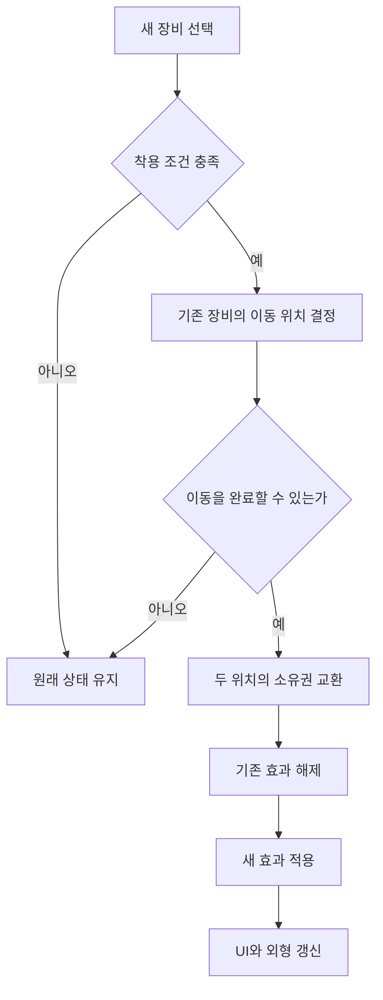

# 07. 인벤토리·장비 슬롯·내구도·보관

> 작성일: 2026-11-13 | 범위: PC 싱글플레이 DS 기본판 + Reign of Giants | 직접 플레이·원본 코드 검증 미실시
>
> `[자료 확인]`은 공개 규칙, `[설계 해석]`은 플레이 역할 분석, `[재구성 설계]`는 독자적 데이터·처리 제안이다. 패치로 달라진 항목과 미검증 조건을 함께 표시한다.

[전체 목차](00_index.md) · [자원](06_resources_tools_gathering.md) · [전투와 방어구](13_combat_armor.md) · [저장 구조](19_data_architecture_save.md)

## 1. 시스템의 목적

**인벤토리의 제한은 무엇을 소유할 수 있는지보다, 다음 행동에 무엇을 준비할지 결정하게 만든다.** 식량·연료·도구·회복품·전리품이 같은 제한을 공유하므로 더 큰 수확에는 더 큰 위험이나 재방문 비용이 붙는다.

`[자료 확인·공통]` 일반 캐릭터의 기본 인벤토리는 15개 슬롯이며 손·몸·머리 장비 슬롯이 별도로 있다. 몸 슬롯에는 방어구·의복·가방이 들어가므로 기능이 경쟁한다. 기본 Backpack은 8칸을 추가한다. Backpack 자체는 일반 인벤토리나 상자에 넣지 못한다. [I1][I2]

본 문서의 수치는 기본 가방과 일반 캐릭터를 설명하는 대표값이다. 다른 DLC의 캐릭터 예외, DST의 추가 가방·보관 시설, 모드로 늘린 슬롯은 기본 규격으로 취급하지 않는다.

## 2. 실제로 경쟁하는 세 가지 자원

| 제한 | 경쟁하는 대상 | 플레이 결과 |
| --- | --- | --- |
| 인벤토리 슬롯 | 서로 다른 재료·도구·식량 묶음 | 버릴 물건 또는 귀환 시점 선택 |
| 장비 슬롯 | 조명·무기·보호·운반 기능 | 안전과 생산 효율의 교체 비용 |
| 잔여 사용량 | 도구·무기·의복·광원의 수명 | 원정 거리와 예비품 필요량 |

`[설계 해석]` 슬롯을 늘리면 수송 효율은 좋아지지만 장비 교체의 판단까지 사라져서는 안 된다. 몸 장비의 경쟁은 공간 제한과 위험 대응을 연결하는 핵심 장치다.

## 3. 소유 상태와 위치

아래는 `[재구성 설계]`용 소유 상태 구분이다. 원작 UI의 명칭이나 내부 enum을 복원한 표가 아니다.

| 상태 | 소유자 | 적용해야 할 규칙 | 대표 실패 |
| --- | --- | --- | --- |
| 바닥 아이템 | 월드 | 위치·환경·다른 개체와의 상호작용 | 보관품처럼 안전하다고 오판 |
| 기본 슬롯 | 플레이어 | 스택·소비·제작·신선도 | 없는 수량을 중복 사용 |
| 장비 슬롯 | 플레이어 | 착용 효과·사용량·해제 | 효과가 중복 적용되거나 남음 |
| 가방 내부 | 가방 오브젝트 | 가방 위치·접근 가능성·내용물 | 가방 교체로 내용물 소멸 |
| 구조물 보관 | 보관 구조물 | 컨테이너 규칙·파괴·환경 | 구조물만 파괴되고 내부 데이터 유실 |
| 커서 선택 | 입력 컨텍스트 | 드래그·교환·분할·취소 | 저장·메뉴 전환 시 소유권 불명 |

핵심 불변식은 **하나의 아이템 인스턴스가 동시에 두 위치에 존재하지 않는다**는 것이다. 스택 수량은 분리·합치기로 변할 수 있지만 총량 변화는 소비·획득·파괴 사건으로만 설명되어야 한다.

## 4. 대표 용량과 경계

| 항목 | 대표값 또는 제약 | 범위·근거 |
| --- | --- | --- |
| 일반 기본 인벤토리 | 15칸 | 공통, 일반 캐릭터 [I1] |
| 장비 슬롯 | 손·몸·머리 | 공통 [I1] |
| 기본 Backpack | 추가 8칸 | 공통 [I2] |
| 일반 Chest | 9칸 | 공통 [I1] |
| 가방과 몸 방어구 | 같은 몸 슬롯 경쟁 | 공통 [I1] |
| 스택 상한 | 아이템 정의별로 다름 | 단일 상수로 일반화하지 않음 |

`[자료 확인·공통·2023 이후]` Mega Update에서 가방 통합 표시 옵션과 컨테이너 안 재료를 이용하는 제작이 추가되었다. 통합 표시는 장비 슬롯을 추가한다는 뜻이 아니다. [I3]

`[검증 필요]` 제작 재료로 인정되는 컨테이너의 거리·열림 상태·접근 대상 범위는 이 문서에서 실측하지 않았다. “월드에 있는 모든 상자를 자동으로 검색한다”는 사양으로 해석하지 않는다.

## 5. 조작별 처리 규칙

| 입력 | 확인 조건 | 성공 결과 | 실패 또는 부분 성공 |
| --- | --- | --- | --- |
| 아이템 획득 | 호환 스택 또는 빈 슬롯 | 기존 스택 증가 또는 새 슬롯 점유 | 수용하지 못한 수량은 월드에 유지 |
| 스택 분리 | 수량이 분리 가능한가 | 두 스택의 수량 합계 보존 | 최소 단위 이하면 거절 |
| 스택 병합 | 동일 종류·병합 가능 상태인가 | 상한까지 합치고 나머지 유지 | 다른 상태를 합칠 정책 없으면 거절 |
| 장비 착용 | 대응 슬롯과 캐릭터 조건 | 새 효과 적용·기존 효과 해제 | 기존 장비 이동 위치를 해결해야 함 |
| 가방 교체 | 새 가방 착용 가능 | 내용물을 가진 가방 단위 이동 | 내용물만 자동 삭제하면 안 됨 |
| 컨테이너 이동 | 수용 규칙·남은 공간 | 소유 위치 변경 | 들어간 양과 남은 양 분리 |
| 소비·제작 | 소비 대상과 사용 가능 수량 | 수량·상태 변화 | 성공 결과 없는 중복 차감 방지 |

위 표의 실패 처리 세부는 `[재구성 설계]`다. 실제 원작의 자동 배치 우선순위를 모두 확인한 것은 아니다.

### 5.1 장비 교체의 원자성



`[재구성 설계]` 가방을 벗을 때 내부 슬롯이 UI에서 사라져도 가방의 내용물은 가방 데이터에 남아야 한다. 가방의 표시 여부와 내부 아이템의 생존 여부를 같은 플래그로 처리하면 안 된다.

## 6. 내구도는 하나의 감소식이 아니다

`[자료 확인·공통]` 도구는 작업 사용으로, 무기는 공격 사용으로, 방어구는 피해 흡수와 연결되어 내구도를 소비한다. 시간·부패에 의해 수명이 줄어드는 물건도 있어 퍼센트 표시만으로 같은 계산을 적용할 수 없다. [I4]

| 수명 유형 | 소모 사건 | 평가 기준 | 재구성 시 주의 |
| --- | --- | --- | --- |
| 작업 횟수 | 유효 작업 타격 | 완료 가능한 작업 수 | 작업과 공격의 비용을 분리 |
| 공격 횟수 | 유효 공격 | 원정 중 지속 전투량 | 빗나감·중단 처리 확인 |
| 방어 내구 | 피해 처리 | 견딜 수 있는 공격 조합 | 흡수율과 남은 내구의 역할 분리 |
| 착용 시간 | 장착 중 시간 경과 | 실질 사용 가능 시간 | 벗어 둔 시간 처리 확인 |
| 연료 | 활성 상태 유지 | 남은 조명·기능 시간 | 꺼진 상태·재급유 조건 확인 |
| 신선도 | 월드 시간·환경 | 사용 가능한 기간 | 일반 내구와 수리 체계를 공유하지 않음 |

방어구 중첩과 마지막 내구 타격의 흡수 판정은 [전투 문서](13_combat_armor.md)의 버전 기준을 따른다. 여기서는 방어 계산식을 독립적으로 다시 정의하지 않는다.

### 6.1 UI 퍼센트의 의미

`[설계 해석]` 서로 다른 물건의 50%는 같은 남은 시간을 의미하지 않는다. 사용자는 아이템의 용도와 경험을 바탕으로 수명을 추정한다. 재현 UI가 필요하다면 표시값은 동일하게 단순화하되 내부 단위는 각 수명 유형별로 유지하는 편이 정확하다.

## 7. 스택과 신선도의 연결

`[자료 확인·공통]` 같은 음식 스택을 합치면 신선도가 평균화되는 동작이 문서화되어 있다. [I1]

`[검증 필요]` 평균의 정확한 가중 방식, 서로 다른 컨테이너 환경에서 옮기는 순간의 갱신 순서, 반올림은 별도 확인이 필요하다. 단순한 두 퍼센트의 산술 평균이라고 가정하지 않는다.

`[재구성 설계]` 수량 가중 평균을 쓰는 구현을 택한다면 새 신선도는 `합계(수량 × 신선도) / 총수량`으로 정의할 수 있다. 이 식은 재현안이며 본 조사로 원작 계산식을 확인한 결과가 아니다. 최종 규칙은 [음식과 부패](10_food_cooking_spoilage.md) 문서의 검증 결과에 맞춰 하나로 통일한다.

## 8. 재현용 데이터 모형

```yaml
ItemDefinition:
  item_type_id: definition_key
  stack_limit: item_specific
  equip_slot: none_or_hand_body_head
  lifetime_kind: uses_or_armor_or_time_or_fuel_or_freshness
  allowed_containers: policy_reference

ItemInstance:
  instance_id: stable_identity
  quantity: positive_integer
  owner: world_or_actor_or_container
  slot: location_within_owner
  lifetime_state: kind_specific_payload
  freshness_state: optional_payload

InventoryOperation:
  operation_id: unique_operation
  source: owner_and_slot
  destination: owner_and_slot
  requested_quantity: selected_quantity
  committed: false
```

```text
MoveItems(operation):
    resolve current source and destination
    verify item identity and available quantity
    determine transferable quantity under destination rules
    prepare merge, split or swap result
    commit source and destination changes together
    apply equipment effects only for changed equipment ownership
    notify UI using the committed result
```

`[재구성 설계]` 제작의 재료 차감도 이 이동·소비 계층을 이용하면 인벤토리와 컨테이너의 다른 우선순위가 중복 차감을 일으키는 일을 줄일 수 있다.

## 9. 원정 준비 시나리오

### 사례 A: 전리품이 많을수록 귀환이 늦어짐

`[설계 해석·가상 사례]` 새로운 지역에서 여러 종류의 재료를 발견하면 총수량은 작아도 슬롯이 빨리 찬다. 무엇이 다음 제작의 병목인지 판단하지 못하면 가치가 낮은 다양성 때문에 필요한 자원을 두고 오게 된다. 인벤토리는 탐험 정보를 제작 목표로 바꾸도록 압력을 준다.

### 사례 B: 가방을 벗는 전투

`[설계 해석·가상 사례]` 몸 방어구로 교체하면 수송 능력과 방어가 분리된다. 가방 위치가 안전한지, 전투 뒤 회수할 수 있는지, 긴급 식량이 접근 가능한 기본 슬롯에 있는지까지 판단해야 한다. 가방 교체는 장비 수치만 바뀌는 행동이 아니다.

### 사례 C: 내구도가 낮은 예비품

`[설계 해석·가상 사례]` 얼마 남지 않은 도구를 챙기면 한 칸을 쓰지만 현장에서 새 도구를 만드는 시간을 아낄 수 있다. 반대로 여러 예비품을 모두 챙기면 채집할 공간이 없다. 예비품의 가치는 남은 횟수보다 원정 중 중단 위험을 얼마나 줄이는가에 달려 있다.

## 10. 예외·QA 항목

| ID | 조건 | 검증할 결과 |
| --- | --- | --- |
| INV-01 | 15칸 가득 찬 상태에서 동일·다른 아이템 획득 | 병합 가능량과 바닥 잔량의 보존 |
| INV-02 | 가득 찬 가방을 몸 장비로 교체 | 가방 내용물과 위치 보존 |
| INV-03 | 장비 효과를 가진 물건을 연속 교환 | 속도·보호·상태 효과의 중복 누적 방지 |
| INV-04 | 수량이 다른 음식 스택을 합침 | 원작 신선도 공식과 일치 여부 |
| INV-05 | 커서에 물건을 든 채 저장·종료 | 소유권과 수량 보존 |
| INV-06 | 열린 컨테이너를 제작 중 파괴·닫기 | 재료 자격 재검증과 단일 차감 |
| INV-07 | 마지막 내구 사용과 착용 해제가 겹침 | 효과 해제·아이템 파괴가 한 번씩 발생 |
| INV-08 | 컨테이너 파괴 | 내용물의 정확한 방출 또는 해당 규칙의 적용 |
| INV-09 | 통합 가방 UI 옵션 변경 | 실제 용량·장비 슬롯·수량이 변하지 않음 |
| INV-10 | 접근 불가능한 보관함에 재료 존재 | 임의 원격 제작이 일어나지 않음 |
| INV-11 | 슬롯 정렬·분할 뒤 제작 | 소비된 인스턴스·수량을 추적 가능 |
| INV-12 | 장거리 원정 중 내구 0 도달 | 즉시 교체 행동과 실패 피드백 일관성 |

## 11. 밸런스 해석

`[설계 해석]` 슬롯 제한은 단순한 불편이 아니라 운반·위험·정착을 묶는다. 다만 빈번한 정렬 조작이 의미 있는 선택을 압도하면 긴장보다 피로가 커진다. 분석 시 “무엇을 버릴지 고민한 시간”과 “같은 물건을 반복 이동한 시간”을 따로 측정하는 편이 좋다.

재현 우선순위는 **소유권·수량 보존 → 기본 슬롯 → 장비 교체 → 가방 → 내구 종류 → 컨테이너 제작 연결 → 표시 편의** 순서로 잡는다. 시각적 슬롯이 먼저 완성되어도 소유권 모델이 불안정하면 저장과 제작에서 결함이 반복된다.

## 12. 출처와 접근 수준

| 출처 | 확인 내용 | 접근 수준 |
| --- | --- | --- |
| [I1] Inventory | 일반 슬롯, 장비 구분, 상자 용량, 음식 스택 | 검색 인덱스 확인, 원문 open 403 |
| [I2] Backpack | 추가 용량과 일반 보관 제한 | 검색 인덱스 확인, 별칭 URL |
| [I3] Mega Update | 2023 인터페이스·제작 연결 변경 | 공식 검색 인덱스 확인, 원문 open 403 |
| [I4] Durability | 수명 소모 유형 | 검색 인덱스 확인 |

[I1]: https://dontstarve.wiki.gg/wiki/Inventory
[I2]: https://dontstarve.wiki.gg/wiki/Krampus_Sacks
[I3]: https://kleiforums.com/forums/topic/147423-the-dont-starve-mega-update-is-now-live/
[I4]: https://dontstarve.wiki.gg/wiki/Durability
