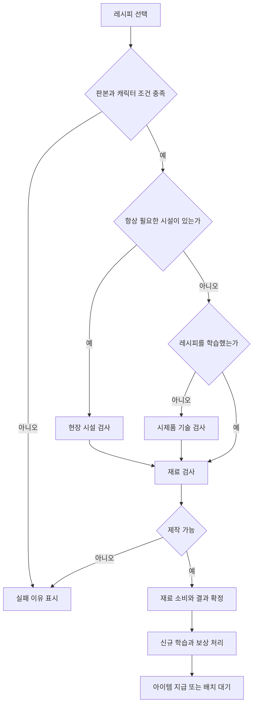

# 08. 제작·연구·마법·레시피 해금

> 작성일: 2026-11-13 | 범위: PC 싱글플레이 DS 기본판 + Reign of Giants | 직접 플레이·원본 코드 검증 미실시
>
> `[자료 확인]`과 `[설계 해석]`을 구분한다. 데이터 구조·의사코드는 `[재구성 설계]`이며 실제 원본 소스의 이름·순서를 의미하지 않는다.

[전체 목차](00_index.md) · [자원](06_resources_tools_gathering.md) · [인벤토리](07_inventory_equipment_durability.md) · [건설](09_building_base_fire.md)

## 1. 시스템의 목적

**제작은 재료를 물건으로 바꾸고, 연구는 한 번의 거점 투자를 이후의 이동 자유로 바꾼다.** 초기에는 연구 시설을 찾아가거나 직접 세워야 하지만 일반적인 시제품 제작을 마치면 같은 레시피를 시설 밖에서도 만들 수 있다.

`[자료 확인·공통]` Science Machine은 과학 1단계 시제품 제작을 제공하며 최초 제작으로 일반 레시피를 학습할 수 있다. 상위 과학 시설은 Alchemy Engine이다. 마법 기술은 Prestihatitator와 Shadow Manipulator로 별도 단계를 갖는다. [C1][C2][C3][C4]

아래 분석은 원작의 제작 탭을 기준으로 한다. DST의 검색 필터, 캐릭터 스킬 트리, 협동 전용 시설은 기본 레시피 체계에 합치지 않는다.

## 2. 반드시 분리해야 할 네 상태

| 상태 | 의미 | 재료가 충분할 때 가능한 행동 |
| --- | --- | --- |
| 아직 모름 | 일반 레시피를 학습하지 않았음 | 필요한 시제품 제작 조건 충족 시 최초 제작 |
| 학습함 | 해당 일반 레시피의 지식 보유 | 통상 시설 밖에서도 재제작 |
| 현장 시설 필요 | 매번 지정 제작 시설이 필요함 | 시설 조건을 충족할 때만 제작 |
| 사전 제작 완료 | 구조물 재료를 쓰고 배치만 남김 | 유효 위치에 배치 |

`[자료 확인·공통]` 일반 시제품 시설과 매번 방문해야 하는 제작 시설은 구분된다. Ancient Pseudoscience Station 계열은 일반적인 영구 해금과 동일하게 취급하면 안 된다. 청사진은 지식을 제공하며 완제품 자체를 지급하는 아이템이 아니다. [C5][C6]

`[자료 확인·공통]` 구조물을 미리 제작한 뒤 배치를 보류해 나중에 설치하는 사용 방식이 문서화되어 있다. 다만 미배치 보관 개수·취소 시점·보상 지급 순간의 세부는 대상 빌드 관찰로 확정해야 한다. [C7]

## 3. 대표 연구 구조와 검증된 재료 예시

| 시설 | 역할 | 대표 제작 재료 | 적용 범위 |
| --- | --- | --- | --- |
| Science Machine | 과학 1단계 시제품 | Gold Nugget 1, Logs 4, Rocks 4 | 공통 [C1] |
| Alchemy Engine | 과학 2단계 및 하위 과학 | Boards 4, Cut Stone 2, Gold Nugget 6 | DS 기본판 [C2] |
| Alchemy Engine | 과학 2단계 및 하위 과학 | Boards 4, Cut Stone 2, Electrical Doodad 2 | RoG [C2] |
| Prestihatitator | 마법 1단계 시제품 | 정확한 재료는 별도 데이터 표로 확인 | 공통 [C3] |
| Shadow Manipulator | 마법 2단계 및 하위 마법 | Living Log 3, Purple Gem 1, Nightmare Fuel 7 | 공통 [C4] |
| Ancient Pseudoscience Station | 현장 고대 제작 | 일반적인 거점 연구 시설과 별도 | 공통 [C5][C6] |

`[자료 확인·공통]` 일반 시제품의 최초 제작은 정신력 15 회복을 제공한다. 캐릭터 특성으로 시제품 조건이 달라지는 예외가 있으므로 위 표를 모든 캐릭터의 동일 진행 순서로 읽지 않는다. [C1][C2]

숫자는 출처가 확인된 대표 구조물만 싣는다. 특히 DS 기본판과 RoG의 Alchemy Engine 재료 차이는 판본 구분 없이 하나의 레시피로 합치면 구현 오류가 된다.

## 4. 제작 판정의 입력과 출력

| 검사 항목 | 필요한 정보 | 거절 사유 예 | UI에 전달할 내용 |
| --- | --- | --- | --- |
| 판본 적합성 | 현재 게임·DLC·규칙 버전 | 해당 판본에 없는 레시피 | 노출 여부 |
| 캐릭터 조건 | 허용 캐릭터·특성 | 전용 제작 자격 없음 | 전용 조건 |
| 지식 조건 | 학습 목록·청사진 지식 | 미학습 | 시제품 시설 필요 |
| 기술 조건 | 주변 시설·시설 단계 | 하위 단계만 충족 | 필요한 시설 |
| 현장 조건 | 항상 필요한 제작 시설 | 학습했어도 시설 부재 | 시설 의존 설명 |
| 재료 조건 | 사용 가능한 인벤토리·컨테이너 | 수량 부족 | 부족 재료와 수량 |
| 결과 수용 | 아이템 수용 또는 배치 경로 | 출력물을 받을 방법 없음 | 배치·수용 실패 이유 |

이 표는 `[재구성 설계]`용 책임 분리다. 플레이어가 보기에 “재료가 충분한데 제작 불가”인 상황을 설명하려면 부족 재료와 기술 조건 실패를 같은 잠금 아이콘에만 의존하지 않는 편이 좋다.

2023 이후 컨테이너 재료 사용 변경과 접근 범위의 검증 항목은 [인벤토리 문서](07_inventory_equipment_durability.md)에서 정의한다. 이 문서에서는 재료 탐색 범위를 독립적으로 넓히지 않는다.

## 5. 시제품 제작과 일반 제작 흐름



`[재구성 설계]` 실제 구현에서는 D·F의 실패도 X로 연결한다. 도식은 핵심 분기만 나타내며, 원작의 프레임별 실행 순서를 주장하지 않는다.

### 5.1 지식과 재고를 구분하는 이유

`[설계 해석]` 레시피를 학습해도 재료가 무료가 되는 것은 아니다. 반대로 재료를 잃어도 학습한 일반 지식까지 사라지는 것은 별개의 문제다. 이 분리는 거점을 잃은 뒤의 복구 능력과 원정을 떠날 때의 자율성을 설명한다.

## 6. 마법 기술의 역할

`[설계 해석]` 과학 제작이 반복 생존의 생산성을 높인다면, 마법 제작은 이동·전투·부활·자원 접근에서 기존 비용을 다른 비용으로 교환하는 층으로 분석할 수 있다. 이를 단순한 상위 등급 장비 목록으로만 설계하면 희귀 재료와 정신력 위험의 관계가 약해진다.

| 분석 축 | 일반 생산 장비에 대한 질문 | 마법 장비에 대한 질문 |
| --- | --- | --- |
| 효율 | 같은 행동을 얼마나 싸게 수행하는가? | 원래 불가능하거나 위험한 행동을 우회하는가? |
| 공급 | 반복 수요를 감당할 재료가 있는가? | 희귀 입력의 대체 공급이 있는가? |
| 위험 | 장비가 깨질 때 대체할 수 있는가? | 사용 부작용 때문에 별도 회복 루프가 필요한가? |
| 진행 | 다음 시설 건설이 쉬워지는가? | 새 지역·전투·복구 선택이 열리는가? |

모든 마법 아이템에 정신력 소모나 같은 부작용이 있다는 뜻은 아니다. 각 아이템의 비용 채널을 따로 분석하기 위한 분류다.

## 7. 구조물의 사전 제작과 배치

`[설계 해석]` 사전 제작은 원재료 운반과 현장 설치를 분리한다. 즉시 배치하지 않아도 준비한 구조물을 사용할 수 있기 때문에 원정 전에 “어떤 문제에 대비할지”를 정할 수 있다.

| 단계 | 재구성 시 상태 | 확인할 경계 |
| --- | --- | --- |
| 레시피 선택 | 재료·기술 후보 확인 | 조건을 아직 소비하지 않음 |
| 제작 확정 | 결과 또는 배치 대기 생성 | 재료·학습 보상을 한 번만 확정 |
| 배치 미리보기 | 유효 위치 검사 | 이동·회전·겹침 상태 갱신 |
| 배치 보류 | 준비 상태 유지 | 재료 반환인지 보류인지 명확히 구분 |
| 설치 완료 | 월드 구조물 생성 | 준비 상태 제거와 월드 생성 원자 처리 |

`[검증 필요]` 일반 아이템 제작 취소와 구조물 배치 보류를 같은 “취소” 이벤트로 처리하지 않는다. 원작에서 각각 재료·정신력·지식이 언제 확정되는지 재현 테스트가 필요하다.

## 8. 재현용 레시피 정의

```yaml
RecipeDefinition:
  recipe_id: illustrative_recipe
  editions: [DS_base, DS_RoG]
  recipe_revision: selected_ruleset
  category: science_example
  ingredients: edition_specific_list
  result: item_or_structure_id
  result_count: defined_count
  prototype_requirement: science_level_example
  persistent_knowledge: true_or_false
  always_required_station: optional_station_tag
  character_requirement: optional_character_tag
  placement_rule: optional_rule_id

RecipeKnowledge:
  learned_recipe_ids: set
  pending_structure_ids: set_or_counts_to_verify
  granted_blueprints: knowledge_history
```

```text
CommitCraft(actor, recipe, context):
    validate edition, character, knowledge and station conditions
    resolve accessible ingredient sources from inventory policy
    reserve an exact ingredient consumption plan
    prepare a valid result or pending-placement record
    if preparation fails: release reservation and report cause
    commit ingredients and output in one transaction
    if newly learned: add knowledge and grant one-time reward
    emit the committed crafting result
```

`[재구성 설계]` 레시피 ID만으로 재료를 찾으면 판본별 차이를 잃기 쉽다. “콘텐츠 이름 + 게임 판본 + 규칙 버전”을 합쳐 유효 정의를 결정하고, 저장 시 학습한 레시피가 삭제·변경되었을 때의 처리 정책도 둔다.

## 9. 진행과 경제에 미치는 영향

### 사례 A: 연구 시설을 일찍 세우는 이유

`[설계 해석·가상 사례]` 초기에 얻은 금을 첫 연구 시설에 투자하면 여러 도구와 가공 경로를 열 수 있다. 투자한 재료의 즉시 효용은 낮아 보이지만 이후 행동의 선택지가 늘어난다. 연구 시설의 가격은 직접 생산량이 아니라 열어 주는 경로의 가치로 평가해야 한다.

### 사례 B: 같은 레시피라도 판본에 따라 다른 병목

`[설계 해석]` Alchemy Engine의 DS·RoG 재료 차이는 원재료 수량뿐 아니라 중간 가공 단계에 영향을 준다. 이름이 같은 구조물의 비용을 단순 복사하면 준비 동선과 초반 기술 속도가 달라진다.

### 사례 C: 지하 제작을 거점으로 가져올 수 없는 이유

`[설계 해석]` 현장 시설이 필요한 제작은 재료 운반·장비·귀환을 묶어 원정 목표를 만든다. 일반 시제품처럼 한 번 해금한 뒤 어디서나 제작 가능하게 바꾸면 위험 지역을 다시 방문할 동기가 줄어든다.

## 10. 예외와 QA

| ID | 조건 | 확인할 결과 |
| --- | --- | --- |
| CRF-01 | 최초 시제품을 여러 번 연속 입력 | 지식·정신력 보상이 한 번만 발생 |
| CRF-02 | 학습 후 시설에서 멀어짐 | 일반 레시피 재제작 가능 |
| CRF-03 | 고대 레시피 지식만 보유 | 필요한 현장 시설을 우회하지 않음 |
| CRF-04 | 다른 캐릭터 전용 레시피 | 재료 보유만으로 제작되지 않음 |
| CRF-05 | DS에서 RoG 레시피 데이터 혼입 | 유효 버전 선택 실패를 탐지 |
| CRF-06 | 재료가 여러 슬롯·컨테이너에 분산 | 총량·소비 순서·접근 범위 일관성 |
| CRF-07 | 제작 도중 피격·취소 | 재료·결과·학습 상태가 모순되지 않음 |
| CRF-08 | 배치 불가 위치에서 연속 클릭 | 준비 상태 중복 소비·복제 없음 |
| CRF-09 | 청사진으로 이미 아는 지식 학습 | 해당 빌드의 소비·보상 규칙 확인 |
| CRF-10 | 미배치 구조물을 가진 채 저장·로드 | 준비 상태가 유지되는가 |
| CRF-11 | 시설이 파괴되는 순간 제작 | 판정 시점과 자원 차감 정책 일관성 |
| CRF-12 | 상위 시설만 존재 | 지원되는 하위 기술 범위 확인 |

## 11. 밸런스 해석과 구현 순서

`[설계 해석]` 제작의 깊이는 레시피 수가 아니라 서로 다른 생존 문제를 해결하는 경로 수에서 나온다. 비슷한 무기를 수십 개 추가하는 것보다 조명·저장·복구·원정의 병목을 바꾸는 제작물이 선택을 더 크게 바꿀 수 있다.

재현은 **아이템 제작 → 일반 시제품 학습 → 판본별 재료 → 구조물 배치 대기 → 캐릭터 예외 → 현장 제작 → 청사진** 순서가 적절하다. 모든 기술을 정수 레벨 하나로 구현하면 과학·마법·고대 제작의 서로 다른 공간 의존성을 잃는다.

`[검증 필요]` 모든 레시피의 완전 목록, 캐릭터별 예외, 해금·보상 확정 프레임, 제작 시 주변 컨테이너의 정확한 자격은 별도 데이터 수집 대상이다.

## 12. 출처와 접근 수준

| 출처 | 확인 내용 | 접근 수준 |
| --- | --- | --- |
| [C1] Science Machine | 대표 비용, 시제품과 재제작, 최초 정신력 | 검색 인덱스 본문 확인 |
| [C2] Alchemy Engine | 과학 단계, DS·RoG 재료 차이 | 검색 인덱스 본문 확인 |
| [C3] Prestihatitator | 마법 1단계와 해금 | 검색 인덱스 확인 |
| [C4] Shadow Manipulator | 마법 2단계와 대표 비용 | 검색 인덱스 본문 확인 |
| [C5] Crafting | 시제품 시설과 현장 제작 시설 구분 | 검색 인덱스 확인, 원문 open 403 |
| [C6] Blueprint | 지식과 완제품 구분, 고대 시설 예외 | 검색 인덱스 확인 |
| [C7] Lights Out 안내 | 구조물 사전 제작 사용 사례 | 커뮤니티 위키 검색 인덱스 확인 |

[C1]: https://dontstarve.wiki.gg/wiki/Science_Machine
[C2]: https://dontstarve.wiki.gg/wiki/Alchemy_Engine
[C3]: https://dontstarve.wiki.gg/wiki/Prestihatitator_Science_Machine
[C4]: https://dontstarve.wiki.gg/wiki/Shadow_Manipulator
[C5]: https://dontstarve.wiki.gg/wiki/Craftables
[C6]: https://dontstarve.wiki.gg/wiki/Blueprint
[C7]: https://dontstarve.wiki.gg/wiki/Guides/Surviving_In_Lights_Out
