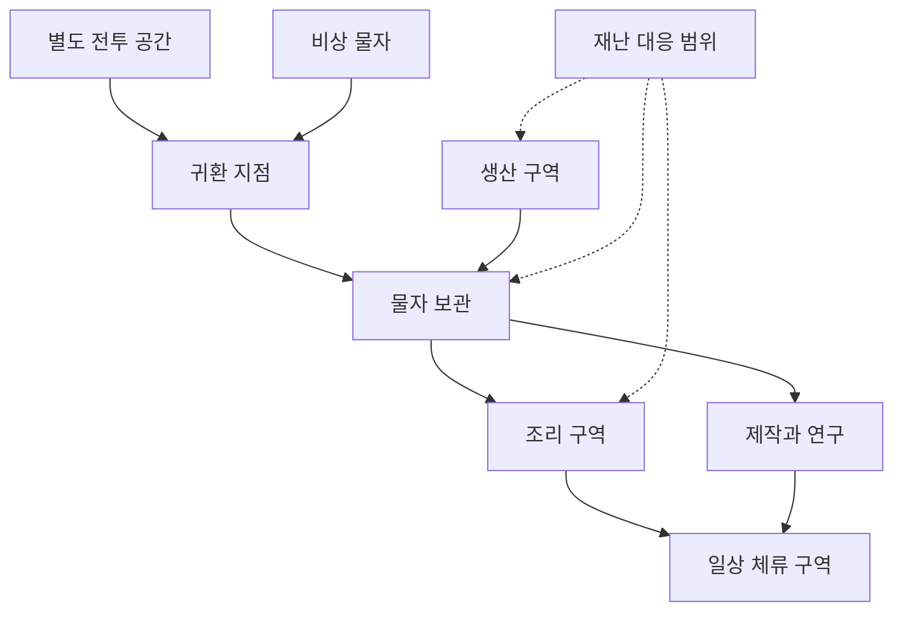
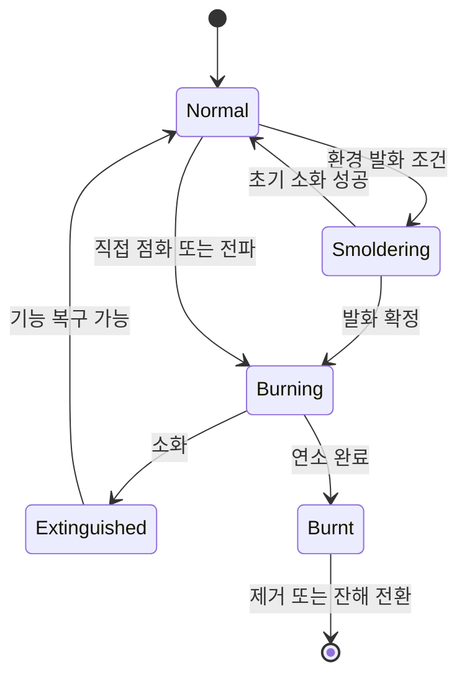

# 09. 건설·거점 운영·조명·화재

> 작성일: 2026-11-13 | 범위: PC 싱글플레이 DS 기본판 + Reign of Giants | 직접 플레이·원본 코드 검증 미실시
>
> `[자료 확인]`은 공개 자료로 확인한 게임 규칙, `[설계 해석]`은 역할 분석, `[재구성 설계]`는 독자적 재현안이다. 배치 간격·효과 반경·처리 순서의 미검증값은 확정하지 않는다.

[전체 목차](00_index.md) · [제작](08_crafting_research_magic.md) · [시간](02_time_day_night.md) · [계절](12_seasons_weather_temperature.md)

## 1. 시스템의 목적

**거점은 생존 문제를 해결하는 시설을 모으는 곳이면서, 그 투자 전체를 위험에 노출시키는 장소다.** 조리·보관·연구·생산을 가까이 두면 시간이 절약되지만 화재·습격·식량 중단이 여러 기능을 동시에 멈출 수 있다.

`[설계 해석]` 따라서 건설의 성장은 건물 수 증가보다 “필수 작업을 안정적으로 반복하는 능력”의 증가로 평가해야 한다. 불 하나와 조리 수단만 있는 임시 거점도 원정의 실패 가능성을 크게 줄일 수 있다.

## 2. 구조물의 기능 묶음

| 기능 | 대표 구조물·수단 | 해결하는 문제 | 새로 발생하는 의존성 |
| --- | --- | --- | --- |
| 조명·열 | Campfire, Fire Pit | 어둠과 체온 대응 | 연료와 유지 시간 |
| 연구 | Science Machine, Alchemy Engine | 초기 기술 접근 | 제작 재료와 거점 위치 |
| 조리·저장 | Crock Pot, Ice Box 등 | 식량 효율·소비 기한 | 식재료와 운영 동선 |
| 재생산 | 농장·Bee Box·이식 식물 | 반복 공급 | 비료·계절·서식 조건 |
| 보관 | Chest 등 | 원정 물자 집적 | 화재·파괴 시 손실 집중 |
| 재난 대응 | Lightning Rod, RoG의 Ice Flingomatic | 특정 발화 위험 완화 | 배치 범위·작동·연료 조건 |
| 동선 제어 | 벽·문·바닥 배치 | 이동·작업 공간 정리 | 경로 막힘·기능 충돌 |

이 표는 기능별 설계 분류다. 세부 제작법과 조건은 [제작](08_crafting_research_magic.md), [음식](10_food_cooking_spoilage.md), [농업](11_farming_animals_sustainability.md) 문서에서 다룬다.

## 3. 불의 네 역할을 분리한다

`[자료 확인·공통]` 불은 조명·열·조리 기능을 제공하고, 통제되지 않는 화염은 주변 가연물로 번질 수 있다. Campfire는 주변 가연물에 불을 옮길 수 있지만 Fire Pit은 같은 방식의 비산 발화원이 아니다. 번개도 발화 원인이 될 수 있다. [B1][B2]

| 역할 | 입력 | 효과 | 잘못 단순화한 구현 |
| --- | --- | --- | --- |
| 광원 | 활성·연료·광원 범위 | 어둠 노출 감소 | 불이 보이면 모든 거리에서 안전 |
| 열원 | 열량·거리·환경 | 캐릭터 체온에 영향 | 조명과 체온을 동일 반경으로 처리 |
| 조리 도구 | 조리 가능한 음식·상호작용 | 음식 변환 | 모든 광원을 조리 도구로 인정 |
| 위험원 | 가연성·주변 대상·발화 조건 | 연쇄 화재와 파괴 | 구조물의 종류와 무관하게 같은 전파 |

`[설계 해석]` 불은 생존의 해답과 위험을 동시에 제공한다. 같은 연료를 넣는 행동도 추운 밤에는 생존 시간을 늘리고, 가연물이 가까운 상황에서는 손실 가능성을 키울 수 있다.

## 4. 임시 불과 반복 사용할 화덕

| 항목 | Campfire | Fire Pit |
| --- | --- | --- |
| 역할 | 원정·임시 체류의 조명과 열 | 반복 귀환하는 장소의 조명과 열 |
| 연료 소진 이후 | 같은 Campfire를 다시 점화하지 못함 | 구조물을 남겨 다시 연료 투입 가능 |
| 주변 가연물 | 인접 가연물에 전파 가능 | 같은 형태의 직접 전파를 하지 않음 |
| 투자 성격 | 매번 필요한 저비용 설치 | 장기 반복 사용을 위한 초기 투자 |

`[자료 확인·공통]` 위 차이는 Campfire와 Fire 관련 문서에서 확인했다. 정확한 연료 효율·기본 유지 시간·거리 수치는 이 문서에서 밸런스 상수로 확정하지 않는다. [B1][B2][B3]

`[설계 해석]` Fire Pit이 반복 이용에 유리하다고 모든 이동 경로에 설치하는 것이 항상 최적은 아니다. 돌을 다른 필수 제작에 써야 하는 초반에는 이동 빈도와 재방문 가능성을 먼저 판단해야 한다.

## 5. 건설의 입력·조건·처리·출력

| 입력 | 조건 | 비용 | 처리 | 출력 |
| --- | --- | --- | --- | --- |
| 구조물 제작 | 레시피·재료·기술 충족 | 레시피 비용 | 제작 또는 배치 대기 확정 | 배치 가능한 결과 |
| 위치 선택 | 해당 지형·겹침·거리 조건 | 이동·행동 시간 | 유효성 표시 | 설치 가능한 위치 안내 |
| 설치 | 마지막 순간에도 유효한 위치 | 준비 상태 소비 | 월드 오브젝트 생성 | 구조물 기능 활성 |
| 연료 투입 | 연료 수용·작동 가능 | 연료 수량 | 잔량 증가·활성 갱신 | 기능 유지 시간 확보 |
| 기능 사용 | 해당 구조물의 조건 충족 | 재료·시간·수명 등 | 조리·연구·생산 등 | 각 시스템 결과 |
| 철거·파괴 | 철거 가능 또는 파괴 조건 | 도구·전투·재난 결과 | 구조물 종료·내용물 처리 | 정의된 회수물·잔해 |

`[재구성 설계]` 구조물 배치 가능 여부와 안전한 배치 여부는 다른 검사다. 게임이 가까운 위치에 설치를 허용한다고 그 자리가 화재·습격에 안전하다는 의미는 아니다.

## 6. 배치 판단의 세 가지 거리

1. **작업 거리**: 저장고와 조리·제작 시설 사이를 얼마나 자주 왕복하는가.
2. **기능 거리**: 조명·열·재난 대응처럼 범위를 가진 기능이 필요한 대상을 포함하는가.
3. **피해 거리**: 하나의 화재·적·이동 장애가 주변 기능으로 얼마나 쉽게 이어지는가.

`[설계 해석]` 작업 거리를 줄이면 기능 밀도가 높아지지만 피해 거리도 가까워질 수 있다. 거점의 평가는 “모든 시설을 가장 가깝게”가 아니라 반복 편의와 손실 분산의 절충이다.

### 예시 배치의 관계도



`[재구성 설계]` 이는 시설 간 이동·보호 관계도다. 실제 최적 좌표·타일 간격이나 안전이 보장되는 원작 배치도를 뜻하지 않는다.

## 7. RoG의 연기·발화·소화

`[자료 확인·RoG]` 여름 열기는 대상에 연기 상태를 만들고 발화로 이어질 수 있다. Ice Flingomatic은 켜진 상태에서 범위 안 연기·불을 향해 소화 동작을 수행하며 연료를 사용한다. Campfire·Fire Pit 같은 필요한 불도 대상이 될 수 있다. [B1][B4]

`[검증 필요]` DST의 비상 모드, 자동 전환, 사거리 수치를 단일판의 확정 사양으로 복사하지 않는다. 여기서는 RoG의 작동/비작동과 연료·목표 검사를 기준으로 설계한다.



`[재구성 설계]` 모든 오브젝트가 동일한 상태를 지원할 필요는 없다. 이미 타고 있는 구조물을 소화했을 때 원래 기능으로 돌아가는지, 손상된 상태로 남는지는 대상별 정책으로 둔다.

## 8. 거점 운영의 반복 업무

| 업무 | 시작 조건 | 완료 조건 | 미실행 시 연쇄 영향 |
| --- | --- | --- | --- |
| 연료 보충 | 다음 사용에 필요한 잔량 부족 | 예상 체류 시간과 예비량 확보 | 어둠·체온 문제로 작업 중단 |
| 식량 정리 | 원정 귀환·수확 완료 | 조리·보관·즉시 소비 분류 | 슬롯 혼잡·부패 손실 |
| 장비 교체 | 다음 원정에 수명 부족 | 필요한 작업을 마칠 예비품 확보 | 원정 중 생산 중단 |
| 생산원 점검 | 수확·계절 변화·소실 | 비료·수확·다음 공급 일정 확인 | 식량과 기본 재료 공급 공백 |
| 재난 대비 | 계절 또는 위협 변화 | 대응 시설·퇴로·비상 물자 점검 | 한 번의 사건이 전 기능 상실 |
| 원정 준비 | 새 목표 선정 | 조명·식량·공간·귀환 경로 확보 | 추가 탐험의 수익이 손실로 변함 |

`[설계 해석]` 거점 작업을 마치고 원정으로 돌아갈 수 있는지가 운영의 질을 결정한다. 거점이 커질수록 관리 시간이 원정 시간을 모두 삼킨다면 생산량 증가가 자유를 늘리지 못한 것이다.

## 9. 재현용 데이터 모형

```yaml
StructureDefinition:
  structure_id: illustrative_structure
  editions: permitted_editions
  placement_policy: terrain_and_clearance_rules
  interaction_profiles: enabled_functions
  fuel_profile: optional_fuel_policy
  light_profile: optional_light_policy
  heat_profile: optional_heat_policy
  fire_response: flammability_and_recovery_policy
  destruction_policy: drops_and_contents_policy

StructureState:
  entity_id: persistent_id
  position: world_position
  active: boolean
  fuel_remaining: optional_value
  damage_state: optional_value
  burn_state: normal_smoldering_burning_or_burnt
  attached_inventory: optional_container_id
```

```text
AdvanceFireState(target, elapsed_time):
    evaluate target-specific ignition and suppression inputs
    advance only transitions supported by the target policy
    update light, heat and damage from the committed fire state
    if state is burning: evaluate permitted spread targets
    if burn completion occurs: resolve destruction exactly once
    if the object owns contents: apply its contents policy
    publish changes for UI, sound and nearby interactions
```

`[재구성 설계]` 화재 대상 검색은 공간 질의를 사용할 수 있지만 특정 엔진의 물리 충돌과 반드시 같아야 하는 것은 아니다. 방화 범위·조명 범위·온도 영향·캐릭터 이동 충돌을 별도 데이터로 두면 기능 간 결합 오류를 줄일 수 있다.

## 10. 구체적인 실패 시나리오

### 사례 A: 소화 장치가 필요한 불까지 끔

`[설계 해석·가상 사례]` 저장고 보호를 위해 장치를 배치했지만 체류용 불까지 범위에 들어갔다. 보호 범위를 넓힌 선택이 조명·체온의 안정성을 떨어뜨린다. 단순히 보호 장치를 많이 만드는 문제가 아니라 각 기능의 공간 관계를 이해하는 문제다.

### 사례 B: 모든 비상 물자를 같은 보관 구역에 둠

`[설계 해석·가상 사례]` 구조물은 많이 갖췄지만 복구용 조명·식량까지 같은 구역에 모여 있다. 재난 이후 사용할 수 있는 물건이 없어 복구가 어려워진다. 보유 총량보다 **재난 후에도 접근 가능한 최소 기능**을 평가해야 한다.

### 사례 C: 거점 안에서 위협에 대응

`[설계 해석·가상 사례]` 전투 자체는 이겼지만 주변 생산·보관 시설을 잃는다. 전투 결과를 플레이어 생존 여부 하나로만 기록하면 거점 경제의 손실을 놓친다. 자세한 공격·구조물 파괴 관계는 [습격과 보스](15_bosses_raids_events.md) 문서로 연결한다.

## 11. 예외·QA 항목

| ID | 조건 | 확인할 결과 |
| --- | --- | --- |
| BAS-01 | 배치 미리보기 이후 대상 위치 점유 | 최종 설치 시 충돌 조건 재검증 |
| BAS-02 | 배치 대기 중 취소·저장 | 재료와 준비 상태의 보존 |
| BAS-03 | Campfire 소진·Fire Pit 소진 | 서로 다른 종료 상태 적용 |
| BAS-04 | 불빛 범위 경계에서 이동 | 시각적 불빛과 어둠 판정의 일관성 |
| BAS-05 | 가연물·비가연물을 인접 배치 | 대상별 전파 가능 조건 준수 |
| BAS-06 | 연기 상태에서 소화·로드 | 이미 해소된 발화가 다시 나타나지 않음 |
| BAS-07 | 소화 대상이 동시에 여러 개 발생 | 우선순위·발사 간격·연료 소비 측정 |
| BAS-08 | 소화 범위에 체류용 불 포함 | 원작 대상 선정 규칙 확인 |
| BAS-09 | 보관 구조물이 연소·철거·공격으로 파괴 | 파괴 원인별 내용물 처리 확인 |
| BAS-10 | 시설 밀집으로 이동 통로 차단 | 실제 상호작용 지점 접근 가능 여부 |
| BAS-11 | 화면 밖에서 장기간 지난 뒤 귀환 | 연료·연소·생산 상태 일관성 |
| BAS-12 | 전투 직후 거점 기능 점검 | 살아남았어도 손실된 생산 능력 기록 |

## 12. 밸런스 해석과 구현 순서

`[설계 해석]` 좋은 거점 시스템은 플레이어가 위험을 줄였다는 성취를 주면서도 모든 위험을 영구 제거하지는 않는다. 장비·비상 물자·이동 거점을 함께 준비할 이유를 남겨야 정착과 탐험이 서로를 지지한다.

재현은 **배치·상호작용 → 조명과 연료 → 조리·연구 연결 → 보관과 파괴 → 불 전파 → RoG 환경 발화·소화** 순으로 진행한다. 화재가 없을 때의 운영이 안정되지 않은 상태에서 연쇄 재난부터 구현하면 실패 원인을 구분하기 어렵다.

## 13. 출처와 접근 수준

| 출처 | 확인 내용 | 접근 수준 |
| --- | --- | --- |
| [B1] Fire | 불의 역할, 가연물 전파, RoG 발화 | 검색 인덱스 본문 확인, 원문 open 403 |
| [B2] Campfire | 임시 불의 소진·주변 전파 특성 | 검색 인덱스 본문 확인 |
| [B3] Beginner's Guide | Fire Pit 재점화 | 커뮤니티 위키 검색 인덱스 확인 |
| [B4] Ice Flingomatic | RoG의 소화 대상과 연료·작동 | 검색 인덱스 본문 확인 |

[B1]: https://dontstarve.wiki.gg/wiki/Fire
[B2]: https://dontstarve.wiki.gg/wiki/Campfire
[B3]: https://dontstarve.wiki.gg/wiki/Guides/Beginner%27s_Guide_for_staying_alive
[B4]: https://dontstarve.wiki.gg/wiki/Ice_Flingomatic
