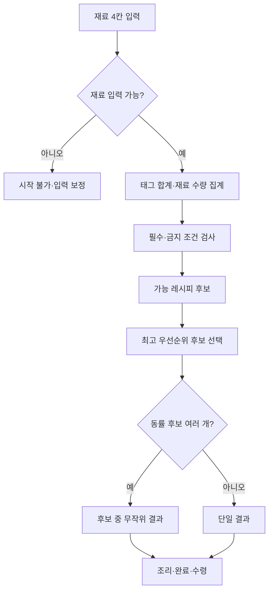

# 10. 음식·조리·레시피 판정·부패 시스템

작성일: 2026-11-13 | 범위: PC 싱글플레이 DS 기본판 및 RoG, 2023 Mega Update 적용판 기준 | 직접 플레이/원본 코드 검증 미실시

[목차](00_index.md) · [생존 수치](03_survival_stats.md) · [캐릭터](04_characters.md) · [생산](11_farming_animals_sustainability.md)

## 1. 시스템의 목적

음식은 허기를 채우는 소모품이면서 체력·정신력 회복 수단, 저장 가능한 노동, 위험한 재료를 가공하는 경로다. 부패는 생산한 식량을 무한히 쌓아 두는 전략에 비용을 부여하고, 조리는 동일한 재료를 다른 효과로 전환한다.

**[설계 해석]** 이 시스템에서 플레이어가 최적화하는 것은 재료 개수보다 "부패하기 전에 실제로 활용할 수 있는 회복량"이다. 요리의 회복량이 높아도 먹을 시점이 없거나 보관 비용이 크면 효율이 낮다. 즉석 섭취·불에 굽기·냄비·건조·냉장 사이에서 현재 문제에 맞는 처리를 고른다.

이 문서는 [자료 확인], [설계 해석], [재구성 설계]를 구분한다. 레시피 의사코드는 원작 코드가 아니며, 정확한 전체 레시피·식품 데이터베이스를 복제한 문서도 아니다.

## 2. 버전 경계

**[자료 확인·공통]** 2023년 Mega Update의 새장·냄비 재료 변경을 반영한다. [F01](#f01) 새장의 구체적 허용·거절 규칙은 [11번 생산 문서](11_farming_animals_sustainability.md)에 정리했다. 다른 DLC 재료의 조리 허용과 현재 세계에서의 획득 가능성은 구분한다.

구버전 브랜치·콘솔판·모드판의 설명을 같은 규칙으로 사용하기 전에는 적용 범위를 확인한다.

## 3. 음식의 데이터 축

| 축 | 의미 | 필요한 이유 |
| --- | --- | --- |
| 섭취 분류 | 고기·식물·특수 음식 등 | 캐릭터가 먹을 수 있는지 판정 |
| 영양 효과 | 허기·체력·정신력 변화 | 식사의 목적 선택 |
| 조리 태그 | 고기값·생선값·괴물값 등 | 냄비 결과 판정 |
| 개별 재료 식별 | 특정 재료의 유무·수량 | 태그만으로 구분 못 하는 레시피 |
| 신선도 | 현재 남은 수명 비율 | 섭취 효과와 폐기 시점 |
| 기본 수명 | 가공 상태별 부패 기간 | 원정·비축 계획 |
| 보관 상태 | 인벤토리·냉장·노출·젖음 | 부패 속도 계산 |
| 가공 경로 | 굽기·건조·냄비·교환 | 같은 자원의 대체 용도 |

**[자료 확인·공통]** 냄비는 4개의 재료 칸을 채워 요리를 만들고, 레시피는 음식 그룹 값과 특정 재료 조건을 사용한다. 재료가 여러 레시피를 만족하면 우선순위가 결과를 결정한다. [F02](#f02) [F03](#f03)

**섭취 분류와 냄비 태그는 같은 것이 아니다.** 플레이어에게 먹을 수 없는 재료가 특정 레시피에서 허용될 수 있고, 고기가 들어간 요리가 어떤 캐릭터에게 허용되는지는 완성 음식의 분류로 따로 확인해야 한다.

## 4. 가공 경로와 역할

| 경로 | 입력·조건 | 출력의 성격 | 설계상 비용 |
| --- | --- | --- | --- |
| 바로 먹기 | 섭취 가능한 아이템 | 즉시 수치 변화 | 낮은 효율·불이익을 그대로 감수할 수 있음 |
| 불에 굽기 | 해당 조리 가능한 식품·열원 | 별도의 익힌 아이템 | 열원 접근과 행동 시간 |
| Crock Pot | 허용 재료 4개·시설 | 조건에 맞는 요리 | 레시피 지식·조리 대기·시설 |
| Drying Rack | 건조 가능한 재료·시설 | 건조 식품 | 처리 시간·시설 점유 |
| Ice Box | 보관 가능한 식품·시설 | 식품 상태 유지 | 시설 제작·거점 의존 |
| 새장 교환 | 새·허용 먹이·시설 | 알 등 다른 자원 | 시설 구성·먹이 규칙 |

**[설계 해석]** 조리와 보존을 하나의 "음식 업그레이드"로 합치면 선택이 줄어든다. 즉시 회복이 필요한지, 장기 원정에 들고 갈 것인지, 희귀 재료를 다른 용도로 남길 것인지가 가공 경로를 결정해야 한다.

## 5. 냄비 결과 판정

**[자료 확인·공통]** 일치하는 레시피 중 우선순위가 높은 결과가 선택된다. 최고 우선순위가 같은 후보가 여럿이면 그 후보 중 무작위 선택이 가능하며, 다른 적합한 결과가 없으면 Wet Goop이 결과가 된다. [F03](#f03)



**[재구성 설계]** 결과 예측용 의사코드는 다음과 같다.

```text
ResolveRecipe(ingredients, ruleset):
    require exactly_four_accepted_ingredients
    summary = AggregateTagsAndCounts(ingredients)
    candidates = recipes_for(ruleset).filter(rule_matches(summary))
    if candidates is empty:
        return fallback_wet_goop
    highest = max(candidates.priority)
    finalists = candidates.where(priority == highest)
    return ruleset_random_choice(finalists)
```

원작이 요리 결과를 시작 시 확정하는지, 완료 시 확정하는지, 저장 시 어떤 상태를 기록하는지는 직접 확인하지 않았다. 재현 구현에서는 시작 시 결과와 사용한 난수 상태를 저장하는 방식처럼 재접속으로 결과가 반복해서 바뀌지 않는 정책을 명시한다.

## 6. 대표 요리와 판단 사례

다음 수치는 **신선한 기본 음식의 대표 효과**다. 캐릭터 예외·부패·모드·다른 판본은 별도 적용한다. [F04](#f04)

| 결과 | 허기 | 체력 | 정신력 | 역기획에서의 용도 |
| --- | ---: | ---: | ---: | --- |
| Meatballs | +62.5 | +3 | +5 | 유연한 재료 조합을 통한 허기 보급 |
| Meaty Stew | +150 | +12 | +5 | 큰 허기 결손을 한 번에 채우는 선택 |

**[자료 확인·공통]** 고기 4개는 Meatballs와 Meaty Stew 조건이 겹치지만 더 높은 우선순위의 Meaty Stew가 선택되는 예시다. [F03](#f03)

**[설계 해석]** Wilson에게 허기가 조금만 비어 있다면 큰 회복량의 요리를 먹어도 많은 효과가 상한에서 버려진다. 따라서 최대 회복량이 큰 음식이 항상 경제적인 것은 아니다. 캐릭터의 허기 최대치와 식사 시점까지 함께 평가해야 한다.

**[자료 확인·공통]** Monster Meat 1개와 Berries 3개는 Meatballs의 예로 소개되어 있다. [F02](#f02) 이를 "어떤 괴물 재료든 1개만 넣으면 항상 Meatballs"로 일반화하지 않는다. 다른 재료가 더 높은 우선순위의 레시피를 성립시킬 수 있다.

## 7. 부패 상태와 저장

**[자료 확인·공통]** 음식은 신선함·상함·부패한 상태에 따라 섭취 효과가 달라지며, 더 오래 두면 Rot 같은 결과로 변한다. 모든 아이템이 같은 부패 결과를 쓰는 것은 아니다. 예를 들어 알은 Rotten Egg로 바뀔 수 있다. [F05](#f05)

| 상태 | 플레이어가 이해해야 할 내용 | 재구성 데이터 |
| --- | --- | --- |
| 신선 | 기본 효과를 활용할 시기 | `freshness`가 높은 구간 |
| 상함 | 영양·회복 가치가 줄어드는 구간 | 상태별 효과 변형 |
| 부패한 음식 | 남은 수명과 섭취 불이익 고려 | 마지막 섭취 가능 구간 |
| 부패 완료 | 원래 음식 기능이 끝남 | 변환 결과 아이템 또는 제거 |

표시상 약 50%·20% 부근의 구간 구분이 공개 자료에 있지만, UI 반올림과 내부 경계 비교 연산은 직접 검증하지 않았다. 재현을 위해 임계값을 확정할 때 경계값을 포함하는 쪽도 함께 기록한다.

**[자료 확인·공통]** Ice Box는 기본 부패 속도를 절반으로 늦추는 보관 수단이다. [F06](#f06) 이는 절대적으로 일정 일수 동안 보존한다는 뜻과 다르다. 원래 식품 수명과 추가 환경 배율의 영향을 구분해야 한다.

## 8. 조리와 신선도 변환

**[자료 확인·공통]** 공개 설명에서는 굽기·냄비 조리가 진행된 부패 비율을 줄이며, 냄비는 부패 가능한 재료들의 평균 부패를 사용한다. 부패하지 않는 재료는 해당 평균 계산에서 제외된다. [F02](#f02) [F05](#f05)

이를 신선도 `f`가 0~1인 표현으로 옮긴 **분석식**은 다음과 같다.

```text
average_freshness = average(freshness of perishable ingredients)
output_freshness = 1 - (1 - average_freshness) / 2
                 = 0.5 + 0.5 × average_freshness
```

예를 들어 계산에 포함된 재료의 평균 신선도가 0.2이면 결과 신선도는 0.6이다. 이 값은 위 공개 규칙으로 계산한 예이며 실제 게임에서 해당 조합을 실행한 결과는 아니다. **새 요리의 기본 부패 기간도 따로 바뀌므로**, 신선도 비율만 비교해서 보존 기간이 얼마나 늘었다고 판단하면 안 된다.

**[검증 필요]** 부패 가능 재료가 하나도 없는 조합, 정확히 부패 완료와 조리 시작이 겹치는 순간, 스택 합치기·나누기의 신선도 보정은 별도 실험 대상으로 남긴다.

## 9. DS와 RoG의 시설 위 음식 차이

| 상태 | DS 기본판 공개 규칙 | RoG 공개 규칙 | 설계상 영향 |
| --- | --- | --- | --- |
| 냄비에서 완료 후 미수령 | 수령 전 부패 시작을 보류하는 설명 | 완료 후에도 부패 진행 | 시설을 장기 저장고로 사용하는 가치 변화 |
| 건조대 위 완료 식품 | 수령 전 보존 효과 | 완료 상태에서도 부패 진행 | 시설 확장과 수확 주기의 가치 변화 |

**[자료 확인]** 위 차이는 냄비·음식·육류 문서에 구분되어 있다. [F02](#f02) [F05](#f05) [F07](#f07) 설치한 DLC와 호환 세계 설정이 다르면 같은 모양의 시설도 처리 규칙이 다를 수 있으므로, 실제 재현 대상의 호환 플래그까지 확인한다.

## 10. 생산량보다 사용 가능량을 평가

**[재구성 설계]** 음식 경제를 다음 지표로 분석한다.

```text
usable_food_value = produced_value
                    - value_lost_to_spoilage
                    - value_wasted_at_stat_cap
                    - processing_and_risk_cost
```

모든 항목을 같은 화폐로 환산한 원작 공식이 아니다. 생산량만 높은 식단과 실제 원정에서 도움이 되는 식단을 비교하기 위한 틀이다.

| 상황 | 좋은 선택의 기준 | 잘못된 최적화 |
| --- | --- | --- |
| 당장 굶주림 | 즉시 접근 가능한 섭취 | 최고 효율 요리를 기다리다 피해 누적 |
| 전투 후 부상 | 체력 회복과 안전한 추가 식량 | 허기 수치만 높은 요리에 재료 소모 |
| 장기 원정 | 수명·슬롯·회복 목적 | 신선도 낮은 대량 식품을 모두 운반 |
| 겨울 대비 | 지속 공급과 보존의 조합 | 부패를 무시한 한 번의 대량 생산 |
| 재료 과잉 | 재료별 다른 변환 경로 | 한 레시피만 반복해 희귀 용도 소진 |

## 11. 데이터 예시

```yaml
# [재구성 설계] 실제 원작 데이터 구조가 아니다.
FoodDefinition:
  id: food_id
  edible_category: diet_category
  base_effects: { hunger: value, health: value, sanity: value }
  cooking_tags: { meat: value, monster: value, vegetable: value }
  perish_duration: ruleset_value
  perish_result: item_id_or_none
  roast_result: item_id_or_none
RecipeDefinition:
  id: dish_id
  supported_rulesets: []
  required_items: []
  tag_conditions: []
  forbidden_conditions: []
  priority: data_value
  cook_duration: data_value
  output_id: item_id
FoodRuntime:
  freshness: normalized_value
  storage_context: current_container
  wetness: runtime_value
```

레시피의 금지 조건을 필수 조건만큼 명시적으로 저장한다. "고기값이 충분하다"만 기록하면 금지 재료를 넣어도 요리가 만들어지는 오류가 생긴다. 입력 가능한 재료의 목록과 개별 레시피의 허용 조건 역시 다른 단계다.

## 12. 경계·오류·QA

다음은 **실행하지 않은 검증 명세**다.

| ID | 입력·상황 | 확인 사항 |
| --- | --- | --- |
| F-01 | 3칸·4칸·금지 재료 | 조리 시작 조건과 아이템 미소모 |
| F-02 | 여러 레시피가 동시에 일치 | 최고 우선순위 선택 |
| F-03 | 최고 우선순위 동률 | 결과 범위와 저장 후 정책 일치 |
| F-04 | 신선·상함·부패 직전 혼합 | 평균 계산 대상과 결과 신선도 |
| F-05 | 비부패 재료와 부패 재료 혼합 | 비부패 재료를 잘못 100%로 평균내지 않는지 |
| F-06 | 완성 직전 시설 파괴 | 입력·출력 아이템의 중복 생성 또는 소실 |
| F-07 | [DS/RoG] 완성 음식 미수령 | 판본별 부패 시작 정책 |
| F-08 | 냉장고 안팎 이동·수면 | 시간 누락·부패 중복 적용 |
| F-09 | 식단 제한 캐릭터 | 섭취 분류와 냄비 태그 구분 |
| F-10 | 최대 허기에 큰 음식 섭취 | 상한 초과 효과와 소비 일관성 |
| F-11 | 2023 적용/구버전 새장 | 생 몬스터 고기·익힌 알 규칙 구분 |
| F-12 | 젖은 재료 스택 분리 | 신선도·젖음 속성이 보존되는지 |
| F-13 | 조리 중 저장·재개 | 남은 시간·결과·재료 상태 복원 |

## 13. 밸런스 해석

냄비 레시피는 단순 암기 퍼즐과 자원 운영 사이에 있다. 재료가 서로 대체 가능하면 지역별 식재료 차이를 흡수하고, 특정 재료 요구는 탐사의 이유를 남긴다. 우선순위와 금지 조건은 값싼 재료로 모든 고급 요리를 만들지 못하도록 경계를 만든다.

부패가 너무 약하면 식량 문제가 한 번의 생산으로 끝나고, 너무 강하면 탐험보다 수확·정리 반복에 시간을 쓰게 된다. 평가할 것은 총 부패량뿐 아니라 플레이어가 예측하고 대응할 수 있었는지다. 색상 경고, 저장 수단, 가공 선택, 다른 용도로의 전환이 있어야 손실이 판단의 결과로 읽힌다.

## 14. 출처

확인일: 2026-11-13. wiki.gg 및 Klei 포럼 직접 열기는 403으로 제한되어 검색 인덱스에 제공된 발췌를 확인했다. 포럼의 개발자 게시물과 커뮤니티 설명의 증거 수준을 구분한다.

<a id="f01"></a>**F01.** [Klei: The Don't Starve Mega Update is now live!](https://kleiforums.com/forums/topic/147423-the-dont-starve-mega-update-is-now-live/) (2023-04-27), [변경 이력 정리](https://dontstarve.wiki.gg/wiki/Don%27t_Starve_Mega_Update) — 새장·냄비 재료 변경.

<a id="f02"></a>**F02.** [Crock Pot](https://dontstarve.wiki.gg/wiki/Crock_Pot) — 4재료, 신선도 변환, 기본판 보관 규칙.

<a id="f03"></a>**F03.** [Dishes](https://dontstarve.wiki.gg/wiki/Dishes) — 레시피 우선순위·동률·대표 결과. 이전 경로 `Crock_Pot_Recipes`도 같은 문서로 검색됨.

<a id="f04"></a>**F04.** [Dishes](https://dontstarve.wiki.gg/wiki/Dishes), [Guides/Crock Pot Dishes](https://dontstarve.wiki.gg/wiki/Guides/Crock_Pot_Dishes) — Meatballs·Meaty Stew의 대표 효과. 가이드 전략 전체는 재사용하지 않음.

<a id="f05"></a>**F05.** [Food / Spoiling](https://dontstarve.wiki.gg/wiki/Spoiling) — 부패 단계·변환·판본 차이.

<a id="f06"></a>**F06.** [Ice Box](https://dontstarve.wiki.gg/wiki/Ice_Box) — 보관 부패 속도.

<a id="f07"></a>**F07.** [Meat](https://dontstarve.wiki.gg/wiki/Meat) — 건조 식품과 DS/RoG 수령 전 부패 차이.
