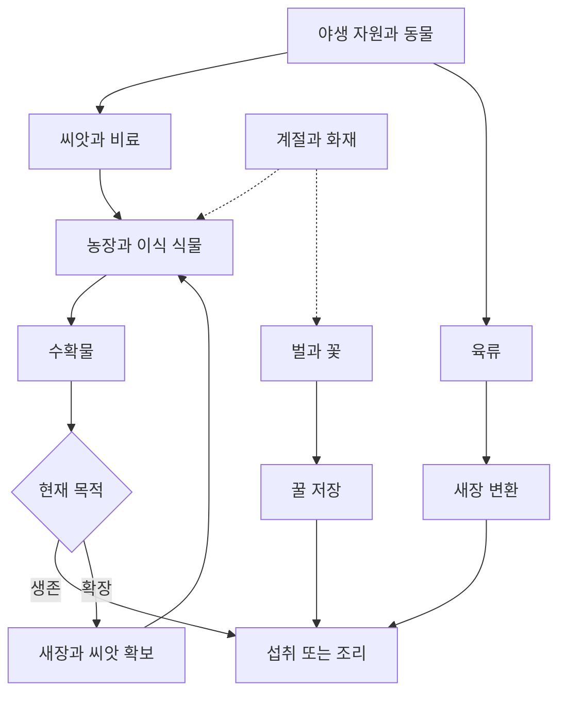

# 11. 농업·이식·양봉·동물 자원·지속 생산

> 작성일: 2026-11-13 | 범위: PC 싱글플레이 DS 기본판 + Reign of Giants | 직접 플레이·원본 코드 검증 미실시
>
> `[자료 확인]`은 공개 규칙, `[설계 해석]`은 생산 경제 분석, `[재구성 설계]`는 독자적 데이터·운영 모형이다. DST의 작물 스트레스·영양소·거대 작물 규칙은 이 문서에 포함하지 않는다.

[전체 목차](00_index.md) · [채집과 자원](06_resources_tools_gathering.md) · [음식](10_food_cooking_spoilage.md) · [생물과 생태계](14_creatures_ecology_ai.md)

## 1. 시스템의 목적과 기본 범위

**지속 생산은 식량을 무한히 만드는 기능이 아니라, 미래 공급의 변동을 줄이기 위해 지금 재료·노동·공간을 투자하는 선택이다.** 야생 채집만으로 살 수 있더라도 일정한 위치에서 반복 공급을 확보하면 더 먼 탐험과 위험한 활동을 계획하기 쉬워진다.

`[자료 확인·공통]` 원작의 농업에는 Basic Farm·Improved Farm, 이식한 식물, 동물을 이용한 반복 생산 등이 포함된다. 일반 씨앗을 농장에 심으면 작물이 결정되며, 특정 작물 씨앗으로 원하는 작물을 재배할 수 있다. [F1][F2][F3]

원작 농장과 현재 DST의 경작 시스템은 데이터 구조부터 다르다. 원작 재현에 작물 스트레스나 혼작 영양소를 기본 규칙으로 넣지 않는다. 해당 차이는 [판본 비교](21_dlc_dst_comparison.md)에서 다룬다.

## 2. 생산 방식별 핵심 교환

| 생산 방식 | 초기 투자 | 반복 작업 | 주요 산출 | 장기 제약 |
| --- | --- | --- | --- | --- |
| 야생 채집 경로 | 탐험과 위치 파악 | 왕복·수확 | 현지 식량·기초 재료 | 이동과 재성장 시점 |
| 식물 이식 | 굴착·운반·비료 등 | 수확·조건별 재비료 | 베리·풀·나뭇가지 | 계절·화재·집중 손실 |
| 농장 작물 | 농장·씨앗·성장 조건 | 파종·수확·유지 | 채소·과일 | 성장시간·계절·재투자 |
| 새장 변환 | 새장·포획·입력 식품 | 먹이 공급·결과 회수 | 알·작물 씨앗 | 입력 재료의 기회비용 |
| 양봉 | Bee Box·벌·꽃 접근성 | 수확과 관리 | 꿀 | 벌 활동·계절·방어 |
| 동물 자원 | 서식처·개체군·관계 | 회수·사냥·보호 | 분뇨·털·고기 등 | 번식·재출현·적대 상태 |

위 표의 비용·역할 해석은 독자적 분석이다. 정확한 초당 생산량과 시설별 재료 수량의 완전한 데이터베이스를 대신하지 않는다.

## 3. 원작 농장과 작물의 상태

`[자료 확인·공통]` 농장에는 Basic Farm과 Improved Farm이 있으며 성장 성능과 투자 비용이 다르다. 성장에는 시간이 들고 환경 조건의 영향을 받는다. 수확하지 않은 농장 작물은 음식 아이템처럼 부패하지 않으므로 수확 시점을 조절할 수 있다. `[자료 확인·RoG]` 다만 여름에는 성숙한 작물도 더위로 시들 수 있으므로 수확 보류가 영구적으로 안전한 저장을 뜻하지는 않는다. [F1]

| 상태 | 가능한 행동 | 다음 상태 | 설계상 의미 |
| --- | --- | --- | --- |
| 파종 가능 | 씨앗 투입 | 성장 중 | 식량의 미래 공급을 예약 |
| 성장 중 | 기다림·허용되는 비료 처리 | 수확 가능 또는 성장 정체 | 생산시간과 환경을 관리 |
| 수확 가능 | 수확 또는 보류 | 수확하면 빈 농장 / 보류하면 수확 가능 유지 | 수확할 때 인벤토리 음식으로 전환 |
| 유지 필요 | 비료 등 유지 조건 충족 | 다시 생산 가능 | 건설 후에도 생산 비용 존재 |
| 파괴·소실 | 시설 재건 | 파종 가능 | 초기 투자부터 다시 필요 |

`[재구성 설계]` 성장 가능 여부, 누적 성장량, 농장의 남은 생산 능력은 다른 필드로 둔다. 계절 때문에 성장하지 않는 것과 비료가 필요한 상태를 구분하지 않으면 플레이어는 잘못된 해결책을 반복하게 된다.

## 4. 씨앗 선택과 재투자의 경제

`[자료 확인·공통]` 새장에 넣은 새는 허용되는 작물을 먹고 해당 작물의 씨앗을 제공한다. 모든 식용 식물이 이 변환을 지원하는 것은 아니다. [F3]

`[설계 해석]` 수확물을 먹으면 당장의 허기를 해결하고, 씨앗으로 바꾸면 이후 작물 구성을 통제한다. 즉 특정 작물 생산량을 늘리려면 초기 수확을 소비하지 않고 재투자하는 시간이 필요하다.

| 선택 | 당장 얻는 것 | 포기하는 것 | 적합한 상황의 분석 |
| --- | --- | --- | --- |
| 일반 씨앗 파종 | 낮은 준비 부담 | 수확 종류의 통제 | 아직 목표 식단이 뚜렷하지 않음 |
| 특정 씨앗 파종 | 원하는 작물로 연결 | 씨앗 확보의 선행 비용 | 특정 조리 경로를 반복 운영 |
| 수확물 즉시 섭취 | 현재 허기 해결 | 조리·씨앗 전환 선택 | 생존 상태가 급함 |
| 조리 재료 사용 | 조합 결과의 효용 | 원재료와 다른 레시피 기회 | 목표 회복량·재고에 맞는 식단 |
| 새장에 투입 | 다음 파종의 통제력 | 지금 먹을 수 있는 작물 | 식량 여유가 있고 확장할 계획 |
| 수확 보류 | 현장에 준비된 공급 | 성장 공간의 재사용 | 곧 공급이 나빠질 시기 대비 |

## 5. 이식 식물의 관리

`[자료 확인·공통]` 이식한 베리 덤불과 풀은 다시 생산하려면 비료가 필요하다. 이식한 묘목은 같은 요구가 없다. 수확을 반복한 식물에는 다시 비료가 필요한 경우가 있고, 겨울의 성장과 RoG 여름의 시듦은 별도 제약이다. [F2]

| 분석 항목 | 관리 질문 | 재현 데이터 |
| --- | --- | --- |
| 이식 직후 활성 | 지금 비료가 필요한가? | transplant_activation_policy |
| 반복 수확 후 유지 | 얼마나 더 생산할 수 있는가? | fertility_or_harvest_budget |
| 계절 성장 | 기다리면 자라는 상태인가? | season_growth_policy |
| 시듦·환경 피해 | 환경 문제를 해결해야 하는가? | environmental_stress_state |
| 화재 소실 | 생산원이 남았는가? | destroyed_or_recoverable |

`[검증 필요]` 비료 1개가 모든 식물·상태에서 같은 효과를 내는 것으로 가정하지 않는다. 비료 종류별 효과, 재비료 주기, 시듦과 고갈의 시각적 구분은 대상 빌드에서 확인해야 한다.

## 6. 새장은 변환 설비다

`[자료 확인·공통·2023 이후]` Mega Update 이후 새장 속 새는 생 몬스터 고기를 받아들이고 익힌 알을 거절한다. 구형 자료의 생 몬스터 고기 거절 규칙과 혼합하지 않는다. [F4]

`[설계 해석]` 새장의 가치는 입력 식품의 효용을 다른 조리 범주로 옮기는 데 있다. 이미 식량이 충분하더라도 알 또는 특정 씨앗이 필요한 레시피의 병목을 풀 수 있다.

| 처리 계열 | 입력 조건 | 결과의 역할 | 데이터상 주의점 |
| --- | --- | --- | --- |
| 육류 계열 변환 | 새가 허용하는 먹이 | 알 기반 조리 경로 | 식품 태그만으로 무조건 허용하지 않음 |
| 작물 씨앗 확보 | 씨앗 변환을 지원하는 작물 | 원하는 작물의 반복 생산 | 예외 작물·가공 여부 검사 |
| 거절 | 허용 목록 밖의 입력 | 변환되지 않음 | 버전별 허용표 유지 |

산출물의 정확한 수량·확률·신선도 규칙은 판본별 식품 정의와 함께 확인한다. 먹이를 주는 애니메이션이 끝났다는 이유만으로 모든 종류에 같은 결과를 지급하지 않는다.

## 7. 양봉과 동물 자원의 생산 구조

### 7.1 양봉

`[자료 확인·공통]` Bee Box의 벌은 꽃을 이용해 꿀 생산에 기여하며 겨울에는 밖으로 나와 활동하지 않는다. 상자 안의 꿀은 수확 시점까지 남겨 둘 수 있다. [F5]

`[설계 해석]` Bee Box만 만드는 것으로 생산망이 완성되는 것은 아니다. 꽃 접근성, 활동 가능한 계절, 수확 경로, 방어와 다른 거점 기능의 거리가 모두 실효 생산량을 바꾼다.

### 7.2 비팔로·돼지와 개체군

`[자료 확인·공통]` 비팔로는 분뇨·털·고기의 공급원이 될 수 있고, 돼지는 Pig House와 재출현이 연결된다. [F6][F7]

| 운영 방식 | 얻는 것 | 유지해야 하는 자산 | 주요 의사결정 |
| --- | --- | --- | --- |
| 비살상 반복 회수 | 분뇨·털 등 | 살아 있는 생산 개체 | 접근 위험과 회수 주기 |
| 계획된 사냥 | 고기·고유 재료 | 재생산·재출현 기반 | 현재 식량과 미래 생산력의 교환 |
| 서식처 활용 | 반복 출현·노동·상호작용 | 집·둥지·개체 관계 | 시설 철거의 단기 재료 가치와 장기 가치 |
| 개체 유도·격리 | 회수 동선·위험 통제 | 이동 공간과 행동 조건 | 편의가 다른 생태계 상호작용을 막는가? |

길들이기·안장·탑승은 별도의 개체 상태와 장비 관계로 다룬다. 현행 단일판에도 탑승 관련 동작이 있으므로 이를 전부 DST 전용 기능으로 분류하면 안 된다. 상세 행동과 적대 전환은 [생물 문서](14_creatures_ecology_ai.md)로 연결한다. [F4]

## 8. 생산망의 연결과 끊김



`[설계 해석]` 생산망의 다양성은 서로 다른 고장 원인을 분산할 때 의미가 있다. 겉으로 여러 종류의 식량을 생산해도 모두 같은 계절에 멈추거나 같은 화재 범위에 있으면 실질적 대체 공급이 되지 못한다.

## 9. 생산량 평가 모형

다음은 원작 내부 공식이 아닌 `[재구성 설계]`용 운영 지표다.

`실효 공급 = 수확 가능량 − 재파종·유지에 재투자한 양 − 운반·보관 중 손실`

`생존 기여 = 실제 소비한 회복 효용 / 건설·수확·운반·관리의 총 활동시간`

`공급 공백 = max(0, (다음 수확 가능 시각 − 현재 시각) − 현재 가용 식량의 지속시간)`

시각과 지속시간은 같은 시간 단위로 환산한다. 식량이 다음 수확까지 충분하면 공급 공백은 0이며, 남은 여유 시간을 별도 지표로 기록할 수 있다.

수량이 많아도 필요한 시각보다 늦게 나오면 생존에는 기여하지 못한다. 반복 생산의 평가에는 일 평균뿐 아니라 가장 긴 공급 공백을 함께 기록해야 한다.

### 가상의 비교 예

| 구성 | 수확량의 성격 | 장점 | 남은 문제 |
| --- | --- | --- | --- |
| 농장 한 종류에 집중 | 특정 회복 경로가 안정적 | 조리와 재고 관리 단순 | 해당 생산 조건이 막히면 일괄 중단 |
| 야생 채집과 농장 병행 | 즉시 식량과 미래 식량의 혼합 | 첫 수확 전 공백 완화 | 채집 동선이 계속 필요 |
| 작물·꿀·육류 병행 | 서로 다른 공급 조건 | 상황별 대체와 조리 조합 | 관리 업무·슬롯 종류 증가 |

이 표는 일반적인 설계 비교이며 특정 시설 수가 항상 효율적이라는 공략은 아니다.

## 10. 재현용 생산 데이터

```yaml
ProductionSourceDefinition:
  source_id: illustrative_source
  edition_rules: selected_ruleset
  inputs: seeds_fertilizer_food_or_habitat
  growth_policy: time_and_environment_policy
  output_policy: crop_honey_or_animal_product
  maintenance_policy: source_specific
  preharvest_storage_policy: source_specific
  destruction_policy: source_specific

ProductionSourceState:
  entity_id: persistent_identity
  phase: ready_growing_harvestable_or_inactive
  progress: accumulated_growth
  maintenance_budget: optional_value
  stored_output: optional_output
  linked_creatures: relevant_entity_ids
  last_update_time: simulation_time
```

```text
AdvanceProduction(source, context, elapsed):
    resolve the source's edition-specific rule set
    verify source, habitat and required inputs still exist
    calculate growth eligibility separately from maintenance
    advance progress only under permitted environmental conditions
    on completion: enter the source-specific harvestable state
    do not create duplicate output on reloading or revisiting
    on harvest: transfer output and apply the next-cycle costs
```

`[재구성 설계]` 화면 밖에서 지나간 시간을 처리할 때 결과만 현재 상태에 덧셈하면 겨울·비활동 시간을 모두 생산시간으로 계산할 수 있다. 시간 구간별 조건 변화를 기록하거나, 해당 생산원의 단순화된 비활성 갱신 정책을 명시해야 한다. 원작의 오프스크린 시뮬레이션 방식을 확인했다는 뜻은 아니다.

## 11. 구체적인 실패·복구 사례

### 사례 A: 첫 수확 전에 식량을 모두 소비

`[설계 해석·가상 사례]` 농장을 만들고 씨앗을 충분히 심었지만 그날 먹을 식량을 남기지 않았다. 설치된 생산 능력과 현재 먹을 수 있는 재고가 다르다는 것을 드러내는 실패다. 생산 투자 화면에서는 완성된 시설 수보다 다음 공급까지의 시간을 확인하는 편이 유용하다.

### 사례 B: 겨울 준비를 시설 수로만 계산

`[설계 해석·가상 사례]` 식량 시설이 많아도 해당 시기의 활동이 멈추면 공급이 부족해진다. 계절 전에 수확 보류분·저장 식량·대체 획득 경로를 준비해야 한다. 동작 중인 생산과 준비된 식량을 같은 값으로 합쳐서는 안 된다.

### 사례 C: 유지비로 쓰일 물자를 모두 다른 용도로 사용

`[설계 해석·가상 사례]` 씨앗이나 비료·제작 재료를 다른 긴급 용도로 사용한 뒤 기존 생산망이 다음 주기를 시작하지 못한다. 공용 자원은 현재 효용뿐 아니라 다음 생산을 여는 역할을 가지므로 최소 재투자량을 계산할 필요가 있다.

## 12. 예외·QA 항목

| ID | 조건 | 확인할 결과 |
| --- | --- | --- |
| FAR-01 | 일반 씨앗과 특정 작물 씨앗 파종 | 판본별 작물 선택 규칙 적용 |
| FAR-02 | 이식한 풀·베리·묘목 비교 | 비료 요구가 종류별로 구분됨 |
| FAR-03 | 성장 중 겨울로 전환 | 성장 조건과 유지 비용의 분리 |
| FAR-04 | RoG 여름에 식물이 시듦 | 비료 고갈과 환경 상태를 혼동하지 않음 |
| FAR-05 | 수확 가능한 작물을 오래 방치 | 수확 전·후 부패 규칙 차이 확인 |
| FAR-06 | 2023 이후 새장에 생 몬스터 고기·익힌 알 | 최신 허용·거절 규칙 확인 |
| FAR-07 | 겨울 Bee Box 생산 | 활동 중단과 기존 꿀 보관 분리 |
| FAR-08 | 꽃·벌·Bee Box 중 하나가 사라짐 | 생산망의 실제 필요 조건 반영 |
| FAR-09 | 동물 사망과 서식처 파괴가 근접 발생 | 재출현·개체군 중복 생성 방지 |
| FAR-10 | 원거리에서 계절 여러 번 경과 | 비활성 시간 생산량과 유지 상태 검증 |
| FAR-11 | 수확 순간 화재·파괴 | 산출물 복제·소실 방지 |
| FAR-12 | 원작 농장 데이터에 DST 스트레스 필드 입력 | 잘못된 판본 데이터 혼입 탐지 |

## 13. 밸런스 해석과 재현 우선순위

`[설계 해석]` 지속 생산의 성취는 모든 생존 행동을 자동화하는 데서 나오지 않는다. 반복적으로 먹을 수 있다는 확신을 얻고, 그 여유로 더 큰 위험을 감수할 수 있게 되는 것이 중요하다. 생산량과 관리 노동을 함께 보지 않으면 시설 확대가 자유를 늘리는지 판단할 수 없다.

재현은 **야생 재성장 → 이식·비료 → 농장 성장·수확 → 새장 변환 → 양봉 → 서식처와 동물 자원 → 비활성 시간 검증** 순서가 적절하다. 각 단계가 다음 단계를 위해 필요한 입력·시간을 제공하는지 확인한다.

`[검증 필요]` 작물별 확률, 정확한 성장 시간, 비료 효율, 양봉의 화면 밖 생산, 새장 산출 수량, 비팔로 길들이기 세부 상수는 별도 데이터 조사 대상이다. 이 값을 구형 위키나 DST 표에서 일괄 복사하지 않는다.

## 14. 출처와 접근 수준

| 출처 | 확인 내용 | 접근 수준 |
| --- | --- | --- |
| [F1] Farm | 원작 농장, 씨앗, 수확 전 보관 | 검색 인덱스 확인, 원문 open 403 |
| [F2] Farming | 이식·비료·계절의 구분 | 검색 인덱스 확인 |
| [F3] Birdcage | 작물에서 특정 씨앗을 얻는 기능 | 검색 인덱스 확인, 구형 먹이 규칙은 F4 우선 |
| [F4] Mega Update | 새장 먹이 변경, 단일판 탑승 관련 동작 | 공식 검색 인덱스 확인, 원문 open 403 |
| [F5] Bee Box | 꽃과 꿀 생산, 겨울 활동 | 검색 인덱스 확인 |
| [F6] Beefalo | 분뇨·털·고기 공급 | 검색 인덱스 확인 |
| [F7] Pig House | 서식처와 재출현의 연결 | 검색 인덱스 확인 |

[F1]: https://dontstarve.wiki.gg/wiki/Farm
[F2]: https://dontstarve.wiki.gg/wiki/Farming
[F3]: https://dontstarve.wiki.gg/wiki/Birdcage
[F4]: https://kleiforums.com/forums/topic/147423-the-dont-starve-mega-update-is-now-live/
[F5]: https://dontstarve.wiki.gg/wiki/Bee_box
[F6]: https://dontstarve.wiki.gg/wiki/Beefalo
[F7]: https://dontstarve.wiki.gg/wiki/Pig_House
