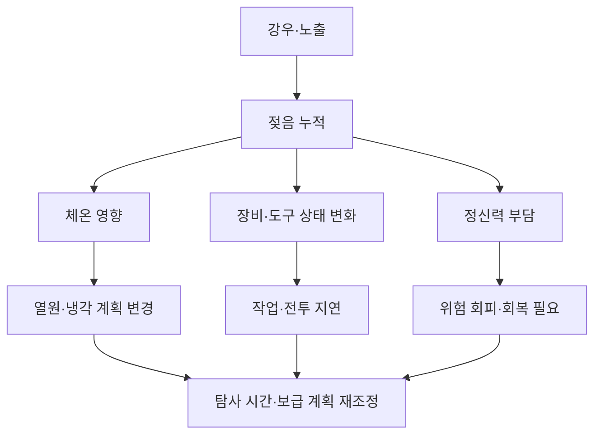

# 12. 계절·날씨·체온·젖음·화재 시스템

작성일: 2026-11-13 | 범위: PC 싱글플레이 DS 기본판 및 RoG | 직접 플레이/원본 코드 검증 미실시

[목차](00_index.md) · [시간](02_time_day_night.md) · [생존 수치](03_survival_stats.md) · [보스·습격](15_bosses_raids_events.md)

## 1. 목적과 범위

환경 시스템은 계절이 바뀔 때 기존 생산·탐험 계획의 가정을 바꾼다. 같은 식량 루트가 계속 유효하지 않고, 같은 옷을 항상 입는 것이 최선이 아니며, 안전하던 거점도 새로운 위협에 노출된다. **[설계 해석]** 장기 생존은 자원을 많이 모으는 능력보다 변화 이전에 생산·장비·배치를 조정하는 능력으로 확장된다.

자료 규칙은 [자료 확인], 그 효과는 [설계 해석], 재현을 위한 모델은 [재구성 설계]로 구분한다. 실측하지 않은 정확한 기온 곡선·확률·보온 계산은 [검증 필요]다.

## 2. 기본판과 RoG를 구분하는 달력

| 판본 | 계절 구성 | 시작 계절 | 이 문서의 처리 |
| --- | --- | --- | --- |
| [DS·자료 확인] | 여름·겨울 | 기본적으로 여름 | 기본판 여름에 RoG 과열을 추가하지 않음 |
| [RoG·자료 확인] | 가을·겨울·봄·여름 | 기본적으로 봄 또는 가을에서 선택 | 가을 고정 시작으로 설명하지 않음 |

**[자료 확인·RoG]** 기본 길이는 가을 20일·겨울 15일·봄 20일·여름 15일이며 합계 70일이다. 시작 계절과 계절 길이는 세계 설정의 영향을 받는다. [E01](#e01)

### 가을 시작을 선택했을 때의 예시 달력

| 구간 | 계절 | 운영 목표에 대한 해석 |
| --- | --- | --- |
| 1~20일 | 가을 | 탐사·거점·겨울 장비 준비 |
| 21~35일 | 겨울 | 열원·식량 루트 유지 |
| 36~55일 | 봄 | 방수·낙뢰·생물 변화 대응 |
| 56~70일 | 여름 | 냉각·화재·자원 손실 대응 |

위 일차는 공개 기본 길이를 합산한 **가을 시작의 계산 예시**다. 모든 RoG 새 게임의 첫 겨울이 21일에 온다고 일반화하지 않는다.

**[검증 필요·DS]** 기본판 연간 길이는 공개 자료 사이에 20+15일과 20+16일 설명이 충돌한다. 이 문서는 기본판의 정확한 연간 일수를 확정하지 않는다. 대상 실행판과 세계 설정으로 달력 경계를 측정해야 한다.

## 3. 계절을 자원 규칙 변경으로 읽기

| 계절·범위 | 대표 압력 | 먼저 준비하는 것 | 설계상의 전환 |
| --- | --- | --- | --- |
| DS 여름 / RoG 가을 | 비교적 활동하기 쉬운 기간 | 탐사 정보·시설·다음 계절 장비 | 현재 소비와 장기 투자 경쟁 |
| 공통 겨울 | 추위·일조 변화·일부 생산 제약 | 열원·보온·식량 대안 | 왕복 거리와 체온 예산 중요 |
| RoG 봄 | 비·젖음·낙뢰·생물 변화 | 방수·거점 보호·대체 식량 | 식량이 있어도 장비 상태가 병목 |
| RoG 여름 | 과열·자연 발화·생산 손실 | 냉각·소화·비축 분산 | 거점에 머무르는 것도 위험 비용 |

자료상 계절의 큰 변화는 [E01](#e01), 세부 환경 규칙은 아래 출처를 따른다. 각 계절의 거인은 [보스 문서](15_bosses_raids_events.md)에 분리했다. 거인 이름만으로 매 계절 무조건 한 번 나온다고 가정하지 않는다.

## 4. 기온과 체온을 분리

**[자료 확인·공통]** 추위는 플레이어 체온이 낮아져 발생한다. **[RoG·자료 확인]** 과열은 기본판 이후 도입된 환경 위험이다. 공개 자료의 대표 피해 경계는 체온 0 미만의 추위, 70 초과의 과열이다. 이 수치는 게임의 온도 값이며 실제 인체 생리값이 아니다. [E02](#e02) [E03](#e03)

| 변수 | 의미 | 다른 변수와 구분해야 하는 이유 |
| --- | --- | --- |
| 세계 기온 | 계절·시간·날씨에 따른 환경 | 옷을 갈아입는다고 세계가 따뜻해지지 않음 |
| 지역 열원 | 불·냉각원·위치 효과 | 가까이 있을 때와 떠났을 때가 다름 |
| 플레이어 체온 | 현재 누적된 열 상태 | 위험은 환경값만 보고 즉시 결정하지 않음 |
| 보온·방열 | 체온 변화에 영향을 주는 장비 성능 | 자체 열원과 같은 효과로 취급하지 않음 |
| 젖음 | 강우와 건조의 누적 결과 | 체온·정신력·아이템 성능에 연결 |
| 휴대 열 자산 | Thermal Stone 등의 상태 | 장비 착용과 다른 충전·시간 문제 |

**[설계 해석]** 보온 장비는 따뜻한 상태에서 확보한 활동 시간을 늘리는 것으로 이해하면 열원과의 역할 분담이 분명해진다. 열원 없이 보온 수치만 올리면 어떤 날씨에서도 무제한으로 안전해진다는 식으로 재구성하지 않는다.

## 5. 체온 모델의 재구성

아래는 설명용 **[재구성 설계]**다. 원작의 정확한 열전달 식을 옮긴 것이 아니다.

```text
environment_target = climate_temperature
                     + local_heat_effect
                     - wetness_cooling_effect

temperature_delta = approach(environment_target, body_temperature,
                             insulation_policy, dt)

body_temperature += temperature_delta
if ruleset_supports_freezing and body_temperature < cold_threshold:
    apply_cold_risk()
if ruleset_supports_overheating and body_temperature > hot_threshold:
    apply_heat_risk()
```

재현 시 필요한 결정은 다음과 같다.

- 가까운 열원 여러 개가 합산되는지, 가장 강한 것만 쓰는지.
- 보온과 방열이 어떤 방향의 체온 변화에 적용되는지.
- 낮은 체온에서 따뜻해지는 속도와 평상시 속도가 같은지.
- Thermal Stone의 내부 온도·발열·장비 효과가 어떻게 분리되는지.
- 환경 경고와 실제 피해 시작 사이에 어느 정도 대응 시간이 있는지.

공개 문서에는 DS와 DST의 보온·Thermal Stone 차이가 별도로 설명된다. 따라서 DST 구현식을 원작의 식으로 채택하지 않는다. [E02](#e02) [E03](#e03)

## 6. 젖음과 복합 불이익

**[자료 확인·RoG]** 젖음 게이지는 비 등으로 증가하며 장비·아이템의 상태, 정신력, 체온에 영향을 준다. 젖은 도구는 사용 중 손에서 미끄러질 수 있고, 장비와 음식·연료 역시 불리한 상태를 갖는다. WX-78의 비 관련 피해는 캐릭터 예외다. [E04](#e04)

**[설계 해석]** 젖음의 강점은 체력 피해 하나로 끝나지 않는다는 것이다. 장비가 미끄러지면 작업이 중단되고, 정신력이 줄면 다른 위험이 커지고, 체온이 낮아지면 열원에 돌아갈 필요가 생긴다. 각 효과의 강도보다 동시 발생할 때 줄어드는 행동 선택지가 핵심이다.



**[재구성 설계]** 캐릭터의 젖음 수치와 개별 아이템의 젖은 상태를 동일 필드 하나로 합치지 않는다. 보관함·가방·바닥에 놓인 아이템이 서로 다른 환경을 가질 수 있기 때문이다. 스택을 나누거나 보관 위치를 옮겨도 상태가 설명 없이 초기화되지 않아야 한다.

## 7. 화재를 발생 원인과 전파로 분리

**[자료 확인·공통]** 화재는 주변 가연물로 전파될 수 있고, 낙뢰도 발화 원인이 된다. **[RoG·자료 확인]** 여름의 자연 발화는 연기가 나는 단계에서 대응할 수 있으며 Ice Flingomatic 같은 수단이 있다. [E05](#e05) [E06](#e06)

| 단계 | 의미 | 플레이어 대응 | 재현 시 필요한 상태 |
| --- | --- | --- | --- |
| 발화 시도 | 계절·낙뢰·불 공격·플레이어 점화 | 예방·거리 분산·보호 시설 | 원인·대상 선정 |
| 연기 발생 | 일부 자연 발화의 경고 상태 | 직접 소화·냉각 | 남은 시간·소화 가능 여부 |
| 연소 | 대상이 불타며 피해·전파 유발 | 소화·대피·자산 분리 | 연소 시간·전파 범위 |
| 연소 결과 | 재·숯·탄 구조물 등 | 회수·재건 | 대상별 결과 |

이는 모든 점화가 반드시 연기 단계를 거친다는 의미가 아니다. 자연 발화의 경고 처리와 즉시 불이 붙는 원인을 구분해야 한다. 불타는 생물이 이동하면서 전파 위험을 바꾸는 것도 고정 구조물 화재와 다른 사례다.

**[설계 해석]** 거점 효율을 위해 구조물을 밀집시키면 이동 시간이 줄지만 연쇄 화재의 피해는 커질 수 있다. 이 상충이 건축을 장식이 아닌 운영 판단으로 만든다. 소화 설비를 설치했다는 사실만으로 연료·작동·범위 문제까지 해결되었다고 보지 않는다.

## 8. 낙뢰·방수·소화의 기능 구분

**[자료 확인·공통]** Lightning Rod는 낙뢰를 유도하는 보호 시설이다. [E07](#e07)

| 대응 수단의 역할 | 해결하려는 문제 | 자동으로 해결하지 않는 문제 |
| --- | --- | --- |
| 방수 | 비에 의한 젖음 누적 | 모든 기온 위험·적 공격 |
| 낙뢰 보호 | 낙뢰 경로와 발화 위험 | 다른 원인의 화재 |
| 보온 | 추운 환경의 체온 유지 | 식량·정신력 부족 |
| 냉각 | 과열 대응 | 거점 전체의 자연 발화 |
| 소화 | 연소·연기 상태 제거 | 장기 연료·설비 유지 |

위 표는 역할 구분을 위한 [설계 해석]이다. 개별 아이템이 여러 역할을 겸할 수 있으므로 최종 장비 표에는 기능을 복수로 기록한다. 특히 방수와 전기 피해 방지는 이름이 비슷해도 동일 조건으로 판단하지 않는다.

## 9. 데이터와 이벤트 계약

```yaml
# [재구성 설계] 원작 내부 스키마가 아니다.
SeasonDefinition:
  id: autumn_or_winter_or_spring_or_summer
  duration_days: world_setting
  day_phase_schedule: data_curve
  temperature_curve: data_curve
  weather_policy: data_policy
  growth_modifiers: []
  creature_event_policy: []
EnvironmentRuntime:
  season_day: runtime
  weather_state: runtime
  precipitation: runtime
  ambient_temperature: runtime
PlayerExposure:
  body_temperature: runtime
  wetness: runtime
  insulation_modifiers: []
  water_resistance_modifiers: []
BurnState:
  phase: safe_or_smoldering_or_burning_or_burnt
  cause: runtime
  remaining_time: runtime
```

| 입력 이벤트 | 소비 시스템 | 일관성 조건 |
| --- | --- | --- |
| 계절 전환 | 기온·생장·생물·시계 | 같은 일차에서 서로 다른 계절로 판단하지 않음 |
| 비 시작·종료 | 젖음·연료·음식·연출 | 시각 효과만 바뀌고 수치는 남는 현상 방지 |
| 장비 교체 | 방수·보온·정신력 | 이전 장비 효과를 해제하고 신규 효과 적용 |
| 발화·소화 | 대상·주변·설비 | 중복 소화 비용·불 상태 잔존 방지 |
| 저장·불러오기 | 전체 환경 상태 | 날씨·연소·캐릭터 노출을 함께 복원 |

## 10. 구체적인 운영 시나리오

### 10.1 봄 시작 세계

**[설계 해석]** 가을 시작 공략을 그대로 사용하면 비가 잦은 초기 환경에서 방수 준비가 늦어질 수 있다. 같은 기술 단계라도 우선 확보할 재료가 달라진다. 따라서 초반 계획은 절대 일차만 보고 구성하지 않고 시작 계절과 관측한 날씨를 입력으로 사용해야 한다.

### 10.2 겨울 원정

**[설계 해석]** 목적지까지 이동할 수 있어도 돌아올 체온·연료 여유가 없으면 원정은 실패한다. 식량 예산과 별도로 열원 간 이동 구간을 나누고, 중간 복구 지점을 확보하는 것이 의미를 가진다. 보온 장비의 가치는 체력 회복 비용을 줄이는 효과까지 포함한다.

### 10.3 여름의 거점 집중 위험

**[설계 해석]** 긴 시간 모은 식량과 제작 재료가 좁은 곳에 집중되어 있으면 작은 화재가 여러 날의 노동 손실로 이어질 수 있다. 비축 분산·소화 설비·동선의 선택은 현재 편의와 실패 손실의 교환이다. 이런 위험은 피해량 수치만으로 평가하기 어렵고, 잃는 생산 기능까지 관찰해야 한다.

## 11. QA 명세

아래는 실제 테스트 결과가 아니라 **대상 빌드 조사 및 재현 구현에서 수행할 항목**이다.

| ID | 상황 | 확인할 결과 |
| --- | --- | --- |
| E-01 | [DS] 기본 계절 한 주기 측정 | 35/36일 자료 충돌 해소 |
| E-02 | [RoG] 가을·봄 시작 각각 생성 | 달력·기온·목표 계절 순서 일치 |
| E-03 | [RoG] 기본 계절 한 주기 | 20/15/20/15 적용과 경계 일차 |
| E-04 | 체온 경계 바로 위·아래 | 경고·피해·해제 조건의 포함 경계 |
| E-05 | 장비·열원 조합 비교 | 열원과 보온을 잘못 같은 효과로 적용하지 않는지 |
| E-06 | 젖은 도구로 작업·전투 | 미끄러짐·드롭·행동 취소 처리 |
| E-07 | 비 중 가방·상자·바닥 아이템 | 보관 위치별 젖음 보존 |
| E-08 | 서로 다른 원인의 발화 | 자연 발화·낙뢰·점화의 경고 차이 |
| E-09 | 소화 설비 연료 소진 직후 | 작동·범위·HUD 상태 일치 |
| E-10 | 계절 전환 중 수면·지역 이동 | 기온·날씨·생장 상태 동기화 |
| E-11 | 비·연기·연소 중 저장·재개 | 남은 시간과 환경 상태 복원 |
| E-12 | [DS] 기본판 여름 | RoG 과열·자연 발화가 잘못 활성화되지 않는지 |
| E-13 | WX-78 등 특성 캐릭터 | 일반 환경 처리와 캐릭터 예외 분리 |

## 12. 밸런스 해석

계절은 플레이어가 이미 해결했다고 생각한 문제를 다시 꺼내되, 동일한 과제를 반복시키지 않아야 한다. 겨울과 여름이 똑같은 "다른 색의 체력 감소"에 그치면 준비와 공간 운영의 차이가 작아진다. 시간대·생장·날씨·화재·생물 관계가 함께 변할 때 계절별 운영 전략이 구분된다.

준비 시간을 줄이거나 시작 계절을 바꾸면 첫 고비까지의 학습 기회도 줄어든다. 이를 단순히 난도 상승으로만 보지 않고, 처음 겪는 위험에 대한 경고·대응 자원·회복 기회가 충분한지 확인해야 한다. 숙련자는 여러 시스템을 연결해 효율을 높일 수 있지만, 초보자도 실패의 원인을 구분할 수 있어야 다음 플레이에서 계획을 바꿀 수 있다.

## 13. 미확정 항목과 출처

정확한 날씨 발생 확률, 자연 발화 선택 반경·확률, 낙뢰 보호의 세부 기하, 보온 공식, 계절별 기온 곡선은 수록하지 않았다. 기본 DS 계절 길이와 플랫폼별 차이는 실행판 검증으로 해결해야 한다.

확인일: 2026-11-13. wiki.gg 직접 열기는 403으로 제한되어 검색 인덱스 발췌를 확인했다. 공통 문서의 DST 전용 설명을 원작 규칙으로 채택하지 않았다.

<a id="e01"></a>**E01.** [Seasons](https://dontstarve.wiki.gg/wiki/Seasons), [Seasons/World](https://dontstarve.wiki.gg/wiki/Seasons/World) — 판본별 계절과 RoG 기본 길이·시작 계절. [Day-Night Cycle](https://dontstarve.wiki.gg/wiki/Day-Night_Cycle)의 기본 DS 길이와는 충돌.

<a id="e02"></a>**E02.** [Freezing](https://dontstarve.wiki.gg/wiki/Freezing) — 추위·체온과 판본별 보온 차이.

<a id="e03"></a>**E03.** [Overheating](https://dontstarve.wiki.gg/wiki/Overheating) — RoG 이후 과열·대표 경계와 DST 차이.

<a id="e04"></a>**E04.** [Wetness](https://dontstarve.wiki.gg/wiki/Wetness), [Guides/Managing Wetness](https://dontstarve.wiki.gg/wiki/Guides/Managing_Wetness) — 젖음과 도구·체온·정신력의 관계.

<a id="e05"></a>**E05.** [Fire](https://dontstarve.wiki.gg/wiki/Fire) — 전파·발화 원인·RoG 소화 대응.

<a id="e06"></a>**E06.** [Wildfires](https://dontstarve.wiki.gg/wiki/Wildfires), [World Customization/Reign of Giants](https://dontstarve.wiki.gg/wiki/World_Customization/Reign_of_Giants) — 자연 발화·연기와 세계 설정. 공통 문서의 정밀 확률식은 판본 검증 전 사용하지 않음.

<a id="e07"></a>**E07.** [Lightning Rod](https://dontstarve.wiki.gg/wiki/Lightning_Rod), [Lightning](https://dontstarve.wiki.gg/wiki/Lightning) — 낙뢰 보호 역할.
