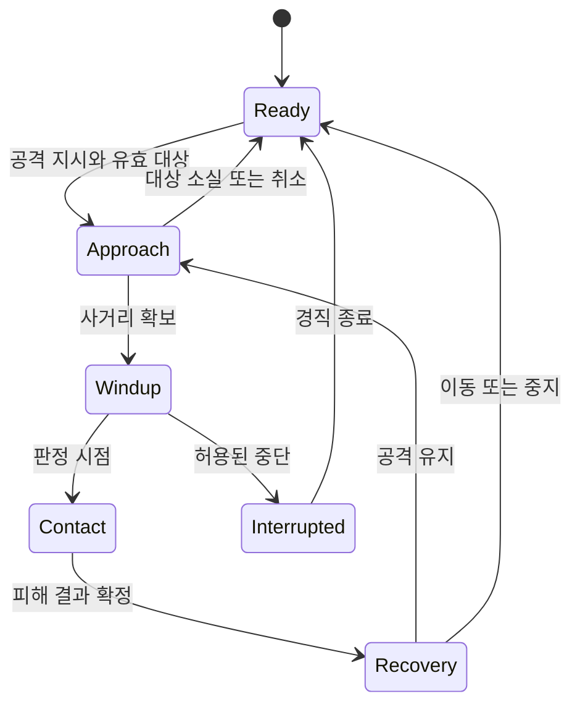

# 13. 전투·방어구·피해 처리 역기획서

> 작성일: 2026-11-13 | 범위: PC 싱글플레이 Don't Starve 및 Reign of Giants  
> 검증 수준: 문헌 조사. 직접 플레이·설치 빌드·원본 코드 검증 미실시.  
> [목차](00_index.md) · 관련: [인벤토리](07_inventory_equipment_durability.md), [생물 AI](14_creatures_ecology_ai.md), [보스](15_bosses_raids_events.md)

## 1. 시스템의 목적

**[설계 해석]** 전투는 적을 제거하는 수단이면서, 체력·장비 내구도·회복 식량·낮 시간의 교환 장치다. 따라서 성능을 공격력 하나로 평가하면 실제 플레이 의사결정을 설명할 수 없다. 전투에서 이겼더라도 다음 밤의 광원이나 겨울 준비가 부족해지면 장기적인 손실이 된다.

전투의 핵심 선택은 다음 세 가지다.

- 직접 교전해 전리품을 얻을지, 생물을 남겨 지속적인 자원원으로 사용할지 결정한다.
- 시간을 써서 공격을 회피할지, 방어구와 회복 자원을 소비해 빠르게 처리할지 결정한다.
- 개인 장비로 해결할지, 생물 사이의 적대 관계와 지형을 이용할지 결정한다.

## 2. 자료로 확인한 규칙과 적용 범위

| 규칙 | 범위 | 근거 및 주의 |
|---|---|---|
| 방어구는 피격 피해 일부를 흡수하며 내구도를 소비한다 | [공통] | [S1] |
| 머리·몸 방어구를 함께 착용하면 한 방어구 처리 뒤 남은 피해에 다음 방어구가 적용된다 | [공통: 싱글플레이] | [S1]. DST의 최고 흡수율 적용 방식과 혼합 금지 |
| 방어구별 내구도 소모량은 처리 순서에 영향을 받는다 | [공통] | [S1]. 재장착·로드와 관련된 우선순위는 별도 실측 필요 |
| 적의 공격을 피한 뒤 다음 공격 전까지 반격하는 방식이 유효하다 | [공통] | [S2]. 모든 적에 공통인 고정 타격 횟수는 없음 |
| 일반 거미와 병정 거미는 피격 경직을 이용하는 방식이 다르다 | [공통] | [S2]. 적별 전투 정책이 필요함 |

이 문서에서 **[공통]은 DS 기본과 RoG의 공통 부분**을 뜻한다. DST의 Planar Damage, 후반 균열 장비, 캐릭터 스킬 트리는 분석 범위에 포함하지 않는다.

## 3. 전투 단위와 판단 정보

**[재구성 설계]** 아래 항목은 같은 플레이를 재현하기 위한 분석 모델이며 실제 클래스·컴포넌트 이름이 아니다.

| 단위 | 필요한 정보 | 판단에 미치는 영향 |
|---|---|---|
| 공격자 | 현재 행동, 무기, 공격 보정, 이동속도 | 접근 가능 여부와 공격 주기 |
| 대상 | 생존 여부, 적대 관계, 위치, 경직 정책 | 공격 가능 여부와 후속 행동 |
| 공격 정의 | 준비 시간, 판정 시점, 사거리, 회복 시간 | 반응·회피·반격의 시간창 |
| 장비 | 슬롯, 흡수율, 남은 내구도, 특수 효과 | 피해와 자원 소모 |
| 환경 | 광원, 온도, 장애물, 주변 생물 | 전투가 지속될 수 있는 시간 |
| 결과 | 최종 체력 피해, 장비 파손, 상태 이상 | 사망·후퇴·장비 교체 분기 |

공격 범위와 타격 애니메이션의 시각적 크기는 별개 값으로 보관하되, 플레이어가 보는 범위와 판정이 어긋나지 않도록 검수한다. 넓은 공격에는 여러 대상을 처리하는 규칙이 필요하며, 단일 대상 공격의 사거리만 확대해서 대체하면 주변 생물 전투가 달라진다.

## 4. 행동 상태와 시간창

**[재구성 설계]** 공격을 이동과 분리된 단발 함수로 처리하지 않고, 중단 가능 여부가 다른 상태의 연속으로 정의한다.



| 상태 | 입력 처리 제안 | 설계상 검수 기준 |
|---|---|---|
| 접근 | 이동 목표 갱신·대상 유효성 재검사 | 공격 불가능한 대상을 끝없이 추격하지 않음 |
| 공격 준비 | 중단 허용 구간을 정의 | 모션 취소로 공격만 무한히 앞당길 수 없음 |
| 판정 | 대상 생존·거리·면역을 재검사 | 클릭 시점의 거리에만 의존하지 않음 |
| 공격 후 회복 | 다음 공격 가능 시점 계산 | 회피 가능한 틈이 일정하게 인지됨 |
| 경직 | 적 종류별 경직 가능 여부 적용 | 일반 몬스터의 경직 잠금이 보스에 자동 적용되지 않음 |
| 장비 파손 | 이번 공격과 다음 공격의 장비를 구분 | 무기가 깨진 뒤 이전 무기 피해가 계속 적용되지 않음 |

## 5. 방어구의 피해 흡수

### 5.1 확인 가능한 정상 상태

**[자료 확인]** 싱글플레이의 두 방어구가 모두 해당 피격을 처리할 충분한 내구도를 가진 일반적인 물리 피해 상황에서는 순차 흡수를 다음과 같이 표현할 수 있다. [S1]

```text
체력 피해 = 입력 피해 × (1 - 첫 방어구 흡수율) × (1 - 둘째 방어구 흡수율)
```

입력 피해를 100, 두 흡수율을 각각 80%라고 놓은 **계산 예시**는 100 → 20 → 4이다. 전체 감소율은 96%가 된다. 이 100은 특정 적의 실제 공격력으로 지정한 수치가 아니다.

**[설계 해석]** 플레이어가 받는 최종 피해가 같더라도 장비별 소모는 같지 않을 수 있다. 따라서 최종 체력만 비교하는 테스트로 방어구 동작을 검증하면, 귀한 머리 방어구가 예상보다 빨리 깨지는 문제를 놓친다.

### 5.2 이 식을 그대로 사용할 수 없는 경우

- 한 방어구가 이번 공격 도중 파손될 정도로 내구도가 부족한 경우.
- 캐릭터 고유 피해 저항·취약성이나 특수 장비 효과가 포함된 경우.
- 화재·추위·허기·암흑 등 원인이 다른 피해를 처리하는 경우.
- 특정 피해원이 방어구를 우회하거나 별도 방식을 사용하는 경우.
- 다른 에디션이나 모드가 피해 파이프라인을 바꾼 경우.

**[검증 필요]** 원작의 파손 순간 잔여 피해 처리, 특수 저항의 정확한 적용 순서, 부위별 내구도 소모 우선순위는 대상 빌드에서 따로 측정해야 한다. 문헌의 정상 상태 흡수식으로 이 경계까지 확정하지 않는다.

## 6. 공격과 자원 소모의 처리 계약

**[재구성 설계]** 한 타격은 판정과 결과를 묶어 처리한다. 원본 코드를 복원한 의사코드가 아니다.

```text
ResolveHit(context):
    if target is invalid or attack cannot connect:
        return MissResult

    attack = SnapshotAttackDefinition(context)
    damage = ApplyAttackerModifiers(attack, context)
    protection = EditionRules.ResolveProtection(
        damage, target.currentEquipment, context.damageKind)

    result = BuildHitResult(protection)
    CommitHealthAndEquipmentChanges(result)
    EmitHitFeedback(result)
    EvaluateDeathOnce(target)
    return result
```

이 구조에서 버전별 규칙은 `EditionRules`가 담당한다. 흡수 계산에 임의의 평균 내구도 분배를 넣지 않고, 실제 검증이 끝난 정책을 주입한다. 장비 파손·상태 이상·사망을 여러 리스너가 각각 처리하면 한 공격으로 드롭이나 사망 이벤트가 중복 발생할 수 있으므로 결과 확정 지점을 둔다.

## 7. 장비 선택의 기회비용

**[설계 해석]** 장비 선택은 단순한 상위 등급 교체가 아니라 슬롯의 용도를 바꾸는 결정이다. 슬롯의 실제 구성은 [인벤토리 문서](07_inventory_equipment_durability.md)를 기준으로 한다.

| 선택 | 얻는 이점 | 함께 고려할 비용 |
|---|---|---|
| 몸 방어구 사용 | 직접 피격에 대한 여유 | 가방·의복과의 슬롯 경쟁 |
| 머리 방어구 사용 | 몸 슬롯 활용 가능 | 방한·정신력·조명용 머리 장비와 경쟁 |
| 양 부위 방어구 사용 | 정상 물리 피격 감소 확대 | 이동·환경 대응과 장비 재료 부담 |
| 회피 중심 교전 | 체력·방어구 절약 가능 | 전투 시간 증가, 주변 상황 변화 |
| 높은 피해 무기 | 교전 시간 감소 | 재료 희소성·부패·정신력 등 개별 대가 |
| 적을 다른 생물에 유도 | 직접 피해를 줄일 가능성 | 생태 자원 감소와 전리품 회수 불확실성 |

여기서 유리한 전투란 피격 횟수가 가장 적은 전투와 항상 같지 않다. 밤이 가까운 경우에는 안전하게 끝낼 수 있는 시간이 핵심이며, 장기 원정에서는 교체 가능한 장비 재료가 핵심이 된다.

## 8. 전투 선택 시나리오

### A. 첫 거미 사냥

**[설계 해석]** 실크가 필요하지만 다수의 거미가 동시에 반응하면 치료 비용이 늘어난다. 핵심 학습은 최대 공격력보다 적을 분리하는 방법과 퇴로를 확인하는 데 있다. 한 개체를 처리한 뒤 계속 사냥할지는 체력뿐 아니라 남은 낮과 횃불 재료를 보고 결정한다.

### B. 겨울의 장비 교체

**[설계 해석]** 방어구로 바꾸면 피격 손실은 줄어도 기존 보온 장비의 역할이 사라질 수 있다. 전투 동안 체온이 버틸 수 있는지, 주변에 열원을 둘지, 짧게 싸운 뒤 다시 의복을 입을지까지 하나의 전투 계획에 포함한다.

### C. 전투 도중 방어구 파손

**[재구성 설계]** UI는 남은 내구도와 파손음을 구별해서 보여준다. 플레이어가 다음 공격 전에 교체할 기회를 얻으려면 파손 신호가 타격 연출에 묻히지 않아야 한다. 예비 장비의 자동 착용 여부는 원작의 빌드별 동작을 확인한 뒤 규칙으로 고정한다.

## 9. 시스템 간 입출력

| 연결 시스템 | 입력받는 것 | 전달하는 것 |
|---|---|---|
| 생존 수치 | 현재 체력·정신력·온도 위험 | 피해·사망·특수 효과 |
| 인벤토리 | 장착물과 내구도 | 소모·파손·드롭 |
| 생물 AI | 공격 목표와 적대 관계 | 피격·보복·도움 요청 |
| 자원 경제 | 교체 재료·치료 식량 | 전리품·장비 비용 |
| 시간·환경 | 낮밤·광원·기상 | 교전 지속 가능 시간 |
| 저장 | 공격 외 영속 상태 | 체력·장비·대상 상태 |

## 10. 검증 시나리오와 완료 기준

| ID | 조건 | 확인할 결과 |
|---|---|---|
| C-01 | 방어구 없음, 단일 고정 피해 | 기준 체력 피해와 일치 |
| C-02 | 한 부위만 착용 | 해당 장비의 흡수율과 내구도 감소 확인 |
| C-03 | 두 부위, 충분한 내구도 | 순차 흡수 결과와 부위별 소모를 함께 기록 |
| C-04 | 장착 순서 변경·저장 후 재로드 | 체력 피해와 내구도 분배가 각각 어떻게 달라지는지 확인 |
| C-05 | 한 방어구가 한 타격 안에 파손 | 잔여 피해·다음 타격·교체 처리 검증 |
| C-06 | 공격 준비 중 대상 사망·이탈 | 잘못된 전리품·유령 타격이 없음 |
| C-07 | 낮에서 밤으로 전환하며 교전 | 광원 교체와 공격 입력이 충돌하지 않음 |
| C-08 | 광역 공격에 다수 생물 포함 | 개체별 1회 판정·관계 반응 검증 |
| C-09 | 일반 물리 외 피해 | 방어구 흡수식을 무조건 재사용하지 않음 |
| C-10 | 장비 파손과 사망이 같은 타격 | 사망·드롭·통계가 중복 실행되지 않음 |

## 11. 밸런스 분석에 사용할 지표

**[재구성 설계]** 원작의 공식 분석 지표가 아니라 비교 제작을 위한 측정 제안이다.

- 적 1종을 처리하는 평균 시간과 평균 피격 횟수.
- 전리품 1단위당 소모한 회복 식량·장비 재료·시간.
- 숙련도별 회피 성공률과 방어구 파손 이후 사망률.
- 전투 종료 후 귀환 가능 여부와 다음 밤의 광원 확보율.
- 생태 유도를 사용했을 때의 주변 자원 생산력 감소.

이 지표는 전투가 생존 경제에서 어떤 가격을 가지는지 보여준다. 무기 수치만 상향하면 전투뿐 아니라 식량·실크·귀한 제작 재료의 유입량도 함께 바뀐다.

## 12. 출처와 추가 검증 범위

- **[S1]** [Don't Starve Wiki — Armor/DS](https://dontstarve.wiki.gg/wiki/Armor/DS): 싱글플레이 방어구 흡수·중첩·순서 설명. 검색 인덱스 본문 확인; 사이트 직접 열기는 403 응답.
- **[S2]** [Don't Starve Wiki — Guides/Mob Killing Guide](https://dontstarve.wiki.gg/wiki/Guides/Mob_Killing_Guide): 적별 전투 대응·일반 거미와 병정 거미의 경직 차이. 검색 인덱스 확인.
- **보조** [Don't Starve Wiki — Spider Queen](https://dontstarve.wiki.gg/wiki/Spider_Queen): 공격 회피 뒤 반격하는 카이팅의 설명. 검색 인덱스 확인.

원본 소스의 함수명, 프레임별 판정 타이밍, 수치 반올림 방식은 확인하지 않았다. 이 문서의 상태도·의사코드·지표는 관찰 가능한 플레이를 분석해 제안한 재구성 모델이다.

[S1]: https://dontstarve.wiki.gg/wiki/Armor/DS
[S2]: https://dontstarve.wiki.gg/wiki/Guides/Mob_Killing_Guide
