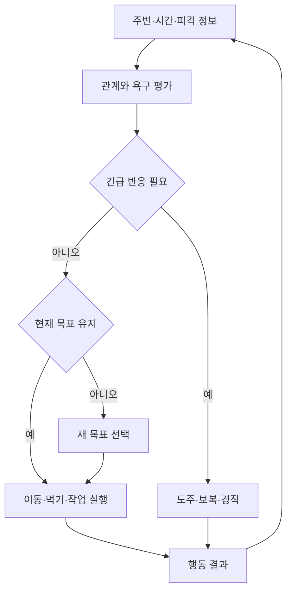

# 14. 생물·생태계·AI 역기획서

> 작성일: 2026-11-13 | 범위: PC 싱글플레이 Don't Starve 및 Reign of Giants  
> 검증 수준: 문헌 조사. 직접 플레이·설치 빌드·원본 코드 검증 미실시.  
> [목차](00_index.md) · 관련: [자원](06_resources_tools_gathering.md), [지속 생산](11_farming_animals_sustainability.md), [전투](13_combat_armor.md)

## 1. 시스템의 목적

**[설계 해석]** 생물은 전투 대상, 식량, 제작 재료, 노동력, 지역 위험을 동시에 담당한다. 하나의 생물을 제거하는 행동은 전리품 획득과 향후 자원 생산력 감소를 함께 일으킨다. 이 관계 때문에 월드는 자원을 수확하는 배경을 넘어 플레이어의 행동에 반응하는 공간으로 작동한다.

분석 단위는 생물 한 마리의 공격 패턴뿐 아니라 **개체–거점–군집–환경**의 연결이다. 예를 들어 가까운 집이나 둥지를 없애는 선택은 지금의 이동 안전성과 미래의 수급 경로를 함께 바꾼다.

## 2. 대표 생물의 확인된 역할

| 생물군 | 자료에서 확인한 행동 | 플레이에 제공하는 선택 |
|---|---|---|
| Pig | 고기를 주어 동행시키고 작업·전투에 활용할 수 있음 [S1] | 식량을 노동·보호와 교환 |
| Beefalo | 무리 단위로 생활하며 발정기에는 공격적이 됨 [S2] | 평소 자원 지역과 계절적 위험 지역의 중첩 |
| Spider | 주변 거미가 공격받은 개체에 반응하며 둥지 주변 교전이 확대될 수 있음 [S3] | 개체 분리 사냥과 군집전의 선택 |
| Bunnyman | 당근으로 동행시킬 수 있고 플레이어의 고기 소지에 적대적으로 반응함 [S4] | 인벤토리 내용이 외교 조건이 됨 |
| Treeguard | 벌목을 계기로 등장할 수 있으며 주변에 나무를 심어 진정시킬 수 있음 [S5] | 채집 행동의 위험과 비전투 대응 |

**[범위 주의]** 위 표는 DS 기본·RoG에서 분석할 수 있는 관계다. DST의 Beefalo Bell, Webber 개편으로 추가된 거미 관리 기능, 새로운 추종자 명령은 이 표에 포함하지 않는다. 세부 아이템 호환성과 최근 원작 패치의 추가 행동은 해당 빌드에서 확인한다.

## 3. 생물을 기능으로 분류하기

**[재구성 설계]** 종족 이름과 별개로 아래 기능을 조합하면 동일 종의 변형과 계절 변화를 명확히 관리할 수 있다.

| 기능 축 | 가능한 값의 예 | 필요한 이유 |
|---|---|---|
| 기본 관계 | 회피·중립·선제 적대 | 접근만으로 일어나는 반응을 구분 |
| 소속 | 단독·무리·둥지·집 | 동료 도움과 재생산 범위 정의 |
| 먹이 반응 | 먹이 탐색·친화·변신·무반응 | 투척한 자원의 용도 결정 |
| 활동 시간 | 주간·야간·항상·상태 의존 | 같은 지점의 시간별 위험 차이 |
| 성장 | 개체 성장·둥지 성장·없음 | 방치했을 때의 월드 변화 |
| 자원 역할 | 지속 산출·사망 드롭·노동 | 살려 둘 가치와 제거할 가치 비교 |
| 관계 예외 | 캐릭터 특성·소지품·장비 | 적대 여부가 동적으로 변하는 조건 |
| 환경 반응 | 계절·화재·광원·악몽 주기 | 생존 시스템과 생물 AI 연결 |

이 표의 값들은 분류용 용어다. 실제 원작 태그나 데이터 필드 명칭을 추출한 것이 아니다.

## 4. 관계 판정은 여러 조건의 합성

**[설계 해석]** 종족별로 플레이어를 적 또는 아군으로 한 번 지정하는 방식만으로는 원작의 상호작용을 설명하기 어렵다. 음식 제공으로 형성한 관계도 특정 소지품이나 캐릭터 특성에 따라 달라질 수 있기 때문이다.

**[재구성 설계]** 관계 판단은 다음 입력을 받는 별도 서비스로 구성한다.

| 입력 | 예시 의미 | 주의점 |
|---|---|---|
| 종족 관계 | 원래 서로 공격하는 생물 | 플레이어와의 관계와 분리 |
| 개체 기억 | 최근 자신을 공격한 대상 | 종족 전체의 영구 적대와 혼동 금지 |
| 군집 사건 | 동료의 피격·둥지 위협 | 전달 범위와 중복 전달 제한 |
| 추종 관계 | 음식을 받고 따르는 대상 | 지속 시간·해제 조건 필요 |
| 캐릭터 특성 | 특정 생물에게 괴물로 인식됨 | 화면 외형만 보고 판정하지 않음 |
| 소지품 조건 | 고기 등 특정 물건 소지 | 획득·소비·보관 이동 시 재평가 |
| 계절·상태 | 발정기, 변신 등 | 기존 관계보다 우선하는지 명시 |

**[검증 필요]** 원작의 모든 조건 사이에 적용되는 정확한 우선순위는 미확정이다. 재현 제작에서는 관계 충돌 표를 먼저 만들고, 관찰 결과와 일치하도록 정책을 채워야 한다.

## 5. 판단·행동·애니메이션의 분리

**[재구성 설계]** 아래는 구현을 위한 권장 분리다. 원작이 반드시 이 형태의 행동 트리를 사용한다는 주장은 아니다.



판단은 무엇을 할지 결정하고, 행동은 이동·공격·먹기 같은 작업을 수행하며, 애니메이션은 그 상태를 보여준다. 애니메이션 중간에 대상이 사라졌을 때 처리할 곳이 명확해야 한다. 예를 들어 먹이로 접근하던 생물이 다른 생물에게 먹이를 빼앗겼을 때, 먹기 애니메이션만 끝내고 추종 보상을 지급해서는 안 된다.

## 6. 개체·거점·군집의 상태 모델

### 6.1 개체 상태

**[재구성 설계]**

```yaml
CreatureRuntime:
  speciesId: data_reference
  persistentId: world_unique_id
  homeId: optional
  groupId: optional
  leaderId: optional
  targetId: optional
  actionState: idle_or_action
  relationshipMemory: bounded_entries
  reproductionState: species_policy
  health: current_value
  timers: named_durations
```

### 6.2 거점 상태

| 정보 | 의미 |
|---|---|
| 거점 유형 | 집·둥지·서식 범위 |
| 연결 개체 | 해당 거점에 소속된 생물 |
| 생성 조건 | 재생 시간·활성 조건·최대 개체 |
| 성장 단계 | 둥지 강화 등 단계가 있는 경우 |
| 파괴 처리 | 소속 해제·전리품·재생 중단 |
| 생태 영향 | 미래 산출량과 주변 위협 변화 |

### 6.3 군집 상태

군집은 가까운 모든 개체를 무조건 동일하게 취급하지 않는다. 도움 요청의 범위, 군집에 머무는 조건, 새 개체의 편입, 마지막 개체가 죽었을 때의 처리 등을 별도로 정의한다. 이 정보가 없으면 작은 사냥이 전 지도의 전투로 번지거나, 이미 소멸한 무리가 저장 후 다시 나타날 수 있다.

## 7. 생태계의 자원 흐름

**[설계 해석]** 생물을 자원으로 이용하는 방식은 세 층으로 나뉜다.

| 이용 방식 | 즉시 이익 | 장기 변수 |
|---|---|---|
| 사냥 | 고기와 제작 재료 | 개체·둥지 회복 여부 |
| 비살상 이용 | 부산물·작업·보호 | 접근 안전성·친화 비용 |
| 생물 간 전투 유도 | 플레이어 장비 소모 감소 | 양측 개체 감소·드롭 회수 |
| 거점 이동·배치 | 동선 단축·집중 생산 | 주변 생활권의 위험 상승 |
| 생태 유지 | 안정적인 미래 공급 | 당장의 수확 기회 포기 |

어떤 선택이 효율적인지는 식량의 양만으로 판정하지 않는다. 귀한 제작 재료가 필요한 시기, 다음 계절의 환경, 치료 식량 보유량에 따라 같은 생물의 가치가 바뀐다.

## 7.1. 비팔로 길들이기·탑승의 별도 상태

**[자료 확인]** 현재 싱글플레이 자료에도 비팔로 길들이기와 탑승이 설명되어 있으므로 이를 일괄적으로 DST 전용 기능으로 분류하면 안 된다. 길들이기 진행, 복종, 허기, 성향은 구분된 요소이며, DS에는 DST의 Beefalo Bell이 없는 것으로 설명된다. [S2]

**[검증 필요]** 구버전·플랫폼·확장팩 호환 설정의 사용 가능 범위는 빌드별로 확인한다. 여기서는 모든 과거의 기본 DS에 같은 기능이 있었다고 가정하지 않는다.

**[설계 해석]** 길들이기는 지금 가진 먹이를 장기 이동 능력과 전투 능력에 투자하는 선택이다. 잠깐 먹이를 주어 따라오게 하는 것과 완전한 길들이기를 같은 상태로 처리하면 장기 투자의 의미가 사라진다.

| 상태 축 | 분석상 의미 | 분리해야 하는 이유 |
|---|---|---|
| 길들이기 진행 | 장기간 투자한 정도 | 오늘의 기분과 영구 진행을 구분 |
| 복종 | 현재 장착·탑승 수용 가능성 | 충분히 키웠어도 당장 거부할 수 있는 조건 표현 |
| 허기·건강 | 유지 비용과 손실 위험 | 플레이어 음식 예산과 경쟁 |
| 성향 | 훈련 결과의 특성 | 같은 생물에도 역할 선택 부여 |
| 안장·탑승 상태 | 실제 이동·전투 사용 | 개체 상태와 장비 상태의 불일치 방지 |

**[재구성 설계]** 길들이기 값의 증가·감소는 이름 있는 정책으로 관리한다. 훈련 중 저장, 먹이 지급 직후 전투, 탑승 중 사망, 안장 이탈, 세계 전환을 각각 검증한다. 정확한 길들이기 일수·회복량·탑승 전투 보정은 원작과 DST가 다를 수 있어 이 문서에서는 고정하지 않는다.

## 8. 행동 결과 처리

**[재구성 설계]** 생물 행동은 완료 시점에 조건을 다시 확인한다.

```text
CompleteEatAction(creature, food):
    if food no longer exists:
        Replan(creature)
        return

    policy = SpeciesPolicy.ResolveFood(food, creature.state)
    ConsumeFoodOnce(food)
    ApplyPolicyResult(creature, policy)
    ReevaluateRelationships(creature)
    PublishEcologyEvent(policy.event)

OnGroupMemberAttacked(event):
    for ally in EligibleLocalResponders(event):
        if ally can react and relationship permits:
            QueueThreatReaction(ally, event.attacker)
```

음식 소비와 동행 관계 생성은 한 번만 처리해야 한다. 도움 요청은 전달받은 생물이 다시 같은 사건을 재전송하며 무한 반복하지 않도록 사건 식별자를 둔다. 이들은 원작의 내부 구현 설명이 아니라 재현 시스템의 안정성 조건이다.

## 9. 플레이 시나리오

### A. 돼지에게 고기를 주는 선택

**[설계 해석]** 고기는 직접 먹을 수 있는 자원이지만 동행자를 확보하는 대가가 될 수도 있다. 즉, 동일 아이템이 식량 예산과 노동 예산 사이를 이동한다. 동행 시간이 제한된다고 판단되는 상황에서는 이동 동선을 먼저 정리한 뒤 자원을 지급하는 것이 유리하다.

### B. 비팔로 생활권 옆 기지

**[설계 해석]** 평소에는 근처 자원과 보호 가능성이 매력적이지만, 발정기에는 안전했던 귀환 동선이 위험해진다. 좋은 기지 위치는 가장 가까운 위치와 같지 않으며, 평시 접근성과 위험 시 우회로를 함께 평가해야 한다.

### C. 토끼인간 지역에서 전리품 줍기

**[설계 해석]** 전투에서 나온 고기를 줍는 순간 관계 조건이 달라질 수 있다. 이 사례는 전리품 획득이 언제나 무조건적인 보상은 아니라는 점을 보여준다. 물건을 들고 있는 사람과 보관 장소를 구분하는 설계가 의미를 가진다.

### D. 벌목과 트리가드

**[설계 해석]** 빠른 대량 채집은 위험한 개체의 출현으로 이어질 수 있다. 나무를 다시 심어 대응하는 선택은 전투 이외의 해결 경로를 만든다. 이것은 현실 생태계의 정확한 시뮬레이션이라기보다 채집에 반응하는 게임 규칙으로 해석한다.

## 10. 상태 갱신과 저장의 재구성 원칙

- 화면 밖 생물을 간소화하더라도 재생·추종·계절 상태의 의미는 보존한다.
- 개체를 삭제하는 것과 비활성화하는 것을 구분한다.
- 저장되는 목표 ID가 사라졌으면 로드 시 유효한 대기 상태로 돌아간다.
- 음식의 부패·연소 등 다른 시스템이 먼저 개입한 경우 행동 성공을 취소한다.
- 군집과 거점의 양방향 참조가 일치하도록 복구 검사를 둔다.
- 프레임마다 모든 개체가 모든 개체를 검색하지 않도록 지역 질의를 제안한다.

마지막 항목은 일반적인 구현 제안이며, 원작의 실제 업데이트 주기·공간 자료구조·성능 수치를 확인했다는 뜻이 아니다.

## 11. QA 시나리오

| ID | 조건 | 기대하는 검증 |
|---|---|---|
| E-01 | 가까운 동료가 공격받음 | 해당 관계·범위 내 생물만 반응 |
| E-02 | 먹이를 주는 도중 아이템 소실 | 무료 추종자 생성 없음 |
| E-03 | 친화 상태에서 적대 소지품 획득 | 종별 정책에 맞게 관계 재평가 |
| E-04 | 거점 파괴 당시 개체가 외출 | 잘못된 귀환 목표·무한 재생 방지 |
| E-05 | 군집 마지막 개체 제거 | 소멸·재생 정책과 일치 |
| E-06 | 계절 전환 직전 저장·로드 | 발정기 등 상태가 누락되지 않음 |
| E-07 | 여러 생물 동시 피격 | 도움 요청 사건의 무한 전파 없음 |
| E-08 | 도망 경로가 막힘 | 진동·영구 행동 잠금 여부 확인 |
| E-09 | 전리품을 다른 생물이 먼저 먹음 | 중복 획득·잔존 아이템 없음 |
| E-10 | 캐릭터·장비 조건 변화 | 기존 적대 기억과 신규 관계 규칙의 우선순위 확인 |

## 12. 밸런스 해석

**[설계 해석]** 생물의 체력이나 재생 시간을 바꾸면 전투 난이도 외에 자원 가격도 함께 바뀐다. 낮은 위험으로 과도한 재료를 공급하는 군집은 상위 제작 단계의 비용을 약화시킬 수 있다. 반대로 거점을 한 번 파괴했다는 이유로 중요 제작 재료가 영구 소진되면 장기 플레이의 선택 폭이 줄어든다.

**[재구성 설계]** 비교 제작에서는 생물군별 하루 생산량, 접근 위험, 재생 가능성, 플레이어 개입 시간, 다른 생물에 의한 손실률을 함께 측정한다. 생태계를 공격력·체력 표만으로 설계하지 않는 것이 핵심이다.

## 13. 출처와 확인 한계

- **[S1]** [Pig](https://dontstarve.wiki.gg/wiki/Pig): 먹이 제공·추종·작업 및 전투 관계.
- **[S2]** [Beefalo](https://dontstarve.wiki.gg/wiki/Beefalo): 무리 생활과 발정기의 적대성. DS와 DST 설명이 공존하므로 공통 기초 행동만 사용.
- **[S3]** [Guides/Mob Killing Guide](https://dontstarve.wiki.gg/wiki/Guides/Mob_Killing_Guide): 거미의 주변 반응과 둥지 방어.
- **[S4]** [Bunnyman](https://dontstarve.wiki.gg/wiki/Bunnymen): 당근 친화와 고기 소지 조건.
- **[S5]** [Treeguard](https://dontstarve.fandom.com/wiki/Treeguard): 벌목 반응과 나무 심기에 의한 진정.

출처는 2026-11-13 검색 인덱스 본문으로 확인했다. AI 소스·원본 상태 그래프를 열람한 것은 아니다. 숫자 확률, 정확한 재생 주기, 모든 캐릭터 관계 예외는 원작 빌드를 고정한 후 추가 검증할 항목이다.

[S1]: https://dontstarve.wiki.gg/wiki/Pig
[S2]: https://dontstarve.wiki.gg/wiki/Beefalo
[S3]: https://dontstarve.wiki.gg/wiki/Guides/Mob_Killing_Guide
[S4]: https://dontstarve.wiki.gg/wiki/Bunnymen
[S5]: https://dontstarve.fandom.com/wiki/Treeguard
