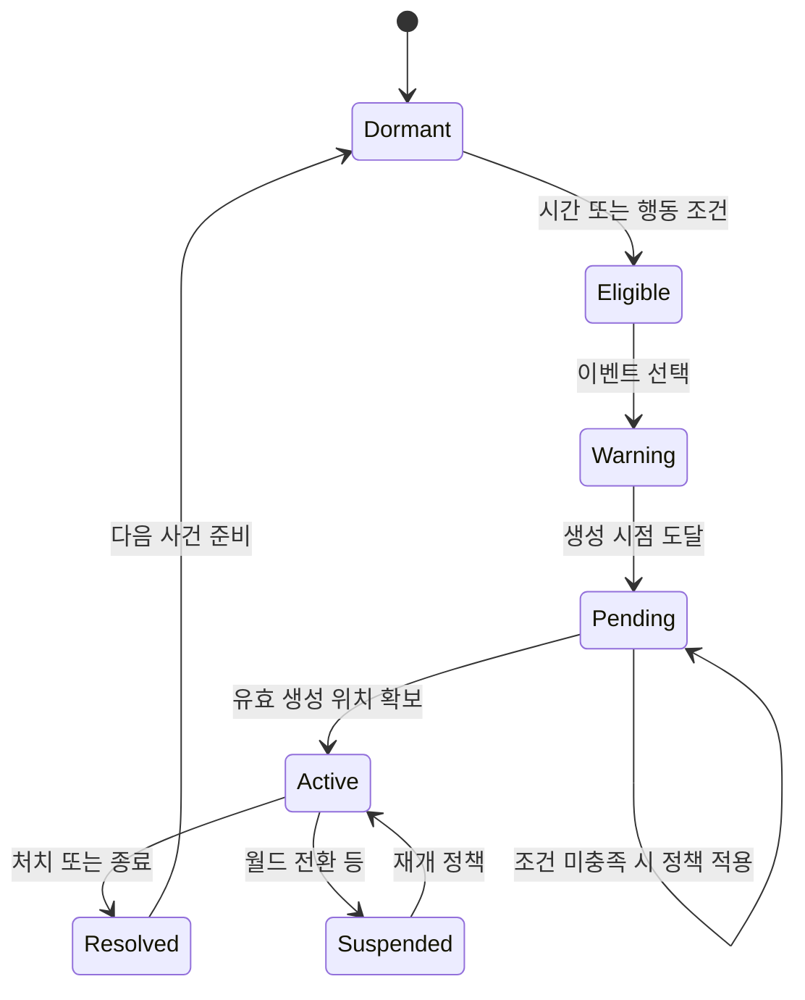

# 15. 보스·습격·이벤트 역기획서

> 작성일: 2026-11-13 | 범위: PC 싱글플레이 Don't Starve 및 Reign of Giants  
> 검증 수준: 문헌 조사. 직접 플레이·설치 빌드·원본 코드 검증 미실시.  
> [목차](00_index.md) · 관련: [계절](12_seasons_weather_temperature.md), [전투](13_combat_armor.md), [생태 AI](14_creatures_ecology_ai.md), [유적](16_caves_ruins.md)

## 1. 시스템의 목적

**[설계 해석]** 보스와 습격은 안정화된 생존 루틴에 추가 비용을 발생시키는 장치다. 식량을 확보하고 기지를 세운 뒤에도 장비·회복·이동 경로·대피 공간을 준비하게 한다. 큰 체력을 가진 적을 추가하는 것만으로는 이 기능이 충분히 구현되지 않는다. 기지, 식량, 계절 준비물처럼 플레이어가 축적한 가치에 압력을 가해야 한다.

습격과 보스의 역할은 구분한다.

- **반복 습격:** 대비 습관과 방어 인프라를 점검한다.
- **계절 거인:** 계절 대응과 전투 대응을 같은 시기에 요구한다.
- **행동 유발 위협:** 사냥·벌목 등 자원 채집 선택에 대가를 연결한다.
- **원정 보스:** 플레이어가 준비하고 찾아가는 고난도 목표를 만든다.

이 구분은 분석용 분류이며 원작 UI가 같은 분류명을 사용한다는 뜻은 아니다.

## 2. 대표 계절 거인과 확인 수치

**[자료 확인]** 아래 체력은 문헌의 **싱글플레이 DS/RoG 표기값**이다. 모드 없는 PC 목표 빌드에서 실측하여 최종 확정하는 기준값으로 사용한다. DST 수치를 대입하지 않는다.

| 개체 | 범위·계절 | 체력 기준값 | 핵심 위협 | 근거 |
|---|---|---:|---|---|
| Deerclops | [DS/RoG] 겨울 | 2,000 | 광역 공격·건축물 파괴, RoG의 냉각/빙결 위험 | [S1] |
| Bearger | [RoG] 가을 | 3,000 | 광역 공격·식량 및 보관물 위협 | [S2] |
| Moose/Goose | [RoG] 봄 | 3,000 | 강한 근접 공격·울음에 의한 무기 낙하 | [S3] |
| Dragonfly | [RoG] 여름 | 2,750 | 화염·주변 가연물·광역 공격 | [S4] |

**[자료 확인]** 가을로 시작한 RoG에서 Bearger는 첫 시작 가을에 등장하지 않는 것으로 설명된다. [S2]  
**[검증 필요]** 이 예외를 모든 거인의 첫 계절 규칙으로 일반화하지 않는다. 개체마다 출현 조건과 세계 설정의 영향을 별도로 확인해야 한다.

## 3. 출현 조건을 구분하는 기준

| 사건 유형 | 대표 사례 | 확인할 조건 | 플레이어의 통제 방식 |
|---|---|---|---|
| 시간 경과형 | Hound 습격 | 경과 일수·습격 단계·세계 설정 | 사전 준비와 이동 |
| 계절형 | RoG 거인 | 계절·출현 자격·세계 설정·개체별 예외 | 계절 준비와 위험 지역 분리 |
| 행동 누적형 | Krampus | 사냥 행동 등 누적 상태 | 자원 획득 속도와 대상 조절 |
| 지역 행동형 | Treeguard | 해당 지역 벌목과 주변 나무 | 채집·도주·진정 선택 |
| 원정 목표형 | Ancient Guardian | 유적 진입·대상 발견 | 도전 시점과 장비 선택 |

**[자료 확인]** Hound 습격은 경고를 동반하며, 생존이 진행되면 규모·빈도·경고 여유가 달라지는 구조로 설명된다. [S5] Krampus는 무해한 생물의 과도한 사냥과 연결된 숨은 누적 규칙으로 설명된다. [S6]

**[검증 필요]** 정확한 첫 출현일, 확률, 누적 임계값, 오프스크린 지연 규칙은 버전·모드·세계 설정에 따라 확인해야 한다. 특히 DST의 Deerclops 첫 출현일을 원작에 복사해 확정 일정표로 만들지 않는다.

## 4. 이벤트 수명주기

**[재구성 설계]** 원작 내부 관리자의 코드 복원이 아니라, 경고와 실제 위협을 일관되게 재현하기 위한 모델이다.



경고 시작, 생성 대기, 활성 위협을 같은 Boolean으로 표현하면 저장·이동 중의 사건 처리에 모호함이 생긴다. 경고를 들었지만 개체가 아직 생성되지 않은 상황과, 생성된 개체가 멀리 남아 있는 상황은 다른 상태다.

## 5. 경고가 하는 역할

**[설계 해석]** 경고는 공포 연출이면서 플레이어에게 행동을 바꿀 시간을 주는 장치다. 완전히 기습적인 사건은 준비 지식의 가치를 낮추고, 너무 긴 경고는 사건을 거의 무료 자원으로 바꿀 수 있다.

| 정보 계층 | 전달할 내용 | 설계상 의미 |
|---|---|---|
| 음향 | 위험의 접근 | 화면 밖 사건 감지 |
| 캐릭터 반응 | 상황이 평소와 다름 | 경고음의 의미 학습 |
| 환경·개체 신호 | 위협 종류와 위치 | 이동 방향과 장비 결정 |
| 실제 공격 | 범위·속도·상태 이상 | 전투 패턴 학습 |
| 종료 피드백 | 위험 해소 여부 | 루틴으로 돌아갈 판단 |

**[재구성 설계]** 여러 사건이 동시에 시작될 때 경고음이 완전히 덮이지 않도록 사운드 우선순위를 둔다. 다만 원작에 전역적인 '동시 위협 제한'이 존재한다고 가정하지 않는다. 복합 위험을 허용하더라도 사건 각각의 신호를 인지할 수 있는지 검수한다.

## 6. 거인별 기획 해석

### 6.1 Deerclops: 건축 자산과 생존의 분리

**[설계 해석]** 건축물을 파괴하는 적은 캐릭터의 체력만 지키는 전투를 불충분하게 만든다. 플레이어에게 전투 장소를 선택할 이유가 생기며, 기지의 생산 설비와 전투 공간을 분리하는 가치가 커진다. 겨울의 광원·보온 준비와 전투 장비가 동시에 필요해진다.

### 6.2 Bearger: 식량 축적에 대한 압력

**[설계 해석]** 식량을 노리는 행동은 장기 비축이 완전한 안전을 보장하지 않도록 만든다. 저장고를 한 지점에 모으면 이동 효율은 좋아지지만 위협이 닿았을 때 손실도 집중된다. 거인을 직접 싸울 대상뿐 아니라 이동시켜야 하는 재난으로 보게 하는 설계다.

### 6.3 Moose/Goose: 장비 의존 행동의 중단

**[설계 해석]** 무기를 떨어뜨리는 공격은 익숙한 공격 반복을 끊는다. 공격력과 체력 외에 장비 재획득·재착용, 주변 아이템 가독성, 다음 공격까지의 시간 판단이 필요해진다. 떨어진 아이템이 다른 오브젝트에 가려지는 상황도 전투 품질에 영향을 준다.

### 6.4 Dragonfly: 전장과 화재의 결합

**[설계 해석]** 화염은 공격 범위를 넘어 주변 가연물의 상태를 바꾼다. 이동 가능한 전장 확보가 곧 자산 보호로 이어진다. 여름의 환경 압박과 화재 대응이 겹치므로, 적의 체력만 낮추는 것으로 난이도를 예측하기 어렵다.

## 7. 반복 습격의 장기 난이도

**[재구성 설계]** 반복 습격은 다음과 같은 독립 파라미터로 분석한다.

```yaml
RaidPolicy:
  eligibility: world_age_and_location_rules
  nextInterval: distribution_reference
  warningDuration: stage_dependent
  groupSize: stage_dependent
  composition: weighted_species_pool
  spawnPlacement: validated_position_policy
  unresolvedEventPolicy: edition_specific
  persistence: warning_and_spawn_state
```

집단 규모만 키우면 일정 시점 이후 직접 전투가 급격히 무너질 수 있다. 간격, 경고, 구성, 동시 접근 방향은 서로 다른 난이도 축이다. 방어 함정·지형·다른 생물을 활용할 여지를 함께 고려한다.

**[설계 해석]** 오래 살아남을수록 습격 대비가 자연스러운 유지보수 업무가 되는 것이 중요하다. 매번 같은 임시 대응만 반복하게 되면 숙련 이후의 선택 폭이 좁아진다. 반대로 구축한 방어 시설이 모든 후속 습격을 영구 무효화하면 자원 순환의 긴장이 줄어든다.

## 8. 사건 생성 의사코드

**[재구성 설계]**

```text
AdvanceEvent(event, worldContext):
    UpdateEligibility(event, worldContext)

    if event enters warning:
        PersistWarningState(event)
        EmitWarning(event)

    if event is pending:
        decision = EditionPolicy.ResolvePendingEvent(event, worldContext)
        if decision allows spawn:
            location = FindValidSpawnLocation(decision)
            if location exists:
                SpawnEventEntitiesOnce(event.id, location)
                MarkActive(event)

    if event is active:
        TrackEventOutcome(event)
```

`EditionPolicy`에는 지하 체류, 계절 종료, 저장 후 재접속, 캐릭터 이동에 관한 확인된 규칙을 넣는다. 임의로 '지하에 가면 모든 습격 취소' 같은 공통 동작을 부여하지 않는다. 생성 완료 식별자는 저장 후 중복 보스가 생기는 상황을 방지하는 재현 구현의 요구사항이다.

## 9. 구체적인 의사결정 시나리오

### A. 밤 직전 Hound 경고

**[설계 해석]** 적을 처리할 무기만 준비해서는 충분하지 않다. 이동 중 사용할 광원, 공격 중 유지할 조명, 주변 생물에게 유도할 경로를 한 번에 결정해야 한다. 장비 슬롯 충돌 때문에 전투 수치가 충분해도 실제로 싸울 수 없는 상황이 만들어진다.

### B. 거인 접근 중 기지 안에 머무르기

**[설계 해석]** 회복 식량이 가까운 이점과 건축물 피해 위험을 비교한다. 기지로 유인하는 것이 항상 유리하지 않으므로, 자원 비축과 전투 지점 사이의 동선이 중요한 준비 요소가 된다.

### C. 여러 위험의 중첩

**[재구성 설계]** 겨울·낮은 정신력·습격이 동시에 진행되는 테스트를 구성한다. 각 시스템은 단독으로 통과 가능하더라도, 장비 슬롯과 행동 시간이 겹치면 대응 불가능한 조합이 생길 수 있다. 단독 난이도와 결합 난이도를 따로 기록한다.

### D. 고유 전리품 회수

**[설계 해석]** 처치는 사건의 마지막 단계가 아니다. 남은 화재·적·어둠 때문에 고유 재료를 회수하지 못할 수 있다. 전투 종료 판정과 안전한 회수 가능 시점을 구분하면 원정 비용을 더 정확히 평가할 수 있다.

## 10. QA 시나리오

| ID | 조건 | 확인할 결과 |
|---|---|---|
| B-01 | 계절·세계 설정 변화 | 허용된 사건만 자격 획득 |
| B-02 | 경고 도중 저장·로드 | 경고 중복·사건 누락·즉시 중복 생성 여부 |
| B-03 | 생성 직전 동굴 이동 | 에디션별 대기·취소·재개 규칙과 일치 |
| B-04 | 계절 종료 시 살아 있는 거인 | 유지·퇴장·소멸 조건 확인 |
| B-05 | 첫 가을 시작 RoG | Bearger의 첫 시즌 예외 확인 |
| B-06 | 광역 공격과 구조물·생물 혼재 | 대상별 피해·파괴가 일관됨 |
| B-07 | 장비 낙하 공격 | 아이템 손실·복제·장착 상태 잔존 없음 |
| B-08 | 화염 공격 직후 보스 처치 | 남은 불의 피해와 종료 표시 구분 |
| B-09 | 두 사건이 겹침 | 경고·목표 전환·성능·생존 가능성 기록 |
| B-10 | 보스 사망과 저장 시점 중첩 | 고유 전리품이 한 번만 지급됨 |

## 11. 재현용 밸런스 지표

**[재구성 설계]**

| 지표 | 측정 목적 |
|---|---|
| 경고부터 첫 피해까지의 시간 | 실제 준비 가능 시간 |
| 사건당 자산 손실 | 체력 외의 압력 평가 |
| 직접 교전·회피·유도 선택 비율 | 해결 방식의 다양성 |
| 처치까지 소모한 치료·장비 | 전리품의 실질 가격 |
| 사건 후 정상 루틴 복귀 시간 | 장기 생산에 주는 충격 |
| 위험 중첩 시 사망 원인 분포 | 결합 난이도의 과도한 구간 탐지 |

## 12. 출처와 범위 제한

- **[S1]** [Deerclops](https://dontstarve.wiki.gg/wiki/Deerclops): 싱글플레이 체력·겨울·구조물 위협.
- **[S2]** [Bearger](https://dontstarve.wiki.gg/wiki/Bearger): 체력·가을·식량 행동·첫 가을 예외.
- **[S3]** [Moose/Goose](https://dontstarve.wiki.gg/wiki/Moose_goose): 체력·봄·무기 낙하.
- **[S4]** [Dragonfly](https://dontstarve.wiki.gg/wiki/Dragonfly): 싱글플레이 체력·여름·화염 위협.
- **[S5]** [Guides/Hound Wave Survival Guide](https://dontstarve.wiki.gg/wiki/Guides/Hound_Wave_Survival_Guide): 경고와 시간에 따른 습격 변화.
- **[S6]** [Krampus/Naughtiness](https://dontstarve.wiki.gg/wiki/Naughtiness): 사냥 행동과 누적 위협의 관계.

2026-11-13 검색 인덱스 본문 확인. Antlion, Klaus, Ancient Fuelweaver, DST의 대규모 레이드 진행은 본 문서의 원작 보스 목록에 포함하지 않는다. 정확한 이벤트 시간표·확률·내부 스케줄러 구현은 별도 검증 대상이다.

[S1]: https://dontstarve.wiki.gg/wiki/Deerclops
[S2]: https://dontstarve.wiki.gg/wiki/Bearger
[S3]: https://dontstarve.wiki.gg/wiki/Moose_goose
[S4]: https://dontstarve.wiki.gg/wiki/Dragonfly
[S5]: https://dontstarve.wiki.gg/wiki/Guides/Hound_Wave_Survival_Guide
[S6]: https://dontstarve.wiki.gg/wiki/Naughtiness
