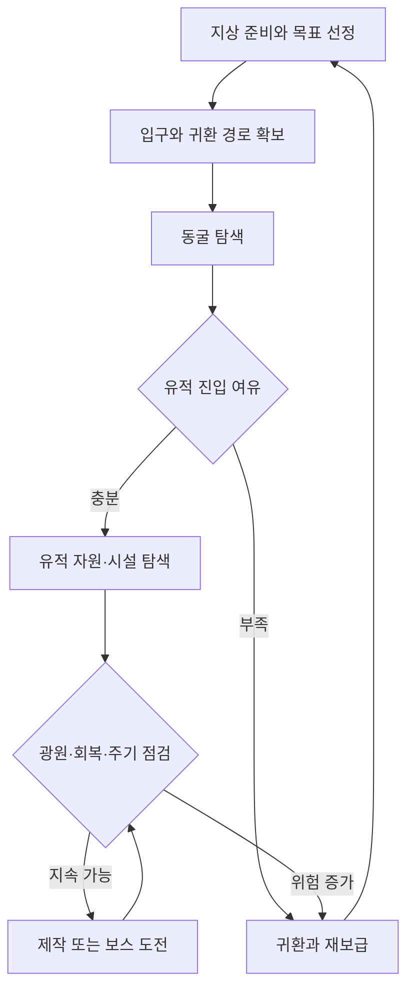

# 16. 동굴·유적·지하 원정 역기획서

> 작성일: 2026-11-13 | 범위: PC 싱글플레이 Don't Starve 및 Reign of Giants  
> 기준 보완: 2023 Mega Update 이후 원작에 추가된 유적 재생성 기능을 별도 표시  
> 검증 수준: 문헌 조사. 직접 플레이·설치 빌드·원본 코드 검증 미실시.  
> [목차](00_index.md) · 관련: [월드](05_world_generation_exploration.md), [광원·시간](02_time_day_night.md), [제작](08_crafting_research_magic.md), [진행](17_adventure_death_progression.md)

## 1. 시스템의 목적

**[설계 해석]** 동굴과 유적은 지상의 생존 능력을 새로운 환경에서 검증하는 원정 공간이다. 지상에서 여유가 생겼더라도 조명·회복·장비·귀환 동선을 확보하지 않으면 지하 탐색을 지속하기 어렵다. 보상은 새로운 자원과 제작 기회지만, 그 보상을 꺼내 가져오는 과정까지 원정에 포함된다.

지하의 핵심 질문은 '얼마나 많이 채집할 수 있는가'뿐 아니라 '언제 되돌아가야 하는가'다. 남은 자원, 길의 길이, 환경 주기를 동시에 읽게 하는 것이 이 시스템의 역할이다.

## 2. 확인된 공간 구조

**[자료 확인]** 싱글플레이에는 여러 별도 동굴이 존재하고 각 동굴에서 별도 유적 층으로 내려간다. 기본 지상의 동굴 입구 수는 3개로 설명된다. DST처럼 하나의 지하 공간 안에 동굴과 유적을 함께 배치하는 구조와 구분한다. [S1], [S2]

| 공간 | 접근 방식 | 분석상 역할 |
|---|---|---|
| 지상 | 일반 생존 월드 | 준비·비축·장기 생활 |
| 동굴 | 지상의 Sinkhole | 지하 자원·생물·추가 탐험 |
| 유적 | 동굴의 하행 입구 | 고대 제작·악몽 주기·원정 보스 |
| 귀환 지점 | 해당 공간의 출구 | 안전한 회수와 재보급 연결 |

**[재구성 설계]** 입구 위치와 연결 대상은 분리해 저장한다. 지도상의 동굴 입구를 단순한 텔레포트 좌표로만 취급하면, 서로 다른 동굴의 저장 상태가 섞이거나 잘못된 지상 입구로 복귀하는 문제가 생길 수 있다.

## 3. 지하 원정의 준비 예산

| 준비 항목 | 소모하는 상황 | 부족할 때 발생하는 문제 |
|---|---|---|
| 광원·연료 | 이동·전투·탐색 지연 | 생존과 행동 가능성 상실 |
| 식량 | 시간 경과·회복 계획 | 귀환 전 허기 압박 |
| 회복 수단 | 전투·환경 피해 | 전리품이 있어도 퇴로 통과 불가 |
| 정신력 대응 | 어두운 환경·위협 | 추가 적대 상황과 행동 제약 |
| 무기·방어구 | 지하 생물과 교전 | 전투 소모 누적 |
| 도구 | 채광·장애물·자원 수집 | 목적 자원 앞에서 원정 중단 |
| 빈 수납공간 | 귀한 재료 회수 | 출발 장비와 보상 사이의 경쟁 |
| 경로 정보 | 방향 전환·우회·교전 | 예상보다 긴 귀환 시간 |

**[설계 해석]** 충분한 예산이란 모든 칸을 채우는 것이 아니다. 회수할 보상의 공간을 남기되, 경로가 예상보다 길어졌을 때 버틸 수 있어야 한다. 따라서 보급량과 빈칸은 서로 경쟁하는 자원이다.

## 4. 장소와 자원의 기능

**[자료 확인]** 유적에는 고대 제작 시설과 Thulecite 계열 자원이 있으며, Nightmare Lights 등 환경 오브젝트가 위험 주기에 연결된다. [S3] Ancient Guardian은 유적의 Labyrinth 지역에서 만나는 원정 보스다. [S4]

**[설계 해석]** 자원 목록을 모두 나열하기보다 획득 방식의 차이를 정의하면 공간의 목적이 선명해진다.

| 자원·시설 유형 | 접근 비용 | 진행상 의미 |
|---|---|---|
| 조명을 유지하는 지하 자원 | 탐색·수집 시간 | 원정 시간을 연장 |
| 지상과 다른 식량원 | 생물·상태에 대한 지식 | 현지 조달 가능성 |
| 고대 광물·보석류 | 위험 지역 진입 | 상위 제작의 재료 관문 |
| 고대 제작 시설 | 시설까지의 이동·주변 정리 | 기술 접근의 공간 관문 |
| 보스 보상 | 전투 준비·회수 | 원정의 고가치 목표 |
| 재생성 수단 | 보스 진행·선택 | 장기 자원 순환 변경 |

시설을 찾는 것, 재료를 갖추는 것, 안전하게 제작하는 것은 서로 다른 단계다. 제작 가능 여부를 연구 해금 하나로만 설명하지 않는다.

## 5. 악몽 주기

**[자료 확인]** 악몽 주기는 지상 낮밤·달·계절 주기와 독립적으로 설명되며 Calm, Warning, Nightmare, Dawn의 네 단계를 갖는다. Nightmare 단계의 균열·조명에서 나오는 적은 플레이어 정신력이 높아도 위협이 될 수 있다. [S5]

| 단계 | 확인된 특징의 요약 | 기획 해석 |
|---|---|---|
| Calm | 악몽 시설이 비활성 상태 | 이동·관찰·정비 기회 |
| Warning | 시각·음향과 시설 상태가 변화 | 곧 위험해질 지역을 판단 |
| Nightmare | 환경에서 적대 그림자 생물 등장 | 체류 비용이 급격히 상승 |
| Dawn | 위험 개체와 환경이 안정 상태로 전환 | 추격 종료를 확인하며 복귀 |

**[검증 필요]** 단계별 지속 시간은 자료의 DS/DST 표기를 잘못 읽기 쉬우므로 수치를 고정하지 않는다. 단계 전환 시 모든 적이 같은 프레임에 사라진다고 가정하지 않으며, 어떤 개체가 개인 정신력에 의해 생성되었는지와 환경 주기에 의해 생성되었는지를 구분한다.

**[설계 해석]** 정신력 회복만으로 해결되지 않는 위험을 두면, 준비가 충분한 플레이어에게도 환경 주기를 읽을 이유가 생긴다. 같은 방과 통로가 시간에 따라 다른 가격을 가진 탐색 경로로 바뀐다.

## 6. 원정의 진행 흐름

**[재구성 설계]**



원정의 종료 조건을 체력 0으로만 두지 않는다. 남은 자원으로 복귀할 수 있는지를 주기적으로 판단하는 것이 실제 플레이의 핵심 의사결정이다.

## 7. Ancient Guardian과 2023년 이후 변화

**[자료 확인]** 원작 공식 Mega Update 공지는 Ancient Guardian 전투를 개편하고 Seed of Ruin을 추가했다고 명시한다. [S6] 현재 싱글플레이 자료의 Ancient Guardian 체력 기준값은 **2,500**이다. [S4]

**[자료 확인]** Seed of Ruin은 지상의 Sinkhole에 사용해 해당 동굴과 유적을 새로 생성하는 수단으로 설명된다. 내부에 남긴 물건·건축물도 보존 대상으로 간주해서는 안 된다. [S7]

| 구분 | 설계에 반영할 점 |
|---|---|
| 2023년 이전 자료 | 전투 패턴·자원 재생 가능성 설명이 현재와 다를 수 있음 |
| [공통·2023+] | Guardian 개편 및 Seed of Ruin 반영 |
| DST | Ancient Fuelweaver를 통한 유적 재생성 등 다른 체계 사용 |

**[설계 해석]** 유적 자원의 분류는 '절대 비재생'과 '언제든 무한 생성'이라는 이분법으로 충분하지 않다. 같은 지하 세계 안에서 재생되지 않는 자원도, 고난도 진행 후 공간을 새로 만드는 비용을 지불하면 다시 얻을 수 있다. 이는 장기 생존 경제에 별도의 순환 단계를 추가한다.

## 8. 자원 재생성의 처리 계약

**[재구성 설계]** 아래는 원작의 저장 파일 구조가 아닌, 동일한 선택을 구현하기 위한 데이터 계약이다.

```yaml
UndergroundWorld:
  id: persistent_world_id
  parentWorldId: surface_or_cave_id
  entranceLinkId: persistent_link_id
  generationSeed: seed_value
  generationVersion: schema_version
  exploredMap: exploration_state
  entities: saved_entities
  nightmarePhase: phase_and_time
  resetState: none_or_pending
```

재생성에는 다음 원칙을 둔다.

1. 어느 입구의 어떤 동굴·유적이 대상인지 식별한다.
2. 해당 공간의 저장 상태와 연결 관계를 묶어 갱신한다.
3. 플레이어·중요 참조가 제거되는 공간을 가리키지 않는지 점검한다.
4. 새 공간의 생성이 완료되면 기존 지도 정보의 유효 범위를 갱신한다.
5. 실패 시 소비된 재생성 아이템과 월드 상태가 서로 모순되지 않게 한다.

공식 기능의 존재와 별개로, 내부 저장 트랜잭션의 구체 구현은 확인하지 않았다.

## 9. 장기 체류와 귀환 판단

**[재구성 설계]** 재현 제작의 원정 판단에는 아래의 개념적 예산을 사용할 수 있다.

```text
귀환 여유 =
    남은 지속 가능 시간
    - 현재 위치에서 출구까지의 예상 시간
    - 경로 방해와 전투를 위한 예비 시간
```

'지속 가능 시간'은 광원·허기·회복 중 하나의 최솟값으로 단순화할 수 있지만, 실제로는 현지에서 보충할 수 있는 자원도 고려해야 한다. 이 식은 원작 UI에 표시되는 수치가 아니라 의사결정을 분석하는 모델이다.

**[설계 해석]** 출구를 알고 있다는 사실은 매우 큰 자산이다. 초회 탐색에서는 지도를 넓히는 것이 보상이고, 반복 원정에서는 같은 경로를 빠르게 왕복하는 것이 생산성이다. 지하 진행은 캐릭터 수치 성장뿐 아니라 플레이어의 경로 지식 축적을 통해 쉬워진다.

## 10. 구체적 시나리오

### A. 자원을 더 캐다가 귀환 연료가 부족해짐

**[설계 해석]** 광원 재료를 찾을 가능성과 알려진 출구까지 돌아갈 확실성을 비교한다. 추가 수확의 이득이 작더라도 이미 투자한 시간을 아까워해 체류를 연장하면 손실이 커질 수 있다. 생존 설계는 이 되돌아갈 시점의 판단을 반복해서 요구한다.

### B. 정신력은 충분하지만 악몽 단계가 시작됨

**[설계 해석]** 개인 수치 관리와 환경 주기 관리가 별개임을 학습하는 구간이다. 안전한 이동 구간을 미리 파악했다면 회피가 가능하지만, 복잡한 미탐색 지형에서는 같은 수치로도 위험이 커진다.

### C. 보스 처치 뒤 지하를 재생성하려는 경우

**[자료 확인·설계 해석]** 재생성은 새로운 자원 기회를 주지만 기존 지하 기반시설과 남겨둔 자산을 함께 잃을 수 있다. [S7] 플레이어는 희귀 재료 보충과 투자한 동선·건축물의 가치 중 무엇을 우선할지 판단한다.

## 11. 시스템 간 연결

| 시스템 | 지하에서 달라지는 평가 기준 |
|---|---|
| 광원 | 밤 대비용에서 지속적인 행동 가능 조건으로 비중 확대 |
| 인벤토리 | 생존 물자와 귀한 전리품 사이의 슬롯 경쟁 |
| 제작 | 시설 접근 여부가 기술 사용 가능성을 결정 |
| 정신력 | 개인 수치와 악몽 환경을 별도 관리 |
| 전투 | 퇴로·빛·원정 자원까지 포함한 교전 비용 |
| 저장 | 공간별 상태·출입 연결·재생성의 일관성 |
| 계절 | 지하의 온도·기상 적용을 에디션별로 확인 |

지하가 모든 계절 위험을 무조건 제거한다고 가정하지 않는다. 기본 DS와 RoG의 지하 환경 차이는 [계절 문서](12_seasons_weather_temperature.md)와 대상 빌드 실측을 함께 적용한다.

## 12. QA 시나리오

| ID | 조건 | 검증 항목 |
|---|---|---|
| U-01 | 서로 다른 지상 입구 진입 | 올바른 별도 동굴로 연결 |
| U-02 | 동굴에서 유적으로 이동 후 복귀 | 부모 공간과 출구 위치 일치 |
| U-03 | 광원 연료 소진 직전 공간 전환 | 조명·연료·위험 판정 상태 보존 |
| U-04 | 악몽 단계 경계에서 저장·로드 | 단계와 생성 개체 중복 없음 |
| U-05 | 높은 정신력으로 악몽 단계 진입 | 환경 생성 적대 개체를 구별 |
| U-06 | 적 추격 중 출입구 사용 | 전환·추적·피해 시점 정책 확인 |
| U-07 | Guardian 처치 후 재접속 | 보스·보상·재생성 수단 상태 일치 |
| U-08 | 지하에 물건·기지를 남긴 채 재생성 | 제거 범위와 지도 갱신 확인 |
| U-09 | 한 동굴만 재생성 | 다른 동굴·지상 상태의 오염 없음 |
| U-10 | 재생성 실패·중단 | 아이템 소비와 공간 저장이 모순되지 않음 |

## 13. 출처와 추가 검증

- **[S1]** [Caves](https://dontstarve.wiki.gg/wiki/Caves): 싱글플레이의 복수 동굴과 DST 구조 차이.
- **[S2]** [Sinkhole](https://dontstarve.wiki.gg/wiki/Cave_Entrance): 입구·출구·기본 개수.
- **[S3]** [Ruins](https://dontstarve.wiki.gg/wiki/Ruins): 고대 제작·자원·시설.
- **[S4]** [Ancient Guardian](https://dontstarve.wiki.gg/wiki/Ancient_Guardian): 위치·싱글플레이 체력·개편 이력.
- **[S5]** [Nightmare Cycle](https://dontstarve.wiki.gg/wiki/Nightmare_Cycle): 독립된 네 단계와 환경 적대성.
- **[S6]** [Klei — The Don't Starve Mega Update is now live!](https://kleiforums.com/forums/topic/147423-the-dont-starve-mega-update-is-now-live/): 2023년 원작 업데이트 공식 공지.
- **[S7]** [Seed of Ruin](https://dontstarve.wiki.gg/wiki/Seed_of_Ruin): 동굴·유적 재생성과 기존 지하 자산 제거.

2026-11-13 검색 인덱스 본문 확인. 설치 버전을 고정한 원정 테스트, 악몽 단계별 실시간 측정, 지하 저장 포맷 검증은 수행하지 않았다.

[S1]: https://dontstarve.wiki.gg/wiki/Caves
[S2]: https://dontstarve.wiki.gg/wiki/Cave_Entrance
[S3]: https://dontstarve.wiki.gg/wiki/Ruins
[S4]: https://dontstarve.wiki.gg/wiki/Ancient_Guardian
[S5]: https://dontstarve.wiki.gg/wiki/Nightmare_Cycle
[S6]: https://kleiforums.com/forums/topic/147423-the-dont-starve-mega-update-is-now-live/
[S7]: https://dontstarve.wiki.gg/wiki/Seed_of_Ruin
