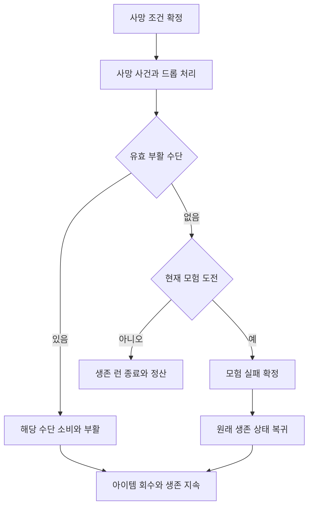

# 17. 모험 모드·사망·부활·장기 진행 역기획서

> 작성일: 2026-11-13 | 범위: PC 싱글플레이 Don't Starve 및 Reign of Giants  
> 검증 수준: 문헌 조사. 직접 플레이·설치 빌드·원본 코드 검증 미실시.  
> [목차](00_index.md) · 관련: [캐릭터](04_characters.md), [월드](05_world_generation_exploration.md), [제작](08_crafting_research_magic.md), [동굴](16_caves_ruins.md)

## 1. 시스템의 목적

**[설계 해석]** 원작의 장기 진행은 캐릭터 레벨 상승 하나로 구성되지 않는다. 현재 세계에서 생존 기반을 넓히는 진행, 다른 조건의 세계를 통과하는 모험, 새로운 캐릭터를 해금하는 프로필 진행이 함께 존재한다. 플레이어가 얻은 지식은 사망 후에도 남지만 현재 세계의 자산은 같은 방식으로 보장되지 않는다.

이 문서는 다음 흐름을 구분한다.

| 흐름 | 핵심 목적 | 월드에 대한 의미 |
|---|---|---|
| Survival 생존 | 현재 세계에서 장기 생존 | 현재 자산 축적 |
| Survival의 Teleportato | 새 세계로 이동 | 기존 세계를 떠나는 일방향 선택 |
| Maxwell's Door | Adventure 진입 | 원래 생존 세계로 돌아올 수 있는 별도 도전 |
| Adventure 챕터 전환 | 제한된 자원으로 다음 조건 통과 | 휴대 자산을 선택적으로 계승 |
| 사망·부활 | 손실 확정 또는 보험 사용 | 현재 런의 지속 여부 결정 |
| 프로필 해금 | 새로운 생존 규칙 접근 | 다음 런의 캐릭터 선택 확대 |

## 2. 두 종류의 문과 전이를 구분하기

### 2.1 Maxwell's Door

**[자료 확인]** Maxwell's Door는 기본 DS와 RoG의 생존 세계에서 Adventure Mode로 들어가는 입구다. 일반적으로 기존 아이템과 연구 레시피를 그대로 가져가지 않으며, 캐릭터 고유 시작 아이템 등 예외가 있다. 모험에서 실패하면 원래 문 앞의 생존 상태로 돌아온다. [S1]

**[설계 해석]** 기존 생활 기반을 보존하면서 별도의 어려운 도전을 시도할 수 있게 하는 구조다. 원래 세계에서 얻은 부의 크기가 모험을 완전히 대체하지 못하므로, 생존 규칙에 대한 이해가 중요한 자산이 된다.

### 2.2 Wooden Thing / Teleportato

**[자료 확인]** Wooden Thing 본체에 네 부품을 모아 결합하면 Teleportato를 완성한다. Survival에서 이를 사용하면 새로 생성된 세계로 이동하고 이전 세계로 돌아갈 수 없다. 휴대한 일반 인벤토리와 학습한 제작 지식은 계승되지만, 일부 월드 연결 아이템에는 예외가 있다. [S2]

**[설계 해석]** 이것은 Adventure 입장과 같은 안전한 외출이 아니다. 건축물·지도·현지 자원을 포기하고 휴대 가능한 자산과 지식을 새 환경에 옮기는 선택이다. 현재 세계에 더 머무를 가치와 새로운 세계의 기회를 비교하게 한다.

## 3. 전이별 계승 계약

| 상태 | Survival → Adventure | Adventure → 다음 챕터 | Adventure 실패 → Survival | Survival → 새 Survival |
|---|---|---|---|---|
| 현재 생존 세계 | 복귀 기준으로 보존 | 별도 유지 | 복귀 | 이전 대상 세계를 떠남 |
| 일반 휴대 아이템 | 원래 상태를 따로 보존 | 선택 제한 적용 | 원래 생존 인벤토리 복구 | 대체로 계승, 개별 예외 |
| 연구 지식 | 일반적으로 새 모험 시작 | 모험 안의 진행 유지 | 원래 생존 지식 복구 | 학습 지식 계승 |
| 지도·현지 건축 | 반입하지 않음 | 다음 챕터에 배치물 반입 안 함 | 원래 세계 상태 | 새 세계에 다시 구축 |
| 캐릭터 고유 상태 | 시작·예외 정책 적용 | 고유 상태별 정책 | 복귀 정책 | 캐릭터 선택·상태별 정책 |
| 실패의 영향 | 모험 도전 시작 | 모험 진행 손실 가능 | 생존 런 지속 | 기존 세계로 되돌릴 수 없음 |

**[자료 확인 범위]** 위 표의 큰 구분은 [S1], [S2], [S3]에 근거한다.  
**[검증 필요]** '제작했지만 배치하지 않은 구조물', 전용 아이템, 캐릭터 수치 업그레이드, 부패도, 확장팩 간 연결은 예외가 있으므로 포괄적인 아이템 복사 규칙 하나로 처리하지 않는다.

## 4. Adventure의 진행 규칙

**[자료 확인]** Adventure Mode는 **5개 챕터와 에필로그**로 구성된다. 각 챕터의 목표는 생존하면서 네 부품을 찾아 Wooden Thing에 결합하고 다음 세계로 나아가는 것이다. 챕터 사이에는 가져갈 아이템을 최대 네 개 선택하는 제한이 있으며, 마지막 5장 Darkness는 지속적인 밤을 핵심 조건으로 사용한다. [S3]

**[설계 해석]** 챕터 진행은 보스를 순서대로 죽이는 구조와 다르다. 자원 조달, 이동, 환경 대응을 특정 조건에서 다시 구성할 수 있는지를 시험한다. 다음 챕터로 무엇을 가져갈지 선택하는 순간이 도전 사이의 연결 역할을 한다.

### 4.1 챕터 설계의 분석 축

| 축 | 챕터가 바꿀 수 있는 것 | 검증하는 능력 |
|---|---|---|
| 시간 | 낮의 길이·밤의 비중 | 광원과 활동 시간 예산 |
| 환경 | 계절·기상·온도 압력 | 준비물과 체류 전략 |
| 지형 | 지역 분리·통로·위험 배치 | 경로 발견과 이동 계획 |
| 자원 | 자원 밀도·편중·접근 비용 | 대체 수급 경로 탐색 |
| 통과 조건 | 정신력·장애물·장비 요구 | 수치를 의도적으로 조절 |
| 계승 제한 | 다음 장에 가져갈 물건 | 현재 편의와 미래 생존의 교환 |

이 표는 각 챕터의 전체 생성 규칙을 복제한 것이 아니라 챕터 기능을 분석하는 틀이다.

### 4.2 휴대 선택의 의미

**[설계 해석]** 네 개 선택 제한은 '가장 비싼 물건 네 개' 문제로 끝나지 않는다. 광원, 장거리 식량, 도구, 회복, 이동 보조가 각각 다른 실패를 방지한다. 현재 챕터에서는 흔하지만 다음 챕터에서 얻기 어려운 자원이 더 높은 가치를 가질 수 있다.

**[검증 필요]** 문헌의 '네 아이템'은 UI의 선택 칸과 스택 동작을 함께 확인해야 한다. 수량 네 개만 가져간다고 해석하거나, 모든 보관 아이템에 동일한 계승 규칙을 적용하지 않는다.

## 5. 사망과 런 종료

**[자료 확인]** 사망 시 휴대한 물건을 떨어뜨리며, 부활 수단이 없다면 캐릭터와 생성된 세계의 해당 생존 런이 종료된다. 부활이 발생해도 아이템 회수는 별도 문제다. [S4]

**[설계 해석]** 사망은 단순한 시간 벌점이 아니다. 살아남는 데 필요한 도구·빛·식량이 사망 장소에 남아 있으므로, 복귀 경로가 새로운 생존 과제가 된다. 부활 지점만 준비하고 회수용 장비를 준비하지 않으면 보험의 실질 가치가 낮아진다.

**[범위 주의]** DST의 유령 상태, 다른 플레이어의 Telltale Heart 사용, 서버의 재시작 모드를 원작 사망 흐름으로 설명하지 않는다.

## 6. 대표 부활 수단

| 수단 | 확인된 사용 조건 | 비용과 기획 의미 |
|---|---|---|
| Touch Stone | 사전에 활성화한 부활 지점 사용 [S5] | 탐험으로 확보하는 일회성 안전망 |
| Meat Effigy | 건축해 둔 대체 신체 사용 [S6] | 제작 자원과 최대 체력의 교환 |
| Life Giving Amulet | 원작에서는 사망 시 몸 슬롯에 착용한 상태가 중요 [S7] | 휴대만으로 보장되지 않는 장비 선택 |

**[자료 확인]** 싱글플레이 Meat Effigy는 개당 최대 체력을 **30** 감소시키며, 사용되거나 파괴되면 해당 감소분이 해제되는 것으로 설명된다. [S6] 따라서 여러 개를 만드는 선택에는 전투 여유 감소라는 대가가 있다.

**[검증 필요]** 여러 수단이 동시에 유효할 때의 선택 순서, 동굴·유적과 지상의 적용 범위, 부활 직후의 수치·시간 이동은 각 수단별로 실측한다. 원작과 DST에서 이름이 같더라도 동작이 같다고 가정하지 않는다.

## 7. 사망 처리 상태도

**[재구성 설계]** 이 상태도는 실제 저장 함수나 내부 우선순위를 추출한 것이 아니다. 런·부활·모험 복귀의 중복 처리를 피하기 위한 기능 모델이다.



한 사망 사건에서 두 부활 수단을 함께 소비하거나, 부활한 뒤 런 종료 정산까지 실행하지 않도록 사건 식별자와 종료 상태를 명확히 둔다.

## 8. 모험 완료와 메타 진행

**[자료 확인]** Adventure를 완료하면 왕좌에서 구한 캐릭터로 원래 Survival에 돌아오는 효과가 있다. 첫 완료에서 Maxwell을 구해 해금하는 진행이 대표적이다. [S3], [S8]

**[설계 해석]** 보상은 기존 캐릭터의 공격력 증가만이 아니라 다른 특성을 가진 생존자를 사용할 권리다. 이는 성공 후의 플레이를 같은 수치의 반복 대신 다른 제약의 재학습으로 연결한다.

**[자료 확인]** 경험치는 생존 일수와 연결된 캐릭터 해금용 포인트로 설명되며, 기준값은 **생존일당 20 XP**이다. Touch Stone이나 Meat Effigy로 부활하는 순간에는 사망 정산 화면이 나오지 않는다. [S9]

**[자료 확인·주의]** 경험치 자료는 Adventure 실패 시 모험 일수를 Survival 사망 정산에 더하지 않는다고 설명하지만, 챕터 전환에서는 해당 챕터의 경험치가 정산된다고도 설명한다. [S9] 따라서 '모험 모드는 어떤 경우에도 XP가 없다'라는 단순 규칙을 사용하지 않는다.

## 9. 재구성 데이터 모델

```yaml
ProfileProgress:
  accumulatedExperience: integer
  unlockedCharacters: set_of_character_ids
  specialUnlockFlags: set_of_flags

RunProgress:
  mode: survival_or_adventure
  currentWorldId: persistent_id
  characterState: serialized_state
  learnedRecipes: recipe_set
  pendingBuiltStructures: build_state
  revivalCandidates: references
  deathEventId: optional_unique_id

AdventureSession:
  originSurvivalSnapshot: snapshot_reference
  chapterIndex: integer
  chapterSequence: selected_sequence
  selectedCarryItems: transfer_selection
  completionState: in_progress_failed_or_completed
```

**[재구성 설계]** 프로필 해금과 현재 런 상태를 분리한다. 런을 종료하면서 프로필 해금을 함께 잃거나, 반대로 프로필 저장이 현재 월드를 되살리는 실수를 막기 위한 구분이다. 원작 파일 구조·포맷을 설명하는 데이터는 아니다.

## 10. 전이 처리 의사코드

**[재구성 설계]**

```text
BeginAdventure(survivalRun):
    origin = CaptureReturnState(survivalRun)
    adventure = CreateAdventureSession(origin)
    ApplyAdventureStartRules(adventure)
    CommitTransition(adventure)

AdvanceAdventureChapter(session, selection):
    ValidateCarrySelection(selection, session)
    destination = GenerateNextChapter(session)
    ApplyTransferPolicy(session, destination, selection)
    CommitTransition(destination)

ResolveAdventureFailure(session):
    MarkSessionFailedOnce(session)
    RestoreOriginSurvivalState(session.origin)
    DiscardAdventureOnlyAssets(session)
```

성공 복귀는 실패 복귀와 같은 함수에 캐릭터 교체 플래그 하나만 무심코 추가하지 않는다. 원작의 승리 시 캐릭터 변경과 상태 보정에 대한 확인 결과를 별도 정책으로 적용한다.

## 11. 플레이 시나리오

### A. Survival에서 안정화 후 모험 진입

**[설계 해석]** 기지 자산을 모험에 그대로 가져갈 수 없으므로, 진입 시점은 장비 총가치보다 플레이어의 이해도와 도전 의지에 영향을 받는다. 실패 후 기존 생존을 계속할 수 있어 장기 세계와 실험적인 도전이 공존한다.

### B. 부활했지만 사망 장소가 위험함

**[설계 해석]** 회수에 필요한 횃불·예비 방어구·식량을 다른 장소에 보관했는지가 중요해진다. 보험은 죽음을 한 번 지우는 것이 아니라 손실을 회수할 기회를 주는 것으로 작동한다.

### C. 새 Survival 세계로 점프

**[설계 해석]** 많은 건축물은 가져갈 수 없지만 휴대 자원과 제작 지식은 가치가 남는다. 가장 발전한 기지를 버리는 선택도 더 나은 자원 배치나 새 탐험 기회를 위해 합리적일 수 있다. 계승 조건이 명확해야 이 선택이 예측 가능해진다.

### D. 다음 모험 챕터로 가져갈 물건 선택

**[설계 해석]** 당장의 회복 효율보다 다음 환경의 병목을 해결하는 물건이 중요해진다. 제한된 계승은 수집량 경쟁을 생존 우선순위 선택으로 바꾼다.

## 12. QA 시나리오

| ID | 조건 | 검증 항목 |
|---|---|---|
| P-01 | 일반 생존에서 부활 수단 없이 사망 | 런 종료와 프로필 정산 구분 |
| P-02 | 부활 수단 여러 개 동시 유효 | 한 수단만 적용·소비 |
| P-03 | Amulet을 소지했지만 미착용 | 착용 조건과 동일하게 처리하지 않음 |
| P-04 | Effigy 생성·파괴·사용 반복 | 최대 체력 감소분의 누적·해제 일치 |
| P-05 | Adventure 진입 직전 저장 | 원래 인벤토리·연구·월드 복귀 기준 보존 |
| P-06 | Adventure 실패 | 모험 전용 자산과 원래 자산 혼합 없음 |
| P-07 | Adventure 챕터 전환 | 선택 제한·스택·고유 상태 예외 확인 |
| P-08 | 마지막 모험 완료 | 캐릭터 교체·해금·원래 세계 복귀 확인 |
| P-09 | Survival Teleportato 사용 | 이전 세계 복귀 불가·계승 예외 검증 |
| P-10 | 부활·모험 실패·챕터 이동 각각 | XP 지급 경계와 중복 정산 여부 |
| P-11 | 전이 중 저장 중단 | 목적지·프로필·아이템이 모순되지 않음 |

## 13. 밸런스 해석

**[설계 해석]** 손실이 커야 준비가 의미를 가지지만, 모든 실패가 새 시작만 강제하면 모험적인 실험을 회피하게 될 수 있다. 원작은 부활 보험, Adventure 복귀, 프로필 해금처럼 서로 다른 범위에서 손실을 완화한다. 각 장치의 보호 범위가 달라서 '죽어도 모두 유지'와 '죽으면 아무것도 남지 않음' 사이에 여러 선택을 만든다.

**[재구성 설계]** 비교 제작에서는 사망 후 복구 시간, 부활 수단 선택률, 모험 재도전율, Teleportato 사용 시점, 해금 후 캐릭터 다양성을 측정한다. 생존 일수만으로 장기 진행의 품질을 평가하지 않는다.

## 14. 출처와 확인 한계

- **[S1]** [Maxwell's Door](https://dontstarve.wiki.gg/wiki/Maxwell%27s_Door): 모험 진입·시작 상태·실패 복귀.
- **[S2]** [Wooden Thing](https://dontstarve.wiki.gg/wiki/Wooden_Thing): 네 부품 조립·일방향 세계 이동·계승.
- **[S3]** [Adventure Mode](https://dontstarve.wiki.gg/wiki/Adventure_Mode): 5챕터·에필로그·휴대 제한·완료 복귀.
- **[S4]** [Death](https://dontstarve.wiki.gg/wiki/Death): 드롭·영구 사망·런 종료.
- **[S5]** [Touch Stone](https://dontstarve.wiki.gg/wiki/Touch_Stone): 원작의 사전 활성화 부활.
- **[S6]** [Meat Effigy](https://dontstarve.wiki.gg/wiki/Meat_Effigy): 최대 체력 30 감소와 해제.
- **[S7]** [Life Giving Amulet](https://dontstarve.wiki.gg/wiki/Life_Giving_Amulet): 몸 슬롯 착용 부활 조건.
- **[S8]** [Maxwell — Don't Starve](https://dontstarve.wiki.gg/wiki/Maxwell/Don%27t_Starve): 첫 모험 완료에 의한 해금.
- **[S9]** [Experience](https://dontstarve.wiki.gg/wiki/Experience): 일수당 XP·부활·모험 전환 정산 차이.

2026-11-13 검색 인덱스 본문 확인. 아이템별 전이 예외 전체 목록, 저장 파일의 실제 구조, 부활 우선순위와 전이 중 오류 복구는 대상 빌드의 플레이·코드 검증이 추가로 필요하다.

[S1]: https://dontstarve.wiki.gg/wiki/Maxwell%27s_Door
[S2]: https://dontstarve.wiki.gg/wiki/Wooden_Thing
[S3]: https://dontstarve.wiki.gg/wiki/Adventure_Mode
[S4]: https://dontstarve.wiki.gg/wiki/Death
[S5]: https://dontstarve.wiki.gg/wiki/Touch_Stone
[S6]: https://dontstarve.wiki.gg/wiki/Meat_Effigy
[S7]: https://dontstarve.wiki.gg/wiki/Life_Giving_Amulet
[S8]: https://dontstarve.wiki.gg/wiki/Maxwell/Don%27t_Starve
[S9]: https://dontstarve.wiki.gg/wiki/Experience
