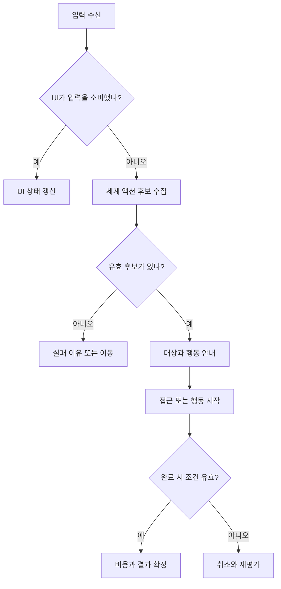

# 18. UI·조작·정보 전달·시청각 피드백

> 작성일: 2026-11-13 | 범위: PC 싱글플레이 DS/RoG | 문서 버전: 1.0  
> 자료 기반 역기획. 실제 화면 좌표·오디오 파일·입력 코드는 계측하지 않았다. [목차](00_index.md)

## 1. 시스템의 역할

**[설계 해석]** 생존 게임의 UI는 보유 자원을 표시하는 동시에 플레이어가 위험의 원인을 해석할 수 있게 해야 한다. 정보가 너무 적으면 실패가 우연처럼 보이고, 모든 계산 결과를 표시하면 발견의 과정이 줄어든다. Don't Starve의 화면을 역기획할 때는 표시 여부뿐 아니라 정보가 언제, 어느 감각으로, 얼마나 정확하게 전달되는지를 구분한다.

본 문서의 데이터 구조, 이벤트 이름, 우선순위와 품질 기준은 **[재구성 설계]**다. 실제 게임의 UI 클래스나 렌더링 파이프라인을 복원한 것이 아니다.

## 2. 자료에서 확인한 범위

| 항목 | [자료 확인] 내용 | 근거와 한계 |
|---|---|---|
| 시각 표현 | 2D 캐릭터와 3D 세계를 결합한다 | Klei 공식 소개 [S1]. 렌더링 내부 구조는 별도 미확인 |
| 입력 장치 | PC에서 키보드·마우스와 컨트롤러를 설정할 수 있다 | 공식 컨트롤러 안내 [S2] |
| 화면 기본 정보 | 체력·허기·정신력과 시간·인벤토리 등이 플레이 판단에 사용된다 | 입문 안내 및 시스템별 자료 [S3] |
| 지도와 정지 | 싱글플레이 DS에서 지도 열기는 게임을 정지시킨다 | Map 문서 검색 인덱스 [S4]. DST 설정과 혼동 금지 |
| 기본 액션 구분 | 비전투 자동 행동과 공격은 구분되어 있다 | Controls 문서 [S5]. 개별 키는 사용자 설정 가능 |

화면에 정확한 온도·위협 타이머·모든 생물 체력이 항상 표시된다는 가정은 하지 않는다. 모드가 추가한 정보를 기본 UI로 취급하면 정보 설계의 난도가 달라진다.

## 3. 화면 정보 구조

**[설계 해석]** 화면을 다음 여섯 종류의 질문으로 읽는다. 표의 배치는 기능 구분이며 픽셀 좌표 명세가 아니다.

| 정보 영역 | 플레이어의 질문 | 원천 시스템 | 필요한 표현 |
|---|---|---|---|
| 생존 상태 | 얼마나 버틸 수 있는가? | [03](03_survival_stats.md), [12](12_seasons_weather_temperature.md) | 게이지, 변화, 이상 상태 |
| 시간·환경 | 언제 위험이 바뀌는가? | [02](02_time_day_night.md), [12](12_seasons_weather_temperature.md) | 시계, 밝기, 환경 징후 |
| 소지품·장비 | 지금 쓸 수 있는 것은 무엇인가? | [07](07_inventory_equipment_durability.md) | 수량, 내구도, 신선도, 장착 상태 |
| 제작 가능성 | 무엇이 부족하고 무엇을 만들 수 있는가? | [08](08_crafting_research_magic.md) | 재료·연구·캐릭터 조건 |
| 세계와 대상 | 무엇에 어떤 행동을 할 것인가? | [05](05_world_generation_exploration.md), [06](06_resources_tools_gathering.md) | 대상 강조, 행동 문구, 지도 |
| 위협과 결과 | 무엇이 일어나고 무엇 때문에 손실을 입었는가? | [13](13_combat_armor.md), [15](15_bosses_raids_events.md) | 전조, 타격, 소리, 상태 변화 |

### 3.1 확정 정보와 해석해야 하는 정보

**[재구성 설계]** UI 설계 문서에는 정보 노출 정책을 명시한다.

| 정보 유형 | 노출 방식의 제안 | 이유 |
|---|---|---|
| 플레이어가 가진 수량 | 명확한 수치 | 자원 계획의 기초 |
| 제작할 수 없는 이유 | 대표 차단 조건과 필요 재료 | 시행착오가 입력 실패로 바뀌지 않게 함 |
| 가까운 직접 위협 | 시각·소리의 중복 신호 | 다른 영역을 보고 있어도 반응 가능 |
| 숨겨진 조합·생태 관계 | 발견 가능한 단서 | 지식 획득의 여지 보존 |
| 장비가 곧 사라질 위험 | 지속 표시와 상태 전환 신호 | 전투·야간 중 장비 전환 판단 |
| 내부 난수·AI 점수 | 디버그 화면에서만 | 플레이 판단과 구현 진단을 구분 |

이 정책은 재현 프로젝트의 제안이다. 원작이 모든 항목에서 같은 노출 방식을 사용한다고 단정하지 않는다.

## 4. 액션 선택과 입력 해석

### 4.1 액션의 공통 구조

```text
ActionCandidate {
  verb, targetId, requiredItemTag,
  allowedStates, reachRequirement,
  priorityClass, destructiveFlag,
  failReasonKey, presentationKey
}
```

**[재구성 설계]** 입력을 곧바로 결과에 연결하지 않고, 현재 상황에서 가능한 후보 액션을 구한 뒤 선택한다. 동일한 생물이나 시설도 들고 있는 물건, 장착한 도구, 대상 상태에 따라 다른 후보를 가질 수 있다.

| 입력 맥락 | 의도 | 후보 선택 시 확인할 것 | 실패 피드백 |
|---|---|---|---|
| 빈손으로 자원 선택 | 줍기·채집 | 이동 가능, 대상 잔존 | 닿지 않음 / 이미 없음 |
| 도구 장착 후 작업 대상 선택 | 베기·캐기 등 | 도구 태그, 내구도 | 도구 필요 / 사용할 수 없음 |
| 재료를 시설에 사용 | 연료 공급·조리·보관 | 수용 가능 종류, 용량 | 재료 종류 불일치 / 가득 참 |
| 전투 입력 | 공격 | 적대 조건, 사거리, 공격 상태 | 대상 유효성 재평가 |
| 강제 의도 입력 | 기본 우선순위 변경 | 공격·파괴 가능한 대상 | 오인 가능성을 줄이는 문구 |
| 지도·메뉴 전환 | 상황 검토 | 입력 포커스, 정지 정책 | 이전 행동 재개 방식 |

### 4.2 액션 처리 흐름



**[재구성 설계]** 시작 시 유효했던 대상이 완료 전에 사라질 수 있으므로 재검증이 필요하다. 인벤토리 창을 클릭했는데 그 아래 세계의 생물을 공격하는 식의 입력 관통은 액션 시스템의 문제가 아니라 포커스 계약 위반으로 다룬다.

### 4.3 반복 행동과 취소

반복 채집은 피로를 줄이지만, 위험이 나타났을 때 플레이어가 즉시 중단할 수 있어야 한다. 재구성에서는 반복 예약과 현재 수행을 분리한다. 이동·장비 변경·위협 대응 중 어느 입력이 현재 행동을 취소하는지 액션별로 정의하고, 이미 확정한 보상만 유지한다.

## 5. 인벤토리·제작 UI의 상태 모델

**[재구성 설계]** UI의 슬롯 번호를 아이템의 정체성으로 사용하지 않는다. 표시 순서가 바뀌어도 동일한 아이템 개체와 소유권을 참조해야 한다.

| UI 상태 | 표시 | 가능한 입력 | 데이터 측 제약 |
|---|---|---|---|
| 평상시 | 현재 슬롯·장비 | 선택·사용 | 소유권 확인 |
| 드래그 | 출발 위치와 후보 목적지 | 이동·분할·취소 | 이중 소유 금지 |
| 컨테이너 열림 | 컨테이너와 소지품 | 전송·제작 관련 사용 | 접근 권한·거리 재검증 |
| 건설 미리보기 | 위치 유효성 | 배치·회전·취소 | 실제 배치 시 충돌 재검증 |
| 제작 진행 | 입력 잠금 또는 취소 가능 상태 | 정의된 취소만 | 비용 중복 차감 금지 |
| 장비 소실 | 장비 슬롯 갱신 | 대체 장비 선택 | 잔여 아이콘 유령 상태 금지 |

통합 가방 표시나 컨테이너 재료 처리의 버전 차이는 [07번 문서](07_inventory_equipment_durability.md)를 기준으로 한다. UI에서 재료가 보이는 것과 제작에 사용할 수 있는 것은 별도의 판정이다.

## 6. 지도와 공간 인지

**[설계 해석]** 지도는 이동 효율을 높이는 동시에 지금까지 탐험한 결과를 보존하는 기록이다. 지형을 기억하면 다음 원정의 식량·연료·빈칸을 계획할 수 있다. 지도 자체의 정보와 플레이어가 직접 이해한 위험 정보를 구분해야 한다.

**[재구성 설계] 지도 데이터 분리:**

```text
WorldTopology = 실제 지형과 연결
ExplorationMemory = 플레이어가 확인한 영역
MapPresentation = 아이콘과 설명, 확대 상태
```

실제 세계가 변했는데 지도 아이콘이 즉시 갱신되는지, 재방문 때 갱신되는지는 오브젝트 유형별로 확인해야 한다. 확인하지 않은 지역의 적이나 자원 상태를 실시간으로 알려준다는 전제는 두지 않는다.

## 7. 시각 표현과 판정의 관계

**[설계 해석]** 캐릭터·생물·아이템의 실루엣은 빠른 분류를 돕고, 조명과 날씨는 공간의 위험도를 바꾼다. 표현이 분위기만 담당하는 것이 아니라 생존 판단에 사용되므로, 화면상 보이는 현상과 실제 판정이 어긋나면 손실이 불공정하게 느껴진다.

**[재구성 설계] 검토할 표현 계약:**

1. 광원 그래픽의 가장자리와 실제 안전 판정을 함께 검증한다.
2. 카메라를 회전했을 때 대상 선택 우선순위가 지형에 가려진 물체를 과도하게 선택하지 않는지 확인한다.
3. 채집 가능·성장 중·소진·연소 중인 자원 상태를 구별한다.
4. 공격 준비·유효 타격·회복 상태의 애니메이션이 전투 규칙과 연결되어 있는지 확인한다.
5. 장비 파손과 음식 상태 변화가 수치 변화 뒤에 늦게 표시되지 않는지 확인한다.

스프라이트 정렬·깊이 처리·오클루전·광원 계산의 실제 구현 방식은 본 문서에서 확인하지 않았다. 구현 시 사용할 기술을 원작의 기술로 오인하지 않는다.

## 8. 오디오와 경고 우선순위

**[재구성 설계]** 오디오 이벤트는 연출용과 정보용의 구분을 가진다. 아래는 원본 믹서 구조가 아닌 재현용 분류다.

| 분류 | 예시 역할 | 우선순위 정책 | 반복 제어 |
|---|---|---|---|
| 치명 위험 신호 | 곧 대응해야 하는 위협 | 다른 소리에 묻히지 않음 | 상태 진입 시, 필요 시 재경고 |
| 행동 확정 | 채집·제작·타격 완료 | 입력 결과 확인 | 한 결과에 한 번 |
| 자원 경고 | 연료·장비·상태의 한계 | 전투 중에도 식별 가능 | 지속 반복보다 단계 전환 |
| 환경 | 날씨·시간·공간 분위기 | 위험 신호와 음역·크기 분리 | 상황에 따른 크로스페이드 |
| 캐릭터 표현 | 짧은 반응·관찰 | 텍스트 이해를 보조 | 동일 문구 과도 반복 방지 |
| 음악 | 작업·긴장·탐험 분위기 | 핵심 경고 우선 | 전환 히스테리시스 |

악기별 캐릭터 음색, 원본 오디오 미들웨어, 정확한 감쇠 곡선은 **[검증 필요]**다. 재현 개발에서 분위기를 비슷하게 만드는 작업과 정보 전달을 검증하는 작업은 별도로 진행한다.

## 9. 접근성과 난도 유지

**[재구성 설계]** 정보의 전달 경로를 늘리는 것과 숨겨진 규칙의 정답을 알려주는 것은 다른 결정이다. 색상 외에 아이콘 형태·점멸·문구를 병행하고, 필수 소리 신호에 시각 대체를 제공하는 방향은 생존 계산 자체를 자동화하지 않으면서 입력과 인지의 장벽을 줄일 수 있다.

컨트롤러는 커서가 없는 상황에서도 가까운 후보 중 어떤 대상을 선택했는지 보여야 한다. 작은 아이템과 큰 구조물이 겹치는 장면, 적과 중립 생물이 함께 있는 장면, UI 배율이 큰 장면을 우선 검증한다.

## 10. QA 시나리오와 수용 기준

아래는 **계획된 테스트**이며 본 작업에서 실행한 게임 테스트가 아니다.

| ID | 초기 조건과 행동 | 관찰할 결과 |
|---|---|---|
| UI-01 | 세계 대상 위로 인벤토리를 열고 클릭 | UI 입력이 세계 공격으로 전달되지 않음 |
| UI-02 | 같은 자리에 아이템과 시설 배치 | 표시한 행동과 실행한 대상이 일치 |
| UI-03 | 반복 작업 중 이동 입력 | 명세된 취소 시점과 결과 보존 규칙 일치 |
| UI-04 | 지도 진입 중 시간 경계 접근 | 싱글플레이의 정지·재개 정책 일치 |
| UI-05 | 내구도 마지막 사용과 슬롯 이동 동시 수행 | 사라진 장비 아이콘·중복 아이템 없음 |
| UI-06 | 건설 미리보기 중 위치에 장애물 발생 | 실행 시 다시 판정하고 이유 표시 |
| UI-07 | 위험 경고·타격·비가 동시에 발생 | 위험 신호 식별 가능, 소리 중복 폭주 없음 |
| UI-08 | 저해상도·큰 배율·긴 한국어 문자열 | 게이지·숫자·행동 문구가 겹치지 않음 |
| UI-09 | 키 재지정 후 컨트롤러 전환 | 안내 문구가 실제 입력과 일치 |
| UI-10 | 저장 후 재개 시 지속 효과 존재 | 효과와 관련 표현이 같은 상태로 복원 |

## 11. 출처

- [S1 — Klei, What is Don't Starve?](https://support.klei.com/hc/en-us/articles/360029554792-What-is-Don-t-Starve): 시각적 표현의 공식 개요. 본문 직접 열람.
- [S2 — Klei, How do I play Don't Starve with a controller?](https://support.klei.com/hc/en-us/articles/360029557372-How-do-I-play-Don-t-Starve-with-a-controller): PC 컨트롤러 설정 지원. 본문 직접 열람.
- [S3 — Getting Started Guide](https://dontstarve.wiki.gg/wiki/Guides/Getting_Started_Guide): HUD 및 기본 플레이 정보. 검색 인덱스 확인; 본문 직접 접근 제한.
- [S4 — Map](https://dontstarve.wiki.gg/wiki/Map): 싱글플레이 지도 정지 규칙. 검색 인덱스 확인; 본문 직접 접근 제한.
- [S5 — Controls](https://dontstarve.wiki.gg/wiki/Controls): 입력 기능의 분류. 검색 인덱스 확인; 개별 키의 현재 기본값 전수 대조는 미실시.
- 연결: [인벤토리](07_inventory_equipment_durability.md), [전투](13_combat_armor.md), [데이터·저장](19_data_architecture_save.md).

[S1]: https://support.klei.com/hc/en-us/articles/360029554792-What-is-Don-t-Starve
[S2]: https://support.klei.com/hc/en-us/articles/360029557372-How-do-I-play-Don-t-Starve-with-a-controller
[S3]: https://dontstarve.wiki.gg/wiki/Guides/Getting_Started_Guide
[S4]: https://dontstarve.wiki.gg/wiki/Map
[S5]: https://dontstarve.wiki.gg/wiki/Controls
