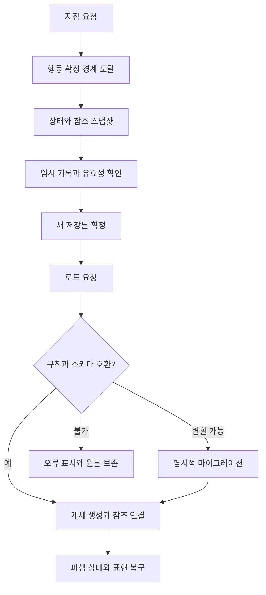

# 19. 데이터 구조·시스템 연결·저장과 복원

> 작성일: 2026-11-13 | 범위: PC 싱글플레이 DS/RoG | 문서 버전: 1.0  
> 원본 소스·바이너리·세이브를 역공학한 문서가 아니다. 별도 표기가 없는 구조와 코드는 모두 [재구성 설계]다. [목차](00_index.md)

## 1. 목적과 근거의 경계

본 문서는 앞선 시스템을 일관된 상태 모델로 구현하기 위한 설계안을 제시한다. 재현해야 하는 것은 단지 같은 아이템 이름이 아니라 시간이 흐르고, 행동이 중단되며, 죽거나 지역을 이동하고, 저장을 다시 읽어도 서로 모순되지 않는 결과다.

**[자료 확인]** 공식 지원 문서는 플레이 로그와 저장 파일을 별도 진단 자료로 안내하고, Steam Cloud 사용 여부에 따라 저장 위치가 다름을 설명한다. [S1] 공개 Saving 문서는 프로필·생존 진행·모험 진행·동굴 등 서로 다른 성격의 저장 상태를 구분한다. [S2] 실제 파일 포맷이나 현재 빌드의 직렬화 순서까지 확인한 것은 아니다.

## 2. 상태의 수명과 소유자

| 상태 영역 | 보존 기간 | 대표 내용 | 다른 영역과의 계약 |
|---|---|---|---|
| 프로필 | 여러 플레이를 통과 | 해금, 환경 설정, 기록 | 한 세계의 사망이 무관한 설정을 지우지 않음 |
| 플레이 슬롯 | 한 생존 진행 | 캐릭터, 활성 세계, 진행 관계 | 모험과 원래 세계의 복귀 관계 유지 |
| 세계 | 해당 지역의 수명 | 지형, 구조물, 채집 상태, 시계 | 다른 지역의 객체 ID와 구분 |
| 캐릭터 | 생존 또는 부활 흐름 | 상태, 장비, 소지품, 위치 | 죽음 처리와 아이템 소유권 일치 |
| 개체 | 생성부터 제거까지 | 생물·자원·시설의 상태 | 저장 후 동일한 개체 식별 |
| 일시 행동 | 시작부터 확정·취소까지 | 공격 준비, 제작, 이동 요청 | 재개 여부를 액션별 명시 |
| 표현 | 화면·소리 재생 기간 | 애니메이션, 툴팁, 효과음 | 권위 있는 게임 상태를 다시 읽음 |

프로필과 세계를 한 덩어리로 처리하면 죽음이나 세계 재생성 때 지워야 할 것과 남겨야 할 것이 섞인다. 반대로 개체마다 모든 상태를 독립 저장하면 참조 관계와 같은 시각의 일관성을 보장하기 어렵다.

## 3. 기능별 책임 분리

다음 이름은 원작 클래스명이 아니다.

| 모듈 | 소유 상태 | 주요 입력 | 내보내는 결과 |
|---|---|---|---|
| RuleProfile | 제품·DLC·설정·수치 테이블 버전 | 새 게임 선택, 로드 | 모든 규칙의 기준 |
| WorldClock | 날짜, 하루 진행, 계절 위치 | 시뮬레이션 경과 | 시간·계절 전환 |
| Environment | 비, 온도, 조명 관련 상태 | 세계·시간·시설 | 생존·자원에 적용할 환경 |
| ActorVitals | 체력·허기·정신력 및 상태 | 소비·환경·피해 | 생존 변화, 사망 후보 |
| ItemOwnership | 아이템 인스턴스·위치·소유자 | 이동·분할·사용 | 재고 변화 |
| ActionResolver | 진행 중 행동과 확정 여부 | 입력·AI 의도 | 자원 획득·소비 명령 |
| Ecology | 성장·번식·생성·관계 | 시간·환경·행동 | 자원·생물 갱신 |
| ThreatScheduler | 습격·지역 위협의 진행 | 시간·세계 조건 | 경고·생성·완료 |
| Progression | 생존·모험·부활·세계 전환 | 사망·문·전환 장치 | 다음 진행 상태 |
| Persistence | 스냅샷·참조·마이그레이션 | 저장·로드 | 일관된 실행 상태 |

핵심 원칙은 같은 자원을 여러 모듈이 직접 수정하지 않는 것이다. 예를 들어 제작과 부패가 같은 아이템을 제거하려 하면 소유권 관리자가 단일 결과를 확정한다.

## 4. 데이터 계층

### 4.1 정의와 인스턴스

| 구분 | 의미 | 예 |
|---|---|---|
| 정의 데이터 | 같은 종류가 공유하는 성질 | 도구 종류, 기본 내구도, 제작 조건 |
| 인스턴스 데이터 | 지금 존재하는 특정 개체의 상태 | 남은 내구도, 수량, 신선도, 소유자 |
| 환경 계산 결과 | 주변 상황을 반영해 파생됨 | 현재 온도 변화, 유효 광원, 작업 가능 여부 |
| 플레이 기록 | 이미 확정된 결과 | 배운 제작법, 발견 영역, 소비한 부활 수단 |

저장할 수치와 다시 계산할 수치를 구분한다. 모든 파생 값을 그대로 저장하면 로드 후 규칙 테이블과 충돌할 수 있고, 모두 다시 계산하면 당시 확정된 결과가 바뀔 수 있다.

### 4.2 예시 데이터 형식

```json
{
  "schemaVersion": "reconstruction-1",
  "ruleProfile": {
    "product": "DS",
    "enabledDlc": ["RoG"],
    "patchBaseline": "2023-plus-review",
    "worldSettingsId": "analysis-profile-autumn"
  },
  "slotId": "sample-slot",
  "activeWorldId": "surface-A",
  "playerId": "actor-player",
  "worlds": [
    {
      "id": "surface-A",
      "clock": {"dayIndex": 0, "timeInDay": 0},
      "generationSeed": "example-seed",
      "generationRevision": "reconstruction-gen-1",
      "entityIds": ["actor-player", "item-example"]
    }
  ],
  "items": [
    {
      "id": "item-example",
      "definitionId": "example-tool",
      "ownerId": "actor-player",
      "location": {"kind": "inventory", "slot": 0},
      "state": {"durabilityFraction": 0.5}
    }
  ]
}
```

이 JSON의 이름·식별자·0.5·날짜는 설명용 예시이며 게임의 기본 값이나 실제 저장 포맷이 아니다. `analysis-profile-autumn`은 분석을 위해 가을로 설정한 테스트 프로필이다. RoG의 기본 시작 계절을 가을로 고정한다는 뜻이 아니다.

## 5. 동일 시각 이벤트의 처리 순서

실제 게임의 틱 순서는 **[검증 필요]**다. 재현 프로젝트에서는 다음과 같이 순서를 명시할 수 있다.

```text
AdvanceSimulation(delta):
  clock = advanceClock(delta)
  collect environmental changes and scheduled events
  validate pending actions against current world state
  resolve completed actions and item ownership changes
  apply continuous resource changes and queued damage
  resolve deaths, resurrection candidates, and world transitions
  publish committed state changes to presentation
  save only at a consistent boundary if requested
```

어떤 순서를 선택하든 한 프레임에 음식 섭취와 굶주림 피해가 겹치거나, 마지막 연료 소모와 광원 교체가 겹치는 결과를 명세해야 한다. 플레이어가 입력한 시점과 결과가 확정되는 시점을 구분하여 테스트 로그에 남긴다.

### 5.1 순서가 중요한 사례

| 상황 | 잘못된 결과 | 필요한 규칙 |
|---|---|---|
| 아이템 부패와 요리 시작이 겹침 | 이미 사라진 재료 사용 | 재료 잠금 또는 완료 시 재검증 |
| 피해와 회복이 겹침 | 화면과 사망 결과 불일치 | 같은 시각의 우선순위 |
| 장비 파손과 두 번째 타격이 겹침 | 파손된 장비가 계속 보호 | 각 타격마다 현재 장비 확인 |
| 시설 철거와 제작 확정이 겹침 | 없는 시설에서 결과 생성 | 시설 요구 조건의 확인 시점 |
| 지역 이동과 습격 생성이 겹침 | 두 지역에서 중복 생성 | 활성 지역과 이벤트 소유자 |
| 부활과 저장이 겹침 | 부활 수단이 다시 생김 | 소비와 진행 전환을 함께 확정 |

## 6. 자원 거래의 원자성

**불변 조건:** 한 아이템 인스턴스는 같은 시각에 바닥·소지품·상자에 중복 존재할 수 없다. 분할 시에는 원래 수량과 새 수량의 합이 보존되어야 하며, 제작·섭취·연소처럼 소모하는 행동은 정의된 결과를 정확히 한 번 만든다.

```text
TryCommitCraft(request):
  verify actor and rule profile
  resolve eligible ingredient instances
  validate required station and unlocked knowledge
  reserve required amounts
  validate output destination or legal drop location
  commit ingredient removal and product creation together
  emit CraftCompleted once
```

생성된 결과를 담을 공간이 없을 때 바닥에 놓을지 행동을 거절할지는 제품 규칙에 맞춰 정한다. 위 의사코드는 어느 쪽도 임의로 원작 규칙이라고 단정하지 않는다.

## 7. 비활성 지역과 시간 누적

플레이어가 떠난 지역의 자원·생물·음식·시설이 어떻게 변하는지는 장기 경제를 크게 바꾼다. 모든 지역을 같은 빈도로 시뮬레이션하는 것과 재진입할 때 경과 시간을 계산하는 것은 구현 선택이며 원본의 방식은 본 작업에서 검증하지 않았다.

| 상태 종류 | 재구성 후보 | 주의할 점 |
|---|---|---|
| 단순 경과 시간 | 마지막 갱신 시각부터 계산 | 음수 시간·시계 변경 처리 |
| 주기적 성장 | 다음 성장 시각과 환경 이력 | 계절을 건너뛴 성장 오계산 |
| 상한 있는 생산 | 상한에서 누적 중지 | 장기 부재로 무한 생성 방지 |
| 생물 간 전투 | 제한 시뮬레이션 또는 별도 규약 | 현재 화면과 다른 결과가 임의로 생기지 않음 |
| 지역별 특수 주기 | 지역 시계와 전역 시계 구분 | 로드마다 초기화되는 현상 방지 |

재구성 테스트에서는 같은 조건에서 계속 머문 결과와 잠깐 떠났다 돌아온 결과를 비교한다. 차이가 원작에서도 존재하는지는 별도의 실제 플레이 검증 대상이다.

## 8. 저장과 로드의 처리 계약



이 흐름의 원자적 파일 쓰기, 버전 변환, 복구 전략은 재구성 제안이다. 원작이 동일한 안전 저장 절차를 사용한다는 주장이 아니다.

### 8.1 필수 보존 상태

- 시간·계절·날씨 등 장기 압력의 진행 상태.
- 플레이어의 상태, 위치, 인벤토리, 장착 상태와 이미 배운 제작법.
- 시설·채집물·생물의 개체별 변화와 관계 참조.
- 진행 중인 경고·습격의 단계와 발생 여부.
- 부활 수단의 사용 상태, 모험과 원래 세계의 연결.
- 지역별 특수 주기와 재생성 상태.
- 세계 생성 버전과 설정, 필요하다면 난수 스트림 상태.

### 8.2 무조건 보존하지 않을 상태

마우스 위치, 일시 툴팁, 완료된 효과음, 더 이상 유효하지 않은 대상 참조는 게임 규칙의 권위 상태로 저장할 필요가 없다. 진행 중 공격·이동·제작은 중단과 재개의 정책을 정의해야 하며, 그 정책을 확인하기 전에는 재현이 완료된 것으로 판정하지 않는다.

## 9. 버전과 규칙 프로필

동일한 이름의 아이템이나 생물이라도 DS·RoG·DST의 데이터는 하나의 전역 행으로 합치지 않는다. `product + dlc + patchBaseline + worldSettings + character` 조합으로 출처와 수치를 고정한다.

```text
ResolvedRule = BaseRule
             + DLCOverride
             + PatchOverride
             + WorldSettingOverride
             + CharacterModifier
```

이 표기에서 `+`는 수치 합산이 아니라 명시적 규칙 적용 순서다. 서로 다른 규칙이 같은 필드를 덮어쓰면 변경 이력을 기록한다. 캐릭터 배율과 환경 배율을 실제로 어떤 순서로 적용하는지는 [검증 필요] 항목으로 남긴다.

## 10. 재현을 위한 로그 설계

| 로그 항목 | 필요한 이유 |
|---|---|
| 게임·DLC·빌드·모드·설정 | 서로 다른 규칙 실험이 섞이는 것을 방지 |
| 시드·지역·위치·시각 | 초기 조건 복원 |
| 요청 액션과 확정 액션 | 입력과 결과 사이의 원인 분석 |
| 상태 변화 전후와 원인 | 굶주림·환경·전투 피해 구별 |
| 아이템 ID·소유자·수량 변화 | 중복 생성과 소실 추적 |
| 이벤트 단계와 다음 예정 시각 | 로드 후 재발생·누락 분석 |
| 저장·로드 경계 | 지속 효과와 참조 복구 확인 |

일반 플레이 화면에 이 정보를 모두 노출할 필요는 없다. 개발용 로그와 플레이어의 정보 설계는 별도로 유지한다.

## 11. QA 불변 조건

다음 항목은 실행 결과가 아닌 재구성 구현의 수용 기준이다.

1. 같은 시점의 저장·로드로 이미 소비된 아이템과 부활 수단이 되살아나지 않는다.
2. 세계에 존재하는 모든 소유 아이템은 유효한 소유자 또는 유효한 바닥 위치를 갖는다.
3. 한 번 확정한 전투·제작 결과를 UI 이벤트 재전송으로 중복 적용하지 않는다.
4. 생물의 대상과 집 참조가 끊어져도 로드가 실패하지 않으며 정의된 복구 동작을 수행한다.
5. 실제 진행 시간과 표현 시간의 정지·재개가 일치한다.
6. 규칙 버전이 다른 저장을 조용히 잘못 읽지 않는다.
7. 지역 재생성 이후 이전 지역의 객체 참조를 새 지역 개체로 잘못 연결하지 않는다.

## 12. 출처와 후속 문서

- [S1 — Klei, Logs and Useful Information for Bug Reports for Don't Starve](https://support.klei.com/hc/en-us/articles/360029557252-Logs-and-Useful-Information-for-Bug-Reports-for-Don-t-Starve): 실제 로그·저장 데이터의 구분과 위치 안내. 본문 직접 열람.
- [S2 — Saving](https://dontstarve.wiki.gg/wiki/Saving): 저장 상태의 종류와 진행 구분. 검색 인덱스 확인. 구형 슬롯 개수는 현재값으로 채택하지 않음.
- [사망·부활·모험 진행](17_adventure_death_progression.md): 실제 진행 규칙.
- [밸런스·QA·재현 계획](20_balance_qa_reproduction.md): 이 구조를 검증하는 실험과 우선순위.
- [제품·DLC 비교](21_dlc_dst_comparison.md): 같은 이름의 규칙을 섞지 않는 범위 관리.

[S1]: https://support.klei.com/hc/en-us/articles/360029557252-Logs-and-Useful-Information-for-Bug-Reports-for-Don-t-Starve
[S2]: https://dontstarve.wiki.gg/wiki/Saving
