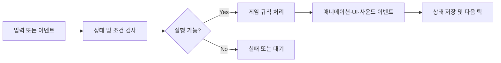

# 게임 개요 및 분석 기준

> 프로젝트: Dungeons & Dragons: Shadow over Mystara (1996)
> 문서 유형: 역기획 및 재구현 명세 초안
> 구분: **관찰된 시스템** / **구현 설계 제안** / **검증 필요**

## 1. 목적과 범위
게임 개요 및 분석 기준의 기능, 데이터, 상태 전이, 예외와 테스트를 독립 모듈로 명세한다.

## 2. 원작 기반 시스템 분석
장르: 2.5D 벨트스크롤 액션 RPG; 1996 Capcom CPS-2; 1~4인 협동; 6개 클래스.

## 3. 게임플레이 규칙 및 데이터 모델
게임 루프: 캐릭터 선택 → 구간 진입 → 적 조우 → 전투/아이템 획득 → 보스 → 보상/상점/분기 → 다음 구간.

## 4. 처리 흐름 및 상태 전이
원작 관찰 사실과 구현 가정은 분리한다. 정확한 프레임/피해 수치는 ROM 분석이나 프레임 단위 캡처로 검증한다.

## 5. 주요 예외 처리
- 피격·사망·장면 전환 중 요청이 발생하면 상태별 우선순위를 적용한다.
- 동일 프레임 중복 이벤트는 이벤트 ID와 대상 ID로 제거한다.
- 인벤토리·자원·체력은 항상 유효 범위로 제한한다.
- 멀티플레이 시 동일 시뮬레이션 틱에서 결정론적으로 처리할 수 있도록 이벤트 순서를 고정한다.

## 6. 테스트 케이스
| ID | 상황 | 기대 결과 |
|---|---|---|
| T01 | 정상 조건에서 기능 요청 | 지정된 상태로 전이 및 효과 발생 |
| T02 | 금지 상태에서 요청 | 실행 차단, 자원 변화 없음 |
| T03 | 동일 틱 중복 요청 | 중복 효과 방지 |
| T04 | 피격과 기능 실행 동시 발생 | 우선순위 표에 따른 일관된 처리 |
| T05 | 4인 협동 중 동시 이벤트 | 플레이어별 상태/자원 독립 유지 |

## 7. 원작 검증이 필요한 항목
- 프레임 수, 피해량, 판정 크기, 예외 입력, 적·보스별 특수 조건을 실기 영상으로 확인한다.
- 이 문서의 엔진 구조·변수·테스트 정책은 **원작 내부 소스의 확인 결과가 아닌 재구현 제안**이다.

## 참고 자료
- 사용자 제공: https://namu.wiki/w/던전%20앤%20드래곤%20섀도%20오버%20미스타라 (자동 열람 제한으로 직접 본문 검증하지 못함)
- https://gamefaqs.gamespot.com/arcade/563201-dungeons-and-dragons-shadow-over-mystara/faqs/11489
- https://gamefaqs.gamespot.com/arcade/563201-dungeons-and-dragons-shadow-over-mystara/faqs/1255
- https://steamcommunity.com/sharedfiles/filedetails/?id=154984901
- https://www.mobygames.com/game/63847/dungeons-dragons-shadow-over-mystara/

