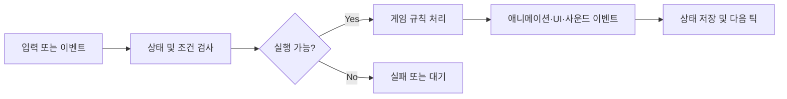

# HUD·인벤토리 링·피드백

> 프로젝트: Dungeons & Dragons: Shadow over Mystara (1996)
> 문서 유형: 역기획 및 재구현 명세 초안
> 구분: **관찰된 시스템** / **구현 설계 제안** / **검증 필요**

## 1. 목적과 범위
HUD·인벤토리 링·피드백의 기능, 데이터, 상태 전이, 예외와 테스트를 독립 모듈로 명세한다.

## 2. 원작 기반 시스템 분석
HP, 클래스/플레이어 식별, 선택 아이템, 주문 잔여 횟수, 상점, 분기 선택과 전투 피드백을 다룬다.

## 3. 게임플레이 규칙 및 데이터 모델
UI 상태: Gameplay, ItemRing, SpellRing, Shop, RouteVote, Pause, Result. 입력 포커스와 게임 정지 여부를 각 상태별로 지정한다.

## 4. 처리 흐름 및 상태 전이
피격 점멸, 히트스톱, 화면 흔들림, 데미지 사운드, 주문 이펙트의 가독성과 중첩 정책을 명세한다.



## 5. 주요 예외 처리
- 피격·사망·장면 전환 중 요청이 발생하면 상태별 우선순위를 적용한다.
- 동일 프레임 중복 이벤트는 이벤트 ID와 대상 ID로 제거한다.
- 인벤토리·자원·체력은 항상 유효 범위로 제한한다.
- 멀티플레이 시 동일 시뮬레이션 틱에서 결정론적으로 처리할 수 있도록 이벤트 순서를 고정한다.

## 6. 테스트 케이스
| ID | 상황 | 기대 결과 |
|---|---|---|
| T01 | 정상 조건에서 기능 요청 | 지정된 상태로 전이 및 효과 발생 |
| T02 | 금지 상태에서 요청 | 실행 차단, 자원 변화 없음 |
| T03 | 동일 틱 중복 요청 | 중복 효과 방지 |
| T04 | 피격과 기능 실행 동시 발생 | 우선순위 표에 따른 일관된 처리 |
| T05 | 4인 협동 중 동시 이벤트 | 플레이어별 상태/자원 독립 유지 |

## 7. 원작 검증이 필요한 항목
- 프레임 수, 피해량, 판정 크기, 예외 입력, 적·보스별 특수 조건을 실기 영상으로 확인한다.
- 이 문서의 엔진 구조·변수·테스트 정책은 **원작 내부 소스의 확인 결과가 아닌 재구현 제안**이다.

## 참고 자료
- 사용자 제공: https://namu.wiki/w/던전%20앤%20드래곤%20섀도%20오버%20미스타라 (자동 열람 제한으로 직접 본문 검증하지 못함)
- https://gamefaqs.gamespot.com/arcade/563201-dungeons-and-dragons-shadow-over-mystara/faqs/11489
- https://gamefaqs.gamespot.com/arcade/563201-dungeons-and-dragons-shadow-over-mystara/faqs/1255
- https://steamcommunity.com/sharedfiles/filedetails/?id=154984901
- https://www.mobygames.com/game/63847/dungeons-dragons-shadow-over-mystara/


## 상세 확장 명세 (v2)

### 세부 동작 규칙

1. 체력·플레이어 상태·현재 아이템·주문 잔여량을 HUD에 표시한다.

2. 아이템 링과 주문 링은 입력 포커스와 선택 상태를 독립적으로 관리한다.

3. 4인 플레이에서는 HUD 배치가 화면을 가리지 않도록 각 플레이어 정보를 구분한다.

4. 아이템 사용 실패, 주문 불가, 분기 선택, 상점 거래는 즉각적인 시각·청각 피드백을 제공한다.

### 데이터 필드 및 구현 검증

| 필드 | 의미 | 검증 기준 |
|---|---|---|
| `HUDSlot` | HUDSlot 설정값/식별자 | 타입·범위·상태 전이 및 데이터 참조 검사 |
| `RingIndex` | RingIndex 설정값/식별자 | 타입·범위·상태 전이 및 데이터 참조 검사 |
| `SelectedItemId` | SelectedItemId 설정값/식별자 | 타입·범위·상태 전이 및 데이터 참조 검사 |
| `SpellCharges` | SpellCharges 설정값/식별자 | 타입·범위·상태 전이 및 데이터 참조 검사 |
| `FeedbackEvent` | FeedbackEvent 설정값/식별자 | 타입·범위·상태 전이 및 데이터 참조 검사 |

### 상태 및 이벤트 처리 예시

```text
for each fixedTick:
  sampleBufferedCommands()
  validateActorStateAndResources()
  advanceAnimationAndStateTicks()
  resolveMovementAndLaneCollision()
  resolveHitAndEffectEventsInStableOrder()
  commitInventoryHealthAndProgress()
  publishPresentationEvents()
```

### 예외 및 테스트 시나리오

| 시나리오 | 기대 동작 |
|---|---|
| 같은 틱에 피격과 행동 요청 | 우선순위 규칙에 따라 단일 상태 전이 |
| 자원 부족 상태에서 사용 | 효과 발생 및 자원 소모 없음 |
| 화면 전환 직전 공격 판정 | 전환 정책에 따라 이벤트 취소 또는 완료 |
| 협동 중 중복 타격 | 공격 인스턴스·대상 조합으로 중복 제어 |
| 프레임레이트 변화 | 고정 틱 기반 결과 동일 |

> **주의:** 위의 필드와 처리 순서는 재구현용 설계 제안입니다. 원작 내부 구현이나 정확한 수치로 단정하지 않습니다.
