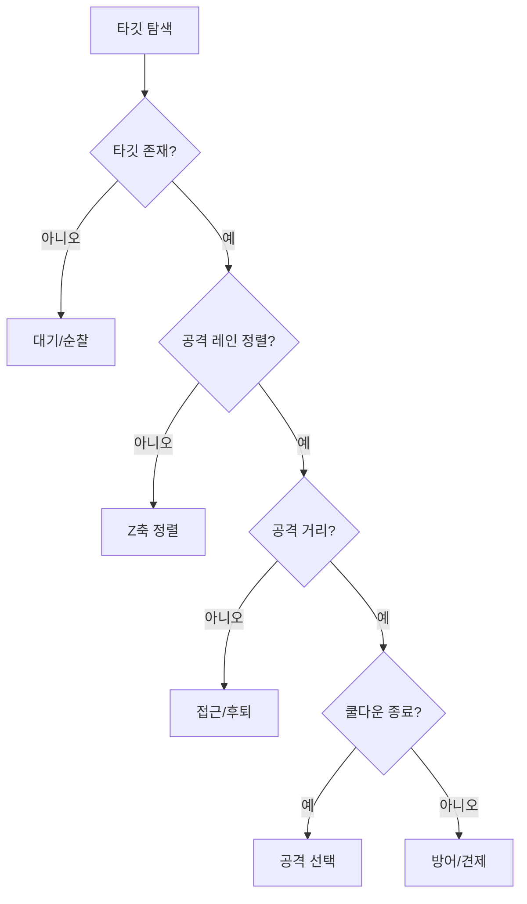

# 적·보스 행동 트리 및 전투 디렉터

## 일반 적 의사결정

## 행동 평가
`Utility = DistanceScore × LaneScore × CooldownScore × ContextWeight` (재구현 제안)

## 보스 패턴 데이터
| 필드 | 목적 |
|---|---|
| telegraphTicks | 공격 예고 시간 |
| attackBoxes | 프레임별 타격 영역 |
| invulnerabilityFlags | 무적·슈퍼아머 구간 |
| recoveryTicks | 반격 가능 시간 |
| phaseGate | 체력/이벤트 조건 |

보스별 실제 패턴명, 패턴 프레임, 체력 분기는 원작 영상에서 개별 측정하여 확정해야 한다.
