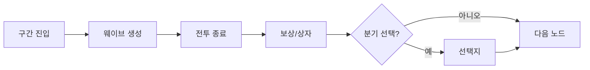

# 스테이지 분기 그래프와 이벤트 시스템

## 노드 모델
`StageNode { id, entryConditions, waves, chests, shops, exits, nextNodes }`

## 이벤트 순서

## 분기 검증
- 선택지 미선택 상태에서 전환이 발생하지 않는지 확인
- 이전 구간 플래그에 따른 잠금 해제 검사
- 상점 및 보상 중복 획득 방지
- 협동 플레이 중 분기 결정 충돌 해결

실제 전체 스테이지 노드와 분기 경로는 원작 플레이 루트별 교차 확인 후 확정한다.
