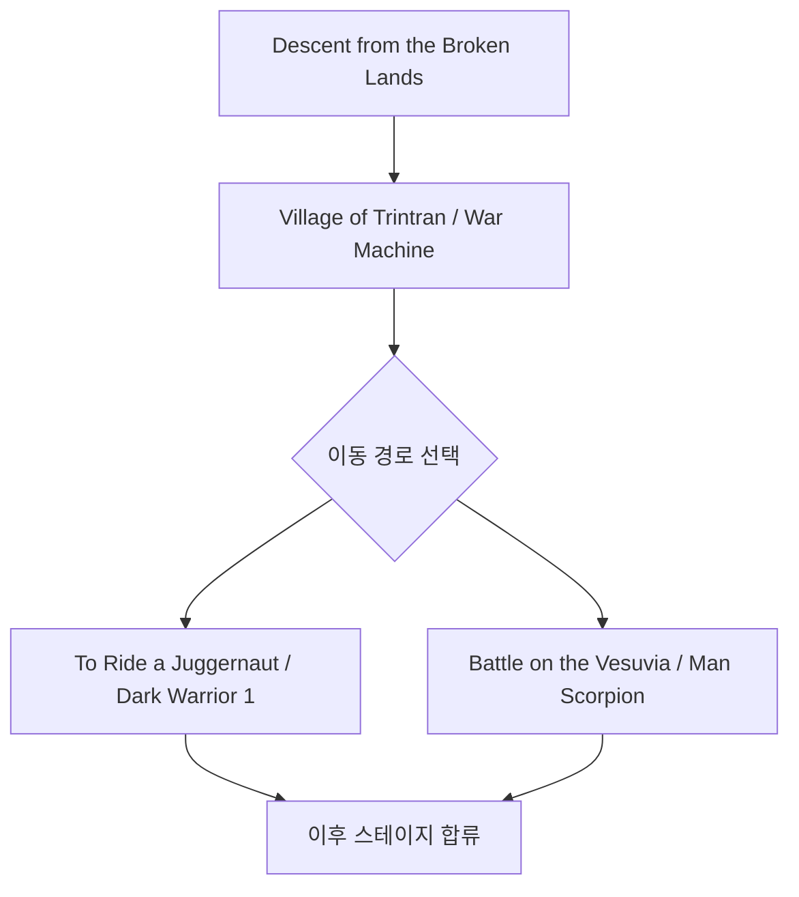

# 스테이지 분기·이벤트 아틀라스

## 초반 확정 분기

위 분기는 공략에 명시. 합류 지점은 후속 스테이지 이벤트 테이블과 별도로 확인한다.

## 후반부 구간
- Gateway / Overtures: 루트 이력에 따라 Tel'Arin 조우 조건이 달라질 수 있다.
- The Arena: Ezerhorden 전투.
- Battle Royal / The Arena Revisited: Dark Warrior 2 조우.
- Inner Heart / Dark Heart: Nagpa 이후 Synn 최종전.

## 스테이지 데이터 구조 [제안]
```json
{"stageId":"03_route_choice","exits":[{"to":"03A_juggernaut","condition":"vote_A"},{"to":"03B_vesuvia","condition":"vote_B"}],"flagsWritten":["route03"],"bossId":null,"spawnWaves":[],"treasureTables":[]}
```

## 이벤트 순서
1. 스테이지 진입 시 이전 분기 플래그 적용
2. 카메라 경계 및 전투 게이트 활성화
3. 적 웨이브 스폰 및 전투 종료 감지
4. 상자·비밀방·아이템 획득 처리
5. 파티 이동 동기화 및 경로 투표
6. 다음 스테이지 로드와 영속 플래그 저장

## 검증 필요
전체 스테이지 순서, 비밀방 좌표, 분기별 보물·보스 재등장 조건, 멀티플레이 투표 규칙은 원작 플레이로 확정해야 한다.

## 근거 및 신뢰도
- [Capcom 공식 소개](https://news.capcomusa.com/lets/browse/dungeons-and-dragons-combat-for-combat-connoisseurs)
- [Steam 상세 플레이 가이드](https://steamcommunity.com/sharedfiles/filedetails/?id=154984901)
- [GameFAQs Kaze_Yagami 공략](https://gamefaqs.gamespot.com/arcade/563201-dungeons-and-dragons-shadow-over-mystara/faqs/11489)
- [한국어 게임 조작 정리](https://theroomofspiritandtime.tistory.com/1020)

**표기:** `[확인]`은 문헌에 명시된 동작, `[추정]`은 공략에 기초한 해석, `[제안]`은 구현을 위한 임의 설정이다. 입력 프레임·대미지·무적 프레임은 실측하지 않았으므로 확정하지 않는다.
