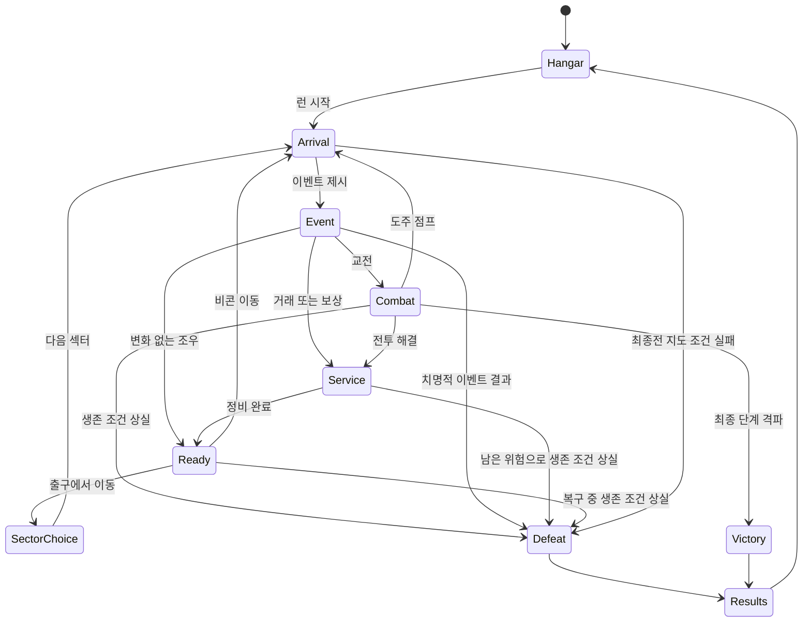

# 01. 핵심 플레이 루프와 런 상태

> 범위: 함선 선택부터 항해·전투·정비·최종전·결과까지.  
> [확인]은 공개 문헌의 동작, [해석]은 설계 분석, 상태 기계와 의사코드는 [재구성안]이다.

## 1. 시스템의 목적

FTL은 한 척의 함선과 제한된 승무원을 유지하면서 목적지까지 도달하는 게임이다. 플레이어가 직접 조종하는 것은 함선의 공간 이동 궤적이 아니라 **자원의 배분과 행동의 순서**다. 전투에서는 일시정지로 판단 시간을 확보하고, 항해에서는 점프를 실행할 때 미래의 선택지를 소비한다. [O1]

**[해석]** 핵심 긴장은 “이번 조우에서 이기기”와 “최종전까지 살아갈 여지를 남기기”가 일치하지 않는 데서 나온다. 미사일을 사용하면 현재 피해를 줄일 수 있지만 다음 전투의 자원이 줄어든다. 승무원을 강습에 보내면 적의 수리를 방해할 수 있지만 본선에서 수리할 인원이 사라진다.

## 2. 세 겹의 루프

| 시간 범위 | 반복 구조 | 주요 결정 | 누적 결과 |
|---|---|---|---|
| 전투의 순간 | 확인 → 일시정지 → 명령 → 실행 → 결과 관찰 | 전력·무기 목표·승무원·문·능력 사용 | 피해·전력 상태·충전·선내 위험 |
| 한 조우 | 항해 → 이벤트/전투 → 보상 → 복구 | 교전·도주·교섭·이벤트 선택 | 재화·장비·승무원·퀘스트 |
| 한 런 | 섹터 탐색 → 성장 → 다음 섹터 → 최종전 | 경로·구매·장기 빌드 | 승패·기록·함선 해금 |

**[해석]** 전투 능숙함만으로 모든 문제를 해결할 수 없게, 조우 밖의 결정이 전투 초기 상태를 바꾼다. 반대로 항해 중 좋은 장비를 얻어도 전력과 배치가 맞지 않으면 즉시 강해지지 않는다.

## 3. 입력과 출력

### 3.1 입력

- 시작 함선·레이아웃·난이도·AE 옵션.
- 전력 배분, 승무원 이동, 방의 개폐, 무기 표적과 발사, 시스템 활성화.
- 이벤트 선택, 상점 구매·판매, 업그레이드.
- 비콘 이동, 다음 섹터 선택, 특정 상황의 대기.
- 일시정지·재개와 중단 후 이어하기.

### 3.2 출력

| 출력 | 소비자 | 요구사항 |
|---|---|---|
| 현재 함선 상태 | 전투·UI·저장 | 선체와 시스템 손상을 구분 |
| 조우 결과 | 이벤트·보상·통계 | 파괴·승무원 제거·항복·도주를 구분 |
| 항해 상태 | 지도·이벤트 | 비콘 방문·추격·퀘스트 목적지를 유지 |
| 성장 상태 | 상점·전투 | 구매한 설비와 현재 전력은 별도 저장 |
| 런 종료 결과 | 기록·프로필 | 사망한 런의 이어하기와 해금을 분리 |

## 4. 상태 구조

**[재구성안]** 원작의 실제 코드 구조가 아니라 동일한 외부 경험을 구현하기 위한 상태 전이다.



일시정지를 독립적인 런 단계로 만들기보다 `simulationPaused`라는 실행 제어로 두면 편하다. 이벤트 선택창, 상점, 게임 메뉴는 서로 다른 정지 이유가 될 수 있다. 하나를 닫았다고 다른 정지 이유까지 해제해서는 안 된다.

생존 조건 검사는 전투에만 한정하지 않는다. 이벤트 손실이나 전투 후 화재·질식 등으로도 치명 상태가 발생할 수 있으므로, 상태를 변경하는 모든 플레이 단계에서 공통 종료 검사를 거친다.

```text
RunState
  profileId, runId, difficulty, advancedContent
  currentSector, currentBeacon
  shipState, encounterState, mapState
  pauseReasons: Set<PauseReason>
  terminalResult: None | Win | Loss
  statistics, resolvedRewardIds
```

## 5. 시간의 분리

### 5.1 전투 시간

**[확인]** FTL은 전투 중 일시정지한 채로 전략을 검토하고 명령할 수 있다. [O1] 무기 충전, 투사체, 이동, 수리, 화재, 산소 변화처럼 시간에 의존하는 기능은 정지 여부를 일관되게 따라야 한다.

### 5.2 항해 턴

**[확인]** 비콘 이동과 연료 부족 상태의 대기는 반군 추격에 영향을 준다. 일반적인 전투를 오래 했다는 이유만으로 반군 지도의 전선이 초 단위로 전진하는 구조는 아니다. [M1][M2]

**[해석]** 이 분리는 플레이어에게 전술을 고민할 시간은 허용하면서, 더 많은 조우를 얻기 위한 항해에는 비용을 부여한다. 전투의 “느리게 판단하기”와 지도의 “한 번 더 들르기”는 서로 다른 선택이다.

### 5.3 프로필 시간

런이 끝나도 일부 해금과 기록은 남는다. 그러나 현재 런의 무기·스크랩·선체가 다음 런에 그대로 이어지는 경제는 아니다. 함선 해금의 구체 조건은 [14번](14_ships_loadouts_and_unlocks.md)을 기준으로 한다.

## 6. 한 비콘의 처리 계약

**[재구성안]** 다음 처리 순서를 권장한다. 원작의 내부 프레임 순서를 단정하는 것은 아니다.

1. 이동 요청 시 도달 가능성·연료·점프 준비·조타·엔진 조건을 검사한다.
2. 승무원 원격 파견 등 손실 가능한 상태를 판정하고 필요한 안내를 제공한다.
3. 이동을 확정한 시점에 비용과 항해 진행을 한 번만 적용한다.
4. 목적지의 점령 상태와 이미 해결된 이벤트 여부를 확인한다.
5. 조우·환경·적 함선을 구성한다.
6. 이벤트 선택이 필요한 경우 시뮬레이션 진행을 잠근다.
7. 이벤트 또는 전투를 처리한다.
8. 결과에 맞는 보상·퀘스트·추격 변경을 한 번만 확정한다.
9. 남은 화재·균열·침입자 등 함선 위험이 있으면 복구를 계속한다.

```text
requestJump(destination):
  requirements = evaluateJumpRequirements(currentState, destination)
  if not requirements.allowed:
      return explain(requirements.reason)
  transaction = reserveTravelCosts(destination)
  resolveDepartureConsequences(transaction)
  applyNavigationTurn(transaction)
  loadOrCreateEncounter(destination)
  commit(transaction)
```

**[검증 필요]** 출발지와 도착지 중 어느 쪽의 성운 속성을 추격 감속에 적용하는지, 점프 취소 가능 지점이 어디인지는 실제 빌드에서 계측해 이 계약에 매핑한다.

## 7. 전투 결과를 하나의 승패 불리언으로 만들면 안 되는 이유

| 결과 | 즉시 의미 | 남을 수 있는 후속 문제 |
|---|---|---|
| 적 선체 파괴 | 적 함선의 생존 종료 | 적 선내에 보낸 아군의 생존·복제 처리 |
| 적 승무원 제거 | 유인선의 인적 저항 제거 | 클론실·자동선·기함 예외 |
| 항복 수락 | 제안된 거래에 따라 교전 해결 | 발사체·침입자·이벤트 후속 상태 확인 필요 |
| 적 도주 | 상대 조우가 이탈 | 정찰 이벤트의 추격 증가, 보상 상실 |
| 아군 도주 | 현재 전투 회피 | 연료·추격·파견 승무원 손실 |
| 아군 선체 파괴 | 함선 생존 조건 상실 | 런 종료·프로필 기록 확정 |

각 결과의 보상 규칙은 동일하지 않다. 특히 승무원 제거가 언제나 고정 배수의 보상을 준다고 가정하면 이벤트별 차이가 사라진다. [E1]

## 8. 패배와 승리 판정

**[확인]** 영구 사망은 런의 핵심 제약이며, 마지막 섹터에서는 반군 기함과 연방 기지의 관계가 별도 패배 조건을 만든다. [O1][M3]

**[재구성안]** 종료 판정은 다음처럼 사유를 보존한다.

```text
LossReason = HullDestroyed
           | NoRecoverableCrew
           | FederationBaseLost

WinReason = FlagshipFinalPhaseDefeated
```

`NoRecoverableCrew`는 “현재 화면에 살아 있는 아군이 0명”과 동일하지 않다. 클론 대기열, 원격 함선의 승무원, 정신 지배로 일시적으로 바뀐 소속 상태 등을 분리해서 판단해야 한다. 자세한 예외는 [10번](10_crew_species_and_training.md), [11번](11_boarding_and_personal_combat.md), [13번](13_advanced_edition_systems.md)을 따른다.

또한 적 선체가 0인 순간과 보상이 확정되는 순간을 분리하면 파괴 연출 중 중복 보상을 막기 쉽다. 기함의 1·2단계 파괴를 최종 승리로 처리해서는 안 된다.

## 9. 대표 플레이 흐름

다음은 **[해석]을 위한 가상 상황**이며 원본의 특정 이벤트나 최적 공략을 옮긴 것이 아니다.

1. 무기는 충분하지만 선체와 연료가 줄어든 상태에서 상점과 미방문 비콘을 발견한다.
2. 상점으로 바로 가면 생존을 확보할 수 있지만 장비를 살 스크랩이 부족하다.
3. 한 번 더 교전해 스크랩을 얻되, 미사일을 사용해 수리비를 줄이는 방향으로 싸운다.
4. 적의 무기를 먼저 끊어 다음 피격을 늦추고, 그 동안 승무원을 수리에 배정한다.
5. 승리 후 선체 손실·소모 미사일·획득 스크랩을 함께 고려한다.
6. 상점에서는 원하는 무기의 표시 가격뿐 아니라 무기실과 전력 확장 비용도 계산한다.
7. 출구까지 남은 거리와 추격을 보고 추가 탐색을 종료한다.

이 예시에서 전투의 성공은 적 격파 하나가 아니라, 다음 상점과 다음 섹터에 들어가는 상태까지 포함한다.

## 10. 핵심 불변 조건

**[재구성안]** 모든 시스템이 공유할 규칙이다.

- 연료·스크랩·소모품 수량은 음수가 되지 않는다.
- 하나의 조우 보상은 같은 식별자로 두 번 수령할 수 없다.
- 런 종료 뒤 전투 명령으로 결과를 다시 바꿀 수 없다.
- 정지 중에도 입력은 받지만 시뮬레이션 시간은 흐르지 않는다.
- 현재 런 데이터와 프로필 해금 데이터는 별도 생명주기를 갖는다.
- 부활 가능성과 단순 생존 여부는 분리한다.
- 점프 비용·추격·목적지 전환은 성공한 이동에 한 번만 적용한다.
- 원작 버그를 재현하려는 목표와 개선하려는 목표를 테스트에서 구분한다.

## 11. 검증 시나리오

| ID | 전제·입력 | 확인할 결과 |
|---|---|---|
| LOOP-01 | 무기 충전 중 일시정지 후 승무원 이동 지시 | 정지 중 충전·이동 진행은 없고 재개 후 명령 실행 |
| LOOP-02 | 같은 전투를 다른 실제 경과 시간으로 완료 | 지도 추격이 단순 실시간 경과로 추가 진행하지 않음 |
| LOOP-03 | 연료 0에서 점프 요청 | 일반 이동은 거부되고 연료 부족 대응으로 연결 |
| LOOP-04 | 마지막 승무원 사망, 정상 작동하는 클론실 존재 | 즉시 일반 전멸 패배로 처리하지 않음 |
| LOOP-05 | 적 사망과 후속 보상 처리를 반복 호출 | 보상은 1회만 확정 — 재구성안의 무결성 테스트 |
| LOOP-06 | 기함 1단계 격파 | 런 승리 대신 다음 단계로 진행 |
| LOOP-07 | 패배 후 새 런 시작 | 이전 무기·스크랩은 초기화되고 해금은 유지 |
| LOOP-08 | 정지 원인 두 개를 만든 뒤 하나만 해제 | 다른 정지 원인이 남으면 시뮬레이션 유지 — 재구성안 |

## 12. 출처와 미확인 사항

- [O1] [공식 Steam 제품 설명](https://store.steampowered.com/app/212680/FTL_Faster_Than_Light/) — 핵심 조작·일시정지·영구 사망.
- [M1] [Beacons](https://ftl.fandom.com/wiki/Beacons) — 점프와 조우의 단위.
- [M2] [Rebel Fleet](https://ftl.fandom.com/wiki/Rebel_Fleet) — 항해에 따른 추격과 이벤트 변경.
- [M3] [Sectors](https://ftl.fandom.com/wiki/Sectors) — 표준 진행과 마지막 섹터의 특수 규칙.
- [E1] [Rewards](https://ftl.fandom.com/wiki/Rewards) — 결과·이벤트별 보상 유형.

커뮤니티 위키는 검색 색인에 제공된 본문을 확인했다. 실제 엔진 업데이트 순서, 동시 승패의 우선순위, 저장되는 내부 필드명은 확인하지 않았으며 위 상태 모델은 제안이다.

[목차로 돌아가기](README.md)
