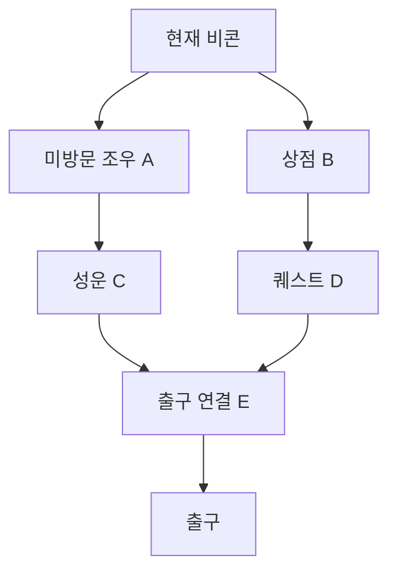

# 02. 섹터·비콘 지도·항해·반군 추격

> 역할: 전투 밖에서 탐색 기회, 정보, 위험, 성장 시간을 배분한다.  
> 연동: [01 런](01_core_loop_run_state.md) · [03 이벤트](03_events_quests_and_choices.md) · [04 경제](04_economy_shops_and_progression.md) · [16 기함](16_rebel_flagship.md)

## 1. 시스템 개요

**[확인]** 표준 진행은 1번 시작 섹터에서 8번 The Last Stand까지 이어진다. 섹터 안에는 여러 비콘이 있고 일반 섹터의 출구에서 다음 섹터로 넘어간다. 숨겨진 크리스털 구역과 마지막 섹터는 일반 지도 규칙의 예외다. [M1]

**[해석]** 지도는 이동 편의를 위한 메뉴가 아니라 성장량을 결정하는 시스템이다. 미방문 비콘은 자원을 얻을 가능성이지만, 그 비콘을 방문하는 행동은 연료와 추격 여유를 쓴다. 따라서 “출구까지 가장 빨리 가는 길”과 “살아남기 위한 좋은 길”은 달라질 수 있다.

## 2. 두 지도 계층

| 계층 | 노드 | 연결 | 플레이어에게 주는 질문 |
|---|---|---|---|
| 섹터 선택 지도 | 다음 지역의 종류 | 앞으로 갈 수 있는 섹터 분기 | 어떤 적·이벤트·상점을 만날 것인가? |
| 현재 섹터 지도 | 비콘 | 현재 점프 가능한 연결 | 얼마나 더 탐색하고 언제 빠져나갈 것인가? |

섹터의 종류와 진행 번호를 별도 데이터로 두어야 한다. 예를 들어 같은 종족의 구역도 초반과 후반에는 적의 성장 수준이 다를 수 있다. 색상은 지역 분류에 가깝고 위험도를 완전히 설명하는 지표로 사용하기 어렵다. [M1]

## 3. 비콘의 상태

**[재구성안]** 비콘 하나에 하나의 `type`만 두면 퀘스트·성운·점령·상점 상태를 함께 표현하기 어렵다.

```text
BeaconState
  id, position, adjacentBeaconIds
  discovery: HiddenDetails | Known | Visited
  baseEventRef, resolvedEventState
  mapTags: Store | Distress | Quest | Exit | Repair
  mapNebula: bool
  encounterEnvironment
  controlledBy: Neutral | Federation | Rebels
  pendingQuestRef
  storeState?
```

`mapNebula`와 `encounterEnvironment`를 분리하는 이유는 지도에서 얻는 정보와 실제 이벤트가 조성하는 전투 환경이 항상 일치한다고 가정하지 않기 위해서다. 문헌에도 지도 성운 표시와 이벤트의 환경 조건이 달라지는 사례가 정리되어 있다. [M1b]

### 비콘별 의미

| 분류 | 플레이어가 아는 정보 | 실제 결정 |
|---|---|---|
| 일반 미방문 | 구체 조우는 불명 | 정보가 부족한 상태에서 방문할지 결정 |
| 조난 | 도움이 필요한 신호 | 구조·전투·위험 이벤트 가능성을 감수 |
| 상점 | 거래 기회 | 구매할 자금과 방문할 시간이 있는지 판단 |
| 퀘스트 | 이전 선택의 목적지 | 약속된 기회를 회수할지 포기할지 판단 |
| 출구 | 다음 섹터로 이동 가능 | 현재 성장 수준으로 넘어갈지 판단 |
| 수리 거점 | 마지막 섹터의 보급 기회 | 기함 저지와 보급 사이의 시간 배분 |
| 반군 점령 | 일반 조우보다 위험한 상태 | 회피하거나 강행해서 출구에 도달 |

**[확인]** 출구와 생성된 퀘스트 표시는 멀리서도 보이고, 일반 상점·조난 정보는 인접 범위에서 발견되는 방식이다. [M2]

## 4. 점프 조건과 자원

**[확인]** 비콘 간 점프는 연료 1을 소모하며, 점프 준비와 정상적인 조타·엔진 조건이 필요하다. 이미 방문한 비콘으로 돌아가도 연료를 사용한다. [M2][E1]

**[재구성안]** 이동 가능성 검사에서 다음 이유를 따로 반환한다.

| 실패 이유 | 설명할 내용 |
|---|---|
| 연결 없음 | 현재 비콘에서 목적지로 이동할 수 없음 |
| 연료 부족 | 일반 점프 대신 연료 부족 상태의 대기 흐름 사용 |
| 충전 미완료 | 탈출까지 남은 준비 상태 표시 |
| 조타 불가 | 조타 설비·승무원 조건 확인 |
| 엔진 불가 | 전력 부족·손상·이온 등 원인 표시 |
| 전환 중 | 이미 처리 중인 이동 요청의 중복 실행 차단 |

자동조타로 회피 일부가 남는 상태를 점프 가능한 상태와 혼동해서는 안 된다. 관련 상세 규칙은 [06번](06_power_systems_and_subsystems.md)을 따른다.

## 5. 반군 추격의 규칙

### 5.1 기본 작동

**[확인]** 일반 섹터에서는 반군이 점차 비콘을 점령한다. 이미 점령된 위치는 기존 조우가 반군 관련 조우로 바뀔 수 있으며, 출구도 안전이 보장되지 않는다. [M3]

**[해석]** 추격은 맵을 끝까지 훑는 플레이를 제한하고 성장량을 유한하게 만든다. 개별 전투에서 시간을 많이 쓰는 행동에 비용을 부여하기보다, 추가 방문을 선택할 때 비용을 부여한다.

### 5.2 변경 요인

| 상황 | 공개 자료상 효과 | 설계 의미 |
|---|---|---|
| 일반 이동 | 기준 추격 진행 | 탐색의 공통 기회비용 |
| 비성운 섹터의 성운 이용 | 해당 추격량이 일반의 50% | 정보 손실 대신 탐색 여유 |
| 성운 섹터의 성운 이용 | 일반의 80% | 성운 전체를 무제한 탐색하는 것을 억제 |
| 일부 정찰선 도주 | 다음 추격 진행 증가 | 전투 목표에 도주 차단을 추가 |
| 지연 이벤트·강화장치 | 명시된 만큼 추격 지연 | 자원 또는 장비 슬롯으로 시간을 구매 |
| 연료 없이 대기 | 지도 진행 발생 | 연료 부족을 즉시 패배 대신 위기로 전환 |

위 비율은 커뮤니티 메커니즘 문헌에서 확인했다. [M3][H1] **[검증 필요]** 성운 감속을 출발지·도착지 중 어느 비콘에서 평가하는지와 표시 전선의 정확한 좌표 변화는 특정 빌드에서 확인한다.

### 5.3 재구성 수식

다음은 **[재구성안]**이며 원작의 좌표 단위와 내부 전선 알고리즘을 복원한 식이 아니다.

```text
advance = baseAdvance * navigationEnvironmentFactor
advance += eventAdvanceDelta
advance -= pendingDelayCredit
fleetFront = updateFleetFront(fleetFront, advance)
```

지연을 음수 거리로 바로 변환할지, 미래 전진을 상쇄하는 크레딧으로 저장할지는 구현 정책이다. 원작과 같은 결과를 목표로 한다면 복수 지연 이벤트가 겹칠 때의 동작을 관찰해 정한다.

## 6. 성운과 환경 위험

| 환경 | 확인된 핵심 역할 | 항해 단계의 판단 | 상세 연결 |
|---|---|---|---|
| 성운 | 센서 사용에 제약, 추격 감속 | 전투 정보와 추가 방문 기회 교환 | 센서·슬러그·탐지 장비 |
| 이온/플라스마 폭풍 | 반응로 전력 제약 | 전력 여유가 적은 함선에 큰 부담 | 전력 공급원 구분 |
| 소행성 지대 | 외부 공격이 추가되는 전투 | 방어가 약한 함선의 위험 증가 | 실드·회피·방어 드론 |
| 항성 근처 | 주기적인 환경 압박 | 교전 지속 시간을 줄일 필요 | 화재·소화·탈출 |
| 펄서 | 시스템에 이온 압박 | 전력과 실드 상태가 불안정 | 이온·정지·회복 |
| 대함 포대 | 외부 지원 포격 | 적 격파보다 빠른 이탈이 중요할 수 있음 | 회피·은폐·FTL 준비 |

위 표는 기능적 요약이며 정확한 포격 간격·화재 확률·펄서 판정 순서는 고정하지 않는다. [H1] **[해석]** 환경은 적 함선의 데이터만으로 전투 난도를 평가하지 못하게 만드는 변인이다.

## 7. 연료 부족

**[확인]** 연료 0은 즉시 게임 오버가 아니다. 대기와 구조 신호를 통한 별도의 이벤트 경로가 존재한다. 구조 신호는 다른 함선과 접촉할 기회를 늘리지만 그 상대가 항상 우호적이지는 않다. [E1]

**[재구성안]** 상태를 다음처럼 분리한다.

```text
OutOfFuelState
  distressSignalEnabled
  waitTurns
  pendingEncounter
  fleetPressure
```

대기 요청은 연료를 소비하지 않더라도 지도 턴을 소비한다. 반면 설정창을 열었다 닫거나 구조 신호를 켜는 UI 조작 자체를 대기 턴으로 처리해서는 안 된다. 이벤트가 연료를 지급하면 이동 가능 조건을 즉시 재평가한다.

**[검증 필요]** 연료 부족 적선의 도주 타이머와 장기 교착 방지 보상은 일반 적 AI와 다를 수 있으므로 독립 테스트가 필요하다.

## 8. 경로 선택의 모델

다음은 실제 맵이 아닌 **[재구성안] 설명용 그래프**다.



| 평가 항목 | 단순 최단거리로 놓치는 내용 |
|---|---|
| 예상 수익 | 미방문 조우와 퀘스트의 가치 |
| 예상 손실 | 선체·승무원·미사일·드론 소모 |
| 상점 접근 | 빌드 전환 기회와 연료 확보 |
| 출구 연결 | 막다른 경로에서 돌아올 때의 비용 |
| 추격 여유 | 추가 방문 뒤 출구까지 갈 수 있는지 |
| 정보 가치 | 장거리 스캐너 등으로 위험이 드러나는 정도 |

**[해석]** 좋은 경로는 최대 보상 경로가 아니라 현재 함선의 약점을 보완하면서 생존 가능한 경로다. 동일한 맵에서도 연료가 부족한 함선과 공격 수단이 부족한 함선의 선택은 달라진다.

```text
RouteValue = ExpectedUsefulRewards
           - ExpectedHullAndCrewLoss
           - ConsumableOpportunityCost
           - RiskOfMissingExit
           + InformationValue
```

위 식의 계수는 원작 AI나 플레이어 최적화 공식이 아니라 분석 도구다. 적 데이터의 정확한 분포를 모르는 상태에서 정밀한 승률 수치로 표시하지 않는다.

## 9. 절차 생성의 제약

**[재구성안]** 완전 무작위 위치 생성보다 아래 검증이 우선이다.

1. 시작 비콘에서 출구까지 연결 경로가 존재한다.
2. 성운 표시와 실제 환경은 별도 필드로 유지한다.
3. 퀘스트 목적지가 보호된 상점·출구를 무조건 덮어쓰지 않는다.
4. 유일 이벤트의 제한 범위를 섹터 단위와 런 단위로 구분한다.
5. 섹터의 등장 깊이, 종족, AE 의존성을 검증한다.
6. 지도에 생성되었지만 접근할 수 없는 콘텐츠를 탐지한다.

원본 이벤트 목록의 개수만 합산해서 실제 비콘 수라고 단정하면 안 된다. 공개 자료도 이벤트 채움 순서와 성운 처리로 인해 정의상 개수와 실제 배치가 달라질 수 있음을 설명한다. [M1b]

## 10. 마지막 섹터의 예외

**[확인]** The Last Stand에서는 일반적인 좌우 추격 전선 대신 비콘별 점령과 기함 이동을 추적한다. 연방 기지를 지키면서 기함을 연속 단계로 상대하며, 수리 거점 방문도 지도 진행과 경쟁한다. [M1]

따라서 마지막 섹터를 “일반 섹터 + 보스 비콘 1개”로 구현하지 않는다. `SectorRuleSet`에 지도 진행 정책을 분리하고 기함 상태를 여러 조우에 걸쳐 유지한다. 세부 시간 조건과 단계 전이는 [16번](16_rebel_flagship.md)을 기준으로 한다.

## 11. QA와 경계 사례

| ID | 입력·전제 | 기대 또는 관찰 항목 |
|---|---|---|
| MAP-01 | 생성된 맵에서 시작→출구 탐색 | 최소 한 개 연결 경로 존재 — 재구성안 |
| MAP-02 | 방문한 비콘으로 후퇴 | 연료와 추격 비용이 사라지지 않음 |
| MAP-03 | 성운 섹터와 일반 섹터에서 성운 이용 | 같은 감속 계수를 무조건 사용하지 않음 |
| MAP-04 | 기존 상점 위치가 반군에 점령 | 이전 상점을 정상 상점처럼 재사용하지 않음 |
| MAP-05 | 연료 0에서 구조 신호만 전환 | 전환 조작과 실제 대기 턴을 분리 — 재구성안 |
| MAP-06 | 7섹터에서 다음 섹터로 미뤄지는 퀘스트 | 마지막 섹터의 목적지 생성 예외 확인 |
| MAP-07 | 지도상 성운과 이벤트 환경이 다른 비콘 | UI 정보·환경·추격을 하나의 bool로 처리하지 않음 |
| MAP-08 | 최종전에서 연료가 있는데 대기 | 일반 연료 부족 대기와 별도 규칙으로 지도 진행 |

## 12. 출처와 한계

- [M1] [Sectors](https://ftl.fandom.com/wiki/Sectors) — 섹터 계층·분류·마지막 섹터.
- [M1b] [Sectors, generation details](https://ftl.fandom.com/wiki/Sectors?page=2) — 비콘 채움과 성운 생성 예외. 같은 문서의 후반부다.
- [M2] [Beacons](https://ftl.fandom.com/wiki/Beacons) — 비콘 정보·가시성·점프.
- [M3] [Rebel Fleet](https://ftl.fandom.com/wiki/Rebel_Fleet) — 점령·감속·이벤트 변경.
- [H1] [Environmental Hazards](https://ftl.fandom.com/wiki/Environmental_Hazards) — 환경의 기능.
- [E1] [Stores and resources](https://ftl.fandom.com/wiki/Stores_and_resources) — 연료와 연료 부족 상태.

커뮤니티 문서는 검색 색인 본문을 확인했다. 지도 생성의 정확한 난수 분포, 전선 좌표 단위, 모든 섹터의 이벤트 원본 테이블은 이번 산출물에서 확정하지 않았다.

[목차로 돌아가기](README.md)
