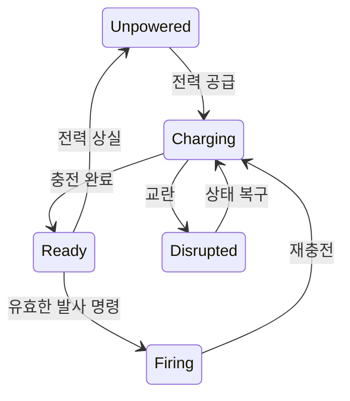

# 08. 무기·실드·표적 지정 역기획

> 대상: 기본 게임 + AE, 모드 무기 제외. 확인일: 2026-11-13.  
> 대표 장비 수치는 무인 운용·강화장치 미적용 기본값이다. 완전한 아이템 데이터 덤프가 아니라 무기군의 동작을 재현하기 위한 문서다.

## 1. 시스템 목적

[해석] 무기는 “높은 DPS를 사는 슬롯”보다 여러 방어를 순서대로 해제하는 조합 부품이다. 실드 제거용 공격, 특정 시스템 마비, 빈틈의 선체 피해, 인원 제거가 분리되어 있다. 사용 전력·슬롯·탄약·충전시간을 함께 고려해야 한다.

| 입력 | 출력 |
|---|---|
| 무기 장착·정렬·전력 공급 | 사용 가능 무기와 충전 상태 |
| 방 또는 선분 지정 | 공격 예정 위치 |
| 자동사격 설정·발사 명령 | 공격 생성·탄약 소비 |
| 무기실 손상·해킹·이온 | 충전 제약·전력 탈락 |
| 적 방어 변화 | 실효 피해·부가 효과 |

## 2. 무기 데이터의 필수 항목

[재구성안]

| 항목 | 의미 | 분리해야 하는 이유 |
|---|---|---|
| family | 레이저·빔·이온·미사일·폭탄·플랙·크리스탈 | 방어 상호작용이 다름 |
| requiredPower | 장치 전체 요구 전력 | 부분 전력 운용 금지 |
| baseChargeTime | 기본 충전시간 | 숙련도·강화장치와 분리 |
| shotsPerVolley | 1회 발사에서 생성되는 유효 탄 수 | 다탄과 단일 고피해의 실드 효율 차이 |
| hull/system/ion/crewDamage | 독립 피해 채널 | 폭탄·이온 예외 |
| ammoPerVolley | 소비 미사일 수 | 발사 수와 자원 소비를 혼동하지 않음 |
| normalShieldPiercing | 일반 실드 관통 정도 | 졸탄 실드와 구분 |
| targetingMode | 방·산포 영역·선분·아군 가능 | UX와 판정 계약 |
| projectileSpeed | 도착 시간 | 집중 사격 순서 |
| fire/breach/stun | 부가 효과 | 단일 공격력으로 환산 불가 |
| chargeMode | 기본·충전 축적·연사 가속 | 상태 초기화 규칙 차이 |
| contentFlag | Base/AE | 생성 풀과 시작 장비 분리 |

## 3. 무기군별 비교

### 3.1 레이저(Laser)

[확인] 일반적인 레이저 탄은 일반 실드 한 층에 막히며, 실드가 없으면 방의 선체·시스템·승무원 피해를 유발할 수 있다. 여러 발을 발사하는 무기는 실드 제거 역할을 맡기 쉽다.[S1]

[해석] 1발 3피해와 3발 1피해는 같은 무기가 아니다. 실드가 남아 있을 때는 탄 수가 유리할 수 있고, 실드가 없을 때는 짧은 시간에 높은 시스템 피해를 넣는 무기가 유리할 수 있다.

### 3.2 미사일(Missile)

[확인] 일반 실드를 무시하지만 회피로 빗나갈 수 있으며 요격 대상이 된다. 발사에는 미사일 자원을 사용한다.[S2]

[해석] 미사일의 목적은 보통 초반에 위험한 적 시스템을 먼저 꺼서 이후 전투 비용을 줄이는 것이다. 사용을 아끼다가 선체 수리비가 더 크게 발생할 수도 있다.

### 3.3 폭탄(Bomb)

[확인] 폭탄은 적 방 내부로 전이되는 공격으로 일반 실드와 방어 드론의 통상 요격을 우회한다. 적에게 사용할 때는 빗나갈 수 있고, 아군 함선 표적은 빗나가지 않는다. 졸탄 실드에는 별도 제한이 있다.[S3]

[해석] 선체 피해 없이 시스템·인원을 무력화하는 무기는 탑승 빌드에서 아군 탑승자와 적 선체를 동시에 보존하는 도구가 될 수 있다. 단, 방 안 승무원 피해는 아군에게도 위험하므로 “폭탄은 탑승 중 항상 안전”으로 이해하면 안 된다.

### 3.4 빔(Beam)

[확인] 빔은 선분을 따라 진행하며 통과한 방들에 피해를 줄 수 있다. 일반적인 회피로 빗나가지 않는다. 일반 실드 한 층마다 방별 기본 피해가 1 감소한다. 예를 들어 2피해 빔은 1층 실드에서 방당 1피해를 줄 수 있다.[S4]

[재구성안] 일반 선체 피해 빔의 단순 설명식:

~~~text
effectiveDamagePerRoom = max(0, baseBeamDamage - activeNormalShields)
totalHullDamage ≈ effectiveDamagePerRoom × validRoomsCrossed
~~~

이 식은 **빔 전체 동안 실드가 일정하고 특별한 무기 속성이 없는 경우**의 설명식이다. 화염 빔·대생체 빔·시스템 없는 방 추가 피해·졸탄 실드는 다른 규칙이다. 같은 방을 여러 타일 통과했다고 선체 피해를 매 타일 반복해서는 안 된다. 인원 피해는 타일 위치를 별도로 본다.

### 3.5 이온(Ion)

[확인] 이온은 시스템을 일시적으로 봉쇄한다. 일반 실드가 공격을 받아내면 실드 시스템 봉쇄에 기여하므로, 빠른 반복 이온 공격은 실드가 복구되기 전에 다시 봉쇄하는 조합을 만들 수 있다.[S5]

[해석] 단독 선체 파괴 능력이 없는 무기를 평가할 때는 “이번 공격으로 늘어난 다른 무기의 피해 창”을 측정해야 한다. 이온의 유지가 끊기는 순간 빔·드론의 효율도 급격히 달라진다.

### 3.6 플랙(Flak, AE)

[확인] 플랙은 산포 영역을 표적으로 삼는다. 실드에 대한 회피 판정과, 실드가 벗겨진 뒤 실제 방에 탄이 떨어지는 문제가 별개다. 가짜 파편은 선체·실드를 손상시키지 않지만 다른 물체와의 상호작용에 참여할 수 있다. 유효 탄들이 비슷한 시점에 도착한다는 점도 집중 사격에 유리하다.[S6]

[해석] 작은 방의 정확한 시스템 제거에는 불확실성이 있으나 넓은 실드 표면을 제거하는 데는 효율적이다. 명중률을 단일 accuracy 값으로 만들면 이 차이를 잃는다.

### 3.7 크리스탈(Crystal)

[확인] 크리스탈 탄은 일반 실드 1층을 관통하는 특성이 있으며 방어 드론이 요격할 수 있다.[S7]

[해석] “실드 무시”라는 하나의 속성 대신 관통 층 수가 필요하다는 사례다.

## 4. 일반 실드와 졸탄 실드 비교

| 항목 | 일반 실드 | 졸탄 실드 |
|---|---|---|
| 기본 표현 | 활성 층과 재생 | 별도 HP |
| 전력 관계 | 플레이어 일반 실드 1층당 2칸 | 별도 특수 효과 |
| 일반 탄 | 대체로 탄 1발당 층 제거 | 공격 유형별 내구 피해 |
| 미사일·폭탄 | 통상 우회 | 별도 차단·피해 규칙 |
| 빔 | 방별 피해 감소 | 별도 특수 실드 피해 |
| 전투 중 회복 | 시스템이 가동되면 재생 | 기본 졸탄 실드와 충전 드론의 규칙 분리 |
| 탑승·해킹·정신 지배 | 일반 실드만으로 차단하지 않음 | 접근을 제한 |
| 우회 강화장치 | 해당 없음 | 일부 효과만 우회, 해킹까지 일괄 허용 금지 |

[확인] 일반적인 졸탄 실드는 5 내구도이며, 이온과 빔은 대졸탄 실드 피해가 일반 공격과 다르다.[S8] 보스의 특수 실드를 이 수치로 고정하면 안 된다.

[검증 필요] 빔의 졸탄 실드 피해를 “항상 한 번에 2배” 같은 단일 문장으로 모든 빔·드론에 적용하지 않는다. 타격 진행과 드론 종류에 예외가 있으므로 장비별 검증이 필요하다.

## 5. 대표 무기 비교표

[확인] 무기별 기본 수치 예시.[S7]

| 무기 | 전력 | 기본 충전 | 유효 탄/방별 피해 | 기획상 역할 |
|---|---:|---:|---|---|
| Burst Laser II | 2 | 12초 | 3발, 각 1피해 | 실드 제거·범용 |
| Heavy Laser I | 1 | 9초 | 1발, 2피해 | 실드 제거 뒤 시스템 압박 |
| Artemis (플레이어 시작형) | 1 | 11초 | 1발, 2피해 | 초기 우회 공격 |
| Halberd Beam | 3 | 17초 | 방당 2피해 | 여러 방 일괄 손상 |
| Glaive Beam | 4 | 25초 | 방당 3피해 | 긴 준비 뒤 큰 피해 |
| Ion Blast II | 3 | 4초 | 이온 1점 | 반복 봉쇄 |
| Small Bomb | 1 | 13초 | 시스템 2피해 | 특정 시스템·인원 제거 |
| Flak I [AE] | 2 | 10초 | 유효 3발, 각 1피해 | 저비용 실드 제거 |

이 표는 전체 가격·희귀도·화재 확률표를 포함하지 않는다. 표준형 이름이 비슷한 적 전용 무기·시작 전용 무기와 혼동하지 않아야 한다.

## 6. 충전·자동사격·슬롯 순서

[확인] 무기를 켜면 충전이 시작되고, 표적을 지정한 뒤 준비되면 발사한다. 자동사격은 전역 또는 무기별로 설정할 수 있다. 무기 슬롯 순서를 바꿀 수 있으며 손상으로 출력이 부족해질 때 오른쪽부터 비활성화된다.[S9]

[재구성안] 기본 상태기계:

실제 상태에는 표적 유효성·탄약·저장된 충전 횟수·연사 누적 상태를 별도 필드로 둔다. 충전 무기와 연사 가속 무기를 위 상태기계 하나로 완전히 표현하려 하지 않는다.

### 6.1 충전 축적과 연사 가속

[확인] AE에는 여러 번의 충전을 저장하는 Charge 계열과 반복 발사로 특성이 변하는 Chain 계열이 있다.[S7]

[해석] 축적은 공격 시점을 늦추는 대가로 한꺼번에 실드 문턱을 넘는다. 연사 가속은 장기 유지의 보상을 주므로 중간 비활성화·피격의 비용이 커진다.

[검증 필요] 무기별 전력 해제·장비 교환·도약 때 저장 충전과 체인 보너스가 어떻게 초기화되는지는 무기 ID별로 검증한다. 하나의 “모든 무기 충전 초기화” 규칙을 원작 사실로 선언하지 않는다.

### 6.2 선제 충전 강화장치

[확인] Weapon Pre-Igniter는 전투 시작 준비에 큰 영향을 주는 장치다. 세부적으로 충전/체인 무기의 누적 상태 전체를 최대치로 만들어 주는 장치라고 해석하면 안 된다.[S10][S11]

## 7. 표적 선택 UX의 요구사항

[재구성안]

- 레이저·미사일·폭탄: 표적 방을 강조하고 장치 종류를 표시.
- 플랙: 표적 중심과 산포 범위를 동시에 표시.
- 빔: 시작·끝 지점, 통과하는 방, 유효 길이를 미리 보여줌.
- 아군 표적 폭탄: 아군 피해와 회복을 색·아이콘으로 구분.
- 반복 사격: 발사 예약과 자동사격을 다른 표시로 표현.
- 은폐·실드 때문에 표적 불가: 이유를 명시.
- 적 함선이 사라짐: 오래된 표적 ID를 제거.
- 일시정지 중 설정: 재개 직후 어떤 무기가 발사되는지 예측 가능.

## 8. 조합 설계 예시

### 조합 A: 다탄 + 빔

실드 제거 후 여러 방을 통과하는 빔으로 선체와 핵심 시스템을 함께 깎는다. 다탄의 회피 실패에 대비한 여분 탄 수와 빔의 충전 차이를 고려한다.

### 조합 B: 이온 + 전투 드론

이온이 실드 봉쇄를 유지하는 동안 자동 공격 드론이 누적 피해를 낸다. 드론 부품·전력·적 드론 대응 능력이 비용으로 붙는다.

### 조합 C: 폭탄 + 탑승

의료실·클론실·무기실을 무력화해 승무원 전투의 시간을 확보한다. 폭탄의 아군 피해와 적 선체 보존을 동시에 관리해야 한다.

### 조합 D: 해킹 + 고피해 빔

실드 펄스와 빔 도착을 맞춘다. 해킹 부품·특수 실드·요격·시스템 슬롯이 제약이 된다.

위 조합은 [해석]이며 모든 상황에서 같은 우선순위를 갖는 추천표가 아니다.

## 9. 밸런스 평가 항목

[재구성안] 장비 평가는 최소 다음 지표를 함께 기록한다.

| 지표 | 질문 |
|---|---|
| First useful hit | 첫 유효 피해가 언제 발생하는가? |
| Shield throughput | 회피 이후 몇 층의 실드를 제거하는가? |
| System suppression | 적의 다음 발사를 얼마나 지연하는가? |
| Resource per fight | 미사일·드론 부품을 얼마나 쓰는가? |
| Damage exposure | 효과가 나기 전 몇 번의 적 공격을 견뎌야 하는가? |
| Recovery risk | 무기실 손상 후 원래 출력 복귀가 얼마나 늦는가? |
| Layout sensitivity | 작은 방·큰 방·다수 연결 방에 따라 성능이 달라지는가? |

## 10. QA와 경계 사례

| ID | 시험 | 기대 결과 |
|---|---|---|
| WPN-01 | 2피해 빔이 일반 실드 1층을 통과 | 유효 방별 1피해 |
| WPN-02 | 같은 방의 여러 타일을 빔이 통과 | 선체 피해를 타일 수만큼 중복하지 않음 |
| WPN-03 | 플랙이 방 밖에 산포 | 시스템 피해로 자동 보정하지 않음 |
| WPN-04 | 가짜 플랙 | 선체·실드 피해 없음 |
| WPN-05 | 적 폭탄 vs 아군 폭탄 | 회피 판정 조건 구분 |
| WPN-06 | 미사일 vs 일반/졸탄 실드 | 같은 관통 규칙을 사용하지 않음 |
| WPN-07 | 무기실에 이온 1점 | 다전력 무기 탈락을 전력 1칸 감소와 혼동하지 않음 |
| WPN-08 | 완충 무기와 자동사격 OFF | 원하지 않는 즉시 반복 사격 금지 |
| WPN-09 | 두 무기의 비행 속도가 다름 | 클릭 동시성으로 명중 동시성 보장 금지 |
| WPN-10 | Charge 무기에 선제 충전 장치 | 저장 한도 전체 충전으로 오구현하지 않음 |

## 11. 출처

- [S1] [FTL Wiki — Weapons](https://ftl.fandom.com/wiki/Weapons)
- [S2] [FTL Wiki — Missile Weapons](https://ftl.fandom.com/wiki/Missile_(Weapons))
- [S3] [FTL Wiki — Bomb Weapons](https://ftl.fandom.com/wiki/Bomb_(Weapons))
- [S4] [FTL Wiki — Beam Weapons](https://ftl.fandom.com/wiki/Beam_(Weapons))
- [S5] [FTL Wiki — Ion Weapons](https://ftl.fandom.com/wiki/Ion_(Weapons))
- [S6] [FTL Wiki — Flak Weapons](https://ftl.fandom.com/wiki/Flak_(Weapons))
- [S7] [FTL Wiki — Weapon Tables](https://ftl.fandom.com/wiki/Weapons_(tables))
- [S8] [FTL Wiki — Zoltan Ships](https://ftl.fandom.com/wiki/Zoltan_Ships)
- [S9] [FTL Wiki — Weapon Control](https://ftl.fandom.com/wiki/Weapon_Control)
- [S10] [FTL Wiki — Augmentations](https://ftl.fandom.com/wiki/Augmentations)
- [S11] [FTL Wiki — Laser Weapons](https://ftl.fandom.com/wiki/Laser_(Weapons)): Charge 무기의 선충전 예외.

표기 충전시간은 기본값이다. 실제 전투 비교에는 운용 숙련도와 강화장치·상태 이상을 반영해야 한다.

**자료 접근 범위:** 커뮤니티 위키의 일부 페이지는 직접 열기가 제한되어 검색 결과가 제공한 본문·표를 확인했다. 이 문서는 원작 실행 파일이나 전체 게임 데이터를 추출한 결과가 아니며, 검증하지 않은 세부 규칙은 별도로 표시했다.

[목차로 돌아가기](README.md)
