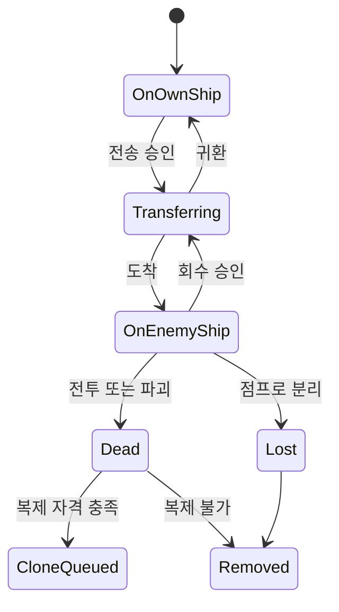

# 11. 침투·대인전·선내 방어 시스템

> 범위: 본편 + Advanced Edition, 모드 제외. 확인일: 2026-11-13. [확인]은 공개 플레이 규칙, [해석]은 분석, [재구성안]은 제안 구조다. 원작의 실제 AI 코드나 충돌 구현을 확인한 문서가 아니다.

## 1. 기획 역할

침투는 적 선체를 모두 깎는 경로 외에 승무원을 제거하거나 핵심 시설을 직접 마비시키는 경로를 제공한다. 동시에 자신의 승무원 일부를 함선 밖으로 보내므로 수리·조작·선내 방어 능력을 포기하게 한다.

**[해석]** 이 시스템은 두 함선의 내부 공간을 하나의 전장으로 연결한다. 무기 표적, 문, 산소, 의료 시설, 순간이동 재사용 시간, 적 도주가 하나의 문제로 묶인다. 따라서 침투를 별도 미니게임으로 만들면 함선 전투와의 긴밀한 상호작용을 잃는다.

| 입력 | 시스템 내부 상태 | 출력 |
|---|---|---|
| 텔레포트·회수 명령 | 전송 자격, 재사용 대기, 이동 중 인원 | 함선 간 승무원 이동 |
| 방 이동 명령 | 슬롯, 문, 경로, 적대 관계 | 대치·회피·집중 공격 |
| 지원 사격·해킹 | 의료·전투·환경 조건 변경 | 전투 지속 시간 및 생존 가능성 |
| 함선 파괴·점프 | 외부 체류 인원, 복제 자격 | 사망·상실·귀환·결과 이벤트 |

## 2. 침투 수단과 목적의 구분

| 수단 | [확인] 성격 | [해석] 설계 의미 |
|---|---|---|
| Crew Teleporter | 아군을 적 함선으로 보내고 회수 | 직접 통제 가능한 지속 투자 |
| Boarding Drone | 적 함선에 진입하여 자동 공격 | 인적 자산 대신 소모품·전력 투자 |
| 이벤트 침입자 | 조우 시작부터 선내에 적이 존재할 수 있음 | 우주전이 없어도 선내 위기 생성 |
| Mind Control [AE] | 기존 승무원의 일시 적대 관계 변경 | 이동 없이 전장 내부의 수적 관계 변경 |

이 문서는 승무원 침투가 중심이다. 드론의 출격과 비용은 [09](09_drones_and_augments.md), 정신 지배의 발동 조건은 [13](13_advanced_edition_systems.md)에 둔다. [B01–B03]

## 3. 전송 규칙

**[확인]** Crew Teleporter의 재사용 대기는 전력 단계별 20/15/10초다. 일반 송신실은 2칸이고 Mantis B·Mantis C·Crystal B는 4인 전송실을 가진다. 활성 Zoltan Shield는 관련 우회 장치가 없으면 전송을 막고, 은폐 중인 함선과의 전송도 제한된다. 선내 드론은 일반 승무원처럼 텔레포트하지 않는다. [B01]

| 검사 단계 | [재구성안] 판정 | 실패 피드백 |
|---|---|---|
| 시스템 검사 | 존재·작동·전력·쿨다운 | 전송기 사용 불가 |
| 대상 검사 | 적 함선 유효, 은폐·특수 실드 조건 | 대상을 지정할 수 없음 |
| 인원 검사 | 유효한 아군과 전송 패드 상태 | 전송할 인원 없음 |
| 도착 검사 | 대상 방·슬롯·오버플로 정책 | 목적지 수용 조건 불충족 |
| 실행 | 트랜잭션으로 함선 소속 위치 변경 | 중복 생성·소멸 금지 |

전송 가능한 인원수와 방의 시각적 빈칸은 동일한 개념으로 단순화하지 않는다. 회수는 송신과 다른 수용 동작을 보일 수 있다. 2칸 텔레포터로 4명을 회수하는 오버플로 사례가 알려져 있으며, 이를 일반적 “항상 정원 2명” 제한으로 막으면 원작과 달라진다. [B04]

### 3.1 전송은 탈출 보장이 아니다

**[확인]** 적 함선에 아군을 남긴 채 플레이어 또는 적이 점프하면 영구 상실될 수 있다. Clone Bay가 이 이탈을 일반 사망처럼 복원해 주지는 않는다. [B01]

**[해석]** 전송기의 재사용 시간은 공격 주기보다 구조 가능 시점을 의미한다. 체력이 얼마 남았는지뿐 아니라 산소가 없는 방에서 버틸 시간, 적의 은폐 시작 시점, 도주까지 남은 시간을 함께 고려해야 한다.

## 4. 방 단위 대인전

**[확인]** 승무원은 방 안의 자리를 차지하며 방 크기와 자리 배치가 교전 인원에 영향을 준다. 이동·재진입으로 자리와 공격 관계가 바뀌는 전술이 존재한다. 적과 아군은 같은 방 안에서 서로 전투할 수 있으므로, 방의 총 칸 수를 양 진영 합계의 단순 수용 한도로 취급하면 잘못된 결과를 낳는다. [B02, B04]

**[재구성안]** 방마다 `friendlySlots`와 `hostileSlots` 또는 이와 동등한 대치 슬롯을 두고, 캐릭터의 논리 위치와 표시 위치를 구분한다. 다수가 단일 적을 공격할 수 있는 배정 규칙을 명시적으로 테스트한다. 원작의 정확한 슬롯 우선순위를 확인하기 전에는 “항상 일대일” 또는 “방 안 모두가 아무나 공격”으로 확정하지 않는다.

### 대인전과 시설 파괴를 분리

종족별 대인 피해와 수리 능력은 [10](10_crew_species_and_training.md)을 따른다. 시설 파괴는 사람에게 가하는 공격과 다른 작업이다. Mantis의 대인 공격 보너스가 모든 종류의 시설 훼손을 같은 비율로 가속한다고 해석하지 않는다.

**[재구성안]** 방 내 행동의 후보를 다음처럼 분리한다.

```text
if forced_movement_or_stun:
    resolve_status()
else if valid_hostile_crew_in_room:
    fight_assigned_target()
else if hostile_system_can_be_sabotaged:
    progress_sabotage()
else:
    wait_or_follow_new_order()
```

이 코드는 독립적인 재현안이다. 화재 대응, 문 공격, 의료 시설 이용, 지배 해제 순간의 우선순위는 별도 정책과 수용 시험으로 확정한다.

## 5. 목표별 침투 설계

| 목적 | 공격 목표 | 성공의 의미 | 반작용 |
|---|---|---|---|
| 전투 승리 | 적 생존자와 복제 능력 | 유인함선 승무원 제거 결과로 전환 | 기함·무인함선은 별도 승리 조건 |
| 미사일 억제 | 특정 무기 또는 무기 시스템 | 앞으로 받을 피해 감소 | 지원 포격이 아군을 다치게 할 수 있음 |
| 방어 약화 | 실드실·조종실 | 아군 화력이 통과할 기회 확보 | 적 수리 인력을 유도할 수 있음 |
| 시간 확보 | 다수 시설에 분산 침입 | 적 작업 이동과 수리 지연 | 아군 부대가 고립될 수 있음 |
| 무산소 압박 | 산소실·균열·방 봉쇄 | 적 이동과 전투 지속성을 제한 | 산소가 필요한 아군도 함께 위험 |

이 표는 **[해석]**이며 모든 적 AI가 같은 목표 우선순위로 반응한다는 주장은 아니다. 특히 적의 의료·클론 존재 여부가 같은 침투 행동의 효용을 크게 바꾼다.

## 6. 선내 방어: 전투 인력보다 이동 경로를 관리

**[해석]** 선내 방어의 핵심 질문은 “누가 더 강한가”와 “어디서 싸우게 할 것인가”다. 약한 인원을 직접 붙이는 대신 문과 산소를 이용해 적 이동을 늦추거나, 회복 가능한 방으로 유도할 수 있다. 적이 없는 방을 잠시 포기하는 것도 방어 자원의 사용이다.

**[재구성안]** 방어 UI는 다음 정보를 한 화면에서 제공한다.

- 침입자 위치와 수, 현재 아군의 체력.
- 문이 단순히 닫힌 것인지 파괴 대기 중인지.
- 방별 산소 위험과 연결된 배기 경로.
- 파괴가 임박한 시설과 철수해야 할 아군.
- 아군이 외부에 있을 때 회수까지 남은 시간.

자동으로 “침입자에게 가장 가까운 모든 인원”을 이동시키면 조종사·전력 제공자가 일제히 이탈하는 부작용이 생긴다. 원작을 재현하는 기본 모드에서는 사용자가 배치를 결정하고, 자동 방어 정책은 별도의 선택 기능으로만 검토하는 편이 타당하다.

## 7. 의료·클론·봉쇄와의 결합

### 7.1 의료 시설

**[해석]** 적이 회복할 수 있는 방이 있으면 체력 교환이 반복될 수 있다. 지원 사격은 즉시 선체 피해를 주는 용도뿐 아니라, 적의 체력 회복 경로를 차단하는 용도가 된다. 아군이 있는 방에 적 의료 시설이 있다는 사실만으로 그 시설이 아군을 치료하도록 일반화하면 안 된다.

### 7.2 클론 시설

**[확인]** 적의 복제가 가능한 상황은 살아 있는 적 인원만 세어 전투를 끝낼 수 없는 예외다. 상세 복제 큐와 종료 판정은 [13](13_advanced_edition_systems.md)에 연결한다. [B03]

### 7.3 Lockdown·해킹 문·기절

**[해석]** 이 효과들은 모두 시간을 벌지만 대상이 다르다. 봉쇄는 출입을, 기절은 인원 행동을, 시설 해킹은 문과 설비 기능을 함께 제약할 수 있다. 효과 종료 시간을 하나의 공통 “마비” 값으로 합치면 여러 효과가 겹친 상황을 재현할 수 없다.

## 8. 대표 교전 시퀀스

### 예시: 의료실이 있는 유인 적 함선

**[재구성안]** 아래는 기능 간 연동을 검증하기 위한 시나리오이며 정해진 공략 순서가 아니다.

1. 일시정지 상태에서 적 의료실과 승무원 위치를 확인한다.
2. 아군 전송기의 회수 가능 시점과 지원 사격 도착 시간을 비교한다.
3. 침투 인원을 전송하고 의료실 또는 교전실에 지원 사격을 예약한다.
4. 적이 이동하면 아군 목적지·슬롯을 재지정한다.
5. 적 복제 시설이 있다면 생존자 수와 별개로 무력화 여부를 확인한다.
6. 적 선체가 폭발하기 전에 회수 또는 복제 가능한 손실을 구분한다.
7. 결과가 승무원 제거·함선 파괴·항복 중 무엇인지 이벤트 시스템에 전달한다.

### 예시: 무인함선에 침투

**[확인]** 무인함선은 승무원이 없어도 작동하고 일반적으로 산소가 없다. 자동 수리 기능도 존재한다. 따라서 승무원 제거 승리 조건으로 처리할 수 없다. [B05]

**[해석]** 이 전투에서 침투의 목적은 시설 무력화이며, 생존자는 환경 저항과 회수 시간에 의해 결정된다. “적 승무원 0명”이 이미 참이라는 이유로 즉시 보상을 지급하는 오류가 특히 위험하다.

## 9. 상태·종료 계약



**[재구성안]** `Dead`와 `Lost`는 서로 다른 사건이다. 결과 시스템은 선체·승무원·복제·기함 페이즈를 모두 검사한 뒤 단일 종료 사유를 확정한다. 한 프레임 안에 마지막 적 사망과 함선 폭발이 겹칠 때 어느 결과를 우선할지는 원작 실측 규칙으로 별도 고정해야 한다.

## 10. QA 및 수용 기준

| ID | 조건 | 검증할 결과 |
|---|---|---|
| BOARD-01 | 활성 특수 실드에 전송 | 우회 장치 유무에 맞는 허용·차단 |
| BOARD-02 | 외부 아군 체류 중 전송기 손상 | 아군이 즉시 삭제되지 않고 회수 제약이 표시 |
| BOARD-03 | 2칸 송신실에서 다수 회수 | 원작 오버플로 규칙과 도착 위치 일치 |
| BOARD-04 | 아군이 있는 방을 포격 | 사격과 대인 피해가 같은 공간 상태를 참조 |
| BOARD-05 | 마지막 적 사망·클론 대기 존재 | 조기에 전투 보상 지급하지 않음 |
| BOARD-06 | 남겨진 승무원이 있는 점프 | 상실 경고와 클론 불가 처리 |
| BOARD-07 | 적 함선만 파괴, 아군 침입자 잔존 | 종료 프레임과 사망·복제 결과 일관성 |
| BOARD-08 | 정신 지배가 전송 준비 중 해제 | 이전 진영의 예약을 정리하고 재판정 |
| BOARD-09 | 무인함선 시작 | 적 인원이 0이어도 교전 지속 |
| BOARD-10 | 모든 아군이 적 함선에 있고 전송기 파손 | 전투 종료 시 특별 귀환 가능 상황을 별도 회귀시험 |

## 11. 근거와 남은 검증

- [B01 Crew Teleporter](https://ftl.fandom.com/wiki/Crew_Teleporter): 재사용 시간·전송 제약·인원 상실. 검색 색인 본문 확인.
- [B02 Boarding](https://ftl.fandom.com/wiki/Boarding): 침투와 방 크기·행동 상호작용. 검색 색인 본문 확인.
- [B03 Clone Bay](https://ftl.fandom.com/wiki/Clone_Bay): 적 복제 존재 시 종료 조건. 같은 패키지 AE 문서에서 상세화.
- [B04 Practical FTL](https://steamcommunity.com/sharedfiles/filedetails?id=266502670): 방의 fill order와 회수 오버플로에 대한 플레이어 실험. 검색 색인 본문 확인.
- [B05 Automated ships](https://ftl-layouts.mikehopley.org/auto): 무인함선 자동 수리. 직접 페이지 확인; 해당 사이트의 수치표는 Hard 기준.
- [B06 FTL guide to boarding](https://subsetgames.com/forum/viewtopic.php?t=2510): 공간과 지원 포격의 실전 관계. 공식 도메인의 **커뮤니티 게시물**이며 개발자 공식 명세로 취급하지 않음.

**[검증 필요]** 이동 중인 승무원의 전송 포함 시점, 슬롯별 정확한 대인 공격 배정, 회수 오버플로 도착 순서, 전송 애니메이션 중 피해 면역 범위, 적 귀환·도주 임계값은 원작 실행 검증이 필요하다. 문헌에 나온 전술을 전체 AI의 확정 규칙으로 확대하지 않는다.

[목차로 돌아가기](README.md)
