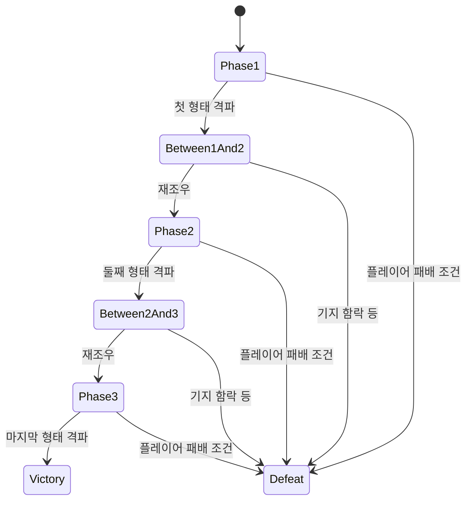

# 16. 반군 기함·최종 섹터 보스

> 범위: 본편 + Advanced Edition, Easy/Normal/Hard 차이 포함. 확인일: 2026-11-13. 보스 전체 구조와 해금 관련 스포일러를 포함한다. [확인]·[해석]·[재구성안]을 구별하며 원작 실행·소스 분석을 수행한 문서는 아니다.

## 1. 보스의 역할

반군 기함은 한 런 동안 모은 공격·방어·인원·제어 수단을 세 차례에 걸쳐 시험한다. 첫 형태에서 유효했던 대응 하나로 모든 형태를 동일하게 풀 수 없도록 위협을 바꾼다.

**[해석]** 선체를 한 번 크게 늘리는 대신 전투 종료와 재조우를 둔 이유는 준비·복구·추격 판단을 보스전 안에 넣기 위해서라고 볼 수 있다. 이 의도는 개발자 발언으로 확정한 것이 아니라 관찰한 플레이 구조에 대한 분석이다.

## 2. 최종 섹터의 외부 압박

**[확인]** 마지막 섹터 The Last Stand에서 기함을 저지해야 하며, 기함이 연방 기지에 머문 채 3턴을 경과하면 패배한다. 따라서 보스가 있는 비콘만이 아니라 기지·수리 지점·남은 이동 기회도 전투 자원이다. [F01]

**[재구성안]** 다음 상태를 보스 전투와 별도로 저장한다.

```text
FinalSectorState
  flagshipBeaconId
  federationBaseBeaconId
  strategicTurn
  flagshipPhase
  baseOccupationTurns
  visitedRepairBeacons
  remainingRouteChoices
```

일시정지나 실제 전투 시간이 곧바로 지도상의 점프 턴이 되는 것으로 구현하지 않는다. 어떤 지도 행동이 전략 턴을 진행시키는지는 [02](02_sector_map_navigation_pursuit.md)의 규칙과 통일한다.

## 3. 세 페이즈 구조

**[확인]** 기함은 세 페이즈로 구성된다. 아래 선체는 각 페이즈의 값이며 모두를 합친 하나의 HP 바가 아니다. AE는 1페이즈 해킹, 3페이즈 정신 지배를 추가한다. [F02–F04]

| 페이즈 | 선체 | 대표 일반 무장 | 주요 추가 위협 | 핵심 시험 과제 [해석] |
|---|---:|---|---|---|
| 1 | 20 | 이온·레이저·미사일·빔 포대 | 은폐, AE 해킹 | 적 제어를 받으며 반복 공격 유지 |
| 2 | 22 | 레이저·미사일·빔 포대 | 일반 드론·침투 드론·드론 Surge | 지속 위협과 주기적 집중 위협 구분 |
| 3 | 20 | 레이저·미사일 포대 | 특수 실드·침투·레이저 Surge·AE 정신 지배 | 초기 방어층 제거와 선내 혼란 동시 처리 |

기함 무기는 일반 무기실 하나에 전부 연결된 무장 세트와 다르다. 각 포대의 상태를 별도로 공격·교란할 수 있도록 모델링해야 한다. [F02]

## 4. 페이즈 전환과 상태 지속

**[확인]** 다음 페이즈로 넘어가면 기함의 선체·시스템 손상과 화재·균열은 정리되지만, 죽은 적 승무원은 일반적으로 다시 채워지지 않는다. 각 단계에서 떨어져 나가는 구역도 달라진다. 도중 철수 후 재조우는 별도 규칙이며, 특히 1페이즈에서 플레이어가 먼저 철수하면 적 승무원이 복원되는 예외가 있다. [F02]

| 데이터 | [재구성안] 보존 정책의 구분 | 검증할 내용 |
|---|---|---|
| 현재 페이즈 | 영구 보존 | 승리 없이 철수해도 단계가 오르지 않음 |
| 적 승무원 생존 | 전환 규칙에 따라 보존 | 사망자·분리 구역 인원·외부 체류 인원 |
| 선체·시스템 피해 | 다음 형태의 기본 상태 적용 | 이전 형태 값의 누출 방지 |
| 화재·균열 | 전환 시 초기화 | 플레이어 함선 피해와 혼동하지 않음 |
| 자동 제어 상태 | 조건에 따라 재평가·보존 | 인원 전멸 이후 행동의 일관성 |
| 지도 위치·기지 압박 | 전략 상태와 연결 | 전투 승리와 이동 이벤트의 순서 |

**[해석]** 적 인원을 미리 줄이는 행동은 다음 페이즈의 수리·방어·침투 능력을 바꾼다. 따라서 첫 페이즈의 목표는 단순히 빨리 선체를 0으로 만드는 것만이 아니다. 현재 안전과 이후 부담 사이에서 선택이 생긴다.

## 5. 1페이즈: 공격 창과 제어 대응

**[해석]** 은폐는 플레이어가 공격할 수 있는 시점을 끊고, 해킹은 준비해 둔 운용을 방해한다. 동일한 무장을 가지고도 어떤 시스템을 해킹당했는지에 따라 전력·사격·침투 계획을 바꾸게 된다.

### 구현상 분리할 이벤트

**[재구성안]** `CloakStarted`, `CloakEnded`, `HackAttached`, `HackPulseStarted`, `HackPulseEnded`, `ArtilleryShot`를 서로 다른 사건으로 기록한다. 보스라는 이유로 이들을 하나의 고정 연출 시퀀스로 묶으면 사용자의 시설 파괴·은폐·도주로 생기는 분기를 처리하기 어렵다.

### 대표 의사결정

- 어떤 포대를 먼저 멈추면 다음 피해가 가장 줄어드는가.
- 기함 본체의 인원을 줄이는 데 시간을 써도 자함이 견딜 수 있는가.
- 현재 해킹 대상과 전력 상황에서 그대로 싸울 것인가, 지도 여유를 써서 재조우할 것인가.

이 항목은 **[해석]**이며 특정 장비를 반드시 사야 한다는 고정 공략이 아니다.

## 6. 2페이즈: Drone Control과 Power Surge 분리

**[확인]** 2페이즈의 일반 드론 운용과 Power Surge로 나오는 추가 드론은 서로 다른 위협이다. 드론 제어를 파괴하거나 해킹했다고 Surge 자체가 제거되는 것은 아니다. Surge 경고를 보고 별도의 생존 수단을 준비해야 한다. [F02, F05]

**[재구성안]** 일반 드론은 시스템 전력·소모품·출격 상태를 사용하고, Surge는 별도 보스 능력 컴포넌트로 관리한다.

```text
BossSurge
  phaseAllowed
  cooldownState
  warningLeadTime
  surgePayloadId
  activeEntities
```

Surge의 개수·간격·구성은 난이도별 데이터로 둔다. 확인한 자료는 Easy/Normal/Hard의 추가 드론 수를 각각 4/6/7로 제시하지만, 본 문서의 재구성 시나리오는 그 수치를 강제하지 않고 별도 회귀 검증 대상으로 관리한다. 원작 동일성 목표에서는 정확한 주기와 생성 분포를 확인해야 한다. [F02]

**[해석]** 플레이어가 일반 드론을 멈추면 기본 부담은 낮아지지만 주기적 고비는 남는다. 이 구조는 제어 빌드의 효용을 유지하면서 보스가 완전히 정지하는 상황을 제한한다.

## 7. 3페이즈: 방어층·침투·정신 지배

**[확인]** 마지막 형태는 12 HP의 강화 Zoltan Shield를 사용한다. 일반 플레이어의 5 HP 특수 실드와 같은 값으로 구현하면 안 된다. 일부 오래된 공략에는 10으로 쓰였으나 Wiki의 개별 실드 항목·기함 항목과 다른 FAQ는 12를 제시하여 이 문서는 12를 채택한다. [F03, F04, F06]

**[해석]** 처음에는 기함 내부에 개입하기 전에 방어층을 제거해야 하므로, 제어 수단을 많이 가진 빌드도 즉시 모든 기능을 사용할 수 없다. 그 시간 동안 침투와 정신 지배가 자함의 작업 인원을 흔든다.

### 정신 지배와 선내 침투가 결합하는 이유

**[해석]** 외부 침입자는 추가 적을 만들고 정신 지배는 기존 아군을 일시적인 적으로 바꾼다. 수리·조작·격투의 수적 균형이 동시에 바뀐다. 따라서 이전 페이즈에서 기함 인원을 줄인 효과는 마지막 페이즈의 직접 위협 감소로 이어진다.

### Surge

**[확인]** 최종 형태의 특수 공격에는 7발 레이저 집중 사격과 특수 실드의 재생이 포함된다. 일반 포대가 멈췄다는 이유로 모든 공격이 끝났다고 판단하면 안 된다. [F05]

**[재구성안]** 일반 포대 타이머와 Surge 타이머를 구분하고, 경고 표시도 위협 출처를 구분한다. 패턴 도중 페이즈 종료가 발생하면 남은 예약을 취소하거나 원작과 일치하는 잔존 투사체 정책을 적용한다.

## 8. 인원 전멸과 AI 전환

**[확인]** 기함은 모든 적 승무원을 제거해도 일반적인 승무원 제거 승리가 되지 않는다. 자동 제어가 이어받아 전투가 계속되고 시스템 복구가 가능해진다. 화재·균열은 자동 복구에도 영향을 준다. [F05]

**[해석]** 이 규칙은 “적 인원은 적을수록 항상 좋다”는 단순한 최적화에 예외를 만든다. 인원을 남길지 제거할지는 다음 페이즈의 수리 능력과 침투 위험 사이의 교환이다. 단, 난이도별 방 연결이 달라 같은 방법이 모든 설정에서 같은 결과를 내지 않는다.

**[재구성안]** 기함의 종료 조건은 일반 함선의 함수에 보스 예외를 덧붙이는 방식보다, 명시적인 `BossOutcomePolicy`로 두는 편이 검토하기 쉽다.

```text
if hull <= 0:
    if phase < 3: commit_phase_clear()
    else: commit_run_victory()
else if no_living_enemy_crew:
    activate_automated_control()
else:
    continue_encounter()
```

이 의사코드는 기본 분기를 설명한다. 동일 프레임의 양 함선 파괴, 외부 체류 승무원, 복제, 부분 분리 구역은 별도 원작 대조가 필요하다.

## 9. 난이도·AE 차이

**[확인]** Easy이면서 AE 콘텐츠를 끈 경우 기함 일반 실드는 3겹이다. 그 외 통상 구성은 4겹이다. Hard에서는 레이저·미사일 포대 구역을 본체와 연결하는 방이 있어 인원의 수리 접근이 달라진다. 단순 HP 배율 차이로 구현하지 않는다. [F02]

| 축 | 바뀌는 의미 | 재구성 검증 |
|---|---|---|
| AE on/off | 해킹·정신 지배 존재 | 전용 시스템의 상태·UI·AI 모두 분기 |
| Easy + AE off | 일반 실드 예외 | 난이도 하나만 보고 실드 수 결정하지 않음 |
| Hard 레이아웃 | 포대 접근·수리·침투 동선 | 그림만 바꾸지 않고 실제 그래프 변경 |
| Surge 난이도 | 집중 위협 규모 | 기본 드론 수와 별도 데이터 |

## 10. 상태 흐름



**[재구성안]** 동일 페이즈 도중의 철수·재조우는 위 상위 상태 안의 하위 흐름으로 구현한다. 철수를 페이즈 승리 이벤트로 잘못 처리하지 않아야 한다.

## 11. QA·수용 기준

| ID | 조건 | 기대 결과 |
|---|---|---|
| BOSS-01 | 1페이즈 선체 0 | 최종 승리 화면 없이 다음 페이즈 준비 |
| BOSS-02 | 2페이즈 Drone Control 파괴 | 일반 드론 변화, Surge는 독립 동작 |
| BOSS-03 | 1페이즈 적 인원 일부 제거 후 격파 | 생존 상태의 전환 규칙 적용 |
| BOSS-04 | 1페이즈 도중 철수·재조우 | 일반 페이즈 승리와 다른 승무원 복원 규칙 |
| BOSS-05 | 기함의 모든 승무원 사망 | 전투 지속 및 자동 제어 전환 |
| BOSS-06 | Easy/AE off와 Easy/AE on 비교 | 일반 실드 3겹 예외 정확 |
| BOSS-07 | Hard 포대 방 경로 검사 | 본체와 연결된 실제 경로 존재 |
| BOSS-08 | 3페이즈 시작 | 특수 실드 12, 일반 실드와 별도 처리 |
| BOSS-09 | 최종 패턴 경고 중 기함 격파 | 잔존 예약·오디오·결과의 정책 일치 |
| BOSS-10 | 양 함선 동시 선체 0 | 원작 결과 우선순위를 별도 검증·고정 |
| BOSS-11 | 기함 전투 사이 기지 점령 턴 경과 | 전략 상태의 패배 조건 적용 |
| BOSS-12 | 이전 페이즈에서 자함에 침투한 적 잔존 | 적 인원 수명주기와 소유 함선 관계 보존 |

## 12. 출처·검증 범위

- [F01 Game Over](https://ftl.fandom.com/wiki/Game_Over): 기지 함락 조건. 검색 색인 확인.
- [F02 The Rebel Flagship](https://ftl.fandom.com/wiki/The_Rebel_Flagship): 페이즈·선체·상태 지속·난이도·Surge의 규칙. 검색 색인 전체 관련 본문 확인, 직접 페이지 열기는 제한됨.
- [F03 Zoltan Shield](https://ftl.fandom.com/wiki/Zoltan_Shield): 기함 특수 실드 12 교차 확인. 검색 색인 확인.
- [F04 FTL FAQ, GameFAQs](https://gamefaqs.gamespot.com/pc/664216-ftl-faster-than-light/faqs/70999?page=6): 3페이즈 시스템·특수 실드 교차 확인. 검색 색인 확인.
- [F05 일본어 FTL FAQ](https://seesaawiki.jp/ftl/d/FAQ): 인원 전멸 시 자동 제어·최종 Surge·페이즈 지속성 교차 확인. 검색 색인 본문 확인. 일부 난이도별 수치가 혼재하므로 범용 수치표로 사용하지 않음.
- [F06 Sullla의 과거 기함 공략](https://sullla.com/FTL/ftlintro.html): 10 HP로 서술된 비교 사례. 특수 실드 수치 근거로 채택하지 않음.

**[검증 필요]** Surge 간격의 정확한 난수 범위와 시작 오프셋, 분리되는 구역의 아군·적 인원 처리, 적 인원 HP의 전환 시 회복, 동시 파괴의 결과 우선순위, 철수 때마다 초기화되는 모든 상태를 버전 고정 원작 실행으로 대조해야 한다.

[목차로 돌아가기](README.md)
