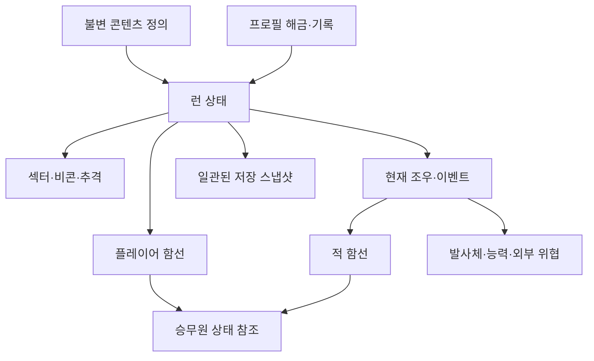

# 19. 데이터 구조·실행 순서·저장 및 재개

> 조사 기준일: 2026-11-13. PC판 원작과 AE의 관측 가능한 동작을 구현 대상으로 삼는다.  
> **이 문서의 구조·필드·JSON·명령·실행 순서는 모두 [재구성안]이다.** 원본 소스 코드, 바이너리 구조체, 실제 저장 파일 포맷을 복원한 자료가 아니다. 확인된 외부 동작과 패치 사실은 별도로 [확인] 표기한다.

관련 문서: [런 상태](01_core_loop_run_state.md), [전력](06_power_systems_and_subsystems.md), [전투](07_combat_timing_and_damage.md), [승무원](10_crew_species_and_training.md), [AE](13_advanced_edition_systems.md), [콘텐츠 제작](20_content_authoring_and_tools.md).

## 1. 구조를 나누는 기준

FTL의 상태는 단순한 함선 HP와 현재 섹터로 표현할 수 없다. 적 함선에 파견된 승무원, 일시적으로 적이 된 아군, 공중에 있는 발사체, 클론 대기열, 방별 산소, 진행 중인 이벤트의 결과가 모두 이후 플레이에 영향을 줄 수 있다.

다음 네 영역을 분리한다.

| 영역 | 수명 | 소유하는 데이터 | 포함하지 않는 것 |
|---|---|---|---|
| 콘텐츠 정의 | 빌드·콘텐츠 버전 | 함선·무기·종족·이벤트의 불변 정의 | 개별 무기 충전량 |
| 프로필 | 여러 런 | 해금·업적·기록·설정 | 현재 함선 선체 |
| 런 | 새 게임부터 종료 | 지도·자원·성장·현재 조우 | 다음 런의 장비 |
| 화면 세션 | 현재 표시 맥락 | 선택 상태·커서·모달·툴팁 | 권위 있는 피해 판정 |

**[확인]** 공식 FAQ는 업적과 함선 해금이 프로필 데이터 손상 시 영향을 받을 수 있다고 설명한다. 이는 영구 기록과 진행 중 전투를 구분해 다룰 이유를 제공하지만, 아래의 구체적 분리 구조가 원작과 같다는 증거는 아니다. [A1]

## 2. 권위 있는 상태의 소유 관계



승무원은 함선의 방 안에만 종속된 객체로 만들지 않는다. 텔레포트 중이거나 적 함선에 있더라도 원래 소속, 현재 위치, 현재 통제권이 유지되어야 한다. 적 함선을 삭제할 때 그 안의 모든 승무원을 무조건 같은 처리로 삭제하면 귀환·사망·복제 규칙을 표현하기 어렵다.

## 3. 핵심 데이터 계약

### 3.1 RunState

| 필드 | 의미 | 검증 조건 |
|---|---|---|
| `runId` | 런의 고유 식별자 | 프로필 기록과 중복되지 않음 |
| `contentVersion` | 사용 중인 규칙·콘텐츠 버전 | 로드 시 호환성 판정 |
| `difficulty`, `aeEnabled` | 고정된 런 설정 | 로드가 설정을 바꾸지 않음 |
| `phase` | 항해·조우·전투·결과·종료 | 허용된 전이만 가능 |
| `sectorIndex` | 현재 섹터 진행도 | 지도 및 보상 범위와 일치 |
| `sectorState` | 비콘 그래프, 방문, 추격, 퀘스트 | 현재 비콘 참조가 존재 |
| `resources` | 스크랩, 연료, 미사일, 부품 | 일반 거래로 음수 금지 |
| `playerShipId` | 플레이어 함선 | 항상 유효하거나 종료 상태 |
| `encounterState` | 적, 이벤트, 위험, 결과 | 조우 종료 시 정리 경계 명확 |
| `rngStreams` | 추첨 상태 | 재개 후 이미 확정된 결과 불변 |
| `resolutionLedger` | 처리한 보상·이벤트 ID | 중복 보상 방지 |

### 3.2 ShipState와 방

| 개체 | 최소 정보 | 분리해야 하는 의미 |
|---|---|---|
| 함선 | 설계 ID, 선체, 실드, 회피 입력값, FTL 상태 | 선체 피해와 시스템 피해 |
| 방 | 설계 방 ID, 산소, 화재·균열, 점유 슬롯 | 방 위험과 통행 가능 여부 |
| 문 | 양쪽 방 또는 외부, 개폐, 잠금, 내구 상태 | 문이 닫힌 상태와 통과 금지 |
| 시스템 | 종류, 방, 설치 수준, 손상, 제한, 배정 전력 | 설치 용량·사용 가능 용량·실제 전력 |
| 무기 인스턴스 | 정의 ID, 충전, 표적, 발사 모드, 추가 상태 | 소유한 무기와 현재 작동 무기 |
| 드론 인스턴스 | 설계, 전원, 배치 상태, 위치, 재구성 상태 | 소모품 사용과 전력 소비 |
| 증강 장치 | 정의 ID, 인스턴스 목록 | 규칙 수정과 즉시 자원 효과 |

`SystemState`를 `level` 하나로 표현하지 않는다. 손상, 이온, 해킹, 환경 제한이 각각 다른 원인으로 가용성을 바꿀 수 있다. 모든 원인을 하나의 `disabled=true`에 합치면 수리로 해결할 수 있는 문제와 시간이 지나야 풀리는 문제를 구별하지 못한다.

### 3.3 CrewState

| 필드 | 목적 |
|---|---|
| `crewId`, `speciesId` | 안정적인 인스턴스 참조와 종족 정의 |
| `ownerFaction` | 원래 소속과 귀환·기록 기준 |
| `controllerFaction` | 정신 지배 등을 반영한 현재 행동 편 |
| `location` | 함선·방·타일, 이동 또는 전송 상태 |
| `hp`, `lifeState` | 생존, 사망 연출, 복제 대기, 영구 손실의 구분 |
| `skills` | 분야별 경험과 단계 |
| `currentOrder` | 이동·수리·전투 등 현재 의도 |
| `savedStation` | 전투 후 복귀 명령용 위치 |
| `statusEffects` | 기절, 정신 지배 등 효과와 종료 조건 |

원래 소속과 현재 통제권을 분리하면 정신 지배가 끝났을 때 원소속 복원이 가능하다. 선내 침입자 판정, 치유 대상, 문 통과 조건은 필요한 의미를 명시적으로 선택해야 한다. 각 원작 예외는 [13번 문서](13_advanced_edition_systems.md)의 확인 규칙을 적용한다.

## 4. 시간 모델

세 종류의 시간을 구분한다.

| 시간 | 진행 조건 | 대표 사용처 |
|---|---|---|
| 시뮬레이션 시간 | 플레이 가능하고 정지하지 않았을 때 | 충전, 이동, 수리, 화재, 전투, 능력 |
| 전략 진행 단위 | 점프·대기 등 해당 규칙이 확정될 때 | 추격 전진, 지도·이벤트 변화 |
| 화면 시간 | 렌더링이 실행될 때 | 커서, 버튼 피드백, 순수 연출 |

일시정지 중 UI가 움직일 수 있어도 화재 피해나 클론 타이머가 진행하면 게임 규칙이 깨진다. 반대로 경고 텍스트의 점멸까지 반드시 멈춰야 하는 것은 아니다. 어떤 연출이 실제 상태를 대표하는지 구별한다.

### 제안하는 처리 경계

1. 입력 의도를 수집한다.
2. 현재 상태로 명령의 유효성을 검사한다.
3. 정지 중에도 허용되는 명령을 반영한다.
4. 실행 시간이 허용될 때만 한 시뮬레이션 단계를 진행한다.
5. 상태 변경 이벤트를 모은다.
6. 패배·조우 종료·보상 후보를 정리한다.
7. 상태의 일관성을 검사한다.
8. 읽기 전용 화면 상태를 발행한다.

이 순서는 원작 tick 순서가 아니다. 특히 같은 순간의 선체 파괴·클론 완료·마지막 승무원 사망처럼 결과가 민감한 동시 사건은 원작 관찰로 우선순위를 정해야 한다. 임의의 처리 순서를 원작 정답으로 문서화하지 않는다.

## 5. 명령과 결과 이벤트

| 명령 예 | 필수 검사 | 결과 이벤트 예 |
|---|---|---|
| `AllocatePower` | 시스템 용량, 반응로, 잠금 | `PowerAllocationChanged` |
| `SetWeaponTarget` | 무기 존재, 표적 종류, 조우 유효성 | `WeaponTargetChanged` |
| `MoveCrew` | 살아 있는 승무원, 도달 가능한 영역 | `CrewOrderAccepted`, `PathBlocked` |
| `ActivateAbility` | 전력, 재사용, 대상, 소모품 | `AbilityActivated`, `ResourceConsumed` |
| `ChooseEventOption` | 이벤트 ID와 조건, 입력 유효성 | `ChoiceResolved`, `RewardCommitted` |
| `BuyItem` | 현재 상점, 재고, 자원, 수용 공간 | `PurchaseCommitted` |
| `Jump` | 연료·도착지·FTL 가능성 | `JumpCommitted`, `EncounterStarted` |

단순 화면 갱신은 게임 이벤트를 다시 발생시키지 않는다. 보상창을 다시 그리는 행위가 스크랩을 지급하면 안 된다. 명령이 거절되면 자원 소모, RNG 소비, 효과 발동 중 일부만 남지 않도록 한다.

## 6. 저장에서 빠뜨리기 쉬운 상태

**[확인]** 공식 변경 이력에는 저장·재개 과정에서 보상을 두 번 얻는 문제와 비행 중 ASB 탄의 상태가 보존되지 않는 문제를 수정한 기록이 있다. 저장은 눈에 보이는 함선 수치만 기록하는 일이 아님을 보여주는 사례다. [A2]

| 상태 | 누락 시 발생 가능한 문제 | 저장 정책 제안 |
|---|---|---|
| 비행 중 발사체 | 재개로 공격을 회피하거나 중복 피해 | 위치·속도·표적·이미 처리한 충돌 보존 |
| 진행 중 무기·능력 | 로드로 충전 초기화 또는 즉시 완성 | 남은 시간·누적 상태 보존 |
| 이벤트 분기 결과 | 다시 로드할 때 결과 변경 | 확정된 결과와 아직 추첨 전 상태 구분 |
| 보상 수령 | 반복 지급 | 조우별 처리 ID 보존 |
| 클론 대기열 | 중복 승무원·부당한 영구 손실 | 안정적인 승무원 ID와 생명 단계 보존 |
| 문·산소·위험 | 진공 방이 갑자기 안전해짐 | 방별 위험과 문 연결 보존 |
| 텔레포트·정신 지배 | 승무원 소속·위치 유실 | 소속·통제권·위치와 효과 남은 시간 보존 |
| 상점 재고 | 재개로 재고 재추첨 | 이미 생성한 재고 인스턴스 보존 |
| 퀘스트·추격 | 완료 퀘스트 재생성, 함대 위치 변경 | 상태와 미결 예약을 같이 기록 |
| 기함 진행 | 페이즈 초기화·승무원 상태 유실 | 페이즈 지속 규칙에 따른 별도 상태 |

## 7. 저장 스냅샷 예시

다음은 제안 모델의 간략 예다. 모든 실제 필드를 보인 완전한 저장 예제가 아니며, 원작 파일과 호환되지 않는다.

```json
{
  "schemaVersion": 1,
  "runId": "example-run-001",
  "contentVersion": "rd-spec-1",
  "settings": { "difficulty": "normal", "aeEnabled": true },
  "clock": { "simulationStep": 4210, "userPaused": true },
  "location": { "sectorIndex": 3, "beaconId": "b_12" },
  "resources": { "scrap": 54, "fuel": 9, "missiles": 6, "droneParts": 3 },
  "encounter": { "id": "enc_18", "phase": "combat", "rewardCommitted": false },
  "crew": [
    {
      "id": "crew_2",
      "ownerFaction": "player",
      "controllerFaction": "player",
      "location": { "shipId": "enemy_18", "roomId": "r_4" },
      "lifeState": "alive"
    }
  ],
  "pendingProjectiles": ["projectile_22"],
  "resolutionLedger": ["enc_17.reward"],
  "rngStreams": { "combat": { "algorithmVersion": 1, "drawIndex": 802 } }
}
```

`drawIndex`만으로 RNG를 복원할 수 있는 것은 아니다. 실제 구현은 선택한 알고리즘의 완전한 내부 상태 또는 시드와 재생에 충분한 정보를 저장해야 한다. 위 JSON은 구조를 설명하기 위해 축약했다.

## 8. 원자적 저장과 프로필 보호

1. 시뮬레이션의 일관된 단계 경계에서 스냅샷을 만든다.
2. 스키마 버전, 콘텐츠 버전, 필수 참조를 검사한다.
3. 임시 파일에 직렬화하고 쓰기 완료를 확인한다.
4. 이전 정상본을 보존한 뒤 새 파일로 교체한다.
5. 로드 시 검증 실패를 새 런 초기화로 조용히 대체하지 않는다.
6. 종료된 런의 재개 불가 상태와 프로필 기록 갱신이 모순되지 않게 처리한다.

이 절차는 안정성을 위한 제안이다. 원작의 영구 사망 경험을 보존하는 것과 디스크 손상에 대비한 복구본을 두는 것은 별개다. 개발용 디버그 저장 슬롯은 출시 게임의 정상 진행 규칙과 분리한다.

## 9. 데이터 버전 변경

- 장비 ID를 이름 문자열과 분리한다. 번역명 변경으로 저장 참조가 깨지면 안 된다.
- 기존 정의를 삭제할 때 진행 중 런의 참조를 어떻게 처리할지 결정한다.
- 규칙 버전이 달라진 저장은 마이그레이션 또는 명시적 거절 중 하나로 처리한다.
- AE 토글은 개별 아이템의 존재 여부뿐 아니라 생성 목록과 이벤트 조건에 반영한다.
- 프로필 해금의 병합은 이미 열린 항목을 닫는 방향으로 자동 처리하지 않는다.
- 저장용 직렬화와 사용자에게 보여주는 요약 JSON을 구별한다.

## 10. 필수 불변식

| 불변식 | 이유 |
|---|---|
| 승무원 ID 하나는 생존 목록과 복제 완료 목록에 동시에 중복 존재하지 않음 | 복제·이벤트 제거 버그 방지 |
| 사용 가능 전력과 배정 전력은 원인별 공급량과 모순되지 않음 | 배터리 종료 후 유령 전력 방지 |
| 명령의 자원 소모는 명령 확정과 한 번만 연결 | 빠른 클릭·재개 중복 방지 |
| 조우 보상은 동일 처리 ID로 한 번만 지급 | 이벤트 재진입 방지 |
| 점프 확정 뒤 현재 비콘은 실제 그래프 노드 | 지도·저장 불일치 방지 |
| 삭제한 함선의 방을 참조하는 상태는 정해진 이전·손실 절차를 거침 | 승무원·표적의 고아 참조 방지 |
| 정지 중 권위 있는 전투 시간이 증가하지 않음 | UI와 시뮬레이션 시간 분리 |

## 11. 출처와 미확인 항목

- **A1 — 공식 FAQ, Lost Game Data:** https://subsetgames.com/faq.html — 프로필 손상과 해금·업적 복구 관련 설명.
- **A2 — 공식 변경 이력:** https://www.subsetgames.com/ftl_changelog.html — 저장·재개의 중복 보상, 비행 중 ASB 상태 관련 과거 수정. 검색 제공 본문을 확인했으며 직접 열기는 403 응답이었다.
- **A3 — 개발자 1.5.10 패치 공지:** https://subsetgames.com/forum/viewtopic.php?t=23727 — 이벤트 결과 저장·점프 중 저장 경계 관련 과거 수정 사례.

**[검증 필요]** 원작의 PRNG, 실시간 업데이트 주기, 동일 시각 사건 순서, 실제 파일 포맷, 자동 저장 시점, 플랫폼 간 이진 호환성은 이 문서에서 확정하지 않는다. 원작과의 완전한 호환이 필요하다면 데이터 관찰·실행 비교를 별도 작업으로 수행해야 한다.

[목차로 돌아가기](README.md)
