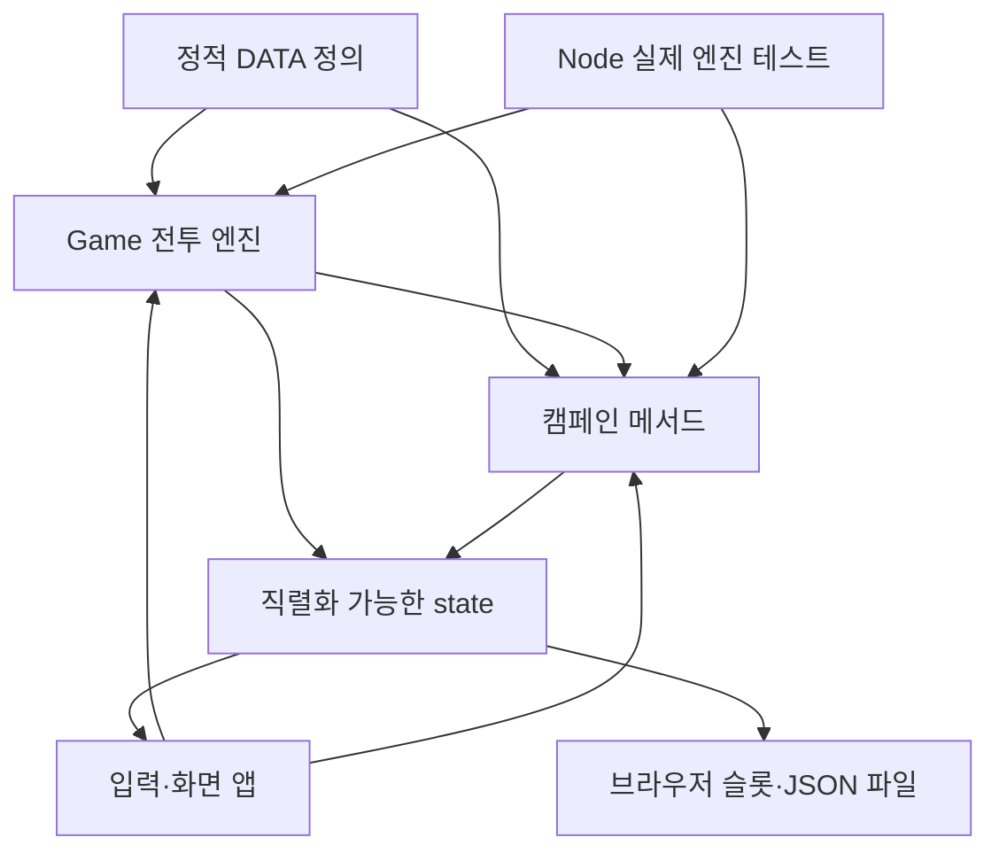
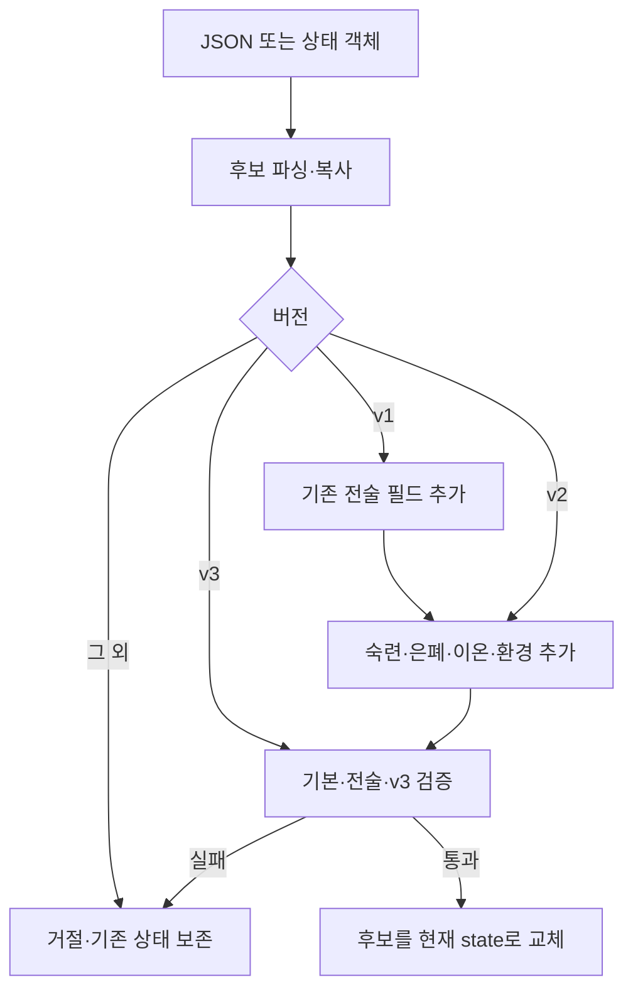

# STARWARD v3 — 상태·저장·인터페이스·검증 명세

> 기준: 2026-11-14. 실제 구현과 테스트의 구조를 설명한다. 원작 FTL의 비공개 코드·저장 형식을 분석한 문서가 아니다.

관련 문서: [전투·환경](v3_combat.md), [성장·캠페인](v3_progression.md), [실행·조작](../README.md).

## 1. 파일 경계와 실행 구조

앱은 네 개의 classic script를 순서대로 로드한다. 서버·npm·번들러·외부 에셋이 필요하지 않는다. 공통 네임스페이스 `globalThis.Starward`가 데이터와 `Game` 클래스를 연결한다.

| 파일 | 책임 |
|---|---|
| [data.js](../dist/data.js) | 방·문 좌표, 종족·무기·드론, 시작 함선, 난이도, 숙련 이름·임계값, 환경 정의 |
| [engine.js](../dist/engine.js) | 상태·난수·고정 시간, 전력·이동·전투·환경·종료, 명령 API, 저장 변환·검증 |
| [campaign.js](../dist/campaign.js) | `Game.prototype` 확장. 지도·조우·조건 사건·상점·정비·보상·기함 |
| [app.js](../dist/app.js) | 화면·입력·SVG·모달·효과음·브라우저 저장·파일 가져오기 |
| [index.html](../dist/index.html), [style.css](../dist/style.css) | 문서 구조·반응형 스타일·접근 가능한 조작 표면 |



화면용 선택·열린 모달·선택 중 빔 시작점 등은 `StarwardUI`에 둔다. 게임 진행과 피해를 소유한 `state`에 DOM 노드·오디오 객체·함수를 저장하지 않는다. 게임 스크립트는 브라우저 없이 Node `vm`에서도 실행할 수 있다.

## 2. 상태 모델

### 2.1 최상위

| 그룹 | 주요 필드 | 의미 |
|---|---|---|
| 버전·설정 | `version`, `loadoutId`, `difficulty` | v3, 선택한 시작 함선·난이도 |
| 결정성 | `seed`, `rng`, `nextId` | 초기 시드, 현재 난수 상태, 고유 ID 순서 |
| 시간 | `time`, `paused`, `speed`, `simRemainder` | 전투 누적 시간과 고정 간격 잔여 |
| 교전 | `mode`, `combatResolved`, `player`, `enemy`, `projectiles`, `environment` | 실제 전투 상태와 종료 중복 방지 |
| 캠페인 | `sector`, `nodes`, `currentNodeId`, `fleet`, `jumpCount`, `bossPhase`, `campaign` | 진행 위치·분기·추격·예정 보상 동작 |
| 자원 | `resources.scrap/fuel/missiles/droneParts` | 정수·비음수 자원 |
| 결과·표시 | `stats`, `lastVictoryCause`, `event`, `reward`, `effects`, `log` | 통계, 모달 데이터, 제한된 효과·로그 |

`enemy`는 비전투 상태에서 `null`일 수 있다. 살아 있는 승무원이 존재하지 않는 적선 위치를 가리키거나, 적선이 없는데 비행 중 적선 관련 발사체가 남아 있으면 유효 저장으로 보지 않는다. [검증 구현](../dist/engine.js)

### 2.2 함선과 컴포넌트

함선에는 `hull/maxHull/reactor`, 주 시스템 맵, 보조 시스템 맵, 방·문·승무원·무기·드론 배열, 실드·회피·FTL·전송·은폐·적 특수 공격 상태가 있다. 주 시스템 여섯 ID는 방 ID와 일치한다. 보조 설비 `drones`, `teleporter`, `cloaking`은 별도 일곱 번째 방을 만들지 않는다.

컴포넌트 공통 필드는 다음과 같다. 아래는 필드 설명용 예시이며 실제 플레이의 초기 저장 전체는 아니다.

```json
{
  "id": "weapons",
  "name": "무기",
  "level": 4,
  "power": 3,
  "desiredPower": 4,
  "damage": 0,
  "repair": 0,
  "ionStacks": 1,
  "ionTimer": 4.2
}
```

`power`와 `desiredPower`를 구분해야 일시 잠금으로 잃은 전력과 사용자가 직접 옮긴 전력을 혼동하지 않는다. 명목 `reactor`를 이온 폭풍 수치로 덮어쓰지 않고 `getReactorCapacity(ship)`가 현재 환경을 반영한다. 저장 검증도 **불러올 후보 상태의 환경**을 사용해 전력 초과를 검사한다.

보조 설비 수리 작업은 드론은 무기실, 텔레포터는 의료실, 은폐는 엔진실에 대응한다. 기본 시스템 손상을 먼저 수리한 뒤 해당 보조 설비를 처리한다. 이온과 물리 손상을 같은 숫자로 합쳐 저장하지 않는다.

### 2.3 소유권과 물리 위치

승무원은 소유자 배열에 유지한다. `player.crew`의 아군이 적선에 침투해도 배열을 옮기지 않고 `shipId:'enemy'`로 바꾼다. `faction`은 소유자와 일치해야 한다. `getCrewOnShip()`은 양쪽 배열에서 실제 해당 함선 위에 있는 살아 있는 인원을 합친다.

이 규칙을 쓰는 경로는 산소·화재·방 피해, 대인전·치료·수리·파괴 공작, 함교·엔진·무기·실드 운용, 이동, 귀환, 교전 종료 사상자 처리다. “아군 배열 안에 있으므로 본함에 있다”는 가정은 금지한다.

승무원은 방 ID·목표 방·연결 경로, 좌표, 체력, 종족, 기본 배치, 현재 작업과 여섯 숙련 XP를 가진다. 경로는 실제 인접 관계를 따라야 한다. 사망자는 HP 0으로 남을 수 있으나 생존 인원 제한은 8명이다.

### 2.4 임시 객체

| 객체 | 저장해야 하는 값 | 놓치면 생기는 문제 |
|---|---|---|
| 문 | 내구도, 개폐, 수동·자동 개방, 자동 닫기 대기 | 저장 뒤 봉쇄가 풀리거나 환기가 바뀜 |
| 무기 | 충전, 가동, 모드, 표적, 발사 예약, 빔 방·끝점 | 중복 발사·탄약 소모 또는 경로 변경 |
| 드론 | 전개·가동·전력, 충전, 체력 | 재개 후 부품 중복 결제 |
| 전송 | 실제 crew 위치, 재사용 대기 | 침투조 자동 구조·유령 인원 |
| 은폐 | 잔여 가동·재사용 대기와 배분 전력 | 무료 반복 은폐·버프 불일치 |
| 이온 | 시스템별 잠금 수·잔여 시간 | 영구 손상으로 오인 또는 즉시 전력 회복 |
| 환경 | 종류, 주기·예고, 잔여 시간, 예고 상태, 발동 횟수 | 저장을 이용한 위험 리셋 |
| 탄 | 출발 함선·종류·대상, 진행·지연·비행시간, 빔 경로·이온 값 | 재조준이 이미 날아간 탄을 바꿈 |

## 3. 공개 명령과 반환

기존 명령은 boolean을 반환하는 것이 있고, 신규 복합 명령은 `{ok,message}`를 반환한다. UI는 `false`와 `result.ok===false`를 실패로 해석한다. 테스트 역시 두 형식을 구분해 수용한다. [화면 명령 처리](../dist/app.js)

| API | 핵심 계약 |
|---|---|
| `newRun(seed, {loadoutId,difficulty})` | 기본 호출 호환, 전체 새 항해 생성 |
| `configureRun(loadoutId,difficulty)` | 출항 전만 허용, 같은 시드, 브라우저 슬롯 직접 변경 없음 |
| `startRun()` | 캠페인의 첫 교전, 일시정지로 시작 |
| `tick(seconds)` | 실제 고정 시간 시뮬레이션 |
| `allocatePower(id,delta)` | 실제 용량·반응로 예산 안에서 정수 전력 변경 |
| `getPowerUsed(ship)`, `getReactorCapacity(ship)` | 사용 합계와 환경을 반영한 현재 예산 |
| `moveCrew(id,roomId,shipId?)` | 자기 승무원을 현재 함선 안에서만 이동 |
| `toggleDoor`, `setDoors`, `sealShip`, `toggleVent` | 아군 문·에어록 조작 |
| `teleportCrew(ids,room)`, `recallCrew(ids?)` | 전력·인원·위치·대기 검사, 실제 전송 |
| `toggleDrone(id)` | 전력·부품·기존 전개 확인 |
| `targetWeapon`, `targetBeam`, `setWeaponAuto` | 실제 표적·모드 구성 |
| `fireWeapon`, `fireAllReady` | 충전·전력·탄약 검사, 정지 중 예약 |
| `activateCloak()` | 실제 설비·전력·재사용 검사 |
| `getCrewSkillLevel(crewOrId,skill)` | XP로부터 0~2 단계 반환 |
| `setEnvironment(kindOrNull)`, `clearEnvironment()` | 전투 환경 적용과 안전한 해제 |
| `jump`, `chooseEvent`, `buy` | 모드·조건·자원 재검증 후 진행·거래 |
| `continueReward`, `leaveShop`, `escape` | 상태 전환과 중복 방지 |
| `serialize`, `load` | JSON 생성과 검증된 원자적 교체 |

UI 버튼이 없는 내부 개발 메서드를 제품 조작으로 설명하지 않는다. 반대로 숨겨진 비활성 상태를 우회해 명령을 호출해도 엔진·캠페인이 조건을 다시 확인해야 한다.

## 4. 고정 단계 순서

실제 `_step(1/30)` 순서는 아래와 같다. 순서가 바뀌면 은폐 종료 후 피격, 대인전 중 사망, 환경 피해 직후 종료 같은 결과도 바뀔 수 있다. [구현](../dist/engine.js)

| 단계 | 작업 | 경계 |
|---:|---|---|
| 1 | 시간 증가, 효과 TTL 감소, 기존 치명 상태 검사 | 이미 끝난 전투를 다시 처리하지 않음 |
| 2 | 이온 시간, 전력 정리, 문, 은폐, 전송 대기 | 해제와 가용 전력이 이후 작업에 반영됨 |
| 3 | 적 승무원 의사결정 | 실제 위치·침입자·부상·사고 사용 |
| 4 | 산소·화재, 대인전, 승무원 이동·작업 | 물리 위치 기준 |
| 5 | 자동 수리·적 전력 복원, 파생값, 실드·조종·FTL | 유효 운용에만 XP |
| 6 | 치명 상태 검사 | 승무원 손실로 끝났으면 후속 공격 없음 |
| 7 | 환경 발동, 다시 치명 상태 검사 | 환경으로 파괴된 함선이 다음 공격을 하지 않음 |
| 8 | 적 특수 공격, 양측 무기·드론 | 일반 충전과 특수 타이머 구분 |
| 9 | 발사체 지연·이동·도착 | 요격된 탄 제외, 빔·이온 별도 경로 |
| 10 | 종료 검사 | 결과·보상 한 번만 처리 |

운용 경험치는 실제 단계에서 얻는다. 무기는 충전 증가가 있는 때, 실드는 층 재충전 때, 수리는 남은 유효 작업 시간만 반영한다. UI 프레임 호출 횟수나 들어온 피해량만으로 경험치를 더하지 않는다.

난수는 엔진에 저장한 xorshift32 상태로 생성한다. 같은 시드만 같다고 모든 플레이 결과가 같지는 않다. 명령 시점·경로·표적·배속을 포함해 같은 입력과 진행을 재현해야 같다. 저장에는 현재 RNG·다음 ID·고정 시간 잔여도 포함한다.

## 5. 저장 변환과 원자성

브라우저 슬롯 키는 호환을 위해 `starward-save-v1`을 유지하며 저장 내부 `version`은 3이다. UI의 파일 가져오기는 별도 `Game`으로 검증해 미리 보여 주고, 사용자가 적용하면 현재 항해를 복구용 슬롯에 보관한 뒤 교체한다. 백업 저장에 실패하면 가져오기를 진행하지 않는다. 불러온 전투의 일시정지는 UI가 적용한다. 엔진 `load()` 자체는 저장의 시간 상태를 보존한다. [저장 UI](../dist/app.js)



v1은 문·물리 위치·드론·사격 모드를 추가한 뒤 v2→v3 변환을 연속 적용한다. v2에는 은폐 미설치·타이머 0, 시스템별 이온 0, 승무원 XP 0, 기본 아르고·표준, 환경 없음과 노드 환경 `null`을 추가한다. 옛 선체·승무원 체력·장비·자원·문·침투·드론 전개·무기 충전·경로·캠페인을 새 함선 초기값으로 대체하지 않는다.

새 v3 형식이 잘못되면 누락 필드를 임의로 초기화해 받아들이지 않는다. 변환은 구 버전 후보에만 적용하며 검증 전에는 현재 상태를 교체하지 않는다. 구문 오류·미지원 버전·범위·참조 오류에 모두 동일한 원자성을 적용한다.

### 핵심 검증 항목

| 범주 | 조건 |
|---|---|
| 설정·모드 | 알려진 함선·난이도·모드·섹터·기함 단계 |
| 자원 | 유한 정수, 0 이상, 제한 범위 |
| 선체·시스템 | 선체 범위, 정수 용량·손상·전력, 현재 유효 용량과 반응로 예산 |
| 이온 | 잠금 0이면 시간 0, 잠금 양수면 시간 양수, 레벨·15초 상한 |
| 은폐 | 잔여 0~10초, 대기 0~20초, 활성과 양수 대기가 동시에 존재하지 않음 |
| 승무원 | 고유 ID·소유 진영·실제 함선·방·연결 경로·HP·생존 정원 |
| 숙련 | 여섯 정확한 키, 각 유한 0~120 |
| 문 | 실제 정의와 ID·연결·좌표 일치, 내구·개폐 일관성 |
| 드론 | 알려진 정의, 전개·가동·전력 관계, 관제 예산 |
| 빔·탄 | 알려진 방과 무기 종류, 고유 대상 방, 끝점·길이·진행·시간 |
| 환경 | 알려진 종류·정의된 주기/예고, 유효 타이머·횟수, 전투 중만 존재 |
| 캠페인 | 실제 지도 연결·현재 노드·사건과 보상에 필요한 상태 |

## 6. 실제 구 버전 fixture

[fixtures/README.md](../tests/fixtures/README.md)에 생성 경위를 남겼다. 두 파일 모두 새 엔진에서 버전 번호만 바꿔 만든 모조 데이터가 아니다.

| 파일 | 생성 원본 | 실제 저장 상태 |
|---|---|---|
| [v1-midcombat.json](../tests/fixtures/v1-midcombat.json) | 배포된 v1 코드의 공개 명령·실제 tick | 약25초, 선체26, 엔지72HP, 미사일8, 충전·이동 |
| [v2-midboarding.json](../tests/fixtures/v2-midboarding.json) | 배포된 v2 코드의 공개 명령·실제 tick | 약26초, 위 손상·탄약, 부품3, 적선 위 록, 전송17초, 적 문HP24, 의료실 산소83.8, 전개 드론 |

v2 fixture는 당시 v2 loader로도 성공을 확인했다. v3 테스트는 구 필드의 값·배열·물리 위치를 재귀적으로 비교해 보존하고, 신규 필드만 올바른 기본값을 갖는지 확인한다.

## 7. 검증 체계와 실제 결과

```bash
node --test tests/engine.test.cjs tests/corev2.test.cjs tests/corev3.test.cjs
node tests/playthrough.cjs
node tests/playthrough.cjs --loadout atlas --difficulty veteran 42
```

2026-11-14 Node.js v24.22.1 기준 **88/88 규칙 테스트**, 별도 고정 완주 사례 **4/4**를 통과했다.

| 파일 | 개수 | 검증 목적 |
|---|---:|---|
| [engine.test.cjs](../tests/engine.test.cjs) | 36 | 기존 시간·전력·이동·피해·저장·거래·지도·종료·기함 흐름 |
| [corev2.test.cjs](../tests/corev2.test.cjs) | 25 | 문·감압·탑승·대인전·전송 손실·드론·수동 사격·빔·v1 호환 |
| [corev3.test.cjs](../tests/corev3.test.cjs) | 27 | 시작 선택·난이도·숙련·은폐·이온·환경·v2 호환·조건 사건·위험 보상 |
| [playthrough.cjs](../tests/playthrough.cjs) | 4개 완주 사례 | 3함선 표준과 아르고 베테랑을 실제 전투·공개 명령으로 완주 |

규칙 테스트의 직접 상태 대입은 특정 손상·명중·한계·종료 상황을 준비하는 fixture다. 이 사실을 완주 성능과 섞지 않는다. 완주 스크립트는 상태를 읽되 자원·체력·승리 상태를 직접 쓰지 않는다. 새 함선의 시작 방식·이온/드론·빔/은폐·폭풍 전력 재배분·실제 숙련 성장까지 캠페인 안에서 사용한다. 결과 수치는 [성장 명세](v3_progression.md)에 있다.

브라우저에서는 격납고 3함선·난이도, 레이스 출항, 두 점 빔 조준, 정지 중 은폐·회피 표시·전력 상실·재사용, 은폐 중 일제사격, 실제 XP·숙련 팝업, JSON 가져오기, 소행성 경고, 지도 환경 설명·+8 보상, 상점 은폐/이온 구매와 `NO POWER`를 확인했다. 이는 데스크톱 브라우저의 해당 경로 확인이며 모바일 실제 기기·모든 브라우저·음향 환경 전체를 검증했다는 뜻은 아니다.

## 8. 오프라인과 소스 패키지

[build-offline.cjs](../scripts/build-offline.cjs)는 `dist/index.html`에서 로컬 CSS와 네 스크립트를 읽어 순서대로 삽입한다. 외부 URL·module script·없는 파일·에셋 루트 밖 경로를 거절한다. 결과 HTML은 `artifacts/`와 `dist/`에 같은 내용으로 저장한다.

[package-source.py](../scripts/package-source.py)는 명시된 게임 소스·README·변경 이력·이 세 문서, `tests/*.cjs`, fixture JSON/MD, 두 빌드 스크립트와 독립 HTML을 ZIP에 넣는다. 최종 브라우저 캡처 `STARWARD_v3_Hangar.jpg`, `STARWARD_v3_Gameplay.jpg`도 존재하면 두 지정 경로만 포함한다. 저장소 전체를 재귀 압축하지 않으므로 작업 환경 메타데이터·이전 ZIP·비공개 설정이 들어가지 않는다. 생성 후 CRC와 구성 목록을 확인한다.

```bash
node scripts/build-offline.cjs
python3 scripts/package-source.py
```

소스가 확정된 다음 두 파일을 다시 생성해야 웹 다운로드와 실제 배포 코드가 같아진다. ZIP을 다시 압축 대상으로 포함하지 않는다. 스크린샷은 실제 UI 기록이며 화면에 게임 에셋으로 로드하는 필수 리소스가 아니다.

## 9. 확장 시 유지할 불변식

- 새 설비는 공유 반응로·손상·이온·정비·저장 검증에 함께 연결한다.
- 새 피해 유형은 실드·회피·물리 피해·승무원·화재·숙련 경로를 명시한다.
- 새 승무원 위치는 소유자 배열과 실제 함선을 분리해 유지한다.
- 새 이벤트는 UI 조건과 실제 선택 시 재검증을 동시에 추가한다.
- 새 저장 필드는 구 버전 변환과 현 버전 오류 거절을 구분한다.
- 가용 반응로·빔 대상·운용자 같은 파생값은 원본 상태의 의미를 바꾸지 않는다.
- 실제 실패나 새 계약이 있을 때만 검증을 넓히고, 이미 충분히 확인한 영역에 무관한 대량 시드 검사를 추가하지 않는다.
