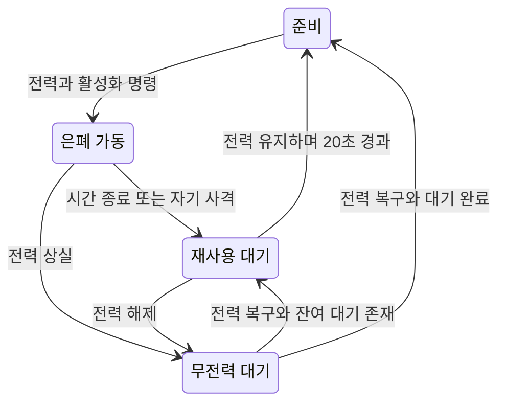

# STARWARD v3 — 전투·환경 시스템 명세

> 기준: 2026-11-14의 실제 STARWARD v3 소스와 자동 검증. 이 문서의 수치와 공식은 이 프로토타입의 구현 명세이며 FTL 원작의 내부 공식이라는 뜻이 아니다.

관련 문서: [성장·캠페인](v3_progression.md), [상태·저장·검증](v3_architecture.md), [실행과 조작](../README.md).

주요 근거는 [engine.js](../dist/engine.js)의 `_step`, `_reconcilePower`, `_resolveProjectile`, `_updateCrew`, `_updateEnvironment`와 [data.js](../dist/data.js)의 무기·종족·환경 정의다. 재현 가능한 경계 검증은 [engine.test.cjs](../tests/engine.test.cjs), [corev2.test.cjs](../tests/corev2.test.cjs), [corev3.test.cjs](../tests/corev3.test.cjs)에 있다.

## 1. 전투의 단위와 시간

한 교전은 아군·적군 함선 각 하나와 여섯 방, 방을 연결하는 문, 실제 위치를 가진 승무원, 시스템·보조 설비, 무기·드론, 비행 중 탄, 선택적인 환경 위험으로 구성한다. 선체 수치와 방 시스템 손상, 방 산소·화재·균열, 승무원 체력은 별개의 상태다. 한 방의 시스템을 수리해도 선체 피해는 돌아오지 않는다.

`tick(dt)`는 초 단위 입력을 받는다. 유효한 진행 중 전투이며 일시정지가 아닐 때만 시간 누적을 수행한다.

```text
누적 시간 += min(dt, 0.25) × 배속
시뮬레이션 간격 = 1/30초
한 tick 호출의 최대 내부 반복 = 16회
```

배속은 1 또는 2다. 긴 브라우저 프레임 하나를 모두 따라잡지 않도록 입력을 제한한다. 일시정지는 산소·이동·화재·수리·대인전·문 파괴·무기 충전·발사체·드론·이온·은폐·환경·특수 공격 시간을 함께 멈춘다.

명령은 시간 진행과 분리한다. 정지 중 전력·표적·이동 경로·문 상태를 바꿀 수 있고, 텔레포트·드론 전개·은폐 활성화도 준비 명령으로 실행한다. 정지 중 무기 발사는 예약만 하며 탄약은 실제 발사 때 소비한다. 같은 준비 명령을 반복해도 이미 예약한 발사를 중복 적재하지 않는다. 이 구분은 `_canFire`, `fireWeapon`, `manualQueued`와 관련 테스트로 확인한다. [구현·검증](../tests/corev2.test.cjs)

## 2. 반응로, 시스템 용량, 이온 잠금

### 2.1 세 가지 전력 제한

각 주 시스템과 보조 설비는 `level`, `damage`, `power`, `desiredPower`, `ionStacks`, `ionTimer`를 가진다. `level`은 설치 용량, `damage`는 수리가 필요한 물리 손상, `ionStacks`는 시간이 지나면 풀리는 잠금이다.

```text
물리 용량 = max(0, level - damage)
사용 가능 용량 = max(0, level - damage - ionStacks)
정상 반응로 예산 = reactor
이온 폭풍 예산 = max(2, floor(reactor × 0.65))
각 power ≤ 사용 가능 용량
전체 power 합계 ≤ 현재 반응로 예산
```

함교는 수동 시스템이므로 `power=0`을 유지한다. 다만 이온으로 함교의 사용 가능 용량이 0이 되면 조종 기능이 멈춘다. 드론·텔레포터·은폐 역시 같은 반응로를 사용한다. 보조 설비라는 이유로 무료 전력을 제공하지 않는다. [구현](../dist/engine.js)

폭풍 진입 등으로 예산을 넘으면 은폐 → 텔레포터 → 드론 → 의료 → 산소 → 엔진 → 무기 → 실드 순서로 필요한 만큼 전력을 줄인다. 이는 초기 자동 정리 순서다. 플레이어는 이후 직접 전력을 재배분할 수 있으며, 폭풍에서 모든 실드를 우선 유지하다 공격 무기가 꺼지는 상황을 피해야 한다.

무기는 장착 배열 순서로 전력을 배분받는다. 필요한 전력이 남아 있으면 그 무기가 가동하고, 부족하면 다음 무기를 살핀다. 가동 중이던 무기가 전력을 잃으면 충전과 수동 발사 예약을 지운다. 드론도 활성 상태·전개 상태·체력과 남은 관제 전력을 함께 확인한다.

### 2.2 의도 전력 보존

`desiredPower`는 일시 잠금이나 환경에 의해 자동으로 줄어들기 전의 희망 배정을 보존한다. 이온이 풀리거나 환경이 해제될 때 **그 순간 남은 예산 안에서만** 복원한다. 사용자가 다른 설비에 옮겨 놓은 전력을 빼앗지 않는다.

예를 들어 무기 희망 전력 4가 이온으로 3이 되고, 남은 1을 드론에 넣었다면 이온이 풀려도 무기는 3에 머물 수 있다. 뒤에 드론에서 1을 뺀 경우 무기 `＋`를 눌러 4를 복구할 수 있다. 만료 이후 영구적인 자동 재배분을 계속하지 않는다. 이 경계는 신규 이온 복원 테스트가 직접 검증한다. [검증](../tests/corev3.test.cjs)

## 3. 회피, 실드, 무기 충전

엔진 배분 전력 0~8에 대한 기준 회피 값은 `[0, 5, 10, 15, 20, 25, 28, 31, 35]`다. 살아 있고 이동하지 않는 아군 조종사와 엔진 전력이 있어야 기본 회피가 생긴다. 적과 싸우는 함교는 조종 기능을 제공하지 않는다.

```text
기본 회피 = 엔진 기준값 + 조종 보너스 5
          + 조종 숙련 단계 × 3
          + 엔진실 운용 시 (5 + 기관 숙련 단계 × 3)
기본 회피 상한 = 65%
최종 회피 = min(95, 기본 회피 + 은폐 중 60)
```

은폐의 +60은 기본 조종 회피가 0이어도 적용한다. 따라서 은폐는 조종·엔진이 꺼졌다는 이유만으로 무효가 되지 않는다. 다만 배분 전력을 잃으면 은폐 자체가 종료된다.

실드 최대 층수는 `floor(실드 power / 2)`다. 소모된 층은 한 번에 하나씩 충전한다. 재충전 시간은 무인 2.8초, 운용자 있음 2.5초를 기준으로 실드 숙련 단계마다 8%씩 감소한다. 이미 가득 찬 실드는 충전 진행과 실드 숙련 경험치를 만들지 않는다.

```text
실드 재충전 시간 = (운용 시 2.5, 아니면 2.8) × (1 - 0.08 × 실드 숙련)
무기 충전 속도 = (운용 시 1/0.9, 아니면 1) × (1 + 0.10 × 무기 숙련)
```

같은 방의 운용 보너스는 중첩하지 않는다. 해당 숙련 XP가 가장 높은 적격 승무원 한 명을 사용한다. 상세 성장 조건은 [성장 명세](v3_progression.md)에 정리한다. [공식 근거](../dist/engine.js)

## 4. 공격 명령과 피해 경로

### 4.1 장비 표

아래 충전 시간은 무인·숙련 없는 기본값이며 실제 운용 보너스로 빨라진다. [무기 데이터](../dist/data.js)

| 무기 | 전력 | 기본 충전 | 탄 수 | 피해 | 주요 판정 |
|---|---:|---:|---:|---:|---|
| 삼연장 레이저 | 2 | 10초 | 3 | 각 1 | 일반 실드 한 층이 한 발 흡수 |
| 아르테미스 | 1 | 13초 | 1 | 2 | 일반 실드 관통, 발사당 미사일 1 |
| 중형 레이저 | 1 | 11초 | 1 | 2 | 실드가 남으면 피해 2 전체 차단 |
| 아크 빔 | 2 | 15초 | 1개 경로 | 방마다 3 | 회피 없음, 남은 실드 층수 감산 |
| 이온 펄스 | 1 | 7초 | 1 | 선체 0 | 실드 또는 대상 시스템에 잠금 1·5초 |

자동 사격은 충전 완료·가동 전력·유효 표적·탄약 조건을 모두 갖추면 반복 발사한다. 수동 사격은 충전 완료 상태를 유지한다. `fireAllReady()`는 그 순간 조건을 갖춘 장비의 발사 명령을 모으며, 부족한 장비를 강제로 발사하지 않는다.

일반 발사체는 실제 비행 시간이 있다. 레이저·이온은 약 0.72~0.84초, 미사일은 약 1.05~1.17초이고 연발은 각 0.11초 간격이다. 빔 판정 지연은 0.25초다. 무기를 끄거나 해당 시스템이 뒤늦게 손상되어도 이미 발사된 탄은 계속 진행한다.

### 4.2 판정 순서

1. 유효한 생존 표적 함선과 방을 확인한다.
2. 요격된 탄을 제외한다.
3. 빔을 제외한 공격은 도착 시 표적의 회피율로 빗나감을 판정한다.
4. 이온이면 잠금 경로로 처리하고 물리 피해 단계로 넘어가지 않는다.
5. 빔이면 발동 시 남은 실드를 한 번 읽어 방별 피해를 결정한다.
6. 일반 비관통 탄이고 실드가 남으면 한 층을 소모하고 끝낸다.
7. 통과한 물리 피해를 선체·대상 방 시스템·실제 그 방에 있는 승무원에 적용한다.

물리 피해 `D`는 선체를 `D`, 시스템 손상을 최대 레벨까지 `D`, 해당 방의 승무원 체력을 각각 `7D`만큼 줄인다. 승무원은 소유자가 아니라 **물리 위치**로 검색하므로 침투조도 아군 포격에 맞을 수 있다. 물리 명중에는 화재·균열 가능성이 있으며 이온 자체에는 없다. [피해 구현](../dist/engine.js)

### 4.3 빔 경로

`targetBeam(weaponId, startRoomId, endRoomId)`는 방 중심 사이 선분을 만들고 길이를 4격자로 제한한다. 방 직사각형과 교차하는 ID를 진입 순서로 모아 중복을 제거한다. 실제 발사체에 `targetRooms`, `beamStart`, `beamEnd`를 복사하므로 발사 뒤 다른 경로로 조준해도 이미 날아간 빔의 대상은 바뀌지 않는다.

```text
각 방의 최종 빔 피해 = max(0, 기본 피해 - 빔 도착 시 남은 실드 층수)
총 선체 피해 = 최종 빔 피해 × 고유한 교차 방 수
```

실드가 2층일 때 3개 방을 통과하는 아크 빔은 각 1, 총 3 피해다. 빔은 실드 층을 탄처럼 소비하지 않는다. 경로에 실드실이 포함되면 그 방의 물리 손상 때문에 이후 운용 층수가 줄 수 있다. 테스트는 실드실을 피하는 경로를 별도로 사용해 이 두 현상을 구분한다. [빔 검증](../tests/corev2.test.cjs)

### 4.4 이온

명중 순간 실드가 남아 있으면 표적 방 대신 실드 시스템을 잠그고, 표시된 실드도 한 층 줄인다. 실드가 없으면 지정 방 시스템을 잠근다.

```text
새 잠금 수 = min(시스템 level, 현재 ionStacks + ionDamage)
새 잔여 시간 = min(15초, 현재 ionTimer + ionDuration)
```

한 번의 이온 펄스는 1잠금·5초다. 후속 명중은 잠금 수와 잔여 시간을 늘릴 수 있다. 잔여 시간이 0이 되면 그 시스템의 잠금을 모두 해제한다. 시스템 수리, 의료, 화재 진압은 이온 시간을 줄이지 않는다. 함교도 잠금 대상이므로 반응로 전력을 사용하지 않는 시스템이더라도 조종 기능을 잃을 수 있다.

## 5. 은폐

은폐 설비는 1~3단계이며 가동 전력 1/2/3에 지속 6/8/10초다. `activateCloak()`는 진행 중 교전, 생존 아군, 설치·배분 전력, 비활성·재사용 대기 완료를 확인한다. [은폐 구현](../dist/engine.js)



은폐 중에는 회피 +60%p가 적용되고 상대 일반 무기의 충전이 멈춘다. 이미 날아오는 탄은 없어지지 않고 도착 시 높아진 회피로 판정한다. 은폐한 함선 자신의 무기는 충전할 수 있으나 **자기 무기 발사 순간 은폐가 끝난다**. 자동 사격을 켜 두면 충전 완료로 의도보다 일찍 해제될 수 있다.

은폐가 어떤 이유로 종료돼도 재사용 대기 20초를 부여한다. 대기는 은폐 설비가 전력을 받고 비활성일 때만 줄며, 전원을 껐다 켜도 초기화하지 않는다. 드론, 환경, 기함 특수 공격의 시간은 은폐로 멈추지 않는다. 은폐는 해당 위험을 모두 무효화하는 무적 상태가 아니다.

## 6. 승무원, 문, 산소

소유자 `player.crew`에 있는 승무원이 `shipId:'enemy'`일 수 있다. 그 경우 적선의 산소·방 피해·적 승무원을 상대하며 본함의 무기·엔진·함교 운용에 기여하지 않는다. 이동 명령으로는 함선 사이를 건널 수 없다.

동일 방의 적대 인원은 기본 초당 4 피해에 종족 배율과 선내 전투 숙련을 곱해 공격한다. 인간·록 1배, 엔지 0.5배, 맨티스 1.5배다. 숙련은 단계당 +10%다. 이동 중인 승무원은 근접 공격하지 않는다. 여러 공격은 한 단계에서 모아 적용하므로 먼저 처리된 공격 하나가 반격을 임의로 없애지 않도록 한다.

아군 의료실은 전력 1일 때 초당 8 HP를 치료한다. 적 의료실은 침투한 아군을 치료하지 않는다. 적대 인원이 함께 있는 방은 수리·운용을 멈추지만, 본함 의료실의 치료 자체는 별도 순서로 처리한다. 비전투 작업은 진화 → 균열 봉합 → 시스템 수리 순이다.

문은 내부 연결 8개와 외부 에어록 2개다. 내구도는 30, 적대 승무원의 문 파괴 속도는 초당 6이다. 자기 함선의 문은 자동 개방해 통과하며 자동 개방 상태만 통과 후 약 0.8초 뒤 닫는다. 수동 개방은 유지하고, 파손된 문은 전투 중 계속 열린다. [문·승무원 구현](../dist/engine.js)

방 산소는 이전 단계 값으로 동시에 교환을 계산한다.

```text
열린 이웃과의 교환 = 합계[(이웃 산소 - 현재 산소) × 0.55]
공급 = 산소 전력 > 0 ? 1.8 × 전력 : -0.65
배출 = 화재량 × 0.7 + 균열 시 7.5 + 열린 에어록 수 × 18
새 산소 = clamp(기존 산소 + (공급 + 교환 - 배출) × dt, 0, 100)
```

산소 20 미만에서 질식 피해가 생기고 0에서는 초당 5 HP다. 일반 승무원은 화재량당 초당 1.6 HP의 화재 피해도 받는다. 록의 화재 면역은 질식을 막지 않는다. 닫힌 문은 방 간 교환·화재 확산을 격리하므로, 개별 에어록만 열어도 함선 전체가 같은 속도로 감압되지는 않는다.

## 7. 텔레포트와 드론

텔레포터는 전력과 충전이 필요하며 같은 출발 함선의 살아 있는 아군 1~2명을 전송한다. 적선 침투는 지정 방, 귀환은 본함 의료실이다. 재사용 대기는 배분 전력 1일 때 18초, 2일 때 12초이며 전력이 있어야 감소한다.

적선 파괴·도주 시 적선에 남은 아군은 사망한다. 일반 승무원 전멸 승리는 생존 침투조를 회수한다. 기함은 승무원 전멸만으로 끝나지 않고 자동 방어로 전환할 수 있다. 종료 시 본함의 적 침입자는 무력화 처리해 다음 교전에 유령 참조를 남기지 않는다.

공격·방어 드론은 각각 전력 2다. 교전당 최초 전개는 부품 1을 사용하고 같은 전개 기체의 중지·재가동은 무료다. 두 종류를 함께 가동하려면 관제 용량·배분 전력 4가 필요하다. 공격 드론은 6초마다 피해 1 레이저를 발사하고 실드·회피를 따른다. 방어 드론은 준비 상태에서 접근하는 미사일 한 발을 지우고 3초 재충전한다. 이온·레이저·빔·소행성을 요격하지 않는다. [드론·귀환 검증](../tests/corev2.test.cjs)

## 8. 환경과 기함의 시간 압박

| 환경 | 발동·예고 | 실제 효과 |
|---|---|---|
| 소행성 | 8초 / 2초 | 양측 각 한 방에 파편 접근. 회피 → 실드 한 층 → 피해 1 순서. 무기 탄약·무기 발사 XP를 만들지 않음. |
| 태양 | 22초 / 5초 | 양측 각 한 방에 화재 +0.8. 그 순간 실드가 0인 함선만 선체 피해 1 추가. |
| 이온 폭풍 | 지속 | 명목 반응로는 유지하고 현재 예산만 65% 내림, 최소 2로 제한. 반복 피해 없음. |

소행성의 실제 방 피해는 일반 피해 경로를 사용하므로 승무원·시스템 피해와 화재·균열이 뒤따를 수 있다. 환경은 일시정지 중 멈추고 저장·복원한 타이머와 발동 횟수를 유지한다. 종료·도주 시 환경을 먼저 정리하고 정비한다. 위험 비콘 승리 보너스 +8과 경로 선택은 [캠페인 명세](v3_progression.md)에 설명한다.

기함 1단계는 26초 주기 기존 승무원 강습, 2단계는 30초 주기 8초간 공격 드론 충전 3배, 3단계는 28초 주기 피해 1 미사일 3발의 1.5초 간격 일제사격이다. 각 예고는 6초다. 보조 공격은 일반 무기 충전과 별도로 진행한다. 3단계 무기실을 완전히 무력화하면 특수 일제사격도 취소할 수 있다. [기함 사양](../dist/campaign.js)

## 9. 종료 경계와 검증 연결

아군 선체 파괴·아군 승무원 전멸을 먼저 확인한다. 적선 파괴로 모든 아군 침투조까지 사망했다면 보상보다 아군 패배를 우선한다. 승리 처리는 한 번만 수행하고, 비행 중 탄을 정리하고 정지한 뒤 캠페인 보상으로 넘긴다.

| 위험 | 보존된 검증 |
|---|---|
| 정지 중 피해·시간 진행 | 기존 pause, 문 파괴 pause, 은폐·이온·환경 pause |
| 반응로 초과·임시 잠금 해제 시 전력 강탈 | 보조 전력, 반복 배분, 폭풍 예산, 이온 복원 예산 |
| 침투 위치를 본함으로 잘못 계산 | 운용 제외·상대 의료 제외·대인전·사상자·귀환 |
| 드론 재가동 중복 결제 | 최초 전개·동일 교전 무료·다음 교전 재결제 |
| 빔 중복 방 타격·실드 혼동 | 고유 교차 목록, 최대 길이, 방별 감산, 단일 방 호환 |
| 이온이 물리 피해를 줌 | 선체·체력·물리 손상·화재·균열 불변 |
| 은폐 전원 반복으로 대기 우회 | 발사·전력 상실 종료 및 전력 없는 대기 동결 |

검증은 실제 STARWARD 엔진을 실행한다. 원작 FTL 실행 결과와 동일하다는 인증, 모든 가능한 플레이 조합을 증명하는 형식 검증, 모든 브라우저·모바일 기기의 확인을 뜻하지 않는다.
