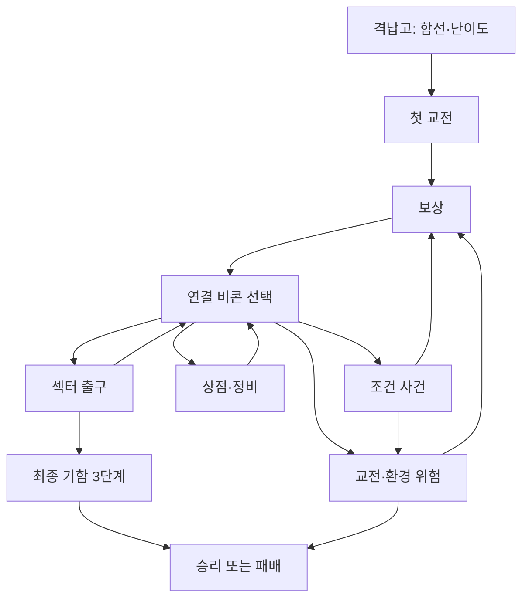

# STARWARD v3 — 함선 선택·성장·캠페인 명세

> 기준: 2026-11-14 실제 구현. FTL에서 영감을 받은 STARWARD의 자체 콘텐츠·경제·진행 규칙을 설명한다. 원작의 전체 함선·8섹터·난이도 경제를 그대로 재현하지 않는다.

관련 문서: [전투·환경](v3_combat.md), [상태·저장·검증](v3_architecture.md), [실행과 조작](../README.md).

수치 근거: [data.js](../dist/data.js)의 `loadouts`, `difficulties`, `skillRules`, `environments`; [campaign.js](../dist/campaign.js)의 `buildMap`, `scaleEnemy`, `onCombatEnd`, `chooseEvent`, `shopItems`, `recoverShip`. 숙련 효과는 [engine.js](../dist/engine.js)의 실제 운용·수리·대인전 경로를 따른다.

## 1. 한 항해의 구성

플레이어는 격납고에서 함선과 난이도를 선택하고, 세 섹터를 지나 기함 세 단계를 격파한다. 승무원 숙련·장비·자원은 **이번 항해 안에서** 유지한다. 새 항해는 새 상태이며 함선 해금·업적·영구 성장에 누적하지 않는다.



실제 `mode`는 `briefing`, `combat`, `map`, `event`, `shop`, `reward`, `victory`, `defeat` 중 하나다. 모든 진입과 거래는 현재 모드를 검사한다. 전투 중 상점 구매 API를 직접 호출해도 구매하지 않는다. 보상 확인을 여러 번 눌러 기함 단계를 건너뛰거나 자원을 반복 수령할 수 없다. [진행 검증](../tests/engine.test.cjs)

## 2. 시작 함선과 난이도

### 2.1 세 함선

공통으로 실드 한 층, 승무원 3명, 주 방 6개, 무기 관제 용량 4를 사용한다. 함선 차이는 실제 선체·반응로·장비·인원·보급에 반영한다. 색과 설명만 바꾸는 선택이 아니다. [정의](../dist/data.js)

| 항목 | 아르고 `argo` | 아틀라스 `atlas` | 레이스 `wraith` |
|---|---|---|---|
| 역할 | 다목적 순항함 | 드론 지원함 | 은폐 타격함 |
| 선체 | 30 | 28 | 26 |
| 반응로 | 10 | 11 | 11 |
| 시작 무기 | 삼연장 레이저·아르테미스 | 이온 펄스·중형 레이저 | 삼연장 레이저·아크 빔 |
| 승무원 | 인간·엔지·록 | 인간·엔지·엔지 | 인간·엔지·인간 |
| 드론 | 방어 | 공격·방어 | 방어 |
| 드론 관제 | 용량 2 / 배분 0 | 용량 2 / 배분 2 | 용량 2 / 배분 0 |
| 텔레포터 | 용량 1 / 배분 0 | 용량 1 / 배분 0 | 용량 1 / 배분 0 |
| 은폐 | 미설치 | 미설치 | 용량 1 / 배분 1 |
| 스크랩 | 60 | 50 | 45 |
| 연료 | 12 | 12 | 12 |
| 미사일 | 10 | 6 | 6 |
| 드론 부품 | 4 | 6 | 3 |

아틀라스도 드론이 무료로 출격하지 않는다. 설치와 전개는 별개이며 공격·방어 각각 교전당 부품 1을 소비한다. 관제 2로 두 기를 동시에 돌릴 수도 없다. 레이스는 자동 발사가 은폐를 해제하므로 사격 모드를 다룰 이유가 있다. 아르고는 v2 시작 구성과 보급을 그대로 유지한다.

`configureRun(loadoutId,difficulty)`는 출항 전만 허용하며 동일 시드로 새 시작 상태를 구성한다. 출항 후에는 함선·난이도를 바꾸지 않는다. 잘못된 ID나 난이도는 기존 상태를 보존하고 거절한다. 이 선택 메서드 자체가 브라우저 저장 슬롯을 직접 쓰지는 않는다. [선택 검증](../tests/corev3.test.cjs)

### 2.2 난이도

| 항목 | 표준 | 베테랑 |
|---|---|---|
| 적 선체 | 사양 그대로 | `ceil(기본 선체 × 1.2)` |
| 적 무기 충전 시간 | 사양 그대로 | 기본값 × 0.9, 소수 셋째 자리 반올림 |
| 플레이어 시작 장비·체력 | 선택 함선 그대로 | 동일 |
| 보상 | 기본 경제 | 동일 |

일반 적과 기함 모두 캠페인 생성 시 난이도 변환을 거친다. 구매한 플레이어 무기나 저장된 선체를 몰래 조정하지 않는다. `startCombat()`에 임의 사양을 전달하는 개발용 fixture와 실제 캠페인 난이도 적용 경로는 구분한다. [난이도 적용](../dist/campaign.js)

## 3. 지도와 환경 선택

각 섹터는 0~4의 다섯 열, 0~2의 행 좌표를 사용한다. 시작과 출구는 각각 하나, 중간 세 열은 각각 세 비콘으로 총 11개다. 중간 열에서는 다음 열의 같은 행·인접 행으로 연결하고 시작·출구 연결은 넓게 열어 둔다. 지나간 비콘으로 되돌아가지 않는다.

| 열 | 위쪽 | 가운데 | 아래쪽 |
|---|---|---|---|
| 0 | — | 현재 섹터 시작 | — |
| 1 | 교전 | 사건 | 정비 |
| 2 | 상점 | 교전 | 상점 |
| 3 | 교전 | 사건 | 교전 |
| 4 | — | 출구 또는 기함 | — |

환경 위험은 선택 가능한 교전 비콘에만 둔다. 첫 교전·상점·기함에는 넣지 않는다.

| 섹터 | 1열 위쪽 교전 | 3열 아래쪽 교전 |
|---|---|---|
| 여명 항로 | 소행성 | 태양 |
| 유리 성운 | 태양 | 이온 폭풍 |
| 마지막 신호 | 이온 폭풍 | 소행성 |

지도는 이름·아이콘·효과·추가 스크랩을 출발 전에 표시한다. 위험 경로를 거치면 전투 상태에 환경을 적용하며, 승리할 때 +8 스크랩을 추가한다. 도주·패배에는 보너스를 지급하지 않는다. 정상 경로도 남아 있으므로 특정 환경을 반드시 감수해야 하는 구조는 아니다. [지도·보너스 검증](../tests/corev3.test.cjs)

도약은 유효한 연결·미방문 목표·`map` 모드·연료를 확인한 뒤 연료 1을 사용하고 이동·추격·도약 통계를 갱신한다. 잘못된 목표는 비용과 위치를 바꾸지 않는다. 추격은 단순한 수치 압박으로, 5 이상이면 일반 적 사양에 선체 2가 추가된다. 원작의 함대 점령선을 그대로 재현한 모델은 아니다.

## 4. 보상과 자원 순환

스크랩은 수리·장비·인원·설비를 구매하는 공통 자원이다. 연료는 지도 이동과 긴급 도약, 미사일은 해당 무기 발사, 부품은 드론 최초 전개에 사용한다. 설치·용량·전개·실제 가동을 나누어 자원이 서로 다른 시점에 필요하도록 한다.

일반 승리 스크랩은 다음과 같다. `U`는 시드 난수의 `[0,1)` 표본이다. [보상 구현](../dist/campaign.js)

```text
첫 승리 = 38
후속 일반 승리 = 27 + 섹터 × 7 + floor(U × 7)
추가 = 매복 보너스 + 승무원 전멸 승리 10 + 환경 위험 8
```

| 승리 구분 | 기본 스크랩 | 연료 | 미사일 | 부품 |
|---|---:|---:|---:|---:|
| 첫 교전 | 38 | 2 | 3 | 2 |
| 일반 1섹터 | 34~40 | 1 | 2 | 1 |
| 일반 2섹터 | 41~47 | 1 | 2 | 1 |
| 일반 3섹터 | 48~54 | 1 | 2 | 1 |
| 일반 승무원 전멸 승리 | 해당 기본 +10 | 1 | 보통 2 | 2 |
| 기함 1·2단계 | 26 | 0 | 4 | 2 |

매복 보너스가 있는 교전은 미사일 4를 지급한다. 기함 중간 보급은 선체 6도 복구한다. 마지막 단계는 최종 승리로 전환한다.

보상은 `reward` 화면 생성 시 한 번 지급한다. **항해 계속**은 이미 받은 보상을 다시 더하지 않고 예정된 다음 모드·단계로 전환한다. 위험 보상은 정리된 전투 환경 객체가 아니라 현재 지도 노드의 환경 정의를 근거로 계산하므로, 종료 시 환경을 먼저 제거해도 잃지 않는다.

### 연료 부족과 도주

유효한 다음 목표를 선택했는데 연료가 0이면 구조 사건을 연다. 스크랩 12로 연료 3을 사거나, 기다려 연료 2·추격 +2·선체 최대 2 손실을 받는다. 기다림의 선체 손실은 마지막 1을 보존한다. 따라서 연료와 스크랩이 동시에 0이라는 이유만으로 진행이 영구 정지하지 않는다.

긴급 도약은 FTL 100, 살아 있는 조종사, 가동 엔진과 연료가 필요하다. 연료 1·추격 1을 소비하고 승리 보상 없이 떠난다. 적선에 남겨 둔 아군은 사망한다. 기함 도주에는 수리·보급·재접근 사건이 따로 있으나 무료 승리 처리나 단계 건너뛰기는 없다.

## 5. 상점과 조건 검증

상점은 고정 상품 목록을 제공한다. 현재 상태로 가격·정원·최대 용량·중복 소유를 다시 계산하고 구매 가능할 때만 스크랩을 차감한다. 설치·고용이 실패하면 이미 차감한 금액을 돌려준다. 버튼의 `disabled` 표시는 편의이며 API의 실제 재검증을 대체하지 않는다. [거래 구현](../dist/campaign.js)

| 상품 | 가격 | 효과와 상한 |
|---|---:|---|
| 수리 | 18 | 선체 5, 최대 선체 초과 불가 |
| 연료 | 12 | 3개 |
| 미사일 | 16 | 4개 |
| 부품 | 18 | 3개 |
| 외부 장갑 | `45 + max(0, 최대선체-30)×3` | 최대·현재 선체 최대 5 증가, 최종 최대 40 |
| 실드 용량 | `55 + max(0, 레벨-2)×10` | +2, 최대 6 |
| 반응로 | `22 + max(0, 반응로-10)×4` | +1, 최대 18 |
| 무기 관제 | `28 + max(0, 레벨-4)×8` | +1, 최대 8 |
| 엔진 | `25 + max(0, 레벨-3)×10` | +1, 최대 6 |
| 드론 관제 | 36 | +2, 최대 4 |
| 텔레포터 | 30 | 2단계까지 |
| 은폐 | 설치 60 / 개량 45 | +1, 최대 3 |
| 중형 레이저 / 빔 / 이온 | 45 / 65 / 45 | 중복 불가, 무기 슬롯 최대 4 |
| 공격 드론 | 42 | 중복 설치 불가 |
| 인간 / 엔지 / 맨티스 | 30 / 38 / 42 | 생존 승무원 최대 8 |
| 집중 치료 | 12 | 살아 있는 아군 전원 회복 |

설비 확장은 반응로도 자동 확장하지 않는다. 여유 예산이 있으면 해당 설비에 연결하지만, 설치한 무기가 `NO POWER`로 남을 수 있다. 기존 반응로를 보거나 다른 설비에서 옮겨야 한다. 레이스의 시작 선체 26에 장갑을 사면 우선 31이 되는 등 최대 선체는 함선별 시작값을 따른다.

### 새 조건 사건 네 종류

| 선택 ID | 조건·비용 | 결과 |
|---|---|---|
| `relay_expert` | 생존 승무원 수리 숙련 1 이상 | 스크랩 34, 연료 2 |
| `refugee_drone` | 방어 드론 설치, 부품 1 | 스크랩 30, 연료 1 |
| `wreck_cloak` | 은폐 1단계 이상, 연료 1 | 스크랩 30, 부품 1, 선체 조사 피해 없음 |
| `workshop_ion` | 이온 펄스 소유 | 스크랩 20, 부품 2 |

이 선택들은 기존 중계기·난민·난파선·작업장 사건에 추가한다. 기본 대체 선택을 남겨 특정 장비 미소유가 진행 불능으로 이어지지 않게 한다. 선택 직전에 종족·생존 인원·숙련·설비·소모 자원을 다시 확인한다. 비용이 사라졌거나 조건을 잃은 오래된 UI 선택은 거절한다. 성공 후 같은 선택을 다시 호출해 보상을 반복할 수 없다. 테스트는 직접 만든 가짜 사건 대신 실제 `jump()`가 생성한 사건으로 이 경계를 검증한다. [검증](../tests/corev3.test.cjs)

## 6. 승무원 숙련

여섯 XP는 `piloting`, `engines`, `weapons`, `shields`, `repair`, `combat`이다. 각 값은 0~120의 실수이며 계단식 단계에 사용한다.

```text
XP < 40      → 단계 0
40 ≤ XP <120 → 단계 1
XP = 120     → 단계 2
새 XP = min(120, 기존 XP + 실제 유효 작업량)
```

| 숙련 | 경험치가 생기는 실제 작업 | 효과 |
|---|---|---|
| 조종 | 유효 조종사·엔진이 작동하는 전투에서 함교 운용 | 단계당 회피 +3%p |
| 기관 | 같은 조건에서 엔진실 운용 | 단계당 회피 +3%p |
| 무기 | 가동 무기 중 실제 충전 증가가 있는 동안 무기실 운용 | 충전 속도 단계당 +10% |
| 실드 | 실제 소모된 층을 재충전하는 동안 실드실 운용 | 재충전 시간 단계당 -8% |
| 수리 | 실제 진화·균열 봉합·시스템 수리에 쓴 시간 | 종족 수리 속도에 단계당 +15% |
| 선내 전투 | 실제 적에게 근접 공격한 시간 | 종족 근접 피해에 단계당 +10% |

운용은 유효 시간당 1 XP, 수리는 실제 작업 시간당 2 XP, 전투는 실제 피해에 기여한 시간당 최대 1 XP다. 마무리 순간 실제 남은 작업·체력만큼 계산하므로 이미 끝난 작업으로 경험치를 계속 얻지 않는다.

정지·사망·이동 중에는 경험치를 얻지 않는다. 전력 없음, 적과 교전 중인 방, 다른 함선의 설비 운용도 운용 경험치를 만들지 않는다. 화재·균열·수리 작업이 있는 방에서는 해당 사고를 처리하며 운용 XP를 함께 얻지 않는다. 수동 사격으로 모든 무기가 가득 찼다면 더 충전하지 않아 무기 XP도 멈춘다. 실드가 가득 찬 상태로 대기해도 실드 XP가 오르지 않는다.

**적선 위 실제 강습대의 근접 전투 XP는 허용한다.** 본함 설비 운용·수리와 물리 위치 조건이 다르다. 혼자 적 시스템을 파괴하는 공작만으로는 선내 전투 XP를 얻지 않는다.

같은 방에 여러 운용자를 둬도 가장 적합한 한 명의 보너스만 적용한다. 단계 상승만 로그로 기록하며 매 프레임 XP 변화는 로그를 만들지 않는다. 고용한 승무원은 0부터 시작하고, 정비·도약은 기존 XP를 초기화하지 않는다. [효과·획득 검증](../tests/corev3.test.cjs)

## 7. 정비 시 보존과 초기화

| 상태 | 비콘·교전 정비 |
|---|---|
| 선체 | 일반 정비만으로 완전 회복하지 않음. 별도 보급·이벤트·구매 적용 |
| 사망자 | 부활하지 않음 |
| 생존 본함 승무원 HP | 상황별 부분 치료, 최대 체력 제한 |
| 승무원 숙련 | 유지 |
| 설치 장비·설비 용량·명목 반응로 | 유지 |
| 자원 | 실제 비용·보상만 반영, 사용 부품 환불 없음 |
| 시스템 손상·화재·균열·산소 | 복구·정리 |
| 문 | 내구도 복구, 닫힘 |
| 드론 | 전개·가동 해제, 다음 교전 최초 전개 비용 필요 |
| 전송·은폐·이온·환경 | 교전 종료 정리 과정에서 임시 효과 제거 |
| 적선 위 아군 | 일반 정비가 자동 구조하지 않음. 전투 종료 원인이 생사·귀환을 먼저 결정 |

이는 원작의 장기 사고 유지와 다른 압축 캠페인 규칙이다. 구현 목표는 짧은 항해에서 전투·구매·승무원 성장의 연결을 경험하도록 하는 것이다. [정비 코드](../dist/campaign.js)

## 8. 실제 완주 검증과 해석

[playthrough.cjs](../tests/playthrough.cjs)는 상태를 읽고 공개 명령으로만 배분·이동·사격·구매·선택한다. 자원·HP·적 선체를 주입하지 않고, 모든 전투와 기함을 실제 `tick()`으로 해결한다. 검증 기본 사례를 실행 전에 고정했다.

| 시드 | 함선·난이도 | 결과 | 전투 시간 | 최종 선체 | 생존 인원 | 드론 전개 | 은폐 |
|---:|---|---|---:|---:|---:|---:|---:|
| 42 | 아르고·표준 | 승리 | 380초 | 28 | 4 | 2 | 0 |
| 42 | 아틀라스·표준 | 승리 | 260초 | 25 | 4 | 11 | 0 |
| 42 | 레이스·표준 | 승리 | 249초 | 30 | 4 | 2 | 11 |
| 42 | 아르고·베테랑 | 승리 | 491초 | 30 | 4 | 2 | 0 |

모두 교전 10회, 기함 3단계, 세 종류 환경을 통과했다. 실제 운용으로 조종·무기·기관 숙련 2단계도 성장했다. 레이스는 장갑을 구매해 시작 최대 선체 26보다 높은 선체로 끝났다.

정책은 아틀라스의 이온·공격 드론에 첫 상점 빔을 연결하고, 레이스의 은폐 중 자동 사격을 잠시 대기한다. 폭풍에서는 명목 반응로가 아닌 현재 가용 전력으로 계획을 다시 계산해 공격 수단을 남긴다. 이는 가능한 한 가지 숙련된 지휘 정책이며 함선 우열·초보자 승률·전체 시드 난이도의 통계적 추정은 아니다.
