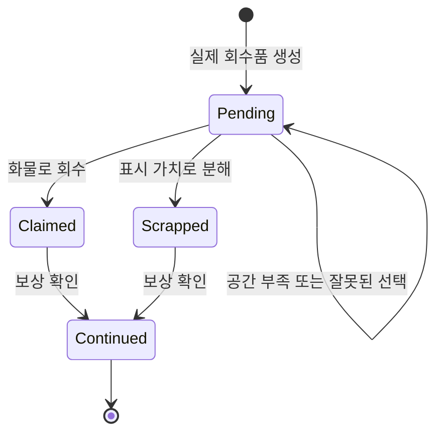

# STARWARD v4 — 장비·화물·회수품·거래 시스템

기준: 2026-11-14 구현과 Node 통합 시험. 이 문서는 STARWARD의 실제 규칙이며 FTL 원작의 내부 구현을 주장하지 않습니다. 전투 공식은 [v3 전투 명세](v3_combat.md), 기존 경제·지도는 [v3 진행 명세](v3_progression.md), 현재 저장 계약은 [v4 검증 명세](v4_validation.md)를 함께 읽습니다.

근거 코드: [장비 정의](../dist/data.js)의 `equipment`·`equipmentLimits`, [엔진](../dist/engine.js)의 장비 공개 명령, [캠페인](../dist/campaign.js)의 `resolveSalvage`·`buy`, [UI](../dist/app.js)의 `renderEquipment`·`renderReward`. 검증: [v4 규칙 시험](../tests/corev4.test.cjs), [공개 명령 완주 정책](../tests/playthrough.cjs).

## 1. 플레이 목표와 보관 단위

전투 보상으로 얻은 장비를 바로 쓰거나, 미래 구성을 위해 보관하거나, 강화 비용으로 바꾸는 선택을 추가합니다. 장비 **정의**와 장비 **개체**를 구분하므로 같은 이온 무기 두 개를 소유할 수 있습니다. 두 개는 `defId`가 같고 `id`가 다릅니다.

| 위치 | 한도 | 저장 상태 | 전투 참여 |
|---|---:|---|---|
| 설치 무기 | 1~4개 | 정의 정보와 충전·전력·표적·사격 상태 | 실제 전력·충전·조준·탄약 조건을 충족할 때 발사 |
| 설치 드론 | 0~2개 | 정의 정보와 전개·활성·충전 상태 | 관제 전력과 첫 전개 부품을 별도로 지불 |
| 공용 화물칸 | 0~6개 | `id`, `kind`, `defId`만 보관 | 전력·충전·효과 없음 |
| 미결정 회수품 | 보상당 최대 1개 | 장비 개체와 분해 가치·결정 상태 | 화물 회수 또는 분해를 먼저 선택 |

화물은 무기·드론이 같은 6칸을 공유합니다. 설치 슬롯은 두 종류가 별도입니다. 빈 드론 슬롯이 있어도 다섯 번째 무기를 설치할 수 없습니다. 최소 무기 1개 규칙은 **슬롯의 존재**만 보장합니다. 마지막 무기를 이온으로 교환할 수 있고, 이온 자체는 선체 피해를 주지 않으므로 화면은 다른 공격 수단의 필요성을 안내합니다.

## 2. 가격표와 수입 통계

| 종류 | 정의 ID | 장비 | 구입 | 판매·회수품 분해 |
|---|---|---|---:|---:|
| 무기 | `burst_laser` | 삼연장 레이저 | 60 | 30 |
| 무기 | `artemis` | 아르테미스 | 40 | 20 |
| 무기 | `heavy_laser` | 중형 레이저 | 45 | 22 |
| 무기 | `beam` | 빔 | 65 | 32 |
| 무기 | `ion` | 이온 | 45 | 22 |
| 드론 | `combat` | 반딧불 공격 드론 | 42 | 21 |
| 드론 | `defense` | 파수꾼 방어 드론 | 40 | 20 |

모든 값은 스크랩입니다. 상점 드론 상품 ID는 `combat_drone`, `defense_drone`이며 정의 ID와 다릅니다. 가격은 품질·충전량·사용 이력에 따라 달라지지 않습니다. 추가 장비가 명목 반응로나 시스템 레벨을 늘려 주지는 않습니다.

| 행위 | 보유 스크랩 | `scrapEarned` | `salvaged` | `equipmentSold` |
|---|---:|---:|---:|---:|
| 기본 전투 자원 보상 | 보상만큼 증가 | 보상만큼 증가 | 유지 | 유지 |
| 회수품을 화물로 회수 | 유지 | 유지 | +1 | 유지 |
| 회수품을 즉시 분해 | 표시 가치만큼 증가 | 표시 가치만큼 증가 | 유지 | 유지 |
| 소유 장비를 상점에서 판매 | 판매가만큼 증가 | 유지 | 유지 | +1 |
| 화물을 폐기 | 유지 | 유지 | 유지 | 유지 |

판매는 이미 가진 자산의 현금화이므로 획득 보상 통계에 다시 넣지 않습니다. `salvaged`는 획득한 장비 개수이며 현재 화물 수와 다릅니다. 회수한 장비를 장착·판매해도 과거 회수 기록은 줄어들지 않습니다.

## 3. 정비 가능한 상태

| 게임 모드 | 화물 획득·보관·장착·교체·순서·폐기 | 판매 |
|---|---|---|
| 출항 준비 `briefing` | 허용 | 거절 |
| 지도 `map` | 허용 | 거절 |
| 교역소 `shop` | 허용 | 허용 |
| 보상 `reward` | 허용 | 거절 |
| 교전 `combat` | 거절 | 거절 |
| 사건 `event` | 거절 | 거절 |
| 승리·패배 | 거절 | 거절 |

**전투를 일시정지해도 정비 권한은 생기지 않습니다.** 전투 중 장비창은 열람용이며 무기 전원·사격·표적·전력 조작은 기존 전술 명령으로 처리합니다. 사건에서 받은 새 장비는 보상창의 회수품 선택으로 전달합니다. 보상 화면에서 장비창을 열어 빈 화물칸을 만들 수 있습니다.

## 4. 공개 명령과 원자성

장비 명령은 `{ok, message}`를 반환합니다. 성공 시 일부 명령에는 `itemId`, `destination`, `scrap`이 추가됩니다. 실패는 자원뿐 아니라 배열·장비 ID 발급·난수·로그까지 그대로 유지해야 합니다. UI의 이전 버튼 상태를 신뢰하지 않고 현재 게임 상태로 조건을 다시 검사합니다.

| 명령 | 성공 동작 | 주요 거절 조건 |
|---|---|---|
| `canManageEquipment()` | 현재 모드의 정비 가능 여부 | 상태 조회 전용 |
| `receiveEquipment(kind, defId, 'auto')` | 해당 설치 슬롯이 비면 설치, 아니면 화물 | 잘못된 정의·모드, 설치와 화물 모두 만석 |
| `receiveEquipment(kind, defId, 'cargo')` | 화물로만 받음 | 화물 만석이면 빈 설치 슬롯이 있어도 거절 |
| `stowEquipment(kind, itemId)` | 설치 장비를 같은 ID의 화물로 변환 | 마지막 무기, 화물 만석, 없는 장비 |
| `installEquipment(cargoId)` | 화물을 새 런타임으로 만들어 빈 슬롯에 설치 | 해당 종류의 설치 슬롯 만석 |
| `installEquipment(cargoId, replaceId)` | 같은 종류의 설치 장비와 화물 슬롯 교환 | 다른 종류·없는 교체 대상 |
| `moveWeapon(itemId, -1 또는 1)` | 설치 배열에서 앞·뒤로 한 칸 이동 | 경계 밖, 잘못된 방향·ID |
| `sellEquipment(location, itemId)` | 장비 제거 후 판매가 지급 | 상점 밖, 마지막 무기, 없는 장비 |
| `discardCargo(itemId)` | 화물만 제거 | 설치 장비 ID, 없는 화물 |

`receiveEquipment` 자체는 결제 API가 아닙니다. 상점이 비용·공간을 확인한 뒤 이 명령으로 인도를 완료하고 가격을 차감합니다. 플레이어가 실제로 얻는 경로는 상점 구매와 회수 선택입니다.

### 만석 교환과 상태 초기화

화물 6칸이 모두 차도 **교체**는 가능합니다. 들어오는 화물이 비우는 한 칸에 나가는 장비를 넣으므로 순수 화물 수는 변하지 않습니다. 마지막 무기와의 교환도 설치 수 1을 유지하므로 허용합니다. 종류가 다른 장비끼리 교환하지 않습니다.

설치 상태를 화물로 바꾸면 전투 런타임을 보관하지 않습니다. 재장착은 동일 `id`·`defId`에 정규 정의를 적용하며 다음 값으로 시작합니다.

- 무기 충전 0, 표적·빔 좌표 없음, 예약 사격 해제. 무기 사용 의도는 켜지만 실제 가동은 전력 배분에 따릅니다.
- 드론 비활성·미전개, 충전 0. 이미 쓴 드론 부품을 반환하지 않습니다.
- 장비 순서·제거 뒤 실제 전력과 선택 무기를 재검산하고 캠페인 전력 계획을 갱신합니다.
- 화물에서는 충전·드론 활동이 진행되지 않습니다. 명목 용량·반응로·미사일·부품을 무료로 보충하지 않습니다.

무기 배열은 실제 전력 우선순위입니다. 예를 들어 무기 전력 2에서 앞의 삼연장 레이저가 2를 쓰면 뒤의 미사일은 꺼집니다. 미사일을 앞으로 옮기면 1을 먼저 받아 켜지고, 남은 1로 레이저를 가동할 수 없어 레이저는 꺼집니다. 단순 카드 정렬이 아닙니다.

## 5. 회수품 발생과 선택

`campaign.normalVictories`는 학습용 첫 교전을 포함한 비보스 승리를 셉니다. **1·2·4·6…번째 승리**에 회수품이 생기며, 승무원 전멸 승리는 홀수 회차에도 제공합니다. 기함 단계 보상은 회수품을 만들지 않고 일반 승리 횟수를 늘리지 않습니다.

첫 회수품은 아르고·레이스의 이온, 아틀라스의 빔입니다. 이후 실제 제안이 생길 때만 7종 정의 풀에서 시드 난수 한 번으로 고릅니다. 제안이 없는 승리에는 장비 추첨 난수를 소비하지 않습니다. 자원 보상·명중·다른 캠페인 선택은 각각 기존 난수를 사용합니다.

기본 스크랩·연료·탄약·부품은 승리 보상 생성 때 이미 지급됩니다. 회수품은 그 위에 추가된 별도 선택입니다. `resolveSalvage('claim')`은 **자동 설치하지 않고 화물로** 넣습니다. `resolveSalvage('scrap')`은 표시된 가치만 한 번 지급합니다. 두 번째 결정 요청과 미결정 상태의 `continueReward()`는 아무것도 바꾸지 않고 거절합니다.

화물 만석일 때는 보상창에서 기존 화물을 장착·폐기해 한 칸을 만들거나, 이번 회수품을 분해합니다. 교체는 화물 수를 줄이지 않으므로 만석 회수를 위한 빈칸을 만들지는 않습니다. 폐기는 확인 UI가 있으며 보상은 없습니다. 판매는 다음 교역소에서 가능합니다.

공방 사건의 공격 드론 주문은 스크랩 30을 쓰고 부품 1과 공격 드론 회수품을 받습니다. 직접 설치하지 않으며 보상창에서 회수 또는 21스크랩 분해를 결정합니다. 이미 공격 드론을 보유해도 선택할 수 있습니다.

## 6. 검증과 의도한 한계

[v4 시험](../tests/corev4.test.cjs)은 실패 전후 `serialize()` 전체를 비교해 공간·돈·ID·로그·난수의 원자성을 확인합니다. 만석 교환, 마지막 무기, 드론 비용, 배열 전력 우선순위, 오래된 상품 버튼, 회수 중복·저장 재개, 회수 후 장착·판매한 영수증도 검증했습니다.

[실제 완주](../tests/playthrough.cjs)는 자원이나 승리를 직접 대입하지 않습니다. 시드 42 네 항해 모두 실제 회수 2개, 후속 분해 2개, 상점 보관·재장착·판매를 실행했습니다. 아르고 표준·베테랑과 아틀라스는 회수품을 설치 장비와 교환해 구성까지 바꿨습니다. 레이스는 기존 빔 구성을 유지하면서 보관·재장착을 수행했습니다.

장비 품질·희귀도·수리비·거래소별 재고·가격 변동·화물 중량·영구 보관함은 없습니다. 동일 정의 중복은 가능하지만 설치 용량·전력·충전·탄약은 계속 필요합니다. 기존 v3 문서의 “장비 판매·화물칸 없음”은 당시 버전의 한계이며 v4에서 해소했습니다.
