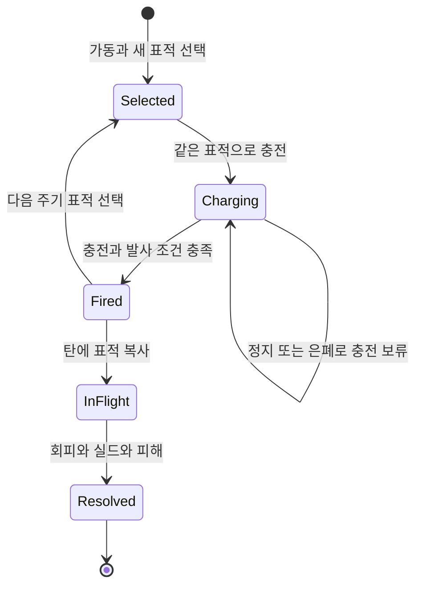

# STARWARD v4 — 적 전술·표적 의도·승무원 배치

기준: 2026-11-14 구현과 통합 시험. STARWARD의 실제 행동 규칙을 설명합니다. 원작 FTL의 AI를 복제하거나 내부 판단을 확인한 문서가 아닙니다.

근거: [data.js](../dist/data.js)의 `enemyProfiles`, [engine.js](../dist/engine.js)의 `_enemyTarget`·`_chooseEnemyTarget`·`_enemyCrewAI`·`_restoreEnemyPower`·`saveStations`·`returnStations`, [campaign.js](../dist/campaign.js)의 `regularEnemy`·`bossEnemy`. 검증은 [corev4.test.cjs](../tests/corev4.test.cjs)에 있습니다. 공통 피해·운용·침투 규칙은 [v3 전투 명세](v3_combat.md)를 유지합니다.

## 1. 전술이 실제 판단으로 연결되는 위치

각 함선은 `aiProfile` 문자열을 저장합니다. 유효 값은 `raider`, `disruptor`, `boarding`, `artillery`이며 기본값은 `raider`입니다. 정의는 이름·설명·색상과 다음 세 가지 판단 데이터를 함께 갖습니다.

| 데이터 | 실제 적용 |
|---|---|
| `targetWeights` | 다음 무기 충전 주기의 표적 추첨 가중치 |
| `repairWeights` | 적 승무원이 수리할 방의 점수 |
| `powerOrder` | 제한된 반응로 전력을 다시 배분할 순서 |

화면은 이 결과를 읽습니다. 적 전술 설명을 보여 주면서 실제로는 모든 적이 같은 표적·수리·전력 정책을 쓰는 방식이 아닙니다. 다만 프로필은 완전한 전략 탐색기가 아니라 가중치와 일부 조건 분기입니다. 적이 플레이어의 향후 입력이나 난수 결과를 미리 읽지는 않습니다.

## 2. 네 프로필과 대응 의미

| 프로필 | 공격 성향 | 실제 장비·상황 | 대응에 주는 정보 |
|---|---|---|---|
| 습격형 `raider` | 무기실 중심, 실드·엔진도 압박 | 첫 교전과 초기 일반 적. 공격을 유지하는 수리·전력 우선순위 | 무기실 표적을 확인하고 수리 인원·방어를 준비 |
| 교란형 `disruptor` | 이온으로 실드 또는 무기·엔진 잠금 | 2섹터 이후 이온+삼연장 레이저 변형 | 이온 잠금과 물리 손상을 구분하고 재배분 판단 |
| 강습형 `boarding` | 산소·의료·무기 지원시설 압박 | 실제 강습 인원·텔레포터·기존 강습 예고와 연결 | 질식·치료 방해와 침입자 대응을 함께 고려 |
| 포격형 `artillery` | 엔진·실드·무기실 | 2섹터 이후 일반형은 실제 미사일 장착 | 회피·방어 드론·무기실 제압의 가치가 커짐 |

첫 학습 교전은 습격형이며 새로운 특수 위협을 추가하지 않습니다. 일반 적은 기존 섹터·변형 추첨에서 프로필을 배정합니다. 기함 1단계는 강습형, 2단계는 습격형, 3단계는 포격형입니다. 3단계의 미사일 압박은 기존 특수 일제사격에 있으며 일반 무기 구성과 특수 공격을 혼동하지 않습니다.

### 기본 표적 가중치

이 값은 확률 그 자체가 아닙니다. 후보 제외와 현재 기능·전력 보정을 적용한 뒤 정규화합니다.

| 프로필 | 무기 | 실드 | 엔진 | 함교 | 산소 | 의료 |
|---|---:|---:|---:|---:|---:|---:|
| 습격형 | 7 | 3 | 3 | 2 | 1 | 1 |
| 교란형 | 5 | 8 | 4 | 1 | 1 | 1 |
| 강습형 | 4 | 1 | 1 | 1 | 7 | 6 |
| 포격형 | 5 | 5 | 7 | 2 | 1 | 1 |

## 3. 표적 선정 알고리즘

일반 무기가 새 충전을 시작할 때 후보 방을 고릅니다. 새 교전은 정지 상태로 시작하지만 가동 중 적 무기의 첫 표적은 이미 정해져 있습니다. 초기 미가동 무기는 실제 가동·충전을 시작할 때 표적을 정합니다.

후보 선택은 다음 순서입니다.

1. 해당 프로필에 양수 가중치가 있는 실제 방을 모읍니다.
2. 강습형이면 현재 플레이어 함선에 있는 **자기 측 생존 강습대**의 방을 제외합니다. 다른 후보가 전혀 없으면 모든 후보를 유지합니다.
3. 교란형의 이온이면 실드 전력과 이온을 뺀 가용 용량이 모두 2 이상일 때 실드실을 지정합니다. 그렇지 않으면 물리적으로 완전히 파괴되지 않은 무기실·엔진실을 우선 후보로 삼습니다.
4. 물리 기능이 남은 후보가 있다면 완전히 파괴된 시스템의 방을 제외합니다. 모든 후보가 파괴되었다면 남은 후보에서 계속 공격할 수 있습니다.
5. 후보가 하나면 그 방을 선택합니다. 여러 방이면 현재 가중치를 계산해 시드 난수로 한 번 선택합니다.

후보 방 `r`의 최종 가중치는 다음과 같습니다.

```text
physicalCapacity = max(0, system.level - system.damage)
integrity = level > 0 ? physicalCapacity / level : 0
operational = bridge ? (validPilot ? 1 : 0) : system.power
weight(r) = max(0.01, profileWeight(r))
            × (1 + integrity × 0.25 + min(4, operational) × 0.2)
```

물리 기능과 전력이 높은 시설에 가중치를 더합니다. 이온 잠금은 영구 손상으로 취급하지 않으므로 잠긴 무기실도 물리적으로 복구 가능한 표적입니다. 강습대 회피는 **표적을 정하는 순간**의 위치를 기준으로 합니다. 충전 도중 강습대가 그 방으로 이동하면 이미 고른 표적을 즉시 바꾸지는 않습니다. 따라서 의도 고정과 아군 피해 회피가 동시에 무조건 보장되는 것은 아닙니다.

## 4. 읽을 수 있는 의도와 고정 주기



적 무기 카드의 “다음 표적”은 실제 `weapon.target`입니다. 충전 중 매 프레임 추첨하지 않습니다. 충전 완료 후 발사가 탄 객체를 만들며 그 표적을 복사하고, 다음 주기를 위해 새 표적을 정합니다. 날아가는 탄은 카드의 새 의도와 독립적입니다. 이 때문에 화면의 다음 표적과 이미 비행 중인 탄의 도착 방이 다를 수 있습니다.

`getEnemyIntent()`는 적이 없으면 `null`, 있으면 다음 구조를 반환하는 읽기 전용 조회입니다.

```json
{
  "profileId": "artillery",
  "name": "포격형",
  "description": "정의에 기록된 전술 설명",
  "targets": [
    { "weaponId": "ewpn-example", "weaponName": "아르테미스", "roomId": "engines" }
  ]
}
```

위 ID는 형식 예시입니다. 조회는 난수·로그·충전을 바꾸지 않습니다. 무기 표적은 저장·복원으로 유지됩니다. 이전 v3 저장의 기존 표적도 덮어쓰지 않습니다. 아직 표적이 없었던 구 버전 무기는 다음 실제 충전 과정에서 정합니다.

드론·환경·기함 특수 공격은 기존 별도 타이머를 사용합니다. 일반 무기 의도 목록이 모든 피해 원인을 열거하는 것은 아닙니다. 강습·드론 과충전·일제사격의 경보 HUD도 계속 확인해야 합니다.

## 5. 수리와 전력의 프로필 차이

적 승무원 AI는 약 1.2초 간격으로 명령을 갱신합니다. 부상 치료, 진행 중 이동, 적선 위 자기 강습대 행동, 본함 침입자 대응을 먼저 처리합니다. 그 뒤 수리 과제가 있으면 프로필 점수로 방을 고릅니다.

```text
repairScore(room) = profileRepairWeight(room)
                    + fireAmount × 2
                    + roomDamage
```

드론은 무기실, 텔레포터는 의료실, 은폐는 엔진실에서 수리합니다. 해당 보조 시설이 손상되었으면 방 가중치와 보조 시설 가중치 중 큰 값을 사용합니다. 먼저 배정한 인원의 목적지를 예약해 다음 인원이 가능한 다른 과제를 선택하도록 합니다. 모든 방의 예약이 찼으면 가장 높은 과제를 함께 처리할 수 있습니다.

| 프로필 | 대표 수리 우선순위 | 전력 재배분 순서 |
|---|---|---|
| 습격형 | 무기8, 실드5, 산소·함교4 | 무기→실드→산소→엔진→드론→의료→텔레포터→은폐 |
| 교란형 | 무기8, 실드7, 산소4 | 무기→실드→드론→산소→엔진→의료→텔레포터→은폐 |
| 강습형 | 텔레포터9, 산소8, 의료7, 무기6 | 무기→텔레포터→산소→의료→실드→엔진→드론→은폐 |
| 포격형 | 무기9, 실드7, 엔진6, 드론5 | 무기→실드→엔진→산소→드론→의료→텔레포터→은폐 |

전력은 순서대로 `min(가용 용량, 희망 전력, 남은 반응로)`만 배정합니다. 폭풍이면 실제 감소한 반응로 예산을 따릅니다. 프로필이 새로운 전력·시설을 만들지는 않습니다. 의료실의 긴급 치유 수요와 기존 이온·손상 제약을 함께 적용합니다.

통합 시험은 무기·산소가 함께 손상된 동일 상황에서 습격형 첫 수리 인원이 무기실, 강습형은 산소실로 이동함을 확인합니다. 반응로 3에서 무기에 2를 준 뒤 남은 1도 습격형은 실드, 강습형은 텔레포터로 실제 배분됩니다.

## 6. 승무원 배치 저장과 복귀

`saveStations()`는 현재 위치를 각 승무원의 `homeRoomId`로 저장합니다. 대상은 **플레이어 소유, 생존, 본함에 실제 위치, 이동 경로 없음, 유효한 방**을 모두 만족해야 합니다. 의료실에서 치료를 마친 뒤 원하는 담당실로 이동시키고 저장하면 새 기본 배치가 됩니다.

이동 중 인원·적선 위 침투조·사망자는 기존 배치를 유지합니다. 대상이 0명이면 `{ok:false,message}`를 반환하며 상태와 로그를 바꾸지 않습니다. 저장 자체는 이동 명령이 아니므로 좌표·목적지·시간을 바꾸지 않습니다. 승리·패배 이후에는 거절합니다.

`returnStations()`는 본함 생존 인원에게 실제 `moveCrew()`를 호출합니다. 저장한 방이 없다면 함교·무기·엔진·실드·산소·의료 순서의 초기 배치를 사용합니다. 정지 중에는 경로만 예약하고 재개 후 이동·문 통과·감압·화재·적대 교전 규칙을 따릅니다. 적선의 아군을 이동시키거나 텔레포터 대기를 무시하지 않습니다. 침투조 회수는 별도 **귀환** 명령입니다.

저장은 승무원 ID별이며 고용 인원·사망·선택 순서로 다른 사람의 배치를 덮어쓰지 않습니다. `homeRoomId`는 이전 저장에도 있던 필드이므로 v4 변환에서 기존 값을 유지합니다. UI의 **배치 저장 / 배치 복귀**는 이 두 API에 연결됩니다.

## 7. 검증 범위와 남은 한계

신규 시험은 초기 정지 화면의 실표적, 조회 시 난수 불변, 충전 중 의도 고정, 탄의 표적 독립, 이온 조건, 자기 강습대 회피, 파괴된 시스템 제외, 실제 수리·전력 차이, 저장 배치의 적격 인원·이동·정지·적선 제외를 확인합니다. 네 공개 명령 캠페인도 새 프로필과 기존 환경·침입·기함을 통과했습니다.

프로필은 학습형 AI·장기 경로 탐색·최적 승무원 분산을 하지 않습니다. 수리 점수와 전력 순서는 공개 데이터이며 같은 전체 상태와 같은 난수 상태에서 동일하게 진행합니다. 회수품과 표적 추첨이 늘어 v3의 같은 초기 시드와 v4의 전체 전투 결과는 달라질 수 있습니다. 저장 안의 난수·현재 표적을 보존하는 것과 버전 간 모든 미래 결과가 같다는 주장은 구분합니다.
