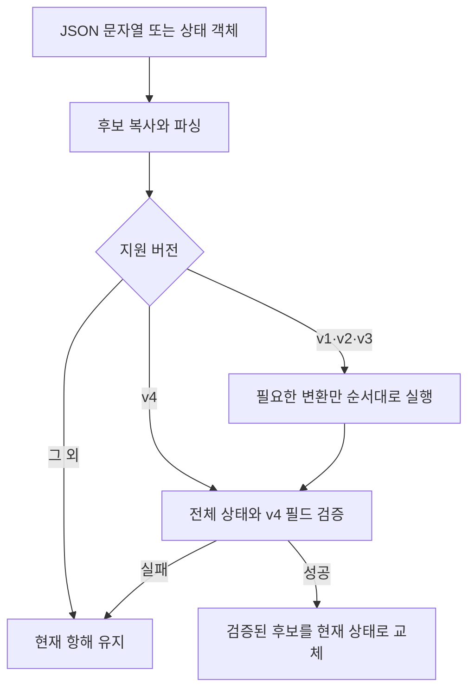

# STARWARD v4 — 상태·호환·검증·배포 구조

기준: 2026-11-14, Node.js v24.22.1에서 확인한 실제 구현. 이 문서는 v4에 추가된 상태 계약과 검증 근거를 정리합니다. v3의 시간 적분·전투·물리 소유권 설명은 [기존 구조 명세](v3_architecture.md)를 유지합니다.

근거: [engine.js](../dist/engine.js)의 `load`·`_migrateV3`·`_validV4State`, [campaign.js](../dist/campaign.js)의 회수품·거래, [v4 시험](../tests/corev4.test.cjs), [fixture 출처](../tests/fixtures/README.md), [완주 정책](../tests/playthrough.cjs), [패키징](../scripts/package-source.py).

## 1. 소스 책임과 실행 방식

| 파일 | 책임 |
|---|---|
| `dist/data.js` | 장비 정의·가격·한도·적 전술 데이터, 기존 시작 함선·종족·환경 |
| `dist/engine.js` | 실제 전투, 재고·배치 명령, AI 의도·수리·전력, 저장 검증·변환 |
| `dist/campaign.js` | 승리 횟수·회수품·자원 보상·상점 거래·섹터와 사건 |
| `dist/app.js` | 장비·보상·상점·배치·적 의도를 표시하고 공개 명령 호출 |
| `tests/*.cjs` | Node 내장 VM과 테스트로 실제 세 로직 스크립트를 실행 |
| `scripts/` | CSS·JS 인라인 독립 HTML과 명시적 허용 목록 소스 ZIP |

Classic script 순서 `data → engine → campaign → app`를 유지합니다. 모듈 번들러·외부 런타임 의존성·서버·계정은 추가하지 않았습니다. 데이터·캠페인·UI와 엔진이 같은 객체의 임의 부분을 각자 복제하지 않도록 게임 명령을 경계로 사용합니다.

## 2. 새 저장 필드

다음은 스키마 설명용 부분 예시이며 단독으로 불러올 수 있는 완전한 저장은 아닙니다.

```json
{
  "version": 4,
  "cargo": [
    { "id": "equip-example", "kind": "weapon", "defId": "ion" }
  ],
  "campaign": { "normalVictories": 2 },
  "stats": { "salvaged": 1, "equipmentSold": 0 },
  "player": { "aiProfile": "raider" },
  "enemy": { "aiProfile": "disruptor" },
  "reward": {
    "salvage": {
      "item": { "id": "equip-next", "kind": "drone", "defId": "combat" },
      "scrapValue": 21,
      "status": "pending"
    }
  }
}
```

설치 장비에는 기존 충전·표적·가동 런타임이 그대로 남습니다. 화물만 정규화된 세 필드로 줄입니다. 적 전술은 각 함선의 문자열이고, 의도는 기존 `weapon.target`·`targetRooms`에 저장합니다. 승무원 배치는 기존 `homeRoomId`를 사용하므로 새로 위치 배열을 만들지 않습니다.

### 개체 ID와 회수 영수증

플레이어 설치 무기·설치 드론·화물·**미결정** 회수품의 ID는 서로 달라야 합니다. 새 개체는 `_newEquipmentId()`를 사용하고 현재 장비와 회수 기록을 검사해 충돌을 피합니다. 보관·교환·재장착은 ID를 재발급하지 않습니다.

`claimed`·`scrapped` 회수 레코드는 두 번째 장비가 아니라 **이미 끝난 선택의 영수증**입니다. 회수된 개체가 화물이나 설치 슬롯에 있어도 영수증의 같은 ID를 중복 장비로 거절하지 않습니다. 이후 해당 장비를 판매·폐기한 뒤에도 영수증은 유효합니다. 반대로 `pending`이 이미 설치·화물 ID와 겹치면 중복 지급 위험이므로 거절합니다.

## 3. 읽기·변환·커밋



마이그레이션과 검증은 후보에서 일어납니다. 실패하면 현재 `state`, 난수, ID 카운터, 로그, 자원을 유지합니다. v4 문서에는 없는 필드를 임의로 보충해 손상 저장을 정상으로 바꾸지 않습니다. 누락 보충은 해당 구 버전의 변환에서만 허용합니다.

| 입력 버전 | 순서 | v4에서 보존할 핵심 |
|---|---|---|
| v1 | v1→v2→v3→v4 | 선체·체력·자원·무기·충전·위치·지도·진행 |
| v2 | v2→v3→v4 | 위 값과 문·감압·침투 위치·드론·빔·보조 전력 |
| v3 | v3→v4 | 위 값과 실제 함선·난이도·XP·은폐·이온·환경·배치 |
| v4 | 직접 검증 | 화물·회수 결정·전술·ID·통계까지 정확한 저장 상태 |

v3→v4는 `cargo=[]`, 회수·판매 통계 0, 일반 승리 수 0, 함선 프로필 `raider`, 기존 보상의 `salvage=null`을 추가합니다. 기존 함선을 현재 시작 구성으로 다시 만들지 않습니다. 구 보상 화면에는 회수품을 소급 지급하지 않으며 즉시 계속할 수 있습니다. 구 승리 횟수는 추정하지 않아 이후 첫 비보스 승리가 v4 카운터의 첫 승리가 됩니다.

브라우저 키 `starward-save-v1`은 유지합니다. 저장 버전과 키 이름은 별개입니다. 엔진은 저장의 일시정지 값을 보존하며 UI는 복원한 전투를 정지시켜 검토할 시간을 줍니다. JSON 가져오기의 미리 보기·검증·교체 전 사본도 유지합니다.

## 4. v4 검증 규칙

| 대상 | 거절 조건 |
|---|---|
| 화물 | 배열 아님·누락·6개 초과, `id/kind/defId` 외 필드, 알 수 없는 종류·정의 |
| ID | 빈 문자열·128자 초과, 설치 무기·드론·화물 간 중복, 미결정 회수품 충돌 |
| 설치 수 | 무기 0 또는 4 초과, 드론 2 초과 |
| 설치 정의 | 카탈로그에 없는 정의, 정의와 런타임 `type` 불일치 |
| 프로필 | 네 enum 외 값 또는 현재 버전 필드 누락 |
| 통계·횟수 | 비정수·음수·1,000,000 초과인 `salvaged`, `equipmentSold`, `normalVictories` |
| 회수 상태 | `pending/claimed/scrapped` 외 값, 장비 형식 오류, 보상 필드 누락 |
| 회수 가치 | 양의 정수 아님·상한 초과·현재 장비 카탈로그의 판매가와 다름 |
| 미결정 위치 | `pending`인데 게임 모드가 `reward`가 아님 |

기존 전력·실드·시스템 용량·은폐·이온 타이머·문·방 참조·승무원 물리 함선·탄·환경·자원 검증도 계속 적용합니다. 유효한 회수 영수증과 실제 개체를 구분하는 검사가 중요한 추가점입니다.

재고 명령은 모드·ID·정의·슬롯·화물 공간을 **쓰기 전에** 검사합니다. 상점은 현재 자금과 현재 공간으로 상품을 다시 계산하고, 실제 인도를 성공한 뒤 차감합니다. 실패 상태의 전체 JSON이 같은지 시험하므로 “스크랩은 돌려줬지만 ID나 난수가 진행된” 부분 실패도 잡습니다.

## 5. 실제 구 버전 fixture

테스트 폴더의 fixture는 현재 상태에서 버전 숫자만 바꾼 파일이 아닙니다.

| 파일 | 생성 소스 | 실제 진행 상태 |
|---|---|---|
| `v1-midcombat.json` | 이전 v1 배포 | 25초 교전, 손실 선체·승무원 HP·미사일·이동 예약 |
| `v2-midboarding.json` | 이전 v2 배포 | 26초 교전, 적선 침투조·전개 드론·문 파괴·감압·전송 대기 |
| `v3-reward.json` | 배포 `438f0412968ed541d2232844c2ceae18339b5e9d` | 레이스 첫 교전의 실제 승리 보상 |
| `v3-midcloak.json` | 같은 v3 배포 | 소행성 경보 1.5초·은폐 6초·실제 XP 약20.23·이동 예약 |

v3 생성은 출항→실제 사격·틱→첫 승리→비콘 도약→6.5초 진행→은폐·이동 명령으로 이루어졌습니다. 체력·자원·위치·승리를 주입하지 않았습니다. 저장 당시 v3 로더로 두 파일을 승인하고 읽어 둔 소스 해시가 배포 HEAD와 일치함을 확인했습니다. [fixture README](../tests/fixtures/README.md)에 출처·생성 절차·SHA-256을 남겼습니다.

마이그레이션 시험은 원래 객체의 모든 기존 키를 재귀 비교합니다. 새 필드를 추가할 수 있지만 기존 ID·HP·XP·문·충전·표적·난수·`nextId`·캠페인을 바꾸면 실패합니다. 변환한 전투를 다시 저장·복원한 두 게임을 같은 시간 진행시켜 일치도 확인했습니다.

## 6. 자동 검증 결과

```bash
node --test tests/engine.test.cjs tests/corev2.test.cjs tests/corev3.test.cjs tests/corev4.test.cjs
node tests/playthrough.cjs
```

2026-11-14 실행 결과 **115/115 통과**했습니다.

| 묶음 | 개수 | 핵심 범위 |
|---|---:|---|
| 기본 엔진·캠페인 | 36 | 정지·전력·이동·피해·자원·저장·지도·도주·기함·패배 |
| v2 전술 | 25 | 문·산소·침투·대인전·드론·수동 발사·빔·v1 저장 |
| v3 선택·성장 | 27 | 3함선·난이도·XP·은폐·이온·환경·사건·v2 저장 |
| v4 장비·전술 | 27 | 재고·거래·회수 원자성, AI 실제 결정, 배치, v3 저장·오류 거절 |

기존 88개 시험은 유지했습니다. 의도된 변경은 현재 버전 기대값, 보상의 명시적 회수 단계, 같은 정의 중복 구매의 허용과 화물 이동입니다. 기존 테스트를 삭제해 통과 수를 맞추지 않았습니다. 특정 규칙 경계 시험은 체력·방·손상 등 전제 조건을 직접 준비합니다. 이것은 별도 완주 검증과 구분합니다.

### 공개 명령만 사용하는 실제 완주

`playthrough.cjs`는 실행 중 상태를 읽고 UI와 같은 공개 명령을 호출합니다. 체력·자원·난수·피해·전투 종료 값을 직접 바꾸지 않습니다. 첫 교전부터 기함 3단계까지 실제 `tick()`과 사격·수리·전력으로 이깁니다. v4 정책은 회수 선택, 장비 보관·교체·재장착, 실제 상점 판매를 포함합니다.

| 시드 | 함선·난이도 | 결과 | 전투 시간 | 최종 선체 | 생존 | 회수 / 판매 |
|---:|---|---|---:|---:|---:|---:|
| 42 | 아르고·표준 | 승리 | 366초 | 34 | 4 | 2 / 2 |
| 42 | 아틀라스·표준 | 승리 | 246초 | 26 | 4 | 2 / 1 |
| 42 | 레이스·표준 | 승리 | 292초 | 35 | 4 | 2 / 2 |
| 42 | 아르고·베테랑 | 승리 | 443초 | 34 | 4 | 2 / 2 |

모두 10교전·기함 3단계·소행성·태양·폭풍을 통과했고 조종·무기·기관 숙련이 2단계가 되었습니다. 아틀라스는 드론 13회, 레이스는 은폐 12회를 실제 사용했습니다. 선체 30 초과는 정당한 장갑 구매 결과입니다. 빠르게 격파한 단계는 해당 특수 경보가 실행되기 전에 끝날 수 있으며, 모든 항해가 모든 경보를 관찰했다고 해석하지 않습니다.

네 사례는 구현이 실제 플레이로 완주 가능함을 보여 줍니다. 초보자 승률·함선 간 균형 통계·모든 시드 보장은 아닙니다. 브라우저 렌더링·입력 검증도 이 Node 결과와 별개이며 최신 확인 범위는 [README](../README.md)에 기록합니다.

## 7. 산출물과 재현

소스 확정 뒤 다음 순서로 생성합니다.

```bash
node scripts/build-offline.cjs
python3 scripts/package-source.py
```

첫 단계는 현재 `index.html`의 CSS와 네 classic script를 순서대로 인라인해 `artifacts/STARWARD_Offline.html`을 만들고 `dist/`에도 복사합니다. 두 번째는 명시적 허용 목록으로 `STARWARD_Source.zip`을 만들고 CRC와 항목을 검사합니다. 최종 배포는 화면 변경 이후 이 두 파일을 다시 생성해 실행 소스와 일치시킵니다.

ZIP에는 실제 실행 소스·README·CHANGELOG·v3/v4 시스템 문서·모든 최상위 CJS 시험·JSON/MD fixture·두 빌드 스크립트·독립 HTML이 들어갑니다. 지정된 v3/v4 실제 화면 이미지는 존재할 때만 포함합니다. 저장소 내부 정보·인증·환경 메타데이터·ZIP 자체·임의 작업 파일은 허용 목록에 없습니다. 새로운 회귀 파일과 두 v3 fixture도 자동 포함합니다.

이번 버전은 백엔드·계정·영구 성장·원격 저장·새 라이브러리를 추가하지 않습니다. 파일을 별도 도구로 편집하면 검증 가능한 구조 안에서는 다른 항해 상태를 만들 수 있으므로 저장 검증은 경쟁 환경의 부정행위 방지 장치가 아닙니다. 목적은 손상·잘못된 참조·중복 지급·부분 적용을 거절하고 정상 항해를 보존하는 것입니다.
